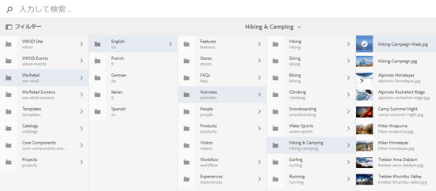
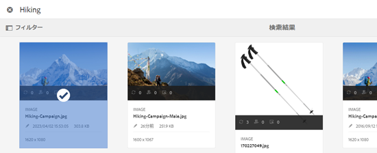
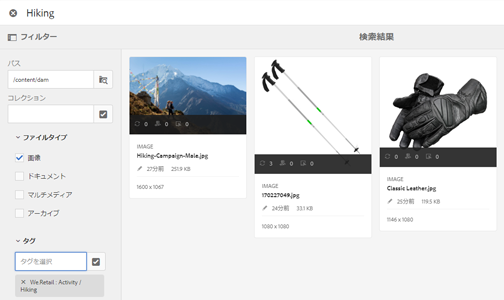

# アセットセレクター {#asset-selector}

>[!NOTE]
>
>[アセットセレクター](https://experienceleague.adobe.com/docs/experience-manager-cloud-service/content/assets/manage/asset-selector.html?lang=ja)は、以前のバージョンの [!DNL Experience Manager] では[アセットピッカー](https://experienceleague.adobe.com/docs/experience-manager-release-information/aem-release-updates/previous-updates/aem-previous-versions.html?lang=ja)と呼ばれていました。

アセットセレクターを使用すると、[!DNL Adobe Experience Manager] アセットでアセットを参照、検索およびフィルターすることができます。 アセットセレクターを使用して選択したアセットのメタデータを取得できます。 アセットセレクターインターフェイスをカスタマイズするには、サポートされているリクエストパラメーターを使用して開始します。 これらのパラメーターは、特定のシナリオのアセットセレクターのコンテキストを設定します。

現在、リクエストパラメーター `assettype`（*Image／Video／Text*）および選択 `mode`（*Single／Multiple*）をアセットセレクターのコンテキスト情報として渡すことができ、この情報は選択操作の間、変わることはありません。

アセットセレクターは、HTML5 **Window.postMessage** メッセージを使用して、選択したアセットのデータを受信者に送信します。

アセットセレクターは、Granite の基盤ピッカーのボキャブラリに基づいています。 デフォルトでは、アセットセレクターは、参照モードで動作します。 ただし、オムニサーチエクスペリエンスを使用してフィルターを適用し、特定のアセットの検索を絞り込むことができます。

任意の web ページでも（CQ コンテナの一部であるかどうかに関係なく）アセットセレクター（`https://[AEM_server]:[port]/aem/assetpicker.html`）で統合できます。

## コンテキストパラメーター {#contextual-parameters}

次のリクエストパラメーターを URL で渡して、特定のコンテキストでアセットセレクターを起動できます。

| 名前 | 値 | 例 | 目的 |
|---|---|---|---|
| リソースサフィックス（B） | URL のリソースサフィックスとしてのフォルダーパス：`http://localhost:4502/aem/` `assetpicker.html/<folder_path>` | 特定のフォルダーが選択された状態でアセットセレクターを起動するには、例えば、フォルダー `/content/dam/we-retail/en/activities` が選択されている場合、URL は次のような形式になります。`http://localhost:4502/aem/assetpicker.html` `/content/dam/we-retail/en/activities?assettype=images` | アセットセレクターの起動時に特定のフォルダーを選択する必要がある場合、そのフォルダーをリソースサフィックスとして渡します。 |
| mode | single、multiple | `http://localhost:4502/aem/assetpicker.html` `?mode=multiple`   `http://localhost:4502/aem/assetpicker.html` `?mode=single` | 複数モードでは、アセットセレクターを使用して、いくつかのアセットを同時に選択できます。 |
| dialog | true、false | `http://localhost:4502/aem/assetpicker.html` `?dialog=true` | アセットセレクターを Granite ダイアログとして開くには、これらのパラメーターを使用します。 このオプションは、Granite パスフィールドを使用してアセットセレクターを起動し、pickerSrc URL として設定する場合にのみ適用できます。 |
| root | `<folder_path>` | `http://localhost:4502/aem/` `assetpicker.html?assettype=images` `&root=/content/dam/we-retail/en/activities` | アセットセレクターのルートフォルダーを指定するには、このオプションを使用します。 この場合、アセットセレクターを使用すると、ルートフォルダーの下の子アセット（直接／間接）のみを選択できます。 |
| viewmode | search |  | assettype パラメーターおよび mimetype パラメーターで、アセットセレクターを検索モードで起動します。 |
| assettype（S） | images、documents、multimedia、archives | <ul><li>`http://localhost:4502/aem/assetpicker.html?viewmode=search&assettype=images`</li> <li>`http://localhost:4502/aem/assetpicker.html?viewmode=search&assettype=documents`</li> <li>`http://localhost:4502/aem/assetpicker.html?viewmode=search&assettype=multimedia`</li> <li>`http://localhost:4502/aem/assetpicker.html?viewmode=search&assettype=archives`</li> | 渡された値に基づいてアセットタイプをフィルターするには、このオプションを使用します。 |
| mimetype | アセットの MIME タイプ（`/jcr:content/metadata/dc:format`）（ワイルドカードもサポートされています） | <ul><li>`http://localhost:4502/aem/assetpicker.html?viewmode=search&mimetype=image/png`</li>  <li>`http://localhost:4502/aem/assetpicker.html?viewmode=search&?mimetype=*png`</li>  <li>`http://localhost:4502/aem/assetpicker.html?viewmode=search&mimetype=*presentation`</li>  <li>`http://localhost:4502/aem/assetpicker?viewmode=search&mimetype=*presentation&mimetype=*png`</li></ul> | MIME タイプに基づいてアセットをフィルターするために使用します |

## アセットセレクターの使用 {#using-the-asset-selector}

1. アセットセレクターインターフェイスにアクセスするには、`https://[AEM_server]:[port]/aem/assetpicker` に移動します。
1. 目的のフォルダーに移動して、1 つまたは複数のアセットを選択します。

   

   または、オムニサーチボックスから目的のアセットを検索して選択することもできます。

   

   オムニサーチボックスを使用してアセットを検索する場合、**[!UICONTROL フィルター]**&#x200B;ウィンドウを使用して検索を絞り込みます。

   

1. ツールバーの「**[!UICONTROL 選択]**」をクリックします。

>[!MORELIKETHIS]
>
>* [AEM as a Cloud Service のマイクロフロントエンドアセットセレクター](https://experienceleague.adobe.com/docs/experience-manager-cloud-service/content/assets/manage/asset-selector.html?lang=ja)
