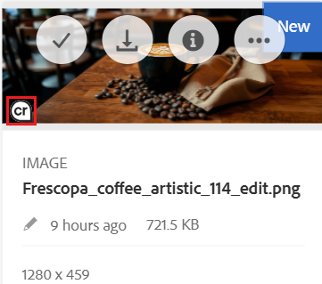

# [!DNL Experience Manager Assets]のC2PA メタデータ {#c2pa-metadata}

ブランドは、コンテンツの透明性、AI の開示、アセットの改ざん防止について、これまで以上に関心を寄せています。 アドビのコンテンツ認証イニシアチブ（CAI）は、[Coalition for Content Provenance and Authenticity](https://c2pa.org/specifications/specifications/2.2/specs/C2PA_Specification.html)（C2PA）技術標準に準拠したツールを作成しています。 C2PA メタデータは、新しいタイプの改ざん防止メタデータであり、視聴者がコンテンツの系統を理解し、ブランドアセットの整合性を確保するのに役立ちます。 これらには、デジタルアセットの履歴に関するインサイトを提供する様々な来歴データを含めることができます。

この情報には以下が含まれます。

* **発行者または署名者：** アセットのデジタル署名を発行したエンティティまたは会社に関する情報。
* **問題日：** C2PA メタデータがアセットに適用された日付。
* **プロセス：**&#x200B;アセットに対して行われた編集または変更の記録。
* **デバイスの詳細：**&#x200B;アセットの作成または編集に使用されたアプリまたはデバイスに関する情報。
* **AI ツール使用済み：**&#x200B;生成AIを使用してアセットを編集または作成した場合、使用したモデルの名前が含まれます。
* **その他の関連情報：** アセットの履歴に関する詳細なコンテキストを提供する追加データ。

アセットの履歴について詳しくは、[検証](https://contentcredentials.org/verify)を参照してください。

[!DNL Adobe Experience Manager Assets]は、アセットのアップロードまたは更新時にC2PA メタデータを検出し、[!DNL Assets] ユーザーインターフェイスでそれらのアセットにフラグを付け、[!DNL Experience Manager]が生成するレンディションに対して生成AIの開示を維持します。 サムネール、web レンディション、透かし入りコピー、ビデオトランスコードなど、[!DNL Experience Manager]が生成AI アセットのレンディションを作成または変更するたびに、[!DNL Experience Manager]は、元のアセットを親として参照する新しいC2PA メタデータを使用してレンディションに署名します。 ダウンロード、公開、共有したレンディションは、その出所を維持します。

## 前提条件 {#Prerequisites}

C2PA メタデータのサポートには、[!DNL Adobe Experience Manager] 6.5 サービスパックが必要です。 サービスパック 6.5.25.0で、[AEM 6.5 SP25 - C2PA GenAI準拠ホットフィックス &#x200B;](https://experience.adobe.com/#/downloads/content/software-distribution/en/aem.html?package=/content/software-distribution/en/details.html/content/dam/aem/public/adobe/packages/cq650/hotfix/cq-6.5.0-hotfix-ASSETS-75868-SP25-1.0.zip)をインストールします。

## サポートされている形式とプラットフォーム {#supported-formats}

### 形式 {#formats}

[!DNL Experience Manager]は、[C2PA仕様](https://c2pa.org/specifications/specifications/2.2/specs/C2PA_Specification.html)が埋め込みマニフェストに対応している形式でレンディションに署名します。

| 種類 | 形式 | MIME タイプ |
|---|---|---|
| 画像 | JPEG、PNG、GIF、TIFF、DNG、WebP、JPEG XL、AVIF、HEIC/HEIF、SVG | `image/jpeg`, `image/png`, `image/gif`, `image/tiff`, `image/x-adobe-dng`, `image/webp`, `image/jxl`, `image/avif`, `image/heic`, `image/heif`, `image/svg+xml` |
| ビデオ | MP4、MOV、AVI | `video/mp4`, `video/quicktime`, `video/x-msvideo` |
| オーディオ | MP3、M4A、WAV、FLAC | `audio/mpeg`, `audio/mp4`, `audio/wav`, `audio/flac` |

[!DNL Experience Manager]は、`image/jpg`、`image/pjpeg`、`image/x-png`、`video/mov`などの一般的なエイリアスも認識します。 [!DNL Experience Manager]は、ファイル形式に関係なく、アップロードされたすべてのアセットをマニフェスト用にチェックします。 PSDやEPSなど、他の形式のレンディションには署名されません。

### Platforms {#platforms}

C2PA メタデータのサポートは、`cq-dam-core` バンドル内に実装されるネイティブ C2PA コンポーネントに依存しており、サポートされている各プラットフォームに1つのビルドが用意されています。 サービスが開始されると、[!DNL Experience Manager]はプラットフォームのビルド （`adobe_c2patool`またはWindowsの`adobe_c2patool.exe`）をバンドルのプライベートデータフォルダーに抽出し、SHA-256 チェックサムを確認して、別のプロセスとして実行します。 何もインストールしたり、`PATH`を変更したりする必要はありません。

| オペレーティングシステム | アーキテクチャ |
|---|---|
| Linux （glibc 2.28以降、Red Hat Enterprise Linux 8を含む） | `x86_64`, `aarch64` |
| macOS | `x86_64`、`aarch64` （Apple シリコン） |
| Windows | `x86_64` |

これは、[!DNL Adobe Managed Services]とオンプレミスのデプロイメントで同じように機能します。 [!DNL Experience Manager] プロセスがこの実行可能ファイルを開始できることを確認してください。 `noexec`台のマウント、ウイルス対策、またはエンドポイント セキュリティ ソフトウェアを使用している場合は、`adobe_c2patool`を`crx-quickstart` フォルダーから実行できます。 そうしないと、C2PA メタデータのサポートを開始できません。

## C2PA メタデータの仕組み {#how-c2pa-metadata-works}

C2PA メタデータのサポートには、2つの部分があります。アセットがアップロードまたは更新されたときに検出し、[!DNL Experience Manager]がレンディションを生成または変更するたびに再署名します。

### ワークフロー設定 {#workflow}

[C2PA メタデータの検出](#detect)に示す&#x200B;**[!UICONTROL C2PA資格情報の検出]** ステップは、デフォルトの&#x200B;**[!UICONTROL DAM アセットの更新]** ワークフローモデルの一部です。 そのモデルのカスタムコピーを使用する場合は、次の手順を自分で追加します。

1. [!DNL Experience Manager] インターフェイスで、**[!UICONTROL ツール]** > **[!UICONTROL ワークフロー]** > **[!UICONTROL モデル]**&#x200B;に移動し、 **[!UICONTROL 編集]** モードでモデルを開きます。
1. **[!UICONTROL メタデータプロセッサー]**&#x200B;の後に&#x200B;**[!UICONTROL C2PA資格情報の検出]** ステップを追加してから、任意のステップでレンディションが生成されます。
1. **[!UICONTROL 同期]**&#x200B;を選択して、モデルを保存します。

レンディションステップは、アセットで既に検出が実行されている場合にのみ出力に署名します。 検出後に検出が実行された場合、ワークフローが再度実行されるまで、レンディションは未署名のままになります。

### C2PA メタデータの検出 {#detect}

**[!UICONTROL DAM アセットの更新]** ワークフローには、**[!UICONTROL メタデータプロセッサー]** ステップの後に実行される&#x200B;**[!UICONTROL C2PA資格情報の検出]** ステップが含まれています（下図を参照）。 アセットの元のバイナリを読み取り、その結果をアセットのメタデータノード `jcr:content/metadata`に記録します。


次の表に、C2PA メタデータワークフローの主要なメタデータプロパティを示します。

| Property | 種類 | 説明 |
|---|---|---|
| `dam:hasC2PAManifest` | `boolean` | 元のバイナリにC2PA マニフェストが埋め込まれている場合、`true`。 常に書かれている。 |
| `dam:isAiGenerated` | `boolean` | `true`。マニフェストが生成AIのラベル付けにアセットをスコープ内に入れる場合。 マニフェストが存在する場合にのみ書かれています。 |
| `dam:c2paValidationState` | `string` | マニフェストの検証状態（`TRUSTED`、`VALID`、`INVALID`、または`UNKNOWN`）について説明します。 マニフェストが存在する場合にのみ書かれています。 |

マニフェストが存在する場合、[!DNL Experience Manager]は`c2pa-manifest.json` レンディション （`application/json`）としても保存します。

元のアセットをマニフェストのないバイナリに置き換えた場合、次のワークフロー実行では`dam:hasC2PAManifest`が`false`に設定され、`dam:isAiGenerated`、`dam:c2paValidationState`、および`c2pa-manifest.json` レンディションが削除されます。

>[!NOTE]
>
>検出エラーは、アセットの取り込みをブロックすることはありません。 マニフェストの読み取りがタイムアウトまたは失敗した場合、[!DNL Experience Manager]はエラーを記録し、メタデータを変更せずに残り、ワークフローの残りの部分で続行します。

### [!DNL Assets] ユーザーインターフェイスでのC2PA メタデータの表示 {#view-c2pa-metadata}

C2PA メタデータを含むAssetsでは、[!DNL Assets] ユーザーインターフェイスに&#x200B;**cr** （C2PA メタデータ）バッジが表示されます。 **[!UICONTROL Assets]** > **[!UICONTROL ファイル]**&#x200B;に移動し、次の左下隅にあるバッジを探します。

* **[!UICONTROL カード表示]**&#x200B;のアセットのサムネール。
* **[!UICONTROL 列表示]**&#x200B;のアセットのサムネール。 サムネールを表示するアセットを選択します。
* アセットの詳細ページのプレビュー領域。

次の図に示す&#x200B;**cr** バッジは、アセットにC2PA メタデータが含まれているかどうかを示します。 マニフェスト自体は表示されません。 完全なマニフェストを表示するには、アセットをダウンロードし、[Verify](https://contentcredentials.org/verify)で開きます。



[!DNL Experience Manager]は、検出されたマニフェストをアセットの`c2pa-manifest.json` レンディションとして保存します。 このレンディションは内部のものです。 アセットの詳細ページの&#x200B;**[!UICONTROL レンディション]** パネルやレンディションピッカーには表示されません。

### Sign レンディション {#sign-renditions}

レンディションは新しいバイナリであるため、元のアセットに埋め込まれたマニフェストではカバーされません。 生成AIの情報開示を維持するため、[!DNL Experience Manager]さんは生成プロセスの最後のステップとして、すべての実施要件を満たすレンディションに署名します。 新しいC2PA メタデータ：

* 元のアセットを&#x200B;**親**&#x200B;要素として参照します。
* レンディションが元のアセットからどのように派生したかを、C2PA アクション `c2pa.resized`、`c2pa.transcoded`、または`c2pa.edited`の1つとして記録します。
* `Adobe Experience Manager`をソフトウェアエージェントとして指定します。

[!DNL Experience Manager]さんがレンディションに署名するのは、次のすべてが`true`の場合のみです。

* ソースアセットには`dam:isAiGenerated`が`true`に設定されています。 マニフェストを持っているがAIで生成されていないAssetsには、**cr** バッジが表示されますが、[!DNL Experience Manager]はレンディションの再署名を行いません。
* ソースマニフェストは読み取り可能で、検証状態が`INVALID`ではありません。 [!DNL Experience Manager]は、アセットが改ざんされた後など、検証に失敗したマニフェストに新しい署名をチェーンしません。
* レンディション形式は、埋め込みC2PA マニフェストをサポートしています。 詳しくは、[&#x200B; サポートされている形式](#supported-formats)を参照してください。 [!DNL Experience Manager]は、サポートされていない形式をエラーなしでスキップします。

[C2PA メタデータの検出](#detect)に示す&#x200B;**[!UICONTROL DAM アセットワークフローの更新ワークフローが完了しました]** ワークフローの次の手順は、出力に署名します。

| ワークフローステップ | 署名されたレンディション | C2PA アクションを記録しました |
|---|---|---|
| **[!UICONTROL サムネールの処理]** | サムネールレンディションとweb対応画像。 | 形式が変更されると`c2pa.resized`と`c2pa.transcoded`が表示されます。 |
| **[!UICONTROL EPSのサムネール （ImageMagickによる提供）]** | プライマリ出力、派生サムネール、web レンディション。 | `c2pa.resized`、`c2pa.transcoded` または `c2pa.edited` |
| **[!UICONTROL FFmpeg サムネール]** | ビデオポスターフレームとサムネール。 | `c2pa.resized` および `c2pa.transcoded` |
| **[!UICONTROL FFmpeg トランスコード]** | 動画エンコーディング： | `c2pa.transcoded` |
| **[!UICONTROL PDF/AI イメージ プレビューのレンダリングをラスタライズ]** | プレビューレンディション： (`cqdam.preview.png`) | `c2pa.transcoded` |

次のワークフロープロセスは、**[!UICONTROL DAM アセットの更新ワークフロー完了]** ワークフロー、別のワークフロー、またはカスタムワークフローモデルで使用する場合にも、出力に署名します。 [C2PA メタデータの検出](#detect)に示すように、ワークフローステップの&#x200B;**[!UICONTROL サムネールの処理]** リストでそれらを選択します。

| ワークフロープロセス | 署名されたレンディション | C2PA アクションを記録しました |
|---|---|---|
| **[!UICONTROL サムネールを作成]** | サムネールのレンディション： | 形式が変更されると`c2pa.resized`と`c2pa.transcoded`が表示されます。 |
| **[!UICONTROL Web対応イメージの作成]** | web レンディション： | 形式が変更されると`c2pa.resized`と`c2pa.transcoded`が表示されます。 |
| **[!UICONTROL コマンドライン]**&#x200B;例：[!DNL ImageMagick] | プライマリ出力、派生サムネール、web レンディション。 | `c2pa.resized`、`c2pa.transcoded` または `c2pa.edited` |
| **[!UICONTROL 画像の透かし処理]** | 透かし入りのレンディション、または透かし入りの元のレンディション。 詳しくは、[&#x200B; アセットに透かしを設定](/help/assets/watermarking.md)を参照してください。 | `c2pa.edited` |
| **[!UICONTROL ビデオストーリーボードを作成]** | ストーリーボードのキーフレーム： | `c2pa.transcoded` |
| **[!UICONTROL XMPの書き戻し]** | メタデータが書き戻された後、元のレンディション。 詳しくは、[XMPのレンディションへの書き戻し](/help/assets/xmp-writeback.md)を参照してください。 | `c2pa.edited` |

### XMPの書き戻し時に元のバイナリを保護する {#xmp-writeback}

XMPの書き戻しは、元のバイナリを書き換え、埋め込まれたマニフェストを壊します。 `dam:hasC2PAManifest`が`true`に設定されているアセットの場合、[!DNL Experience Manager]は、**[!UICONTROL DAM メタデータの書き戻し]** ワークフローの&#x200B;**[!UICONTROL XMP書き戻しプロセス]**&#x200B;手順の動作を次のように変更します。

* **生成AI アセット** （`dam:isAiGenerated`は`true`）: [!DNL Experience Manager]がXMPを書き込み、その後、事前に書き戻されたバイナリを親として元のバイナリに再署名します。 書き戻しと新しい署名を一緒に保存します。 再署名に失敗した場合は、両方が破棄され、手順が失敗します。
* **マニフェストを含むその他のアセット**: [!DNL Experience Manager]はXMPの書き戻しをスキップし、その理由をログに記録します。 元のバイナリとそのマニフェストは変更されません。

### 署名モード {#signing-mode}

[!DNL Experience Manager]は、それらを生成するインスタンス上で、独自に生成する一時的な自己署名証明書を使用して、ローカルでレンディションに署名します。 署名にはネットワークアクセスは必要なく、証明書や秘密鍵の設定も必要ありません。

>[!NOTE]
>
>独自の署名証明書を設定することはできません。 [Verify](https://contentcredentials.org/verify)などの検証者は、レンディションの生成AIへの情報開示と元のデータへのリンクを表示しますが、署名者として組織を識別しません。

## C2PA メタデータの設定 {#configure}

C2PA メタデータのサポートは、デフォルトで有効になっています。 何もインストールしたり設定したりする必要はありません。

### OSGi 設定 {#osgi-configuration}

デフォルト設定を変更するには、次の図に示すように、Configuration Managerの&#x200B;**[!UICONTROL Day CQ DAM C2PA Service]** （PID `com.day.cq.dam.core.impl.c2pa.C2PAServiceImpl`）を`https://[aem_server]:[port]/system/console/configMgr`に設定するか、OSGi設定をプロジェクトに追加します。 詳しくは、[OSGiの設定](/help/sites-deploying/configuring-osgi.md)を参照してください。


次の表に、プロジェクトのOSGi設定のプロパティを示します。

| プロパティ | Configuration Managerの名前 | デフォルト | 説明 |
|---|---|---|---|
| `enabled` | **[!UICONTROL 有効]** | `true` | C2PA メタデータサポートのオンとオフを切り替えます。 オフにすると、[!DNL Experience Manager]はマニフェストを検出せず、レンディションに署名しません。 |
| `timeoutMillis` | **[!UICONTROL CLI タイムアウト （ms）]** | `30000` | ファイルをタイムアウトとして処理する前に、[!DNL Experience Manager]がファイルの1回の読み取りまたは署名操作を待機する最大時間をミリ秒単位で指定します。 大きなビデオまたは高解像度の画像ファイルの場合は、この値を上げます。 |

例えば、`/apps/<your-project>/config/com.day.cq.dam.core.impl.c2pa.C2PAServiceImpl.config`にOSGi設定を追加します。

```text
enabled=B"true"
timeoutMillis=L"60000"
```

### C2PA メタデータのサポートをオフにする {#disable}

[OSGi設定](#osgi-configuration)に示す&#x200B;**[!UICONTROL 日CQ DAM C2PA サービス]**&#x200B;設定で、**[!UICONTROL 有効]** オプションを無効にしてから、変更を保存します。 この変更は、再起動しなくても直ちに有効になります。

* [C2PA メタデータの検出](#detect)に示す&#x200B;**[!UICONTROL C2PA資格情報の検出]**&#x200B;手順は、実行できなくなります。
* ワークフローの手順は、署名せずにレンディションを作成します。
* 以前に処理されたAssetsは、`dam:hasC2PAManifest` プロパティを保持し、**cr** バッジを表示します。

>[!CAUTION]
>
>**[!UICONTROL Enabled]** オプションを無効にした後、生成AI アセットのレンディションにはC2PA メタデータが含まれません。 生成AI開示規制に準拠する場合は、**[!UICONTROL 有効]** オプションを有効にします。

## 処理パイプラインのカスタマイズ {#customize}

**[!UICONTROL DAM アセットの更新]**&#x200B;の手順を追加、削除、または並べ替えし、生成AIの情報開示をそのまま維持するには、次のルールに従います。

* **最初に検出を実行します。** レンディションを作成または変更するすべての手順の前に、**[!UICONTROL C2PA資格情報を検出]**&#x200B;してください。
* **最後に署名** 署名後にバイナリに変更を加えると、署名は無効になります。 レンディションに署名したステップの後にレンディションを変更するステップを実行しないでください。
* **署名する手順を使用します。** [Sign レンディション &#x200B;](#sign-renditions)に記載されている組み込み手順は、出力に署名します。 **[!UICONTROL コマンドライン]** プロセス以外を実行するカスタムステップとサードパーティツールは、署名が明示的に追加されない限り、出力に署名しません。 詳しくは、[&#x200B; メディアハンドラーとワークフローを使用したアセットの処理](/help/assets/media-handlers.md)を参照してください。
* **XMPの書き戻し**&#x200B;および&#x200B;**[!UICONTROL 画像の透かし処理]**&#x200B;のように、手順が再署名しない限り、元の場所&#x200B;**を修正しないでください。**

### カスタムワークフローステップからのレンディションの署名 {#custom-step}

レンディションを生成するカスタムワークフローステップは、`com.day.cq.dam.api.c2pa.C2PASigner` OSGi サービスを通じて署名できます。 組み込み手順と同じ実施要件ルールが適用されますが、代わりに`C2PASigningOutcome`として結果がレポートされます。

```java
import java.util.Collections;

import org.osgi.service.component.annotations.Reference;
import org.osgi.service.component.annotations.ReferenceCardinality;
import org.osgi.service.component.annotations.ReferencePolicy;

import com.day.cq.dam.api.Asset;
import com.day.cq.dam.api.Rendition;
import com.day.cq.dam.api.c2pa.C2PAAction;
import com.day.cq.dam.api.c2pa.C2PAConstants;
import com.day.cq.dam.api.c2pa.C2PASigner;
import com.day.cq.dam.api.c2pa.C2PASigningOutcome;

// Inside your WorkflowProcess implementation:

@Reference(cardinality = ReferenceCardinality.OPTIONAL, policy = ReferencePolicy.DYNAMIC)
private volatile C2PASigner c2paSigner;

private void signRendition(Asset asset, Rendition rendition) {
    C2PASigner signer = c2paSigner;
    if (signer == null) {
        return;
    }
    C2PASigningOutcome outcome = signer.signIfEligible(asset, rendition,
            Collections.singletonList(
                    new C2PAAction(C2PAConstants.ACTION_RESIZED, C2PAConstants.SOFTWARE_AGENT, null)));
    if (outcome == C2PASigningOutcome.FAILED) {
        // Log, retry, or alert an operator.
    }
}
```

手順でレンディションの書き込みが完了した後にのみ`signIfEligible`を呼び出します。 OSGi サービスは、次の表に示すようにメソッドを提供します。

| メソッド | 次の目的で使用します |
|---|---|
| `signIfEligible(Asset, Rendition, List<C2PAAction>)` | ソースアセットを親として、1つの新しいレンディションに署名します。 |
| `signIfEligible(Asset, Map<Rendition, List<C2PAAction>>)` | 同じアセットから派生した複数のレンディションに署名します。 このメソッドは、ソースマニフェストを1回読み取ります。 |
| `captureResignState(Asset)` | 手順でアセットを修正する前に、元のアセットの画像を撮影します。 このメソッドは、アセットが対象外の場合、`null`を返します。 |
| `resign(Asset, Rendition, List<C2PAAction>)` | インプレースでの変更後に、画像を親として元のアセットに再署名します。 |
| `discardResignState(Rendition)` | 例えば、変更が失敗したために撮影した画像を配置しますが、使用できません。 |

`C2PASigningOutcome`の値については、次の表に記載されています。

| 成果 | 説明 |
|---|---|
| `SIGNED` | [!DNL Experience Manager]さんがレンディションに署名しました。 |
| `SKIPPED_SOURCE_NOT_AI_GENERATED` | ソースアセットには、AIによって生成されたアセットとしてのフラグが付けられていません。 |
| `SKIPPED_FORMAT_NOT_ELIGIBLE` | レンディション形式は、埋め込みC2PA マニフェストをサポートしていません。 |
| `SKIPPED_MANIFEST_UNREADABLE` | [!DNL Experience Manager]さんがソースアセットでマニフェストを見つかりませんでした。 |
| `SKIPPED_MANIFEST_NOT_VALID` | ソースマニフェストの検証に失敗しました。 |
| `SKIPPED_SERVICE_UNAVAILABLE` | C2PA メタデータのサポートがオフになっているか、利用できません。 |
| `FAILED` | ソースマニフェストの読み込みやレンディションへの署名に失敗しました。 |

高額なレンディションを生成する前に実施要件を確認するには、`C2PASupportedFormats.isEligible(...)`に電話してください。

## トラブルシューティング {#troubleshooting}

トラブルシューティングを行う場合は、**[!UICONTROL Apache Sling Logging Logger Configuration]**&#x200B;で次のロガーを`DEBUG`に設定します。

* `com.day.cq.dam.core.impl.c2pa`：ネイティブ C2PA コンポーネントの抽出、マニフェストの読み取り、署名。
* `com.day.cq.dam.core.process.DetectC2PACredentialProcess`：検出。

| 症状 | 考えられる原因 | 解決策 |
|---|---|---|
| アセットに&#x200B;**cr** バッジが表示されていません。 | C2PA メタデータのサポートがオフになっているか、ワークフローモデルに検出手順が含まれていない。 | **[!UICONTROL Enabled]**&#x200B;が&#x200B;**[!UICONTROL Day CQ DAM C2PA Service]**&#x200B;設定で有効になっており、**[!UICONTROL DAM アセットの更新]** モデルに&#x200B;**[!UICONTROL C2PA資格情報の検出]**&#x200B;が含まれていることを確認してください。 |
| あなたが知っているアセットにはマニフェストがありますが、バッジが表示されていません。 | アセットは、機能が利用可能になる前にアップロードされました。 | 例えば、**[!UICONTROL タイムライン]** > **[!UICONTROL ワークフローの開始]**&#x200B;から、アセットの&#x200B;**[!UICONTROL DAM アセットの更新]** ワークフローを再度実行します。 |
| サービスが開始されません。 エラーログでは、`adobe_c2patool`を抽出または実行可能としてマークできないことが報告されます。 | オペレーティング・システムまたはアーキテクチャにバイナリが存在しないか、ファイル・システムが実行可能ファイルをブロックします。 | サポートされているプラットフォームを使用する： [!DNL Experience Manager] プロセスが`crx-quickstart` フォルダーから実行可能ファイルを実行することを許可します。 |
| エラーログで`GLIBC_2.xx not found`が報告されています。 | Linux ホストは、2.28より古いバージョンのglibcを実行します。 | ホストオペレーティングシステムをアップグレードします。 |
| 検出または署名がタイムアウトしました。 | サイズの大きいファイルでは、デフォルトの30秒のタイムアウトよりも時間がかかります。 | **[!UICONTROL CLI タイムアウト （ms）]**&#x200B;を発生させます。 |
| 生成AI アセットのレンディションに署名していない。 | 形式がサポートされていないか、マニフェストが`INVALID`であるか、レンディション手順の後に検出が実行されました。 | `dam:c2paValidationState`とレンディション形式を確認してください。 レンディション手順の前に&#x200B;**[!UICONTROL C2PA資格情報を検出]**&#x200B;します。 |
| XMPの書き戻しは、アセットを更新しません。 | アセットにはマニフェストが含まれていますが、AIで生成されないため、[!DNL Experience Manager]は元のアセットを変更しません。 | これは予想される動作です。 詳しくは、[XMPの書き戻し時に元のファイルを保護](#xmp-writeback)を参照してください。 |

## 制限事項 {#limitations}

* [!DNL Assets] ユーザーインターフェイスには、C2PA メタデータが存在するかどうかが表示されます。 マニフェストの詳細パネルはありません。
* AIを通じて生成されたアセットに対してのみ、[!DNL Experience Manager]様がレンディションに再サインします。 マニフェストを含むその他のアセットのレンディションは、C2PA メタデータなしで作成されます。
* 一時的な自己署名証明書を使用して[!DNL Experience Manager]が署名します。 カスタムまたは組織固有の署名証明書はサポートされていません。


>[!MORELIKETHIS]
>
>*  [!DNL Experience Manager as a Cloud Service]&#x200B;[&#128279;](https://experienceleague.adobe.com/ja/docs/experience-manager-cloud-service/content/assets/assets-view/c2pa-metadata-assets-view)のAssets ビューのC2PA メタデータ
>*  [!DNL Experience Manager Assets Essentials]&#x200B;[&#128279;](https://experienceleague.adobe.com/ja/docs/experience-manager-assets-essentials/help/content-credentials)のC2PA メタデータ
>*  [!DNL Dynamic Media]&#x200B;[&#128279;](https://experienceleague.adobe.com/ja/docs/experience-manager-cloud-service/content/assets/dynamicmedia/dynamic-media-open-apis/c2pa-metadata)のC2PA メタデータ
>* [XMPがレンディションに書き戻されました](/help/assets/xmp-writeback.md)
>* [&#x200B; アセットに透かし](/help/assets/watermarking.md)
>* [Content Authenticity Initiative](https://contentauthenticity.org/)
>* [検証](https://contentcredentials.org/verify)
