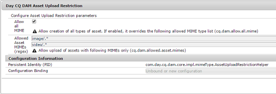

# アセットのアップロード制限を設定する {#configuring-asset-upload-restrictions}

[!DNL Adobe Experience Manager Assets] の設定で、ユーザーがアップロードできるアセット（ファイル）のタイプを制限できます。 これにより、望ましくない形式や悪意のあるファイルが誤ってアップロードされるのを防ぐことができます。 `Day CQ DAM Asset Upload Restriction` サービスを使用すると、ユーザーがアップロードできるファイルの種類を制御できます。 デフォルトでは、[!DNL Assets] ではすべての MIME タイプのアセットをアップロードできます。 ただし、アップロードを特定の MIME タイプのファイルのみに制限するようにサービスを設定できます。

1. Configuration Manager の Web コンソールを開きます。 `https://[aem_server]:[port]/system/console/configMgr` にアクセスします。
1. **[!UICONTROL Day CQ DAM Asset Upload Restriction]** サービスを編集モードで開きます。 デフォルトでは、「**Allow all MIME**」オプションがオンになっており、すべての MIME タイプのファイルのアップロードが許可されます。

   

1. ユーザーがアップロードできるファイルを特定の MIME タイプのみに制限するには、「**[!UICONTROL すべての MIME を許可]**」オプションをオフにして、「**[!UICONTROL 許可されたアセットの MIME（regex）]**」フィールドに許可する MIME タイプを正規表現を使用して指定します。

   

1. 「**[!UICONTROL 保存]**」をクリックして、変更を保存します。 許可されたMIME タイプにMIME文字列を指定すると、これらのフィールドで設定されたMIME文字列と一致しないMIME タイプを持つアセットのアップロード操作が失敗します。
