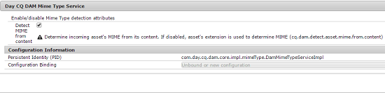

# [!DNL Apache Tika] を使用したアセットの MIME タイプの検出 {#detecting-mime-type-of-assets-using-apache-tika}

通常、[!DNL Adobe Experience Manager Assets] はアップロードするアセットの MIME タイプをファイル拡張子から検出します。

[!DNL Apache Tika] を使用してアセットをアップロードすると、[!DNL Assets] はアセットの MIME タイプをファイル拡張子ではなくコンテンツストリームから、アップロード操作中に検出します。

この機能はデフォルトでは無効になっています。 この機能を有効にするには、[!UICONTROL Configuration Manager] で **[!UICONTROL Day CQ DAM Mime タイプ]**&#x200B;サービスを設定してください。

>[!NOTE]
>
>[!DNL Apache Tika] ライブラリを使用した MIME タイプ検出は、リソースを集中的に消費する操作です。

1. Configuration Manager web コンソールを開くには、 `https://[aem_server]:[port]/system/console/configMgr` にアクセスしてください。

1. サービスのリストから、**[!UICONTROL Day CQ DAM Mime タイプサービス]**&#x200B;をクリックしてから、「 **[!UICONTROL 編集]**」をクリックしてください。

1. アップロードされたアセットの解析を有効にし、ファイルの拡張子を無視して MIME タイプを検出するには、「**[!UICONTROL コンテンツから MIME タイプを検出]**」オプションを選択してください。 デフォルトでは、このオプションはオフになっています。

   

1. 「**[!UICONTROL 保存]**」をクリックして、変更を保存します。
