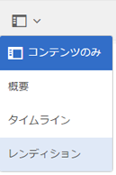
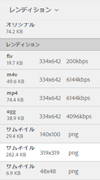

# ビデオレンディション {#video-renditions}

Adobe Experience Manager Assets では、様々な形式（OGG、FLV など）のビデオアセット用のビデオレンディションが生成されます。

Experience Manager Assets では、メディアアセットの静的レンディションと動的レンディション（DM エンコードされたレンディション）がサポートされています。

静的レンディションは、FFMPEG（システムパスにインストールされ、使用できるもの）を使用してネイティブに生成され、コンテンツリポジトリに保存されます。

DM エンコードされたレンディションは、プロキシサーバーに保存され、実行時に提供されます。

Experience Manager Assets では、クライアントサイドでこのようなレンディションの再生がサポートされています。

特定のビデオアセットのレンディションを表示するには、アセットのページを開いて、グローバルナビゲーションアイコンを選択します。 次に、リストから「**[!UICONTROL レンディション]**」を選択します。

ビデオレンディションのリストは、**[!UICONTROL レンディション]**&#x200B;パネルに表示されます。

DM エンコードされたレンディションのプロキシサーバーを設定するには、[Dynamic Media クラウドサービスを設定します](config-dynamic.md)。

目的のパラメーターでビデオレンディションを生成するには、[対応するビデオプロファイルを作成](video-profiles.md)します。

プロキシサーバーを設定し、ビデオプロファイルを作成したら、このビデオプリセットを処理プロファイルに追加して、その処理プロファイルをフォルダーに適用することができます。

>[!NOTE]
>
>Microsoft® Internet Explorer 11 では、OGG および WAV ファイルのオーディオは再生できません。 拡張子が OGG または WAV のアセットの詳細ページに、エラー `Invalid Source` が表示されます。
>
>MS® Edge および iPad では、OGG ファイルは再生されず、サポートされていない形式というエラーが発生します。
