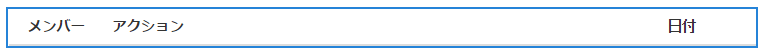
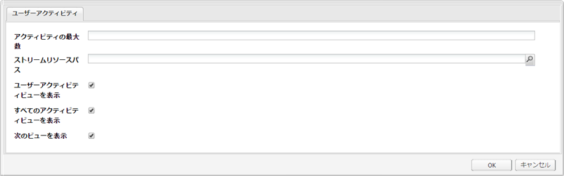
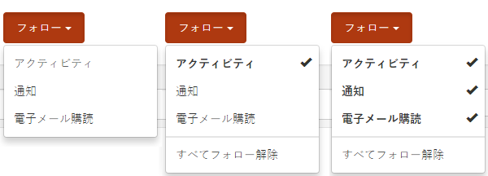

# アクティビティストリーム機能 {#activity-streams-feature}

## はじめに {#introduction}

フォーラムやブログへの投稿など、サインインしたコミュニティメンバーのアクティビティは、ストリームに収集され、`Activity Streams` コンポーネントの設定を通じて様々な方法でフィルタリングおよび表示されます。

フォロー機能は、コミュニティメンバーが関心のある投稿をフォローしたり、他のコミュニティメンバーのアクティビティをフォローしたりすると、アクティビティの別のビューを追加します。

このドキュメントには、次の内容が記載されています。

* AEM サイトへのActivity Streams コンポーネントの追加
* Activity Streams コンポーネントの設定設定

### ページへのアクティビティストリームの追加 {#adding-activity-streams-to-a-page}

作成者モードでページに`Activity Streams` コンポーネントを追加する場合は、コンポーネントブラウザーを使用して検索します

* `Communities / Activity Streams`

アクティビティストリームが表示されるページ上にドラッグします。

必要な情報については、[ コミュニティコンポーネントの基本](/help/communities/basics.md)を参照してください。

[必要なクライアントサイドライブラリ ](/help/communities/essentials-activities.md#essentials-for-client-side)が含まれている場合、`Activity Streams` コンポーネントは次のように表示されます。

### アクティビティストリームの設定 {#configuring-activity-streams}

配置された`Activity Streams` コンポーネントを選択して、編集ダイアログを開く`Configure` アイコンにアクセスして選択できるようにします。

「**ユーザーアクティビティ**」タブで、表示するアクティビティを指定します。

* **アクティビティの最大数**

  表示するアクティビティの数

* **ストリームリソースパス**

  コミュニティサイトまたはコミュニティグループをデフォルトにする場合は、空白のままにします。 ストリームリソースパスは、アクティビティのソースを識別します。 デフォルトは空白です。

* **ユーザーアクティビティ ビューの表示**

  オンにした場合、アクティビティページには、現在のメンバーによってコミュニティ内で生成されたアクティビティに基づいてアクティビティをフィルタリングするタブが含まれます。 デフォルトはオンです。

* **すべてのアクティビティの表示**

  オンにすると、アクティビティページには、現在のメンバーがアクセスできるコミュニティ内で生成されたすべてのアクティビティが含まれるタブが含まれます。 デフォルトはオンです。

* **次のビューを表示**

  オンにした場合、アクティビティページには、現在のメンバーがフォローしているアクティビティに基づいてアクティビティをフィルタリングするタブが含まれます。 デフォルトはオンです。

### 次のビュー {#following-view}

以下を有効にするには、コンポーネントを設定する必要があります。 次の機能を許可するのは、[ ブログ ](/help/communities/blog-feature.md)、[ フォーラム ](/help/communities/forum.md)、[QnA](/help/communities/working-with-qna.md)、[ カレンダー](/help/communities/calendar.md)、[ ファイルライブラリ ](/help/communities/file-library.md)、および[ コメント ](/help/communities/comments.md)です。

「**フォロー**」ボタンは、エントリをアクティビティ、[通知](/help/communities/notifications.md)、または[ サブスクリプション ](/help/communities/subscriptions.md)としてフォローする手段を提供します。 「**フォロー**」ボタンを選択するたびに、選択範囲のオンとオフを切り替えることができます。 `Email Subscriptions`の選択は、設定時にのみ存在します。

次のいずれかの方法を選択すると、ボタンのテキストが&#x200B;**次**&#x200B;に変わります。 便宜上、`Unfollow All`を選択してすべてのメソッドをオフにすることができます。

「**フォロー**」ボタンが表示されます。

* オーディエンスの詳細を表示できます。
* フォーラム、QnA、ブログなどの主要機能ページ。

  * その一般的な機能のすべてのアクティビティに従います。

* 特定のエントリ（フォーラムのトピック、QnAの質問、ブログ記事など）。

  * その特定のエントリのすべてのアクティビティに従います。

### 追加情報 {#additional-information}

詳しくは、開発者向けの[Activity Streams Essentials](/help/communities/essentials-activities.md) ページを参照してください。
