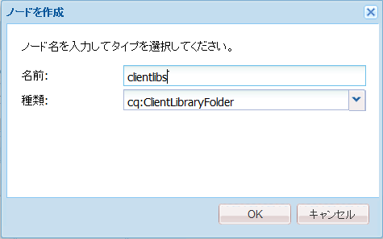
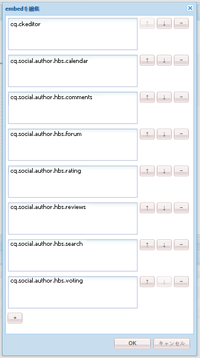
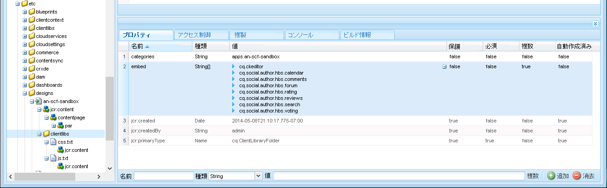
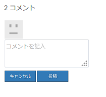
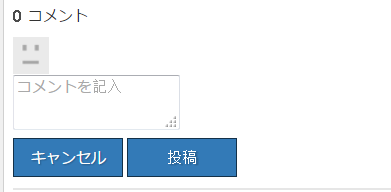

# clientlib の追加 {#add-clientlibs}

## ClientLibraryFolderの追加（clientlibs） {#add-a-clientlibraryfolder-clientlibs}

サイトのページのレンダリングに使用するJavaScript （JS）とカスケーディングスタイルシート （CSS）を含む`clientlibs`という名前のClientLibraryFolderを作成します。

このクライアントライブラリに与えられる`categories` プロパティ値は、このクライアントライブラリをコンテンツページから直接含めるか、他のクライアントライブラリに埋め込むために使用される識別子です。

1. **CRXDE Lite**&#x200B;を使用して、`/etc/designs`を展開

1. `an-scf-sandbox`を右クリックし、`Create Node`を選択します

   * 名前：`clientlibs`
   * 種類：`cq:ClientLibraryFolder`

1. **OK**&#x200B;をクリック



新しい`clientlibs` ノードの「**プロパティ**」タブで、**カテゴリ** プロパティを入力します。

* 名前：**categories**
* タイプ : **文字列**
* 値：**apps.an-scf-sandbox**
* 「**追加**」をクリック
* 「**すべて保存**」をクリック

注意：カテゴリの値の前に「apps.」を付けることは、「所有アプリケーション」が/libsではなく/apps フォルダーにあることを識別するための規則です。 重要：プレースホルダー`js.tx`tおよび&#x200B;**`css.txt`** ファイルを追加してください。 （これらは正式にはcq:ClientLibraryFolderではありません）。

1. **`/etc/designs/an-scf-sandbox/clientlibs`**&#x200B;を右クリック
1. 「**ファイルを作成…**」を選択
1. **名前：** `css.txt`を入力
1. 「**ファイルを作成…**」を選択
1. **名前：** `js.txt`を入力
1. 「**すべて保存**」をクリック


css.txtおよびjs.txtの最初の行は、次のファイルのリストを検索するベースの場所を識別します。

css.txtのコンテンツをに設定してみてください

```
#base=.
 style.css
```

次に、clientlibsの下にstyle.cssという名前のファイルを作成し、コンテンツをに設定します。

`body {`

`background-color: #b0c4de;`

`}`

### SCF Clientlibsを埋め込む {#embed-scf-clientlibs}

`clientlibs` ノードの「**プロパティ**」タブで、複数値の文字列プロパティ **埋め込み**&#x200B;を入力します。 これには、SCF コンポーネント [&#128279;](/help/communities/client-customize.md#clientlibs-for-scf)に必要な クライアントサイドライブラリ（clientlibs）が埋め込まれます。 このチュートリアルでは、Communities コンポーネントに必要な多くのクライアントライブラリが追加されています。

これは、利便性と、各ページに対してダウンロードされるクライアントライブラリのサイズや速度に関する考慮事項があるため、実稼動サイトで使用する目的のアプローチである場合とそうでない場合があります。

1つのページで1つの機能のみを使用する場合は、その機能の完全なclientlibをページに直接含めることができます。例：

`% ui:includeClientLib categories=cq.social.hbs.forum" %`

この場合、それらをすべて含めるので、オーサーのclientlibである、より基本的なSCF clientlibが好まれます。

* 名前：**`embed`**
* 種類：**`String`**
* **`Multi`**&#x200B;をクリック
* 値：**`cq.social.scf`**

  * ダイアログがポップアップ表示され，
    各エントリの後で&#x200B;**`+`**&#x200B;をクリックして、次のclientlib カテゴリを追加します。

    * **`cq.ckeditor`**
    * **`cq.social.author.hbs.comments`**
    * **`cq.social.author.hbs.forum`**
    * **`cq.social.author.hbs.rating`**
    * **`cq.social.author.hbs.reviews`**
    * **`cq.social.author.hbs.voting`**
    * **OK**&#x200B;をクリック

* 「**すべて保存**」をクリック



これで、`/etc/designs/an-scf-sandbox/clientlibs`がリポジトリに表示されます。



### PlayPage テンプレートにClientlibsを含める {#include-clientlibs-in-playpage-template}

ページに`apps.an-scf-sandbox` ClientLibraryFolder カテゴリを含めないと、必要なJavaScriptとCSS スタイルが使用できないため、SCF コンポーネントは機能せず、スタイルも設定されません。

例えば、clientlibsを含めずに、SCF コメントのコンポーネントのスタイルは設定されていません。



apps.an-scf-sandbox clientlibsが含まれると、SCF コメントコンポーネントのスタイルが設定されます。



include ステートメントは、`html` スクリプトの`head` セクションに属しています。 既定の&#x200B;**`foundation head.jsp`**&#x200B;には、オーバーレイ可能なスクリプトが含まれています：**`headlibs.jsp`**。

**headlibs.jspをコピーし、clientlibs:**&#x200B;を含めます

1. **CRXDE Lite**&#x200B;を使用して、**`/libs/foundation/components/page/headlibs.jsp`**&#x200B;を選択します

1. 右クリックして、**コピー**&#x200B;を選択します（またはツールバーから「コピー」を選択します）
1. **`/apps/an-scf-sandbox/components/playpage`** を選択します。
1. 右クリックして、**貼り付け**&#x200B;を選択します（またはツールバーから「貼り付け」を選択します）
1. **`headlibs.jsp`**&#x200B;をダブルクリックして開きます
1. ファイルの最後に次の行を追加します
   **`<ui:includeClientLib categories="apps.an-scf-sandbox"/>`**

1. 「**すべて保存**」をクリック

```xml
<%@ page session="false" %><%
%><%@include file="/libs/foundation/global.jsp" %><%
%><ui:includeClientLib categories="cq.foundation-main"/><%
%>
<cq:include script="/libs/cq/cloudserviceconfigs/components/servicelibs/servicelibs.jsp"/>
<% currentDesign.writeCssIncludes(pageContext); %>
<ui:includeClientLib categories="apps.an-scf-sandbox"/>
```

ブラウザーでweb サイトを読み込み、背景が青色の色合いではないかどうかを確認します。

[https://localhost:4502/content/an-scf-sandbox/en/play.html](https://localhost:4502/content/an-scf-sandbox/en/play.html)


### これまでの作業を保存する {#saving-your-work-so-far}

この時点で、ミニマリストのサンドボックスが存在します。 パッケージとして保存する価値があるかもしれませんが、再生中にリポジトリが破損し、やり直したい場合は、サーバーをオフにすることができます。 次に、crx-quickstart/ フォルダーの名前を変更または削除し、サーバーの電源を入れ、この保存されたパッケージをアップロードしてインストールします。これらの最も基本的な手順を繰り返す必要はありません。

このパッケージは、[&#x200B; サンプルページの作成](/help/communities/create-sample-page.md) チュートリアルに存在します。このチュートリアルは、ジャンプして再生を開始するのを待つことができないユーザー向けです。

パッケージを作成するには：

* CRXDE Liteから、[&#x200B; パッケージアイコン &#x200B;](https://localhost:4502/crx/packmgr/)をクリックします
* 「**パッケージを作成**」をクリックします

  * パッケージ名：an-scf-sandbox-minimal-pkg
  * バージョン：0.1
  * グループ：`leave as default`
  * **OK**&#x200B;をクリック

* 「**編集**」をクリックします

  * 「**フィルター**」タブを選択

    * 「**フィルターを追加**」をクリック
    * ルートパス：`/apps/an-scf-sandbox`を参照
    * 「**完了**」をクリックします。
    * 「**フィルターを追加**」をクリック
    * ルートパス：`/etc/designs/an-scf-sandbox`を参照
    * 「**完了**」をクリックします。
    * 「**フィルターを追加**」をクリック
    * ルートパス：`/content/an-scf-sandbox**`を参照
    * 「**完了**」をクリックします。

  * 「**保存**」をクリックします。

* **ビルド**&#x200B;をクリックします

これで、**ダウンロード**&#x200B;を選択してディスクに保存し、**パッケージ**&#x200B;を他の場所にアップロードし、**詳細> レプリケート**&#x200B;を選択して、サンドボックスをlocalhost パブリッシュインスタンスにプッシュし、サンドボックスの領域を拡張できます。
