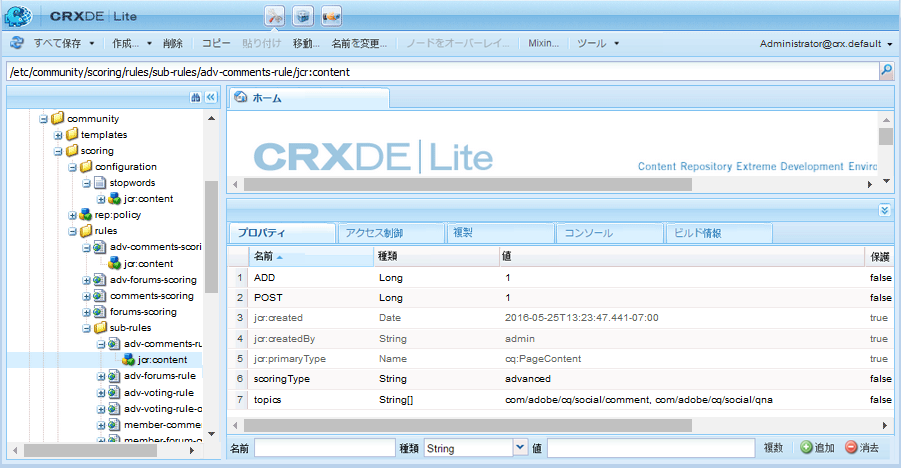

# 高度なスコアとバッジ{#advanced-scoring-and-badges}

## 概要 {#overview}

高度なスコアリングにより、バッジを授与して、メンバーを専門家として特定できます。 高度なスコアリングでは、メンバーが作成したコンテンツの量&#x200B;*および*&#x200B;の品質に基づいてポイントが割り当てられます。一方、基本的なスコアリングでは、作成したコンテンツの量に基づいてポイントが割り当てられます。

この違いは、スコアの計算に使用されるスコアリングエンジンに起因します。 基本スコアリングエンジンは、単純計算を適用します。 高度なスコアリングエンジンは、トピックの自然言語処理（NLP）を通じて導き出された、価値ある関連コンテンツを提供するアクティブなメンバーに報酬を与えるアダプティブアルゴリズムです。

コンテンツの関連性だけでなく、投票や回答の割合など、メンバーのアクティビティもスコアリングアルゴリズムで考慮されます。 基本スコアリングでは定量的にスコアを算出しますが、高度なスコアリングではアルゴリズムを利用してスコアを算出します。

そのため、高度なスコアリングエンジンには、分析を有意義なものにするのに十分なデータが必要です。 アルゴリズムが制作するコンテンツの量と品質を継続的に調整していく中で、専門家になるための達成基準は常に再評価されます。 メンバーの古い投稿の&#x200B;*減衰*&#x200B;という概念もあります。 エキスパートのメンバーが、エキスパートのステータスを取得したテーマに参加しなくなった場合、事前に決められた時点（[&#x200B; スコアリングエンジン設定](#configurable-scoring-engine)を参照）で、エキスパートとしてのステータスを失う可能性があります。

高度なスコアリングの設定は、基本的なスコアリングとほぼ同じです。

* 基本および高度なスコアリングとバッジルールは、同じ方法で[&#x200B; コンテンツ &#x200B;](/help/communities/implementing-scoring.md#apply-rules-to-content)に適用されます。

  * 基本および高度なスコアリングとバッジングルールは、同じコンテンツに適用できます。

* [&#x200B; コンポーネント &#x200B;](/help/communities/implementing-scoring.md#enable-badges-for-component)のバッジを有効にするのは一般的です。

スコアリングルールとバッジングルールの設定の違いは次のとおりです。

* 設定可能な高度なスコアリングエンジン
* 高度なスコアリングルール：

  * `scoringType` を `advanced` に設定
  * `stopwords`が必要です

* 高度なバッジングルール：

  * `badgingType` を `advanced` に設定
  * `badgingLevels`さんが授与するエキスパートレベルの数&#x200B;**件に設定されました**
  * バッジへのポイントのマッピングのしきい値ではなく、バッジの`badgingPaths`配列が必要です。

>[!NOTE]
>
>高度なスコアリング機能とバッジ機能を使用するには、[Expert Identification パッケージ &#x200B;](https://experience.adobe.com/#/downloads/content/software-distribution/en/aem.html?package=%2Fcontent%2Fsoftware-distribution%2Fen%2Fdetails.html%2Fcontent%2Fdam%2Faem%2Fpublic%2Fadobe%2Fpackages%2Fcq610%2Fsocial%2Ffeaturepack%2Fcq-social-expert-identification-pkg)をインストールします。

## 設定可能なスコアリングエンジン {#configurable-scoring-engine}

高度なスコアリングエンジンは、高度なスコアリングアルゴリズムに影響を与えるパラメーターを備えたOSGi設定を提供します。


* **重みをスコア付け**

  トピックの場合は、スコアを計算する際に最も優先度の高い動詞を指定します。 1つ以上のトピックを入力できますが、1つのトピックにつき&#x200B;**1つの動詞**&#x200B;に制限されています。 [&#x200B; トピックと動詞](/help/communities/implementing-scoring.md#topics-and-verbs)を参照してください。
コンマがエスケープされた状態で`topic,verb`として入力されました。 例：
  `/social/forum/hbs/social/forum\,ADD`
  デフォルトは、QnA コンポーネントとフォーラム コンポーネントのADD動詞に設定されます。

* **スコアリング範囲**

  高度なスコアの範囲は、この値（最大スコア）と0 （可能な限り低いスコア）によって定義されます。

  スコアリング範囲が0～100になるように、デフォルト値は100です。

* **エンティティ減衰の時間間隔**

  このパラメーターは、すべてのエンティティスコアが減衰されるまでの時間数を表します。 これは、コミュニティサイトのスコアに古いコンテンツを含めなくなるために必要です。

  デフォルト値は216000時間（約24年）です。

* **スコアリングの成長率**
これは、0 スコアリング範囲のスコアを指定します。このスコアを超えると、成長が遅くなり、エキスパートの数が制限されます。

  デフォルト値は 50 です。

## 高度なスコアリングルール {#advanced-scoring-rules}

基本スコアリングでは、バッジの獲得に必要な数量を把握できます。

高度なスコアリングでは、システム内の品質データの量にもとづいて、必要な量を常に調整します。 スコアリングは、常にベル曲線に類似した方法で計算されます。

メンバーが、アクティブでなくなったトピックに関する専門家のバッジを獲得した場合、時間の経過とともに腐敗のためにバッジが失われる可能性があります。

### scoringType {#scoringtype}

スコアリングルールは、スコアリングサブルールのセットで、それぞれに`scoringType`を宣言します。

高度なスコアリングエンジンを呼び出すには、`scoringType`を`advanced`に設定する必要があります。

[&#x200B; サブルールのスコアリング &#x200B;](/help/communities/implementing-scoring.md#scoring-sub-rules)を参照してください。



### Stopwords {#stopwords}

高度なスコアリングパッケージは、stopwords ファイルを含む設定フォルダーをインストールします。

* `/libs/settings/community/scoring/configuration/stopwords`

高度なスコアリングアルゴリズムは、stopwords ファイルに含まれる単語のリストを使用して、コンテンツ処理中に無視される一般的な英語の単語を識別します。

このファイルが変更される予定はありません。

ストップワードファイルが見つからない場合は、高度なスコアリングエンジンでエラーが発生します。

## 高度なバッジルール {#advanced-badging-rules}

高度なバッジルールのプロパティは、[基本的なバッジルールのプロパティ &#x200B;](/help/communities/implementing-scoring.md#badging-rules)とは異なります。

ポイントをバッジ画像に関連付ける代わりに、許可されるエキスパートの数とバッジ画像を特定するだけで済みます。


<table>
 <tbody>
  <tr>
   <th>Property</th>
   <th>タイプ</th>
   <th>値説明</th>
  </tr>
  <tr>
   <td>badgingPath</td>
   <td>String[]</td>
   <td><em> （必須） </em> バッジ画像の複数値文字列で、バッジレベルの数までです。 最初のバッジ画像パスが最高のエキスパートに与えられるように、バッジ画像パスを並べ替える必要があります。 badgingLevelsで示されるよりも少ないバッジが存在する場合、配列の最後のバッジが配列の残りの部分を塗りつぶします。 エントリ例：<br /> <code>/libs/settings/community/badging/images/expert-badge/jcr:content/expert.png</code></td>
  </tr>
  <tr>
   <td>badgingLevels</td>
   <td>Long</td>
   <td><em> （オプション） </em>付与する専門知識のレベルを指定します。 例えば、<code>expert </code>と<code>almost expert</code> （2つのバッジ）がある場合、値は2に設定する必要があります。 badgingLevelは、badgingPath プロパティにリストされているエキスパート関連のバッジ画像の数と一致する必要があります。 初期設定は 1 です。</td>
  </tr>
  <tr>
   <td>badgingType</td>
   <td>文字列</td>
   <td><em> （必須） </em>は、スコアリングエンジンを「基本」または「高度」として識別します。 「詳細」に設定します。それ以外の場合、デフォルトは「基本」です。</td>
  </tr>
  <tr>
   <td>scoringRules</td>
   <td>String[]</td>
   <td><em> （オプション） </em> バッジルールを、リストされた1つ以上のスコアリングルールで識別されたスコアリングイベントに制限する複数値の文字列。<br /> 例エントリ：<br /> <code>/libs/settings/community/scoring/rules/adv-comments-scoring</code><br /> デフォルトは制限がありません。</td>
  </tr>
 </tbody>
</table>

## 含まれるルールとバッジ {#included-rules-and-badge}

### 付属バッジ {#included-badge}

このベータリリースには、報酬ベースのエキスパートのバッジが1つ含まれています。

* `expert`

  `/libs/settings/community/badging/images/expert-badge/jcr:content/expert.png`


エキスパートのバッジがアクティビティの報酬として表示されるようにするには、次の点を確認します。

* フォーラムやQnA コンポーネントなどの機能に対して`Badges`が有効になっています。

* 高度なスコアリングとバッジルールは、コンポーネントが配置されるページ（または祖先）に適用されます

次の基本情報を参照してください。

* [コンポーネントのバッジの有効化](/help/communities/implementing-scoring.md#enableforcomponent)
* [ルールの適用](/help/communities/implementing-scoring.md#applytopage)

### 含まれるスコアリングルールとサブルール {#included-scoring-rules-and-sub-rules}

ベータ版リリースには、[&#x200B; フォーラム関数](/help/communities/functions.md#forum-function)の2つの高度なスコアリングルールが含まれています（フォーラム機能のフォーラムおよびコメントコンポーネント用にそれぞれ1つ）。

1. `/libs/settings/community/scoring/rules/adv-comments-scoring`

   ```
   subRules[] =
   /libs/settings/community/scoring/rules/sub-rules/adv-comments-rule
   /libs/settings/community/scoring/rules/sub-rules/adv-voting-rule-owner
   /libs/settings/community/scoring/rules/sub-rules/adv-voting-rule
   ```

1. `/libs/settings/community/scoring/rules/adv-forums-scoring`

   ```
   subRules[] =
   /libs/settings/community/scoring/rules/sub-rules/adv-forums-rule
   /libs/settings/community/scoring/rules/sub-rules/adv-comments-rule
   /libs/settings/community/scoring/rules/sub-rules/adv-voting-rule-owner
   ```

**メモ：**

* `rules`と`sub-rules`の両方のノードのタイプは`cq:Page`です。
* `subRules`は、ルールの`jcr:content` ノードのString`[]`型の属性です。
* `sub-rules`は、様々なスコアリングルール間で共有できます。
* `rules`は、全員に対する読み取り権限を持つリポジトリの場所にある必要があります。
* ルール名は、場所に関係なく一意である必要があります。

### 含まれるバッジルール {#included-badging-rules}

このリリースには、[高度なフォーラムとコメントのスコアリングルール &#x200B;](#included-scoring-rules-and-sub-rules)に対応する2つの高度なバッジルールが含まれています。

* `/libs/settings/community/badging/rules/adv-comments-badging`
* `/libs/settings/community/badging/rules/adv-forums-badging`

**メモ：**

* `rules` ノードはcq:Page型です。
* `rules`は、全員に対する読み取り権限を持つリポジトリの場所にある必要があります。
* ルール名は、場所に関係なく一意である必要があります。
