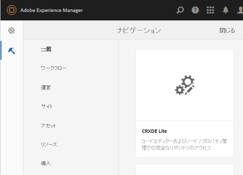
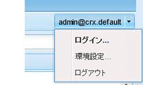

# SCF サンドボックスの作成  {#create-an-scf-sandbox}

AEM 6.1 Communitiesでは、サンドボックスをすばやく作成する最も簡単な方法は、コミュニティサイトを作成することです。 [AEM Communitiesの概要](getting-started.md)を参照してください。

開発者にとってもう1つの便利なツールは、[ コミュニティコンポーネントガイド ](components-guide.md)です。このガイドを使用すると、コミュニティのコンポーネントと機能の探索と迅速なプロトタイピングを行うことができます。

Web サイトを作成する演習は、コミュニティ機能を含むAEM web サイトの構造を理解するのに役立ちます。また、[ ソーシャルコンポーネントフレームワーク（SCF） ](scf.md)の操作を検討するための簡単なページも提供します。

このチュートリアルは、主にAEMを初めて使用する開発者向けに、SCF コンポーネントの使用に興味がある場合に使用します。 ナビゲーション、ロゴ、検索、ツールバー、リストの子ページなど、サイト構造に焦点を当てた[完全特集インターネット Web サイトの作成方法](../../help/sites-developing/website.md)のチュートリアルと同様に、SCF サンドボックスサイトの作成について説明します。

開発はオーサーインスタンスで行われますが、サイトの実験はパブリッシュインスタンスで行うのが最適です。

このチュートリアルの手順は次のとおりです。

* [Web サイト構造のセットアップ](setup-website.md)
* [初期サンドボックスアプリケーション](initial-app.md)
* [初期サンドボックスコンテンツ](initial-content.md)
* [サンドボックスアプリケーションの開発](develop-app.md)
* [clientlib の追加](add-clientlibs.md)
* [サンドボックスコンテンツの開発](develop-content.md)

>[!CAUTION]
>
>このチュートリアルでは、[Communities Sites コンソール ](sites-console.md)を使用して作成された機能を持つコミュニティサイトは作成されません。 例えば、ログイン、自己登録、[ ソーシャルログイン ](social-login.md)、メッセージ、プロファイルなどの設定方法については、このチュートリアルでは説明しません。
>
>単純なコミュニティサイトが望ましい場合は、[ サンプルページの作成](create-sample-page.md) チュートリアルに従ってください。

## 前提条件 {#prerequisites}

このチュートリアルでは、1人のAEM オーサーと、1人のAEM パブリッシュインスタンスがインストールされ、コミュニティの[最新リリース ](deploy-communities.md#latest-releases)がインストールされていることを前提としています。

AEMを初めて利用する場合に役立つリンクをいくつか紹介します。

* [はじめに](../../help/sites-deploying/deploy.md#getting-started): AEM インスタンスのデプロイ用。

  * [基本](../../help/sites-developing/the-basics.md):web サイトと機能の開発者向け。
  * [作成者の最初の手順](../../help/sites-authoring/first-steps.md): ページコンテンツのオーサリング用。

## CRXDE Lite開発環境の使用 {#using-crxde-lite-development-environment}

AEM開発者は、オーサーインスタンスの[CRXDE Lite](../../help/sites-developing/developing-with-crxde-lite.md)開発環境で多くの時間を費やしています。 CRXDE Liteでは、CRX リポジトリへのアクセスが制限されていません。 クラシック UI ツールとタッチ操作対応UI コンソールを使用すると、CRX リポジトリの特定の部分に、より構造化されたアクセスを提供できます。

管理者権限でログインした後、CRXDE Liteにアクセスするには、様々な方法があります。

1. グローバルナビゲーションから、「**[!UICONTROL ツール/CRXDE Lite]**」ナビゲーションを選択します。

   

2. [ クラシック UIのウェルカムページ ](http://localhost:4502/welcome.html)から、下にスクロールして、右側のパネルの&#x200B;**[!UICONTROL CRXDE Lite]**&#x200B;をクリックします。

   

3. `CRXDE Lite`に直接参照：`<server>:<port>/crx/de`

   例えば、ローカル オーサーインスタンスで[http://localhost:4502/crx/de](http://localhost:4502/crx/de)

CRXDE Liteを使用するには、開発者権限または管理者権限でログインする必要があります。 デフォルトのlocalhost インスタンスの場合は、次でログインできます。

* `username: admin`
* `password: admin`

このログインがタイムアウトし、CRXDE Lite ツールバーの右端にあるプルダウンを使用して定期的に再ログインする必要があります。

ログインしていない場合、JCR リポジトリをナビゲートしたり、編集/保存操作を実行したりすることはできません。

***問題が発生した場合、再ログインします！***

