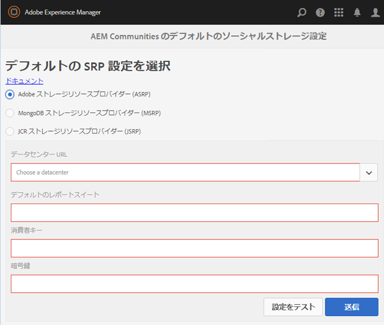

# ASRP - Adobe ストレージリソースプロバイダー {#asrp-adobe-storage-resource-provider}

## ASRPについて {#about-asrp}

AEM CommunitiesがASRPを共通ストアとして使用するように設定されている場合、同期やレプリケーションを必要とせずに、ユーザー生成コンテンツ（UGC）はすべてのオーサーインスタンスとパブリッシュインスタンスからアクセスできます。

[SRP オプションの特性](/help/communities/working-with-srp.md#characteristics-of-srp-options)および[推奨トポロジ ](/help/communities/topologies.md)も参照してください。

## 要件 {#requirements}

ASRPの使用には、追加のライセンスが必要です。

UGCにASRPを使用するようにAEM Communities サイトを設定するには、次の点についてアカウント担当者にお問い合わせください。

* データセンターのURL （ASRP エンドポイントのアドレス）
* Consumer key
* 秘密鍵
* レポートスイート ID

コンシューマーキーと秘密鍵は、会社のすべてのレポートスイートで共有されます。 テナントごとに1つのレポートスイートがあります。

## 設定 {#configuration}

### ASRPの選択 {#select-asrp}

[ ストレージ設定コンソール ](/help/communities/srp-config.md)では、使用するSRPの実装を特定するデフォルトのストレージ設定を選択できます。

**AEM オーサーインスタンス：**

* グローバルナビゲーションから、**[!UICONTROL ツール/コミュニティ/ストレージ設定]**&#x200B;に移動し、**[!UICONTROL Adobe ストレージリソースプロバイダー（ASRP）]**&#x200B;を選択します。

次の情報は、プロビジョニングプロセスから得られます。

* **データセンターのURL**：プルダウンして、アカウント担当者が識別した実稼動データセンターを選択します。
* **既定のレポートスイート**：既定のレポートスイートの名前を入力します。
* **Consumer Key**：消費者キーを入力します。
* **秘密鍵**：秘密鍵を入力します。
* 「**送信**」を選択します。

パブリッシュインスタンスを準備します。

* [暗号化キーのレプリケート](#replicate-the-crypto-key)
* [設定のレプリケート](#publishing-the-configuration)

設定を送信した後、接続をテストします。

* 「**設定をテスト**」を選択します。

  オーサーインスタンスとパブリッシュインスタンスごとに、ストレージ設定コンソールからデータセンターへの接続をテストします。

* プロファイルデータのサイト URLが、[外部リンク ](#externalize-links)によってデータセンターからルーティングできることを確認します。

### 暗号化キーのレプリケート {#replicate-the-crypto-key}

Consumer KeyとSecret Keyは暗号化されています。 キーを適切に暗号化/復号化するには、主要なGranite Crypto キーがすべてのAEM インスタンスで同じである必要があります。

「[暗号化キーをレプリケートする](/help/communities/deploy-communities.md#replicate-the-crypto-key)」の手順に従います。

### リンクの外部化 {#externalize-links}

プロファイルとプロファイル画像の正しいリンクを取得するには、必ず[Link Externalizer](/help/sites-developing/externalizer.md)を適切に設定してください。

ドメインは、データセンターのURL （ASRP エンドポイント）からルーティング可能なURLに設定してください。

### 時間同期 {#time-synchronization}

ASRP エンドポイントを使用した認証を成功させるには、ホストされているAEM Communitiesを実行しているマシンが、[Network Time Protocol （NTP） ](https://www.ntp.org/)などの時間同期されている必要があります。

### 設定の公開 {#publishing-the-configuration}

ASRPは、すべてのオーサーインスタンスとパブリッシュインスタンスで共通のストアとして識別する必要があります。

パブリッシュ環境で同じ設定を使用できるようにするには、次の手順を実行します。

AEM オーサーインスタンスの場合：

* メインメニューから&#x200B;**[!UICONTROL ツール]**/**[!UICONTROL デプロイメント]**/**[!UICONTROL レプリケーション]**&#x200B;に移動します
* 「**ツリーをアクティブ化**」を選択
* **パスの開始**：参照：`/conf/global/settings/communities/srpc/`
* 選択解除&#x200B;**変更済みのみ**
* **アクティブ化**&#x200B;を選択

## AEM 6.0からのアップグレード {#upgrading-from-aem}

>[!CAUTION]
>
>公開されたコミュニティサイトでASRPを有効にすると、オンプレミスストレージとクラウドストレージの間でデータが同期されないため、[JCR](/help/communities/jsrp.md)に既に保存されているUGCは表示されなくなります。

**`AEM Communities Extension`**&#x200B;は、以前にAEM 6.0 social communities as a cloud serviceで導入されました。 AEM 6.1 Communitiesでは、クラウド設定は必要ありません。[ ストレージ設定コンソール ](/help/communities/srp-config.md)からASRPを選択するだけです。

新しいストレージ構造のため、ソーシャルコミュニティからコミュニティにアップグレードする場合は、[ アップグレード ](/help/communities/upgrade.md#adobe-cloud-storage)の手順に従う必要があります。

## ユーザーデータの管理 {#managing-user-data}

*ユーザー*、*ユーザープロファイル*&#x200B;および&#x200B;*ユーザーグループ*&#x200B;について、パブリッシュ環境で頻繁に入力される情報については、次を参照してください

* [ユーザー同期](/help/communities/sync.md)
* [ユーザーとユーザーグループの管理](/help/communities/users.md)

## トラブルシューティング {#troubleshooting}

### アップグレード後にUGCが消える {#ugc-disappears-after-upgrade}

既存のAEM 6.0 ソーシャルコミュニティサイトからアップグレードする場合は、必ず[ アップグレード手順](/help/communities/upgrade.md#adobe-cloud-storage)に従ってください。そうしないと、UGCが失われているようです。

### 認証エラー {#authentication-errors}

Data Center URLに対する認証エラーを受け取り、AEM error.logに古いタイムスタンプに関するメッセージが含まれている場合は、時刻の同期が行われていることを確認します。

[Network Time Protocol （NTP） ](https://www.ntp.org/)などのツールを使用して、すべてのAEM オーサーサーバーとパブリッシュサーバーを時間で同期します。

### 検索に新しいコンテンツが表示されない {#new-content-does-not-appear-in-searches}

Adobe クラウドストレージインフラストラクチャは、スケーリングとパフォーマンスの目標を達成するために&#x200B;*最終的な一貫性*&#x200B;を使用します。 そのため、新しいコンテンツは瞬時に利用できず、検索結果に表示されるまでに数秒かかります。

最終的な一貫性に影響を与える間隔は監視されますが、新しいコンテンツが検索に表示されるまでに数秒以上かかる場合は、アカウント担当者にお問い合わせください。

### UGCがASRPで表示されない {#ugc-not-visible-in-asrp}

ストレージオプションの設定を確認して、ASRPがデフォルトプロバイダーに設定されていることを確認します。 デフォルトでは、ストレージリソースプロバイダーはASRPではなくJSRPです。

すべてのオーサーインスタンスとパブリッシュインスタンスで、ストレージ設定コンソールを再訪問するか、AEM リポジトリを確認します。

JCRで、[/conf/global/settings/communities](https://localhost:4502/crx/de/index.jsp#/etc/socialconfig/)の場合：

* [srpc](https://localhost:4502/crx/de/index.jsp#/conf/global/settings/communities/srp) ノードが含まれていません。これは、ストレージプロバイダーがJSRPであることを意味します。
* srpc ノードが存在し、[defaultconfiguration](https://localhost:4502/crx/de/index.jsp#/conf/global/settings/communities/srp/defaultconfiguration) ノードが含まれている場合、defaultconfigurationのプロパティでASRPがデフォルトプロバイダーとして定義されます。
