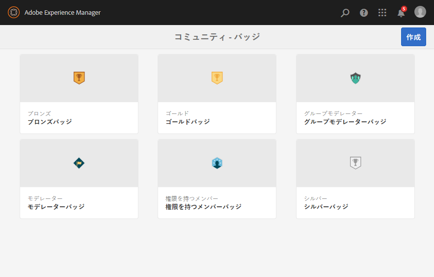
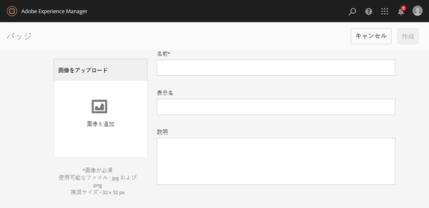

# バッジコンソール {#badges-console}

## バッジについて {#about-badges}

コミュニティバッジコンソールでは、メンバーが獲得（授与）またはコミュニティ内の特定の役割（割り当て）を引き受けたときにメンバーに表示できるカスタムバッジを追加できます。

### バッジの表示 {#badge-visibility}

現在、コミュニティメンバーが獲得または割り当てられたバッジは、名前とアバターとともに次の場所に表示されます。

* プロファイル
* [フォーラム](/help/communities/forum.md)
* [Q&amp;A](/help/communities/working-with-qna.md)
* [リーダーボード](/help/communities/enabling-leaderboard.md)
* [アイディエーション](/help/communities/ideation-feature.md)

オーサー環境で、バッジコンソールに移動します。

* グローバルナビゲーションから：**[!UICONTROL ツール]** > **[!UICONTROL コミュニティ]** > **[!UICONTROL バッジ]**

このコンソールには、現在使用可能なバッジと、新しいバッジを追加できるバッジが表示されます。

## バッジを作成 {#create-badge}

バッジを作成するには、適切な小さい画像（高さが26～32 ピクセルの72 dpi）をアップロードし、名前を入力します。 バッジ画像は`/libs/settings/community/badging/images`のリポジトリに保存され、パブリッシュ環境に自動的にレプリケートされます。

パブリッシュ環境がパブリッシャーのファームである場合、[ ユーザー同期](/help/communities/sync.md)を設定する必要があります。

* **画像をアップロード**

  （*必須*） JPEGまたはPNG形式で、推奨サイズが32 x 32 ピクセル、72 dpiのバッジ画像。

* **名前**

  （*必須*） バッジ名。 デフォルトの`Display Name`とリポジトリノード名です。 `Name`が有効なリポジトリノード名でない場合は、変更されます。

* **表示名**

  （*オプション*） ユーザーインターフェイスでバッジに表示する名前。 デフォルトは、`Name`に入力された変更されていないテキストです。

* **説明**

  （*オプション*）バッジの説明。

## 追加情報 {#additional-information}

スコアリングとバッジルールの設定について詳しくは、[ スコアリングとバッジ ](/help/communities/implementing-scoring.md)を参照してください。

メンバーのバッジの管理については、[ メンバーコンソール ](/help/communities/members.md)を参照してください。
