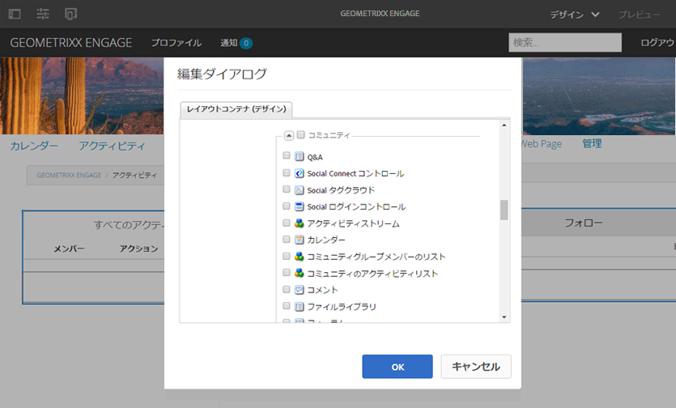
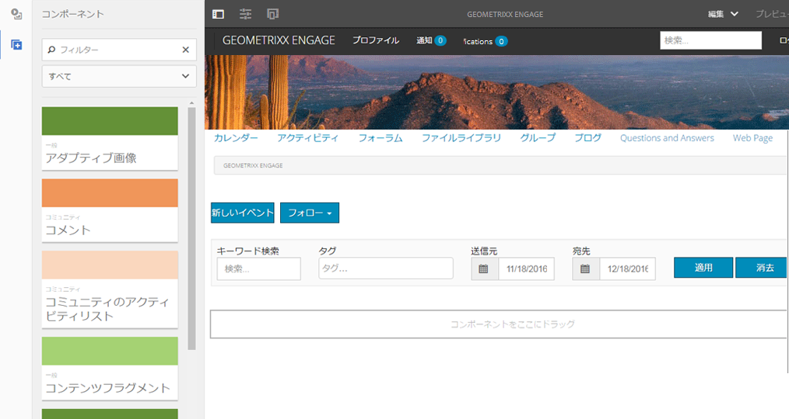
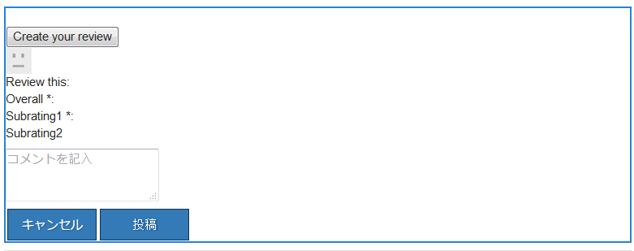

# コミュニティコンポーネントの基本 {#communities-components-basics}

## 概要 {#overview}

ドキュメントの「オーサリング」セクションでは、オーサー編集モードでAEM サイトにCommunities機能を追加する方法と、コンポーネント設定について説明します。

コンポーネントは、AEM インスタンスとインタラクティブな[ コミュニティコンポーネントガイド ](components-guide.md)を使用して検討できます。

## Communities コンポーネントへのアクセス {#accessing-communities-components}

ページコンテンツをオーサリングする際に、基礎となるテンプレートでページのデザインの変更が許可されている場合は、サイトデザインの一部として、コンポーネントブラウザーで既に使用できないコンポーネントを有効にすることができます。

[利用可能なコミュニティコンポーネント ](author-communities.md#available-communities-components)のリストを参照してください。

>[!NOTE]
>
>一般的なオーサリング情報については、[ ページのオーサリングに関するクイックガイド ](../../help/sites-authoring/qg-page-authoring.md)を参照してください。
>
>AEMに詳しくない場合は、[基本処理](../../help/sites-authoring/basic-handling.md)に関するドキュメントをご覧ください。

### デザインモードに入る {#entering-design-mode}

**Communities** コンポーネントがコンポーネントブラウザー（サイドキック）に見つからない場合は、`Design Mode`と入力して他のCommunities コンポーネントを追加する必要があります。 [必要なクライアントサイドライブラリ ](#required-clientlibs) （clientlibs）も追加する必要があります。

詳しくは、[ デザインモードでのコンポーネントの設定](../../help/sites-authoring/default-components-designmode.md)を参照してください。

以下に、いくつかのコミュニティコンポーネントを選択してコンポーネントブラウザーで表示する画像を示します。

選択したコンポーネントがコンポーネントブラウザーで使用できるようになりました。

## 必須Clientlibs {#required-clientlibs}

コンポーネントの適切な機能（JavaScript）とスタイル設定（CSS）には、[ クライアントサイドのライブラリ ](../../help/sites-developing/clientlibs.md) （clientlibs）が必要です。

Communities コンポーネントをページに追加する際に、結果がエラーまたは予期しない外観である場合は、最初にCommunities コンポーネントに必要なクライアントライブラリを追加します。 詳しくは、[ コミュニティコンポーネントのClientlibs](clientlibs.md)を参照してください。

### 例：最初にクライアントライブラリなしでレビューを配置した場合… {#example-initially-placed-reviews-without-client-libraries}

### ...クライアントライブラリを使用して {#and-with-client-libraries}

## タグ付け {#tagging}

多くのコミュニティ機能は、メンバーがパブリッシュ環境で入力（投稿）されたコンテンツにタグを付けられるように設定できます。

タグ付けが許可されている場合、パブリッシュ環境のメンバーに表示される名前空間を制限するように、コミュニティサイトの設定を設定できます。 [ コミュニティサイトコンソール ](sites-console.md#tagging)を参照してください。

タグ付けを許可する機能：[ ブログ ](blog-feature.md)、[ カレンダー](calendar.md)、[ ファイルライブラリ ](file-library.md)、[ フォーラム ](forum.md)

タグを使用する機能：[search](search.md)、[social tag cloud](tagcloud.md)

オーサリング情報の場合：

* [タグの使用](../../help/sites-authoring/tags.md)

管理者情報：

* タグ名前空間を作成しています（分類）: [ タグの管理](../../help/sites-administering/tags.md)
* コミュニティサイト設定：[ タグ付け](sites-console.md#tagging)を参照してください
* [ユーザー生成コンテンツのタグ付け](../../help/sites-authoring/tags.md)

開発者情報：

* [AEM タグ付けフレームワーク](../../help/sites-developing/framework.md)
* [Essentialsのタグ付け](tag.md)
