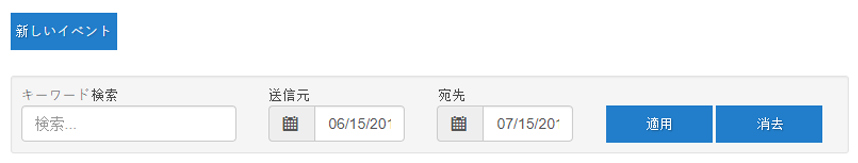
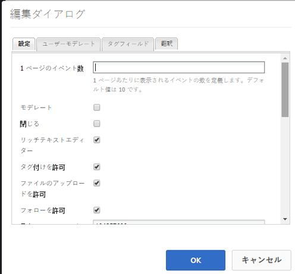
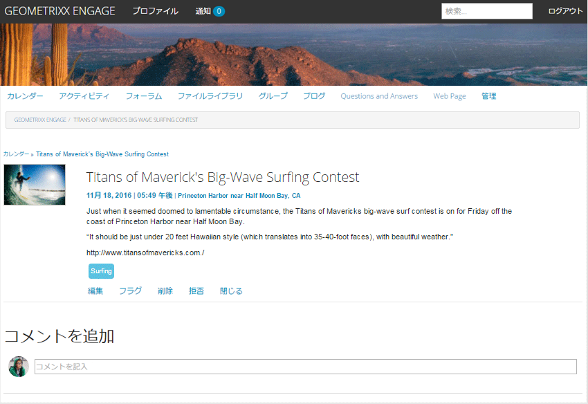
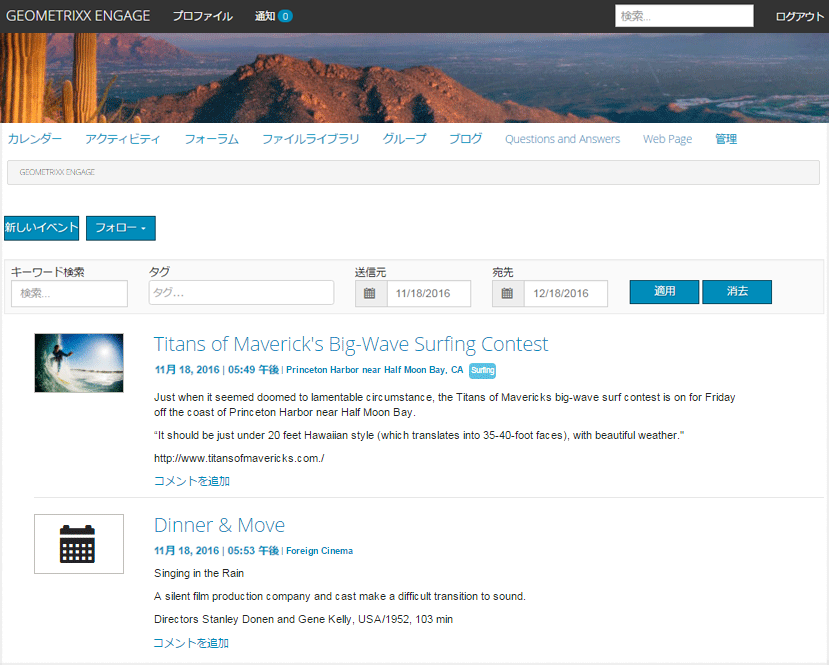
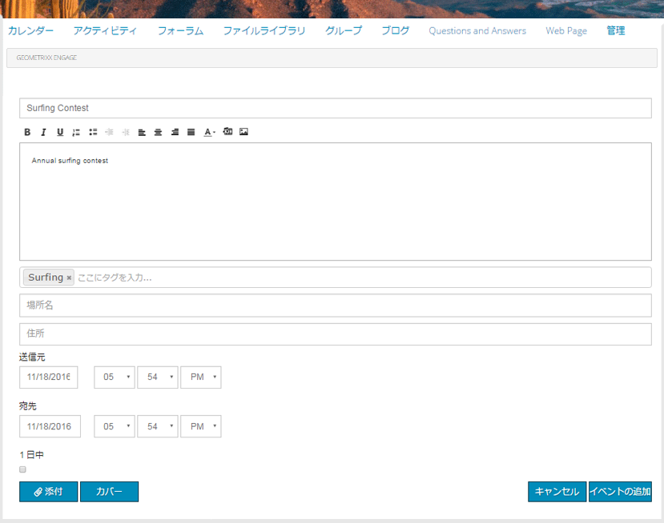
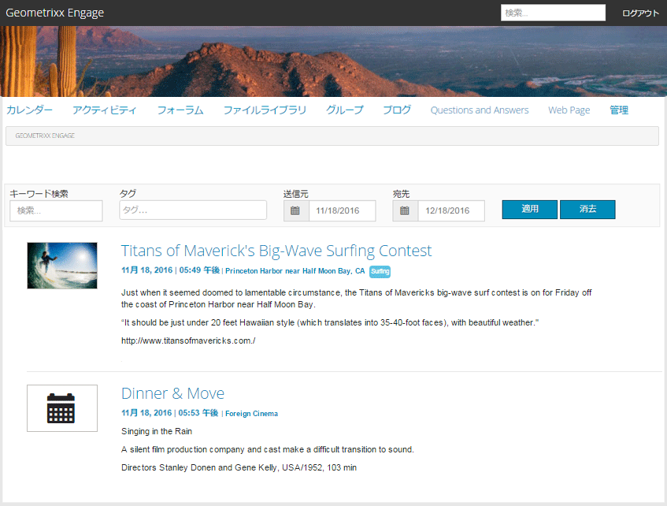

# カレンダー機能 {#calendar-feature}

## はじめに {#introduction}

カレンダー機能は、すべてのサイト訪問者またはサイト訪問者（コミュニティメンバー）でのみサインインしているユーザーに対して、カレンダー形式でコミュニティイベント情報を提供することをサポートしていますが、許可されたメンバーのみがイベントを追加できます。

この節では、次の点について説明します

* AEM サイトへのカレンダー機能の追加
* `Calendar` コンポーネントの構成設定

## ページへのカレンダーの追加 {#adding-a-calendar-to-a-page}

作成者モードでページに`Calendar` コンポーネントを追加するには、コンポーネントブラウザーを使用して

* `Communities / Calendar`

ユーザーがレビューする機能に対する相対的な位置など、ページ上の場所にドラッグします。

必要な情報については、[&#x200B; コミュニティコンポーネントの基本](/help/communities/basics.md)を参照してください。

[必要なクライアントサイドライブラリ &#x200B;](/help/communities/calendar-basics-for-developers.md#essentials-for-client-side)が含まれている場合、`Calendar` コンポーネントはこのように表示されます。

### カレンダーの設定 {#configuring-calendar}

配置された`Calendar` コンポーネントを選択して、編集ダイアログを開く`Configure` アイコンにアクセスして選択できるようにします。

#### 「設定」タブ {#settings-tab}

「**設定**」タブで、カレンダーのエントリにタグを適用できるようにするかどうかを指定します。

* ページごとの&#x200B;**イベント**

  ページごとに表示されるイベントの数を定義します。 初期設定は 10 です。

* **モデレート**

  チェックを入れた場合、カレンダーイベントとコメントの投稿は、公開サイトに表示される前に承認する必要があります。 デフォルトはオフです。

* **終了**

  チェックを入れると、カレンダーは新しいイベントのエントリとコメントに対して閉じられます。 デフォルトはオフです。

* **リッチテキストエディター**

  オンにすると、カレンダーのイベントとコメントがマークアップと共に入力される場合があります。 デフォルトはオンです。

* **タグ付けを許可**

  オンにした場合、メンバーが投稿するイベントにタグラベルを追加できるようにします（**タグフィールド** タブを参照）。 デフォルトはオンです。

* **ファイルのアップロードを許可**

  オンにした場合、添付ファイルをカレンダーイベントまたはコメントに追加できます。 デフォルトはオンです。

* **次を許可**

  オンにした場合、メンバーがカレンダーに投稿されたイベントをフォローできるようにします。 デフォルトはオンです。

* **最大ファイルサイズ**

  `Allow File Uploads`がチェックされている場合にのみ関連します。 このフィールドは、アップロードされたファイルのサイズ（バイト単位）を制限します。 デフォルトは104857600 （10 Mb）です。

* **許可されているファイル形式**

  `Allow File Uploads`がチェックされている場合にのみ関連します。 「ドット」区切り文字を持つファイル拡張子のコンマ区切りリスト。 例：.jpg、.jpeg、.png、.doc、.docx、.pdf 任意のファイルタイプを指定した場合、指定しなかったファイルタイプはアップロードできません。 デフォルトは、すべてのファイルタイプが許可されるように指定されていません。

* **最大アタッチ画像ファイル サイズ**

  「ファイルのアップロードを許可」がオンになっている場合にのみ関連します。 アップロードされた画像ファイルの最大バイト数。 デフォルトは2097152 **&#x200B; **（2 Mb）です。

* **許可されている表紙画像の種類**

  「ドット」区切り文字を使用した画像ファイル拡張子のコンマ区切りリスト。 デフォルトは `.jpg,.jpeg,.png,.gif,.bmp` です。

* **スレッド返信を許可**

  オンにした場合、カレンダーイベントに投稿されたコメントへの返信を許可します。 デフォルトはオンです。

* **ユーザーによるコメントとイベントの削除を許可**

  オンにした場合、メンバーは投稿したコメントとカレンダーイベントを削除できます。 デフォルトはオンです。

* **投票を許可**

  チェックを入れた場合は、カレンダーイベントに「投票」機能を含めます。 デフォルトはオンです。

* **パンくずリストを表示**

  イベントページにパンくずリストを表示します。 デフォルトはオンです。

* **日付範囲フィルター**

  カレンダーイベントリストページフィルターの「宛先」値を計算するために、現在の日付に追加された日数を定義します。 デフォルトの数値は30です。

* **おすすめのコンテンツを許可**

  チェックを入れると、アイデアは[おすすめコンテンツ &#x200B;](/help/communities/featured.md)として識別できます。 デフォルトはオフです。

「**ユーザーモデレーション**」タブで、投稿されたトピックと返信（ユーザー生成コンテンツ）の管理方法を指定します。 詳しくは、「[&#x200B; ユーザー生成コンテンツの管理](/help/communities/moderate-ugc.md)」を参照してください。

#### 「User Moderation」タブ {#user-moderation-tab}

* **投稿を拒否**

  チェックを入れると、信頼できるメンバーのモデレーターは投稿を拒否し、投稿が公開フォーラムに表示されないようにすることができます。 デフォルトはオンです。

* **イベントを閉じる/再度開く**

  オンにすると、信頼できるメンバーのモデレーターは、イベントを閉じてさらに編集やコメントを追加したり、イベントを再開したりできます。 デフォルトはオンです。

* **投稿にフラグを付ける**

  チェックを入れた場合、メンバーが他のユーザーのイベントやコメントに不適切なフラグを付けることを許可します。 デフォルトはオンです。

* **フラグ理由リスト**

  チェックを入れた場合、メンバーはドロップダウンリストから、イベントまたはコメントを不適切としてフラグ付けする理由を選択できます。 デフォルトはオフです。

* **カスタムフラグの理由**

  チェックを入れた場合、メンバーがイベントまたはコメントを不適切としてフラグ付けする独自の理由を入力できるようにします。 デフォルトはオフです。

* **モデレーションしきい値**

  モデレーターに通知する前に、メンバーがイベントまたはコメントにフラグを付ける必要がある回数を入力します。 デフォルトは1 （1回）です。

* **フラグ設定の上限**

  イベントまたはコメントが公開ビューから非表示になる前にフラグを立てる必要がある回数を入力します。 -1に設定すると、フラグ付きのトピックまたはコメントが公開ビューから非表示になることはありません。 それ以外の場合、この数値はモデレーションしきい値以上である必要があります。 デフォルトは 5 です。

#### 「タグフィールド」タブ {#tag-field-tab}

「**タグ」フィールド** タブでは、**設定** タブで許可されている場合、適用できるタグは、選択した名前空間に応じて制限されます。

* **許可された名前空間**

  `Allow Tagging`が「**設定**」タブでチェックされている場合に関連します。 適用できるタグは、チェックした名前空間カテゴリ内のタグに限定されます。 名前空間のリストには、「標準タグ」（デフォルトの名前空間）と「すべてのタグを含める」が含まれます。 デフォルトは「なし」にチェックされます。つまり、すべての名前空間が許可されます。

* **推奨回数**

  フォーラムに投稿するメンバーに提案として表示するタグの数を入力します。 デフォルトは&#x200B;**-**&#x200B;1 （制限なし）です。

>[!NOTE]
>
>タグの名前空間（分類）を追加する方法を学ぶことができる、[&#x200B; タグの管理](/help/sites-administering/tags.md)にアクセスしてください。

#### 「翻訳」タブ {#translation-tab}

「**翻訳**」タブで、コミュニティサイトで翻訳が有効になっている場合、翻訳は、特定の投稿ではなくスレッド全体（イベントとコメント）を翻訳するように設定できます。

* **すべてを翻訳**

  オンにすると、イベントとコメントがユーザーの優先言語に翻訳されます。 デフォルトはオンです。

## サイト訪問者エクスペリエンス {#site-visitor-experience}

パブリッシュ環境では、カレンダー機能にデフォルトの日付範囲を含む検索フィールドと、その範囲内に入るカレンダーイベントが表示されます。

カレンダーイベントを選択すると、カレンダーイベントの詳細、説明、コメントが表示されます。

その他の機能は、サイト訪問者がモデレーター、管理者、コミュニティメンバー、特権メンバー、匿名のいずれであるかによって異なります。

### モデレーターと管理者 {#moderators-and-administrators}

サインインしたユーザーがモデレーターまたは管理者権限を持っている場合、イベントに投稿されたすべてのカレンダーイベントとコメントに対して、[&#x200B; モデレーションタスク &#x200B;](/help/communities/moderate-ugc.md)を（コンポーネントの設定で許可されているように）実行できます。

#### メンバー {#members}

サインインしたユーザーがコミュニティメンバーまたは[特権メンバー](/help/communities/users.md#privileged-members-group)である場合（設定によって異なります）、`New Event`を選択して、新しいカレンダーイベントを作成および投稿できます。

具体的には、次のことが可能です。

* カレンダーイベントの作成
* カレンダーイベントへのコメントの投稿
* 独自のカレンダーイベントまたはコメントの編集
* 自分のカレンダーイベントまたはコメントを削除
* 他のユーザーのカレンダーイベントやコメントにフラグを付ける

#### 匿名 {#anonymous}

ログインしていないサイト訪問者は、投稿されたカレンダーイベントのみを読み、サポートされている場合は翻訳できますが、イベントやコメントを追加したり、他のユーザーのイベントやコメントにフラグを立てたりすることはできません。

## 追加情報 {#additional-information}

詳しくは、開発者向けの[Calendar Essentials](/help/communities/calendar-basics-for-developers.md) ページを参照してください。

カレンダーのイベントとコメントの管理については、[&#x200B; ユーザー生成コンテンツの管理](/help/communities/moderate-ugc.md)を参照してください。

カレンダーイベントとコメントのタグ付けについては、[&#x200B; ユーザー生成コンテンツのタグ付け](/help/communities/tag-ugc.md)を参照してください。

カレンダーイベントとコメントの翻訳については、[&#x200B; ユーザー生成コンテンツの翻訳](/help/communities/translate-ugc.md)を参照してください。
