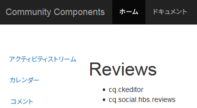
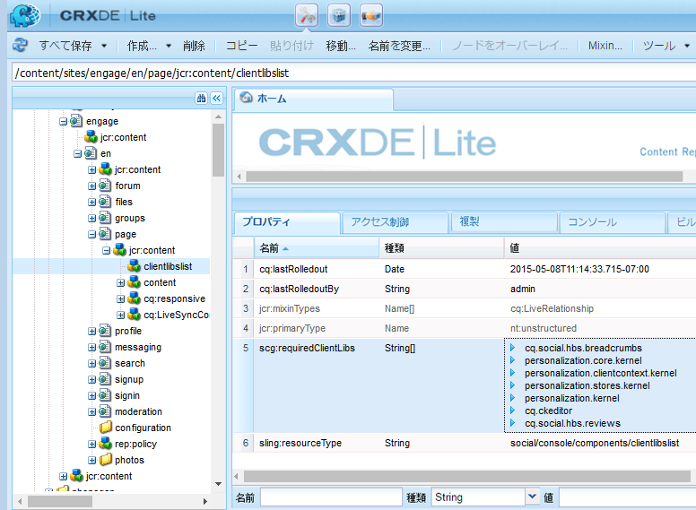

# コミュニティコンポーネントの clientlib {#clientlibs-for-communities-components}

## はじめに {#introduction}

ドキュメントのこの節では、クライアントサイドライブラリ（clientlibs）をコミュニティコンポーネントのページに追加する方法について説明します。

基本的な情報については、次を参照してください。

* [使用状況の詳細とデバッグツールを提供するクライアントサイドライブラリ ](/help/sites-developing/clientlibs.md)の使用
* SCF コンポーネントをカスタマイズする際に役立つ情報を提供するSCF](/help/communities/client-customize.md#clientlibs)の[Clientlibs

## Clientlibsが必要な理由 {#why-clientlibs-are-required}

コンポーネントの適切な機能（JavaScript）とスタイル設定（CSS）には、Clientlibが必要です。

機能に[ コミュニティ関数](/help/communities/functions.md)が存在する場合、必要なクライアントライブラリを含むすべての必要なコンポーネントと設定がコミュニティサイトに存在します。 追加のコンポーネントを作成者が使用できる場合にのみ、追加のクライアントライブラリを追加する必要があります。

必要なclientlibが見つからない場合、[Communities コンポーネントをページ ](/help/communities/author-communities.md)に追加すると、JavaScript エラーが発生し、予期しない外観になる可能性があります。

### 例：Clientlibsを使用しないレビューの配置 {#example-placed-reviews-without-clientlibs}

### 例：Clientlibsを使用したレビューの配置 {#example-placed-reviews-with-clientlibs}

## 必要なクライアントライブラリの特定 {#identifying-required-clientlibs}

開発者に必要な機能情報によって、必要なクライアントライブラリが特定されます。

また、AEM インスタンスから[ コミュニティコンポーネントガイド ](/help/communities/components-guide.md)を参照すると、コンポーネントに必要なclientlib カテゴリのリストにアクセスできます。

例えば、[ レビューページ ](https://localhost:4502/content/community-components/en/reviews.html)の上部に、リストされている必須のclientlibは次のとおりです

* cq.ckeditor
* cq.social.hbs.reviews

## 必要なClientlibの追加 {#adding-required-clientlibs}

コミュニティ コンポーネントをページに追加する場合は、コンポーネントに必要なclientlibsを追加する必要があります（まだ存在しない場合）。

[CRXDE|Lite](#using-crxde-lite)を使用して、コミュニティサイトページの既存のclientlibslistを変更します。

[CRXDE Lite](/help/sites-developing/developing-with-crxde-lite.md)を使用してコミュニティサイトのclientlibを追加するには：

* [https://&lt;server>:&lt;port>/crx/de](https://localhost:4502/crx/de)を参照します。
* コンポーネントを追加するページの`clientlibslist` ノードを見つけます。

  * `/content/sites/sample/en/page/jcr:content/clientlibslist`

* `clientlibslist` ノードを選択しました：

  * 文字列[] プロパティ `scg:requiredClientLibs`を見つけます。
  * その`Value`を選択して、文字列配列ダイアログボックスにアクセスします。

    * 必要に応じて下にスクロールします。
    * 「+」を選択して、新しいクライアントライブラリを入力します。

      * この手順を繰り返して、クライアントライブラリをさらに追加します。

      * 「**OK**」を選択します。

  * 「**すべて保存**」を選択します。

>[!NOTE]
>
>サイトがコミュニティサイトでない場合は、サイトで使用されているクライアントライブラリの存在または場所を検出する必要があります。

[AEM Communitiesの使用開始](/help/communities/getting-started.md)の例（`site-name`は&#x200B;*engage*&#x200B;です）を使用すると、レビューコンポーネントを追加する場合にclientliblistが次のように表示されます。

