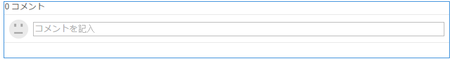
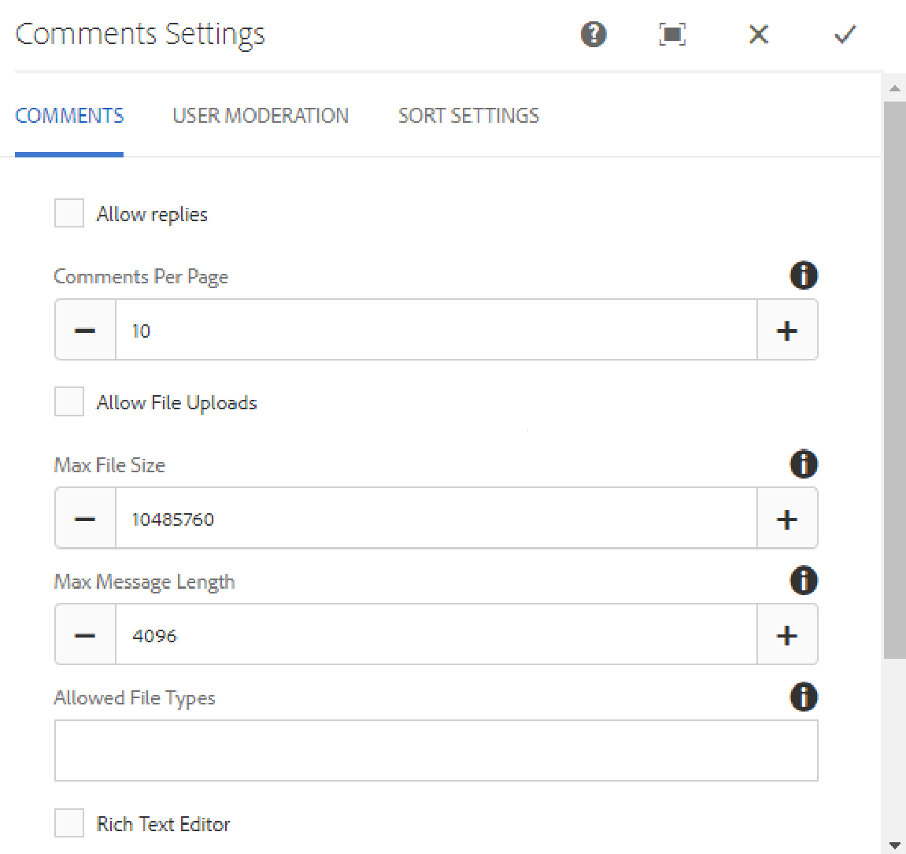
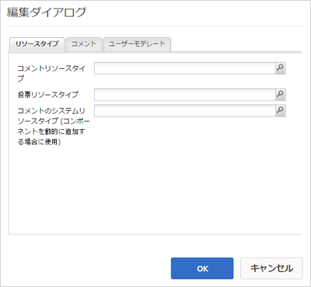

# コメントの使用 {#using-comments}

## はじめに {#introduction}

コメント機能を使用すると、サインインサイト訪問者（メンバー）がサイト上のコンテンツに関する意見や知識を共有できます。 この機能は多くの場合、他の機能に既に存在しますが、どのweb サイトにも追加できます。

このドキュメントには、次の内容が記載されています。

* ページに`Comments`を追加しています。
* `Comments` コンポーネントの構成設定。

>[!NOTE]
>
>コメントの匿名への投稿はサポートされていません。 サイト訪問者は登録（会員になる）し、ログインして参加する必要があります。

### ページへのコメントの追加 {#adding-comments-to-a-page}

作成者モードでページに`Comments` コンポーネントを追加するには、コンポーネントブラウザーを使用して

* `Communities / Comments`

ユーザーがコメントする機能に対する相対的な位置や、ページの下部など、ページ上にドラッグして配置します。

必要な情報については、[ コミュニティコンポーネントの基本](/help/communities/basics.md)を参照してください。

[必要なクライアントサイドライブラリ ](/help/communities/essentials-comments.md#essentials-for-client-side)が含まれている場合、`Comments` コンポーネントはこのように表示されます。

>[!NOTE]
>
>1つのページに存在できるコンポーネントは1つだけです。 `Comments`ブログ、カレンダー、フォーラム、QnA、レビューなど、複数のコミュニティ機能には既にコメントが含まれています。

### コメントの設定 {#configuring-comments}

アクセスする配置された`Comments` コンポーネントを選択し、編集ダイアログを開く`Configure` アイコンを選択します。

#### 「コメント」タブ {#comments-tab}

「**コメント**」タブで、訪問者がコメントを入力する方法を指定します。

* **返信を許可**

  オンにした場合、メンバーは既存のコメントに返信できます。 デフォルトの選択は解除されます。

* ページあたりのコメント数&#x200B;**件**

  ページごとに表示されるコメントの数と、表示される返信の数を制限します。 初期設定は 10 です。

* **ファイルのアップロードを許可**

  オンにすると、ファイルをアップロードするオプションがテキストエントリボックスに表示されます。 デフォルトの選択は解除されます。

* **最大ファイルサイズ**

  「ファイルのアップロードを許可」がオンになっている場合にのみ関連します。 この値は、アップロードされるファイルサイズを制限します。 デフォルトの制限は10 MBです。

* **メッセージの最大長**

  テキストボックスに入力できる最大文字数。 デフォルトは4096文字です。

* **許可されているファイル形式**

  「ファイルのアップロードを許可」がオンになっている場合にのみ関連します。 「ドット」区切り文字を使用したファイル名拡張子のコンマ区切りリスト。 例：.jpg、.jpeg、.png、.doc、.docx、.pdf。 任意のファイルタイプを指定した場合、指定しなかったファイルタイプは使用できません。 デフォルトは、すべてのファイルタイプが許可されるように指定されていません。

* **リッチテキストエディター**

  オンにすると、コメントがマークアップとともに入力されます。 デフォルトの選択は解除されます。

* **投票を許可**

  チェックを入れると、投票を上下するオプションがテキストエントリボックスに表示されます。 デフォルトの選択は解除されます。

* **次を許可**

  オンにした場合、メンバーがコメントをフォローできるようにします。 デフォルトの選択は解除されます。

* **バッジの表示**

  チェックを入れた場合は、アーンドバッジと授与バッジの表示を許可します。 デフォルトの選択は解除されます。

#### 「User Moderation」タブ {#user-moderation-tab}

「**ユーザーモデレーション**」タブで、投稿されたコメントの管理方法を指定します。 詳しくは、「[ ユーザー生成コンテンツの管理](/help/communities/moderate-ugc.md)」を参照してください。

* **事前管理**

  オンにした場合、コメントは公開サイトに表示される前に承認する必要があります。 デフォルトの選択は解除されます。

* **コメントを削除**

  チェックを入れると、コメントを投稿したメンバーにコメントを削除する機能が提供されます。 デフォルトの選択は解除されます。

* **コメントを拒否**

  オンにした場合、モデレーターがコメントを拒否できるようにします。 デフォルトの選択は解除されます。

* **コメントを閉じる/再度開く**

  オンにした場合、モデレーターがコメントを閉じて再度開くことができます。 デフォルトの選択は解除されます。

* **フラグコメント**

  チェックを入れた場合、メンバーが不適切なコメントとしてフラグを立てることを許可します。 デフォルトの選択は解除されます。

* **フラグ理由リスト**

  チェックを入れた場合、メンバーはドロップダウンリストから、不適切なコメントとしてフラグを立てる理由を選択できます。 デフォルトの選択は解除されます。

* **カスタムフラグの理由**

  チェックを入れた場合は、コメントを不適切としてフラグ付けする独自の理由をメンバーが入力できるようにします。 デフォルトの選択は解除されます。

* **モデレーションしきい値**

  モデレーターに通知する前に、メンバーがコメントにフラグを立てる必要がある回数を入力します。 デフォルトは1回（1）です。

* **フラグ設定の上限**

  コメントが公開ビューから非表示になる前にフラグを立てる必要がある回数を入力します。 この数値は、**モデレーションしきい値**&#x200B;以上である必要があります。 デフォルトは 5 です。

#### 「並べ替え設定」タブ {#sort-settings-tab}

「**並べ替え設定**」タブで、投稿されたコメントの表示時の並べ替え方法を指定します。

* **並べ替えフィールド**

  `Newest, Oldest, Last Updated, Most Viewed, Most Active, Most Followed`または`Most Liked`のいずれかを選択します。

* **並べ替え順序**

  `Ascending`または`Descending`のいずれかを選択します。

### カスタムコメントタイプへの変更 {#changing-to-a-custom-comment-type}

コメントリソースタイプを変更すると、コメントシステムはデフォルトを使用してコメントのインスタンスを生成しなくなり、開発者によってカスタマイズ（拡張）されたインスタンスを生成するようになりました。

カスタムリソースタイプがわかったら、[ デザインモード ](/help/sites-authoring/default-components-designmode.md)と入力し、配置された`Comments` コンポーネントをダブルクリックして、追加のタブを含むダイアログを開きます。

「**リソースタイプ**」タブで、`Comments or Voting` コンポーネントの新しいインスタンスのカスタム resourceTypeを指定します。

* **コメントリソースタイプ**

  /appsの拡張`comment` コンポーネント （単一コメント）のresourceTypeに移動します。 例えば、`/apps/social/commons/components/hbs/comments/comment` のように指定します。

  このリソースは、訪問者がコメントを投稿したときに作成されたUGCのresourceTypeを識別します。

* **リソースタイプの投票**

  /appsの拡張`voting` コンポーネントのresourceTypeに移動します。 例えば、`/apps/social/components/hbs/voting` のように指定します。

  このリソースは、訪問者が投票を投稿したときに作成されたUGCのリソースタイプを識別します。

* **コメント システム リソースの種類**

  /appsの拡張`comments` コンポーネント（コメントシステム）のresourceTypeに移動します。 ページテンプレート [がリソースとしてページに追加されるのではなく、基になるスクリプトにコメントシステム ](/help/communities/scf.md#add-or-include-a-communities-component)を動的に含めない限り、空白のままにします（コメントノード）。 詳しくは、[`{{include}}` ヘルパー](/help/communities/handlebars-helpers.md#include)を参照してください。

### サイト訪問者エクスペリエンス {#site-visitor-experience}

#### モデレーターと管理者 {#moderators-and-administrators}

ログインしたユーザーにモデレーターまたは管理者権限がある場合、コメントの作成者に関係なく、コンポーネントの設定で許可されているモデレーションタスクを実行できます。

#### メンバー {#members}

サイト訪問者がログインすると、設定によっては、次のことが起こる可能性があります

* 新しいコメントを投稿
* 独自のコメントを編集
* 自分のコメントを削除
* 他のユーザーのコメントにフラグを付ける

#### 匿名 {#anonymous}

ログインしていないサイト訪問者は、投稿されたコメントを読んだり、サポートされている場合は翻訳したりすることができますが、コメントを追加したり、他のユーザーのコメントにフラグを立てることはできません。

### 追加情報 {#additional-information}

詳細については、開発者向けの[Comments Essentials](/help/communities/essentials-comments.md) ページを参照してください。

投稿されたコメントの管理については、[ ユーザー生成コンテンツの管理](/help/communities/moderate-ugc.md)を参照してください。

投稿されたコメントの翻訳については、[ ユーザー生成コンテンツの翻訳](/help/communities/translate-ugc.md)を参照してください。
