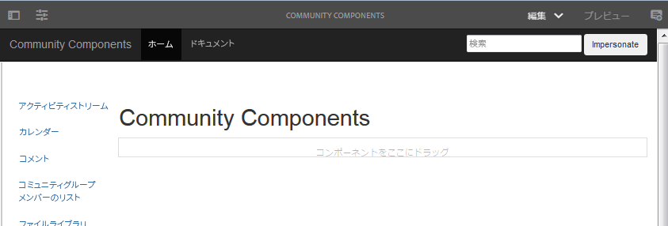
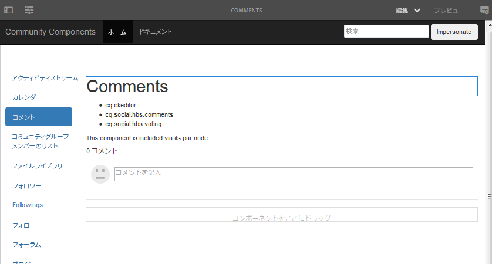
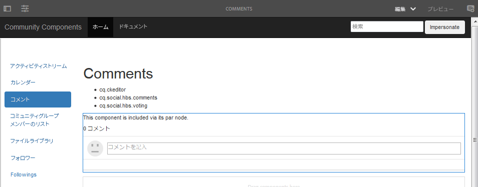
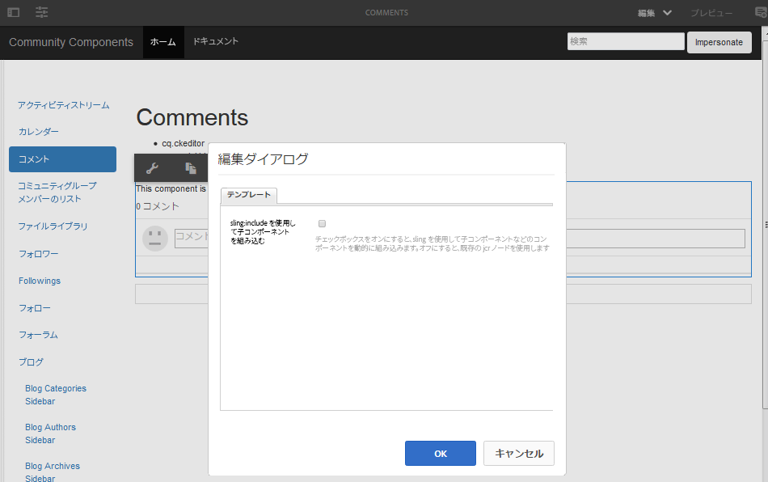
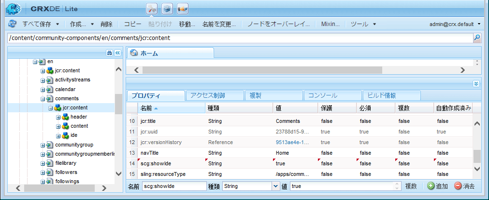
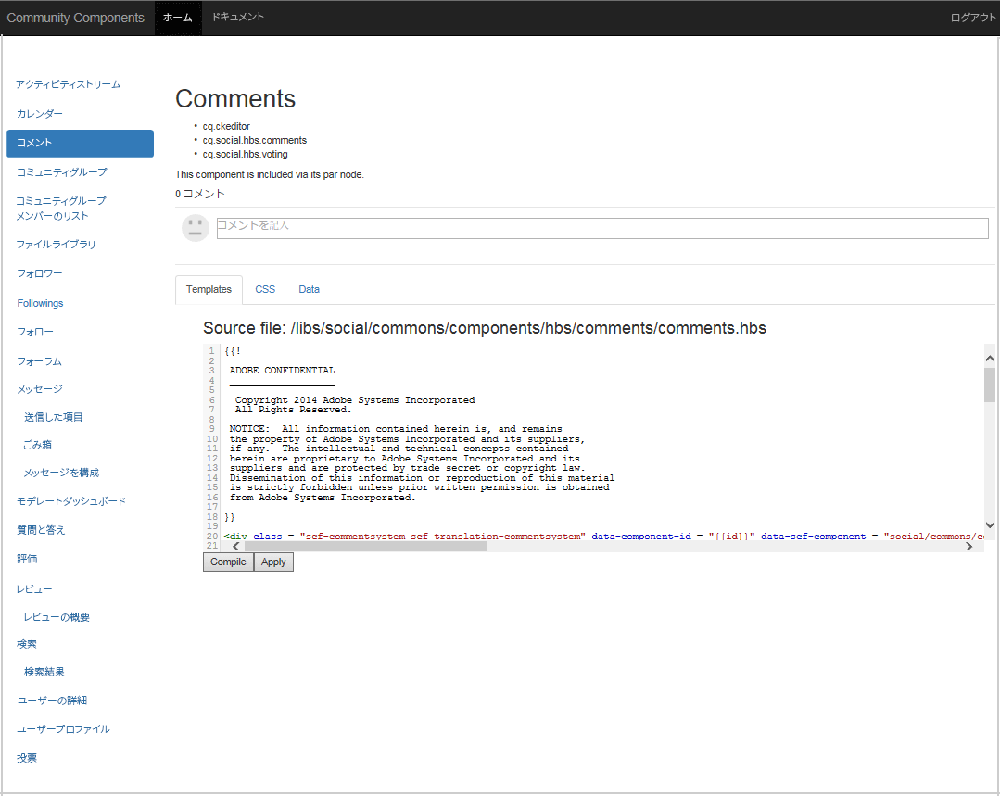

# コミュニティコンポーネントガイド  {#community-components-guide}

コミュニティコンポーネントガイドは、[&#x200B; ソーシャルコンポーネントフレームワーク（SCF） &#x200B;](scf.md)用のインタラクティブ開発ツールです。 使用可能なAdobe Experience Manager（AEM）のCommunities コンポーネントのリストや、複数のコンポーネントで構築される複雑な機能を提供します。

各コンポーネントの基本情報に加えて、このガイドでは、SCF コンポーネントや機能の仕組みと、それらの設定方法やカスタマイズ方法について実験することができます。

各コンポーネントに関連する開発の基本については、[機能とコンポーネントの基本](essentials.md)を参照してください。

## はじめに {#getting-started}

このガイドは、オーサーインスタンス（localhost:4502）とパブリッシュインスタンス（localhost:4503）の開発インストールで使用することを目的としています。

コミュニティコンポーネントサイトにアクセスするには、を参照します。

* [https://&lt;server>:&lt;port>/content/community-components/en.html](http://localhost:4502/content/community-components/en.html)

コミュニティコンポーネントとのインタラクションは、次の要素によって異なります。

* サーバー（オーサーまたはパブリッシュ）。
* サイト訪問者がログインしているかどうかを確認します。
* ログインしている場合は、メンバーに割り当てられた権限。
* 既定のSRP [JSRP](jsrp.md)が使用中かどうか。

作成者が編集モードに入るには、サーバー名の後の最初のパスセグメントとして`editor.html`または`cf#`を挿入します。

* 標準UI:

  [https://&lt;server>:&lt;port>/editor.html/content/community-components/en.html](http://localhost:4502/editor.html/content/community-components/en.html)

* クラシック UI：

  [https://&lt;server>:&lt;port>/cf#/content/community-components/en.html](http://localhost:4502/cf#/content/community-components/en.html)

>[!NOTE]
>
>編集モードの作成者では、ページ上のリンクはアクティブではありません。
>
>コンポーネントページに移動するには、まずプレビューモードを選択してリンクをアクティブ化します。
>
>ブラウザーにコンポーネントページが表示されたら、編集モードに戻ってコンポーネントの編集ダイアログを開きます。
>
>一般的なオーサリング情報については、[&#x200B; ページのオーサリングに関するクイックガイド &#x200B;](../../help/sites-authoring/qg-page-authoring.md)を参照してください。
>
>AEMに詳しくない場合は、[基本処理](../../help/sites-authoring/basic-handling.md)に関するドキュメントをご覧ください。

### ホームページ {#home-page}

このガイドでは、ページの左側に沿って、プレビューとプロトタイプ作成に使用できるSCF コンポーネントのリストを示します。

編集モードのオーサーインスタンスで表示されるコンポーネントガイド：

## コンポーネントページ {#component-pages}

ページの左側にあるリストからコンポーネントを選択します。

ガイドの本体には、次の情報が表示されます。

1. タイトル：選択したコンポーネントの名前
1. [&#x200B; クライアント側ライブラリ &#x200B;](#client-side-libraries):1つ以上の必須カテゴリのリスト
1. [包含可能](scf.md#add-or-include-a-communities-component): コンポーネントが動的に含まれる場合、オーサー編集モードで状態を切り替えることができます。

   * 追加された場合、表示されるテキストは「このコンポーネントはパーノードを介して含まれています」です。
   * 含まれている場合、表示されるテキストは「このコンポーネントは動的に含まれています」です。
   * 含まれていない場合は、テキストは表示されません

1. サンプルコンポーネントまたはフィーチャー：コンポーネントまたはフィーチャーのアクティブインスタンス。 コンポーネントの場合は、タブセクションで提供されているテンプレート、CSS、データに変更を加えて変更することができます。

>[!NOTE]
>
>左側から選択した後、ブラウザーウィンドウが狭すぎると、コンポーネントのリストが横ではなく下に表示されます。

### 作成者インタラクション {#author-interactions}

オーサーインスタンスでガイドを使用する場合、ダイアログを開いてコンポーネントの設定を体験することができます。 開発者向けの情報は、ドキュメントの[&#x200B; コンポーネントと機能の基本](essentials.md) セクションに記載されていますが、ダイアログ設定については、作成者向けの[&#x200B; コミュニティコンポーネント &#x200B;](author-communities.md) セクションに記載されています。

コミュニティコンポーネントガイドの場合、一部のコンポーネントダイアログ設定は、[包含可能](scf.md#add-or-include-a-communities-component) トグル状態でオーバーレイされます。 既存のリソースまたは動的に含まれるリソースの使用を切り替えるには、編集モードでコンポーネントと含まれるテキストの両方を選択し、ダブルクリックして編集ダイアログを開きます。

「**テンプレート**」タブの下：

* **子コンポーネントをsling:include**&#x200B;に含める

  このチェックをオフにすると、コンポーネントガイドはリポジトリ内の既存のリソース（par ノードの子であるjcr ノード）を使用します。

  * 表示されるテキストは、「このコンポーネントはパーノードを介して含まれています」です。

  チェックを入れると、コンポーネントガイドはslingを使用して、子ノードのresourceType （存在しないリソース）のコンポーネントを動的に含めます。

  * 表示されるテキストは「このコンポーネントは動的に含まれています」です。

  デフォルトはオフです。

### インタラクションの公開 {#publish-interactions}

パブリッシュインスタンスでガイドを使用する場合、コンポーネントと機能をサイト訪問者（ログインしていない）として体験したり、ログイン時に様々な権限を持つメンバーとして体験したりできます。

>[!NOTE]
>
>SRPがデフォルトのままの状態が[JSRP](jsrp.md)の場合、パブリッシュインスタンスに入力されたUGCはパブリッシュでのみ表示され、オーサーインスタンスの[&#x200B; モデレーション &#x200B;](moderate-ugc.md) コンソールからは&#x200B;*not*&#x200B;が表示されます。

## クライアントサイドライブラリ {#client-side-libraries}

各コンポーネントにリストされているクライアントサイドライブラリ（clientlibs）は、コンポーネントがページに配置されたときに参照する&#x200B;*必須*&#x200B;です。 clientlibは、ブラウザーでコンポーネントをレンダリングするために使用されるJavaScriptとCSSのダウンロードを管理および最適化する手段を提供します。

詳しくは、[Clientlibs for Communities Components](clientlibs.md)を参照してください。

## 実行 {#impersonation}

作成者インスタンスで、管理者または開発者としてログインすることが多い場合、別のユーザーとしてログインしているコンポーネントを体験するには、**[!UICONTROL 偽装]** ボタンの左側にあるテキストボックスを使用して、ユーザー名を入力するか、プルダウンリストから選択して、ボタンをクリックします。 「戻る」をクリックしてログアウトし、偽装を終了します。

パブリッシュインスタンスは、偽装する必要はありません。 ログイン/ログアウトリンクを使用して、[&#x200B; デモユーザー](tutorials.md#demo-users)など、様々なユーザーを偽装してください。

## カスタマイズ {#customization}

有効にすると、各SCF コンポーネントは、コンポーネントのテンプレート、CSS、およびデータを一時的に変更することで、可能なカスタマイズのプロトタイプ作成に使用できます。

### カスタマイズの有効化 {#enabling-customization}

>[!NOTE]
>
>**このツールは読み取り専用です**。 テンプレート、CSSまたはデータに対して行われた編集は、リポジトリに保存されません。

カスタマイズをすばやく試すには、`scg:showIde` プロパティをコンポーネントページのコンテンツ JCR ノードに追加し、trueに設定する必要があります。

例えば、オーサーインスタンスまたはパブリッシュインスタンスで、管理者権限でログインした場合は、コメントコンポーネントを使用します。

1. [CRXDE Lite](../../help/sites-developing/developing-with-crxde-lite.md)を参照

   例：[http://localhost:4503/crx/de](http://localhost:4503/crx/de)

1. コンポーネントの`jcr:content` ノードを選択

   例えば、`/content/community-components/en/comments/jcr:content` のように指定します。

1. プロパティを追加

   * **名前** `scg:showIde`
   * **型** `String`
   * **値** `true`

1. **[!UICONTROL すべて保存]**&#x200B;を選択
1. ガイドのコメントページを再読み込み

   [http://localhost:4503/content/community-components/en/comments.html](http://localhost:4503/content/community-components/en/comments.html)

1. 「テンプレート」、「CSS」、「データ」の3つのタブがあります。

### 「テンプレート」タブ {#templates-tab}

「テンプレート」タブを選択して、コンポーネントに関連付けられているテンプレートを表示します。

テンプレートエディターを使用すると、リポジトリ内のコンポーネントに影響を与えることなく、ローカル編集をコンパイルし、ページの上部にあるサンプルコンポーネントインスタンスに適用できます。

ローカル編集でコンパイルを実行すると、間隔にドットを配置し、テキストを赤くマークすることで、エラーがハイライトされます。

### CSS タブ {#css-tab}

「CSS」タブを選択して、コンポーネントに関連付けられているCSSを表示します。

コンポーネントが複数のコンポーネントの複合である場合、一部のCSSが他のコンポーネントの1つに一覧表示される場合があります。

CSS エディターを使用すると、CSSを変更し、ページ上部のサンプルコンポーネントインスタンスに適用できます。

Gutter内のルールの横にあるをクリックして、そのルールを使用してDOMの一部をハイライト表示するルールを選択できます。

### 「データ」タブ {#data-tab}

「データ」タブを選択して、.social.json エンドポイントデータを表示します。 このデータは編集可能で、サンプルコンポーネントインスタンスに適用されます。

構文エラーは、間隔でマークされ、エディターでハイライト表示される場合があります。
