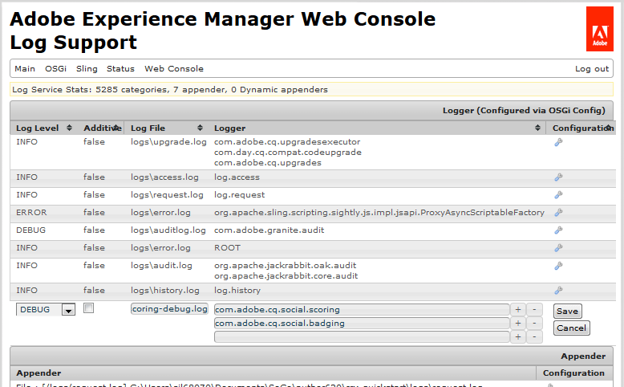
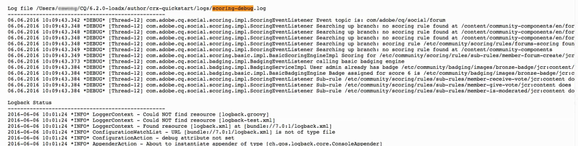
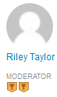
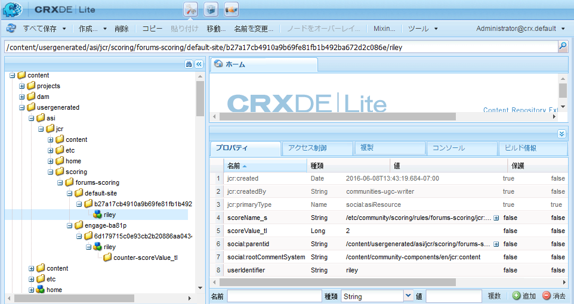
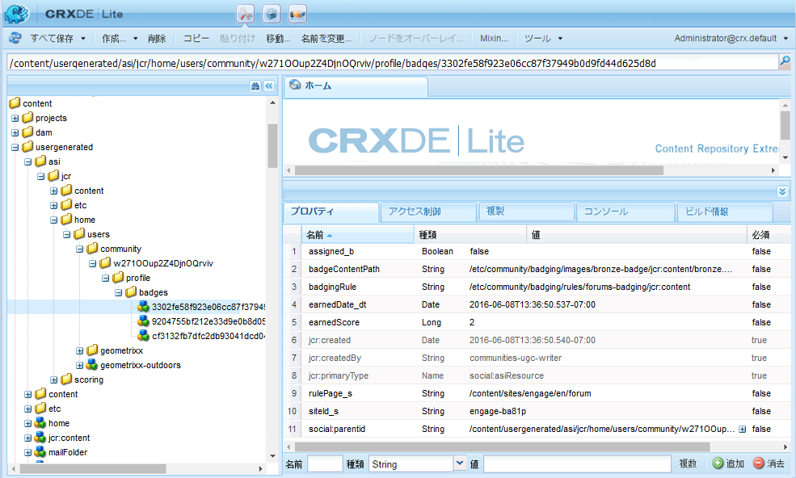
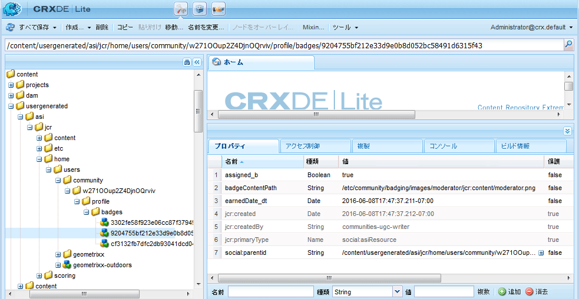

# スコアおよびバッジの基本事項 {#scoring-and-badges-essentials}

AEM Communitiesのスコアリングとバッジ機能では、コミュニティメンバーを識別して報酬を与えます。

この機能の設定の詳細については、を参照してください

* [コミュニティのスコアとバッジ](/help/communities/implementing-scoring.md)

このページには、追加の技術的な詳細が含まれています。

* バッジ [&#128279;](#displaying-badges)を画像またはテキストとして表示する方法
* 広範な[&#x200B; デバッグログ &#x200B;](#debug-log-for-scoring-and-badging)を有効にする方法
* スコアリングとバッジに関連するUGC[&#128279;](#ugc-for-scoring-and-badging)に アクセスする方法

>[!CAUTION]
>
>CRXDE Liteに表示される実装構造は変更される場合があります。

## バッジの表示 {#displaying-badges}

バッジをテキストとして表示するか、画像として表示するかを、HBS テンプレートのクライアント側で制御します。

例えば、`/libs/social/forum/components/hbs/topic/list-item.hbs`で`this.isAssigned`を検索します。

```
{{#each author.badges}}

  {{#if this.isAssigned}}

    <div class="scf-badge-text">

      {{this.title}}

    </div>

  {{/if}}

{{/each}}

{{#each author.badges}}

  {{#unless this.isAssigned}}

    

  {{/unless}}

{{/each}}
```

trueの場合、`isAssigned`は、バッジが役割に割り当てられていることを示します。バッジはテキストとして表示されます。

falseの場合、`isAssigned`は、バッジが獲得スコアに対して授与され、バッジが画像として表示されることを示します。

この動作の変更は、カスタマイズされたスクリプト（オーバーライドまたはオーバーレイ）で行う必要があります。 [&#x200B; クライアントサイドのカスタマイズ &#x200B;](/help/communities/client-customize.md)を参照してください。

## スコアリングとバッジのデバッグログ {#debug-log-for-scoring-and-badging}

スコアリングとバッジのデバッグに役立つように、カスタムログファイルを設定できます。 このログファイルの内容は、機能に問題が発生した場合に、カスタマーサポートに提供される場合があります。

詳細な手順については、[&#x200B; カスタムログファイルの作成](/help/sites-deploying/monitoring-and-maintaining.md#create-a-custom-log-file)を参照してください。

スリングログファイルをすばやく設定するには：

1. 例えば、**Adobe Experience Manager Web Console Log Support**&#x200B;にアクセスします

   * https://localhost:4502/system/console/slinglog

1. **新しいロガーを追加**&#x200B;を選択

   1. **ログレベル**&#x200B;の`DEBUG`を選択

   1. 例えば、**ログファイル**&#x200B;の名前を入力します

      * logs/scoring-debug.log

   1. 2つの&#x200B;**Logger** （クラス）エントリを入力します（`+` アイコンを使用）

      * `com.adobe.cq.social.scoring`
      * `com.adobe.cq.social.badging`

   1. 「**保存**」を選択します



ログエントリを確認するには：

* Web コンソールから

  * **ステータス** メニューの下
  * **ログファイル**&#x200B;を選択
  * ログ ファイル名（`scoring-debug`など）を検索します

* サーバーのローカルディスク上

  * ログファイルは&lt;*server-install-dir*>/crx-quickstart/logs/&lt;*log-file-name*>にあります。

  * 例えば、`.../crx-quickstart/logs/scoring-debug.log` のように指定します。



## スコアリングとバッジ作成のためのUGC {#ugc-for-scoring-and-badging}

選択したSRPがJSRPまたはMSRPのどちらかで、ASRPではない場合、スコアリングとバッジに関連するUGCを表示できます。 （これらの用語に精通していない場合は、[&#x200B; コミュニティコンテンツストレージ &#x200B;](/help/communities/working-with-srp.md)および[&#x200B; ストレージリソースプロバイダーの概要](/help/communities/srp.md)を参照してください）。

UGCには[CRXDE Lite](/help/sites-developing/developing-with-crxde-lite.md)を使用して簡単にアクセスできるため、スコアリングとバッジのデータへのアクセスに関する説明ではJSRPを使用します。

作成者&#x200B;**の** JSRP: オーサー環境で実験すると、オーサー環境からのみ表示されるUGCになります。

**パブリッシュ上のJSRP**：同様に、パブリッシュ環境でテストを行う場合は、パブリッシュインスタンスの管理者権限でCRXDE Liteにアクセスする必要があります。 パブリッシュインスタンスが[実稼動モード &#x200B;](/help/sites-administering/production-ready.md) （nosamplecontent実行モード）で実行されている場合は、[CRXDE Lite](/help/sites-administering/enabling-crxde-lite.md)を有効にする必要があります。

JSRP上のUGCの基本場所は`/content/usergenerated/asi/jcr/`です。

### スコアリングおよびバッジ付けAPI {#scoring-and-badging-apis}

次のAPIを使用できます。

* [6.3のcom.adobe.cq.social.scoring.api](https://experienceleague.adobe.com/docs/experience-manager-release-information/aem-release-updates/previous-updates/aem-previous-versions.html?lang=ja)
* [6.3のcom.adobe.cq.social.badging.api](https://experienceleague.adobe.com/docs/experience-manager-release-information/aem-release-updates/previous-updates/aem-previous-versions.html?lang=ja)

インストールされた機能パックの最新のJavadocsは、Adobe リポジトリから開発者が利用できます。 [Maven for Communitiesの使用：Javadocs](/help/communities/maven.md#javadocs)を参照してください。

**リポジトリ内のUGCの場所と形式は、警告なしで変更される可能性があります**。

### 設定例 {#example-setup}

リポジトリデータのスクリーンショットは、次の2つの異なるAEM サイトでのフォーラムのスコアリングとバッジの設定から得られます。

1. 一意のIDが&#x200B;*のAEM サイト*&#x200B;です（ウィザードを使用して作成されたコミュニティサイト） :

   * [入門チュートリアル &#x200B;](/help/communities/getting-started.md)で作成した入門チュートリアル（エンゲージ）サイトを使用する
   * フォーラムページノードを探す

     `/content/sites/engage/en/forum/jcr:content`

   * スコアリングとバッジのプロパティの追加

   ```
   scoringRules = [/libs/settings/community/scoring/rules/comments-scoring,
   /libs/settings/community/scoring/rules/forums-scoring]
   ```

   ```
   badgingRules =[/libs/settings/community/badging/rules/comments-scoring,
   /libs/settings/community/badging/rules/forums-scoring]
   ```

   * フォーラムコンポーネントノードを探す

     `/content/sites/engage/en/forum/jcr:content/content/primary/forum`
( `sling:resourceType = social/forum/components/hbs/forum`)

   * バッジを表示するには、プロパティを追加します

     `allowBadges = true`

   * ユーザーがログインし、フォーラムのトピックを作成すると、ブロンズバッジが授与されます

1. 一意のIDを&#x200B;*持たないAEM サイト* :

   * [&#x200B; コミュニティコンポーネントガイド &#x200B;](/help/communities/components-guide.md)の使用
   * フォーラムページノードを探す

     `/content/community-components/en/forum/jcr:content`

   * スコアリングとバッジのプロパティの追加

   ```
   scoringRules = [/libs/settings/community/scoring/rules/comments-scoring,
   /libs/settings/community/scoring/rules/forums-scoring]
   ```

   ```
   badgingRules =[/libs/settings/community/badging/rules/comments-badging,
   /libs/settings/community/badging/rules/forums-badging]
   ```

   * フォーラムコンポーネントノードを探す

     `/content/community-components/en/forum/jcr:content/content/forum`
( `sling:resourceType = social/forum/components/hbs/forum`)

   * バッジを表示するには、プロパティを追加します

     `allowBadges = true`

   * ユーザーがログインし、フォーラムのトピックを作成すると、ブロンズバッジが授与されます

1. ユーザーには、cURLを使用してモデレーターバッジが割り当てられます。

   ```shell
   curl -i -X POST -H "Accept:application/json" -u admin:admin -F ":operation=social:assignBadge" -F "badgeContentPath=/libs/settings/community/badging/images/moderator/jcr:content/moderator.png" https://localhost:4503/home/users/community/w271OOup2Z4DjnOQrviv/profile.social.json
   ```

   ユーザーが2つのブロンズバッジを獲得し、モデレーターのバッジを授与されたため、ユーザーは次のフォーラムエントリで表示されます。

   

>[!NOTE]
>
>この例は、次のベストプラクティスに従っていません。
>
>* スコアリングルール名はグローバルに一意である必要があります。同じ名前で終わってはいけません。
>
>  *not*&#x200B;の例：
>
>  /libs/settings/community/scoring/rules/site1/forums-scoring
>  /libs/settings/community/scoring/rules/site2/forums-scoring
>
>* さまざまなAEM サイト用に独自のバッジ画像を作成する

### アクセススコアリング UGC {#access-scoring-ugc}

[API](#scoring-and-badging-apis)の使用をお勧めします。

調査目的では、例としてJSRPを使用すると、スコアを含むベースフォルダーは

* `/content/usergenerated/asi/jcr/scoring`

`scoring`の子ノードはスコアリングルール名です。 したがって、サーバー上のスコアリングルール名はグローバルに一意であることがベストプラクティスです。

Geometrixx Engage サイトの場合、ユーザーとそのスコアは、スコアリングルール名、コミュニティサイトのサイト ID （`engage-ba81p`）、一意のID、およびユーザーのIDで構築されたパスにあります。

* `.../scoring/forums-scoring/engage-ba81p/6d179715c0e93cb2b20886aa0434ca9b5a540401/riley`

コミュニティコンポーネントガイドサイトの場合、ユーザーとそのスコアは、スコアリングルール名、デフォルト ID （`default-site`）、一意のID、およびユーザーのIDで構築されたパスにあります。

* `.../scoring/forums-scoring/default-site/b27a17cb4910a9b69fe81fb1b492ba672d2c086e/riley`

スコアはプロパティ `scoreValue_tl`に保存されます。このプロパティには、値のみを含めるか、atomicCounterを間接的に参照している可能性があります。



### バッジ UGCへのアクセス {#access-badging-ugc}

[API](#scoring-and-badging-apis)の使用をお勧めします。

調査のために、例えばJSRPを使用すると、割り当てられたバッジまたは授与されたバッジに関する情報を含むベースフォルダーは

* `/content/usergenerated/asi/jcr`

ユーザーのプロファイルへのパスが続き、次のようなバッジフォルダーで終わります。

* `/home/users/community/w271OOup2Z4DjnOQrviv/profile/badges`

#### 授与バッジ {#awarded-badge}



#### 割り当て済みバッジ {#assigned-badge}



## 追加情報 {#additional-information}

ポイントに基づいてメンバーのソートされたリストを表示するには、次の手順に従います。

* コミュニティサイトまたはグループテンプレートに含めるための[&#x200B; リーダーボード関数](/help/communities/functions.md#leaderboard-function)。
* ページのオーサリング用に、リーダーボード関数の注目のコンポーネント [&#x200B; リーダーボード コンポーネント &#x200B;](/help/communities/enabling-leaderboard.md)。
