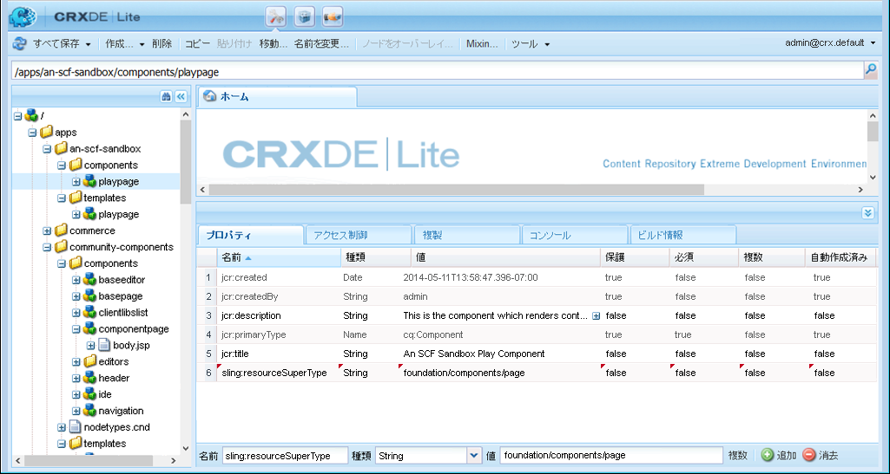
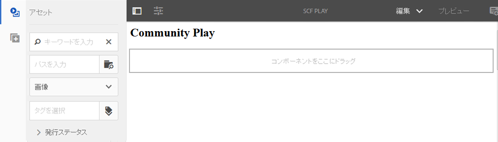
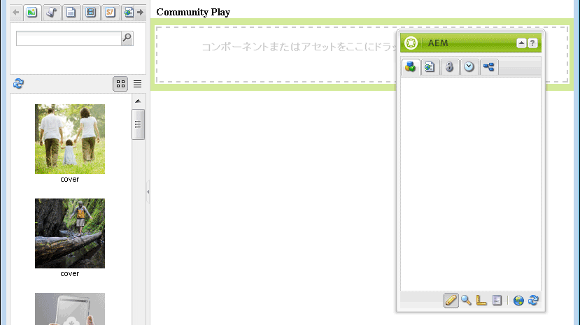

# サンドボックスアプリケーションの開発  {#develop-sandbox-application}

この節では、[初期アプリケーション ](initial-app.md) セクションでテンプレートが設定され、[初期コンテンツ ](initial-content.md) セクションで最初のページが確立されたので、アプリケーションを開発できます。 これには、Communities コンポーネントでオーサリングを有効にする機能を含む基盤スクリプトを使用します。 このセクションの最後には、機能的に動作するweb サイトが表示されます。

## 基礎ページスクリプトの使用 {#using-foundation-page-scripts}

再生ページテンプレートをレンダリングするコンポーネントが追加されたときに作成されたデフォルトのスクリプトは、基礎ページのhead.jspとローカル body.jspを含むように変更されます。

### スーパーリソースタイプ {#super-resource-type}

最初の手順は、リソースのスーパータイプ プロパティを`/apps/an-scf-sandbox/components/playpage` ノードに追加して、スーパータイプのスクリプトとプロパティを継承できるようにすることです。

CRXDE Liteの使用：

1. ノード `/apps/an-scf-sandbox/components/playpage`を選択します。
1. 「プロパティ」タブで、次の値を持つ新しいプロパティを入力します。

   名前：`sling:resourceSuperType`

   タイプ：`String`

   値：`foundation/components/page`

1. 緑色の「**[!UICONTROL +追加]**」ボタンをクリックします。
1. 「**[!UICONTROL すべて保存]**」をクリックします。

   

### Head スクリプトとbody スクリプト {#head-and-body-scripts}

1. **CRXDE Lite**&#x200B;のエクスプローラーパネルで、`/apps/an-scf-sandbox/components/playpage`に移動し、ファイル `playpage.jsp`をダブルクリックして編集パネルで開きます。

   `/apps/an-scf-sandbox/components/playpage/playpage.jsp`

   ```xml
   <%--
   
     An SCF Sandbox Play Component component.
   
     This is the component which renders content for An SCF Sandbox page.
   
   --%><%
   %><%@include file="/libs/foundation/global.jsp"%><%
   %><%@page session="false" %><%
   %><%
    // TODO add your code here
   %>
   ```

1. 開く/閉じるスクリプトタグを認識している場合は、「// TODO ...」を置き換えます。 &lt;html>の頭と体の部分に`includes`個のスクリプトを含む。

   スーパータイプが`foundation/components/page`の場合、同じフォルダーで定義されていないスクリプトは、`/apps/foundation/components/page` フォルダーのスクリプト （存在する場合）に解決されるか、または`/libs/foundation/components/page` フォルダーのスクリプトに解決されます。

   `/apps/an-scf-sandbox/components/playpage/playpage.jsp`

   ```xml
   <%--
   
       An SCF Sandbox Play Component component: playpage.jsp
   
     This is the component which renders content for An SCF Sandbox page.
   
   --%><%
   %><%@include file="/libs/foundation/global.jsp"%><%
   %><%@page session="false" %>
   <html>
     <cq:include script="head.jsp"/>
     <cq:include script="body.jsp"/>
   </html>
   ```

1. 基礎スクリプト `head.jsp`をオーバーレイする必要はありませんが、基礎スクリプト `body.jsp`は空です。

   オーサリング用に設定するには、`body.jsp`をローカルスクリプトとオーバーレイし、本文に段落システム（parsys）を含めます。

   1. `/apps/an-scf-sandbox/components` に移動します。
   1. `playpage` ノードを選択します。
   1. 右クリックして「`Create > Create File...`」を選択します

      * 名前：**body.jsp**

   1. 「**[!UICONTROL すべて保存]**」をクリックします。

   `/apps/an-scf-sandbox/components/playpage/body.jsp`を開き、次のテキストに貼り付けます：

   ```xml
   <%--
   
       An SCF Sandbox Play Component component: body.jsp
   
     This is the component which renders content for An SCF Sandbox page.
   
   --%><%
   %><%@include file="/libs/foundation/global.jsp"%><%
   %><%@page session="false" %>
   <body>
       <h2>Community Play</h2>
       <cq:include path="par" resourceType="foundation/components/parsys" />
   </body>
   ```

1. 「**[!UICONTROL すべて保存]**」をクリックします。

**編集モードでブラウザーでページを表示：**

* 標準UI: `http://localhost:4502/editor.html/content/an-scf-sandbox/en/play.html`

見出し&#x200B;**コミュニティプレイ**&#x200B;だけでなく、ページコンテンツを編集するためのUIも表示する必要があります。

Assets/コンポーネントのサイドパネルは、サイドパネルを両方とも開き、サイドコンテンツとページコンテンツの両方を表示するのに十分な幅でウィンドウが開いている場合に表示されます。



* クラシック UI：`http://localhost:4502/cf#/content/an-scf-sandbox/en/play.html`

次に、コンテンツファインダー（cf）を含むクラシック UIでの再生ページの表示方法を示します。



## コミュニティコンポーネント {#communities-components}

オーサリング用にCommunities コンポーネントを有効にするには、まず次の手順に従います。

* [Communities コンポーネントへのアクセス](basics.md#accessing-communities-components)

このサンドボックスの目的では、次の&#x200B;**Communities** コンポーネントから開始します（チェックボックスをオンにすることで有効にします）。

* コメント
* フォーラム
* レーティング
* レビュー
* レビューの概要 (表示)
* 投票

さらに、次のような&#x200B;**[!UICONTROL 一般]** コンポーネントを選択します

* 画像
* テーブル
* テキスト
* タイトル（基礎）

>[!NOTE]
>
>ページ部分に対して有効になっているコンポーネントは、の`components` プロパティの値としてリポジトリに保存されます
>
>ノード `/etc/designs/an-scf-sandbox/jcr:content/playpage/par`。

## ランディングページ {#landing-page}

多言語環境では、ルートページには、クライアントからのリクエストを解析して優先言語を決定するスクリプトが含まれます。

この例では、ルートページは英語ページにリダイレクトするように静的に設定されています。将来的には、再生ページへのリンクを含むメインランディングページとして開発される可能性があります。

ブラウザーURLをルートページに変更します：`http://localhost:4502/editor.html/content/an-scf-sandbox.html`

* ページ情報アイコンを選択します
* 「**[!UICONTROL プロパティを開く]**」を選択
* 「詳細」タブの

  * リダイレクトエントリについては、**[!UICONTROL Web サイト]** > **[!UICONTROL SCF サンドボックスサイト]** > **[!UICONTROL SCF サンドボックス]**&#x200B;を参照してください
  * **[!UICONTROL OK]**&#x200B;をクリック

* **[!UICONTROL OK]**&#x200B;をクリック

サイトが公開された後、パブリッシュインスタンスでルートページを参照すると、英語ページにリダイレクトされます。

Communities SCF コンポーネントを再生する前の最後の手順は、クライアントライブラリフォルダー（clientlibs）。...[Clientlibsの追加](add-clientlibs.md)です
