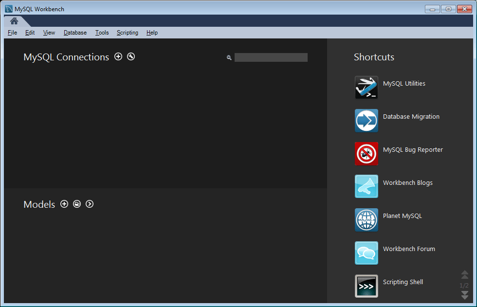
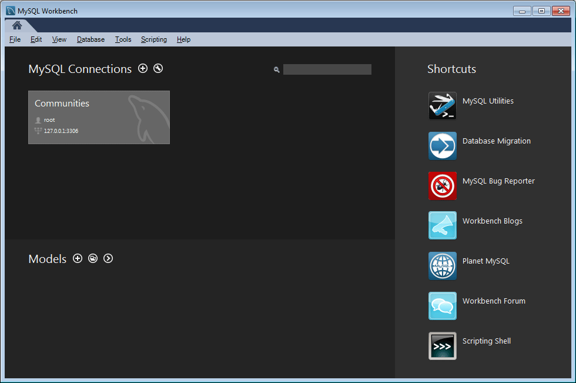
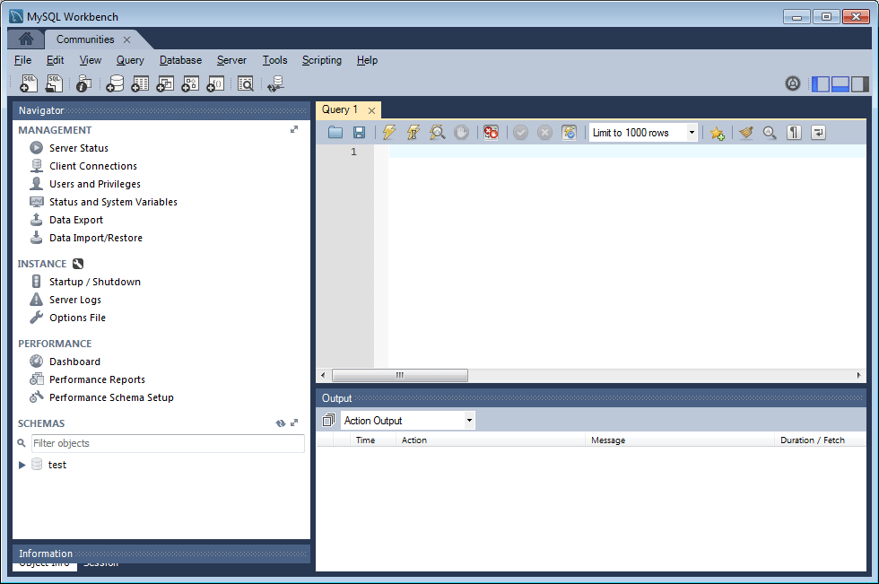
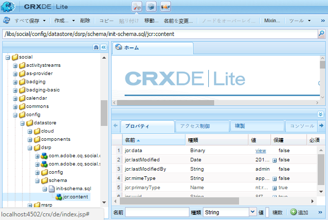
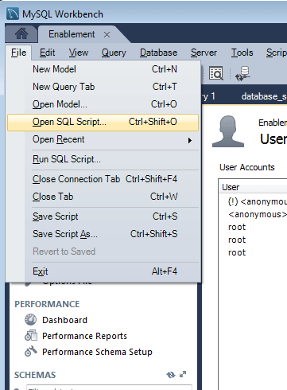
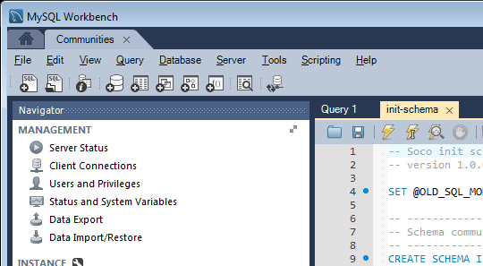
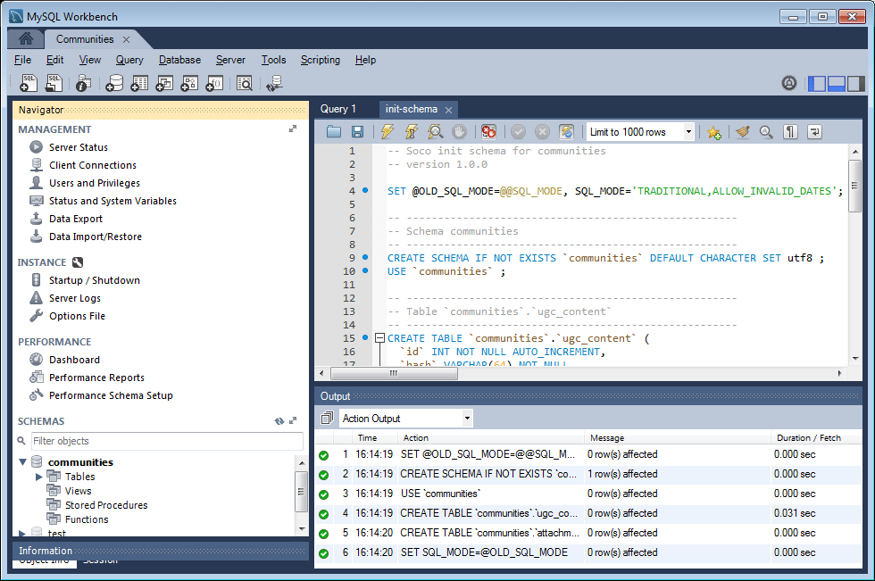
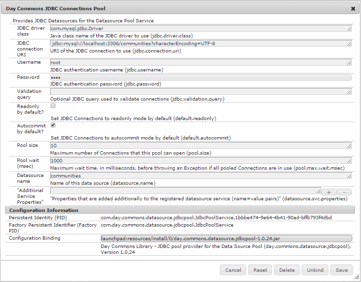

# DSRP 向け MySQL 設定 {#mysql-configuration-for-dsrp}

MySQLは、ユーザー生成コンテンツ（UGC）を保存するために使用できるリレーショナルデータベースです。

これらの手順では、MySQL サーバーに接続し、UGC データベースを確立する方法について説明します。

## 要件 {#requirements}

* [最新のコミュニティ機能パック](deploy-communities.md#latestfeaturepack)
* [MySQL用JDBC ドライバー](deploy-communities.md#jdbc-driver-for-mysql)
* リレーショナルデータベース：

  * [MySQL Server](https://dev.mysql.com/downloads/mysql/) Community Server バージョン 5.6以降

    * AEMと同じホストで実行するか、リモートで実行する可能性があります

  * [MySQL Workbench](https://dev.mysql.com/downloads/tools/workbench/)

## MySQLのインストール {#installing-mysql}

ターゲット OSの指示に従って、[MySQL](https://dev.mysql.com/downloads/mysql/)をダウンロードしてインストールする必要があります。

### 小文字のテーブル名 {#lower-case-table-names}

SQLでは大文字と小文字が区別されないため、大文字と小文字が区別されるオペレーティングシステムでは、すべてのテーブル名を小文字に設定する必要があります。

例えば、Linux OS上のすべての小文字のテーブル名を指定するには、次の手順を実行します。

* ファイル `/etc/my.cnf`を編集
* `[mysqld]` セクションに、次の行を追加します。

  `lower_case_table_names = 1`

### UTF8文字セット {#utf-character-set}

より優れた多言語サポートを提供するには、UTF8文字セットを使用する必要があります。

MySQLをUTF8を文字セットとして使用するように変更します。

* mysql > SET NAMES &#39;utf8&#39;;

MySQL データベースをデフォルトのUTF8に変更します。

* ファイル `/etc/my.cnf`を編集
* `[client]` セクションに、次の行を追加します。

  `default-character-set=utf8`

* `[mysqld]` セクションに、次の行を追加します。

  `character-set-server=utf8`

## MySQL Workbenchのインストール {#installing-mysql-workbench}

MySQL Workbenchには、スキーマと初期データをインストールするSQL スクリプトを実行するためのUIが用意されています。

MySQL Workbenchは、ターゲット OSの指示に従ってダウンロードおよびインストールする必要があります。

## Communities Connection {#communities-connection}

MySQL Workbenchが最初に起動された場合、他の目的で既に使用されていない限り、まだ接続は表示されません。

### 新しい接続設定 {#new-connection-settings}

1. `MySQL Connections`の右側にある`+` アイコンを選択します。
1. ダイアログ `Setup New Connection`で、プラットフォームに適した値を入力します

   デモ用に、オーサーのAEM インスタンスとMySQLを同じサーバー上に置きます。

   * 接続名：`Communities`
   * 接続方法：`Standard (TCP/IP)`
   * ホスト名：`127.0.0.1`
   * ユーザー名：`root`
   * パスワード：`no password by default`
   * 既定のスキーマ：`leave blank`

1. 実行中のMySQL サービスへの接続を確認するには、`Test Connection`を選択します

**メモ**:

* 既定のポートは`3306`です
* 選択した接続名は、[JDBC OSGi設定](#configurejdbcconnections)のデータソース名として入力されます

#### 新しいコミュニティ接続 {#new-communities-connection}

## データベース設定 {#database-setup}

Communities接続を開いて、データベースをインストールします。

### SQL スクリプトの取得 {#obtain-the-sql-script}

SQL スクリプトは、AEM リポジトリから取得されます。

1. CRXDE Liteを参照

   * 例：[http://localhost:4502/crx/de](http://localhost:4502/crx/de)

1. /libs/social/config/datastore/dsrp/schema フォルダーを選択します
1. `init-schema.sql`をダウンロード

   

スキーマをダウンロードする方法の1つは、次のとおりです。

* Sql ファイルの`jcr:content` ノードを選択します
* `jcr:data` プロパティの値がビューリンクであることに注意してください

* 表示リンクを選択して、データをローカルファイルに保存します

### DSRP データベースの作成 {#create-the-dsrp-database}

データベースをインストールするには、次の手順に従います。 データベースのデフォルト名は`communities`です。

スクリプトでデータベース名が変更された場合は、[JDBC設定](#configurejdbcconnections)でも変更してください。

#### 手順1:SQL ファイルを開く {#step-open-sql-file}

MySQL Workbenchの

* ファイル プルダウンメニューから、**[!UICONTROL SQL スクリプトを開く]** オプションを選択します
* ダウンロードした`init_schema.sql` スクリプトを選択

#### 手順2:SQL スクリプトの実行 {#step-execute-sql-script}

手順1で開いたファイルのWorkbench ウィンドウで、`lightening (flash) icon`を選択してスクリプトを実行します。

次の画像では、`init_schema.sql` ファイルを実行する準備ができています。

#### 更新 {#refresh}

スクリプトが実行されたら、`Navigator`の`SCHEMAS` セクションを更新して、新しいデータベースを確認する必要があります。 「スキーマ」の右側にある更新アイコンを使用します。

## JDBC接続の設定 {#configure-jdbc-connection}

**Day Commons JDBC Connections Pool**&#x200B;のOSGi設定では、MySQL JDBC ドライバーが設定されます。

すべてのパブリッシュおよびオーサーAEM インスタンスは、同じMySQL サーバーを指している必要があります。

MySQLがAEMとは異なるサーバーで実行される場合、JDBC コネクタの「localhost」の代わりにサーバーホスト名を指定する必要があります。

* AEMのインスタンスをパブリッシュします。
* 管理者権限でログイン。
* [web コンソール &#x200B;](../../help/sites-deploying/configuring-osgi.md)にアクセスします。

  * 例：[http://localhost:4502/system/console/configMgr](http://localhost:4502/system/console/configMgr)

* `Day Commons JDBC Connections Pool`を探します
* 接続設定を作成するには、`+` アイコンを選択します。

  

* 以下の値を入力します。

  * **[!UICONTROL JDBC ドライバークラス]**: `com.mysql.jdbc.Driver`
  * **[!UICONTROL JDBC接続URI]**: `jdbc:mysql://localhost:3306/communities?characterEncoding=UTF-8`

    MySQL サーバーが「this」のAEM サーバー&#x200B;*communities*&#x200B;と同じでない場合は、localhostの代わりにサーバーを指定します。これは、デフォルトのデータベース （スキーマ）名です。

  * **[!UICONTROL ユーザー名]**: `root`

    または、MySQL サーバー用に設定されたユーザー名（「root」でない場合）を入力します。

  * **[!UICONTROL パスワード]**:

    MySQLにパスワードが設定されていない場合は、このフィールドをクリアします。

    または、MySQL ユーザー名に設定されたパスワードを入力します。

  * **[!UICONTROL データソース名]**: [MySQL接続](#new-connection-settings)に入力された名前（例：「コミュニティ」）。

* 「**[!UICONTROL 保存]**」を選択します
