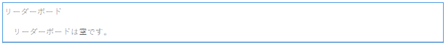
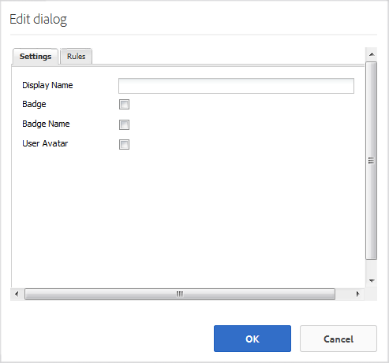

# リーダーボード機能 {#leaderboard-feature}

## はじめに {#introduction}

`Leaderboard` コンポーネントは、獲得したポイント（基本スコアリング）または専門知識（高度なスコアリング）に基づいてメンバーをランク付けすることで、メンバーがコミュニティ内でどのように操作しているのかを把握するのに役立ちます。

ページにリーダーボードコンポーネントを含める前に、[&#x200B; コミュニティのスコアリングとバッジ &#x200B;](/help/communities/implementing-scoring.md)を設定する必要があります。

この節では、次の内容について説明します。

* `Leaderboard` コンポーネントを[&#x200B; コミュニティサイト &#x200B;](/help/communities/overview.md#community-sites)に追加しています。
* `Leaderboard` コンポーネントの構成設定。

### ページへのリーダーボードの追加 {#adding-a-leaderboard-to-a-page}

作成者モードでページに`Leaderboard` コンポーネントを追加するには、コンポーネントを見つけます

* `Communities / Leaderboard`

ページ上の所定の位置にドラッグします。

必要な情報については、[&#x200B; コミュニティコンポーネントの基本](/help/communities/basics.md)を参照してください。

最初にコミュニティサイトのページに配置した場合、コンポーネントは次のように表示されます。

### リーダーボードの設定 {#configuring-leaderboard}

配置された`Leaderboard` コンポーネントを選択して、編集ダイアログを開く`Configure` アイコンにアクセスして選択できるようにします。

#### 「設定」タブ {#settings-tab}

「**[!UICONTROL 設定]**」タブで、メンバーに関連する情報を指定します。

* **表示名**

  ボードに表示する記述的な名前。バッジとスコアの表示に選択したルールを反映しています。
  何も入力されていない場合、デフォルトは`Leaderboard`です。

* **バッジ**

  チェックを入れると、バッジアイコンの列がリーダーボードに表示されます。
  デフォルトはオフです。

* **バッジ名**

  オンにすると、バッジ名の列がリーダーボードに含まれます。
  デフォルトはオフです。

* **アバターを使用**

  オンにすると、メンバーのアバター画像が、メンバープロファイルへの名前リンクの横にあるリーダーボードに含まれます。
  デフォルトはオフです。

#### 「ルール」タブ {#rules-tab}

「**ルール**」タブの下に、コミュニティサイト、およびそのスコアリングとバッジングルールがあります

* **ルールの場所**

  （必須）スコアリング / バッジルールが設定されている場所。

* **スコアリングルール**

  （必須）表示するスコアを生成する特定のルール。

* **バッジングルール**

  （必須）表示するバッジを生成する特定のルール。

* **表示制限**

  ページごとに表示するメンバーの数。 初期設定は 10 です。

### 例：参加者のリーダーボード {#example-participants-leaderboard}

このリーダーボードは、基本的なスコアリングルールを適用した結果をレポートします。

リーダーボードコンポーネントの設定：

* 「設定」タブ：

  * 表示名= `Participation Board`
  * `checked`：

    * バッジ
    * バッジ名
    * アバターを使用

* 「ルール」タブ：

  * ルールの場所= `/content/sites/<site name>/jcr:content`
  * スコアリングルール = `/libs/settings/community/scoring/rules/forums-scoring`
  * バッジルール = `/libs/settings/community/badging/rules//reference-badging`
  * 表示制限= `10`

### 例：エキスパートリーダーボード {#example-experts-leaderboard}

このリーダーボードは、高度なスコアリングルールを適用した結果をレポートします。

リーダーボードコンポーネントの設定：

* 「設定」タブ：

  * 表示名= `Expertise Board`
  * `checked`：

    * バッジ
    * アバターを使用

* 「ルール」タブ：

  * ルールの場所= `/content/sites/<site name>/jcr:content`
  * スコアリングルール = `/libs/settings/community/scoring/rules/adv-forums-scoring`
  * バッジルール = `/libs/settings/community/badging/rules/adv-forums-badging`
  * 表示制限= `10`

### 追加情報 {#additional-information}

詳細については、開発者向けの[Leaderboard Essentials](/help/communities/leaderboard.md) ページを参照してください。

ルールを作成する方法については、管理者向けの[&#x200B; コミュニティのスコアリングとバッジ &#x200B;](/help/communities/implementing-scoring.md) ページを参照してください。
