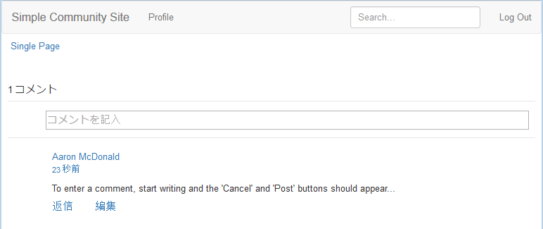

# 外観の変更（HBS） {#alter-the-appearance-hbs}

アプリケーションディレクトリ（/apps）のカスタムコメントシステムのコンポーネントが配置され、resourceSuperTypeがデフォルトのコメントシステムを参照し、カスタムモデル/ビューが登録されたので、実装を編集できます。

簡単なデモでは、ビジュアル機能である、コメントを投稿したサインインユーザーのアバターが削除されます。

>[!NOTE]
>
>この拡張機能を使用するには、影響を受けるweb サイト内のコメントシステムのインスタンス（/content）が、そのresourceTypeをカスタムコメントシステムに設定する必要があります。

## HBS スクリプトの変更 {#modify-the-hbs-scripts}

[CRXDE Lite](/help/sites-developing/developing-with-crxde-lite.md)を使用：

* [/apps/custom/components/comments/comment/**comment.hbs**](https://localhost:4502/crx/de/index.jsp#/apps/custom/components/comments/comment/comment.hbs)を開きます

  * コメント投稿（～ 21行目）のアバターを含むタグをコメントアウトします。

    ```
      <!--
       <</img>
       -->
    ```

* [/apps/custom/components/comments/**comments.hbs**](https://localhost:4502/crx/de/index.jsp#/apps/custom/components/comments/comments.hbs)を開きます

  * 次のコメントエントリ（～ 44行目）のアバターを含むタグをコメントアウトします。

    ```
      <!--
       </img>
       -->
    ```

* **すべて保存**&#x200B;を選択

### カスタムアプリのレプリケート {#replicate-custom-app}

アプリケーションを変更した後、カスタムコンポーネントを再レプリケートする必要があります。

そのひとつの方法は次のとおりです。

* メインメニューから

  * **[!UICONTROL ツール]** > **[!UICONTROL 操作]** > **[!UICONTROL レプリケーション]**&#x200B;を選択します。
  * 「**[!UICONTROL ツリーをアクティブ化]**」を選択します。
  * `Start Path`を`/apps/custom`に設定します。
  * **[!UICONTROL 変更済みのみ]**&#x200B;の選択を解除します。
  * 「**[!UICONTROL アクティブ化]**」ボタンを選択します。

### 公開したサンプルページに対する変更されたコメントの表示 {#view-modified-comment-on-published-sample-page}

[&#x200B; パブリッシュインスタンスでエクスペリエンス &#x200B;](/help/communities/extend-sample-page.md#publish-sample-page)を続行し、同じユーザーとしてサインインしたまま、パブリッシュ環境でページを更新して、アバターを削除するための変更を表示できるようになりました。



### コメント拡張機能パッケージのサンプル {#sample-comment-extension-package}

このチュートリアルで作成したカスタムコメントアプリケーションのパッケージが添付されています。

[ファイルの取得](assets/sample-comment-extension-6-1-fp3.zip)
