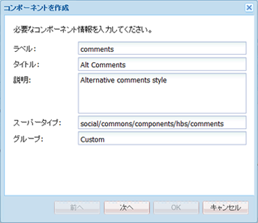
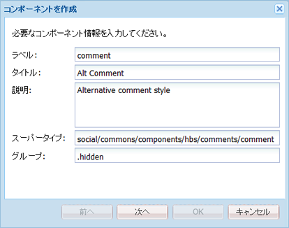
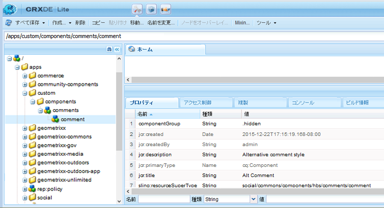
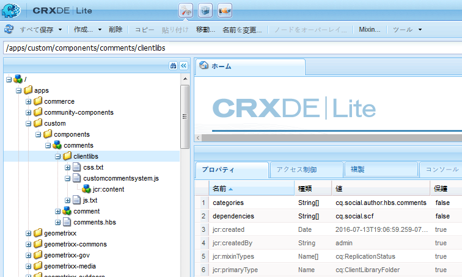

# コンポーネントの作成  {#create-the-components}

コンポーネントを拡張する例では、2つのコンポーネントで構成されるコメントシステムを使用します。

* コメント – ページ上に配置されたコンポーネントを含むコメントシステム。
* コメント – 投稿されたコメントのインスタンスをキャプチャするコンポーネント。

投稿されたコメントの外観をカスタマイズする場合は、両方のコンポーネントを配置する必要があります。

>[!NOTE]
>
>サイトページごとに1つのコメントシステムのみが許可されます。
>
>多くのコミュニティ機能には、既に拡張コメントシステムを参照するようにresourceTypeを変更できるコメントシステムが含まれています。

## コメントコンポーネントの作成 {#create-the-comments-component}

これらの指示は、`.hidden`以外の&#x200B;**グループ**&#x200B;値を指定するため、コンポーネントはコンポーネントブラウザー（サイドキック）から利用できるようになります。

自動作成されたJSP ファイルの削除は、代わりにデフォルトのHBS ファイルが使用されるためです。

1. **CRXDE|Lite** （[http://localhost:4502/crx/de/index.jsp](http://localhost:4502/crx/de/index.jsp)）を参照します

1. カスタムアプリケーションの場所を作成します。

   * `/apps` ノードを選択

     * **フォルダーを作成** （**[!UICONTROL カスタム]**）

   * `/apps/custom` ノードを選択

     * **フォルダーを作成** （**[!UICONTROL コンポーネント]**）

1. `/apps/custom/components` ノードを選択

   * **[!UICONTROL 作成> コンポーネント…]**

     * **ラベル**: *コメント*
     * **タイトル**: *代替コメント*
     * **説明**: *代替コメント スタイル*
     * **スーパータイプ**: *ソーシャル/コモンズ/コンポーネント/hbs/コメント*
     * **グループ**: *カスタム*

   * **[!UICONTROL 次へ]**&#x200B;を選択
   * **[!UICONTROL 次へ]**&#x200B;を選択
   * **[!UICONTROL 次へ]**&#x200B;を選択
   * 「**[!UICONTROL OK]**」を選択します。

1. 作成されたノードを展開します：`/apps/custom/components/comments`
1. **[!UICONTROL すべて保存]**&#x200B;を選択
1. `comments.jsp`を右クリック
1. 「**[!UICONTROL 削除]**」を選択します。
1. **[!UICONTROL すべて保存]**&#x200B;を選択



### 子コメントコンポーネントの作成 {#create-the-child-comment-component}

親コンポーネントのみをページに含める必要があるため、これらの指示は&#x200B;**グループ**&#x200B;から`.hidden`に設定されます。

自動作成されたJSP ファイルの削除は、代わりにデフォルトのHBS ファイルが使用されるためです。

1. `/apps/custom/components/comments` ノードに移動します
1. ノードを右クリックします

   * **[!UICONTROL 作成]** / **[!UICONTROL コンポーネントを選択…]**

     * **ラベル**: *コメント*
     * **タイトル**: *代替コメント*
     * **説明**: *代替コメントスタイル*
     * **スーパータイプ**: *ソーシャル/コモンズ/コンポーネント/hbs/コメント/コメント*
     * **グループ**：`*.hidden*`

   * **[!UICONTROL 次へ]**&#x200B;を選択
   * **[!UICONTROL 次へ]**&#x200B;を選択
   * **[!UICONTROL 次へ]**&#x200B;を選択
   * 「**[!UICONTROL OK]**」を選択します。

1. 作成されたノードを展開します：`/apps/custom/components/comments/comment`
1. **[!UICONTROL すべて保存]**&#x200B;を選択
1. `comment.jsp`を右クリック
1. 「**[!UICONTROL 削除]**」を選択します。
1. **[!UICONTROL すべて保存]**&#x200B;を選択





### デフォルトのHBS スクリプトのコピーと変更 {#copy-and-modify-the-default-hbs-scripts}

[CRXDE Lite](../../help/sites-developing/developing-with-crxde-lite.md)を使用：

* コピー `comments.hbs`

  * [/libs/social/commons/components/hbs/comments](http://localhost:4502/crx/de/index.jsp#/libs/social/commons/components/hbs/comments)から
  * [/apps/custom/components/comments](http://localhost:4502/crx/de/index.jsp#/apps/custom/components/comments)へ

* `comments.hbs`を編集：

  * `data-scf-component`属性の値を変更します（～20行目）:

    * `social/commons/components/hbs/comments`から
    * `/apps/custom/components/comments`へ

  * カスタムコメントコンポーネント（～75行目）を含めるように変更します。

    * `{{include this resourceType='social/commons/components/hbs/comments/comment'}}`を置換
    * `{{include this resourceType='/apps/custom/components/comments/comment'}}`様と

* コピー `comment.hbs`

  * [/libs/social/commons/components/hbs/comments/comment](http://localhost:4502/crx/de/index.jsp#/libs/social/commons/components/hbs/comments/comment)から
  * [/apps/custom/components/comments/comment](http://localhost:4502/crx/de/index.jsp#/apps/custom/components/comments/comment)へ

* `comment.hbs`を編集：

  * data-scf-component属性の値を変更します（～ 19行目）

    * `social/commons/components/hbs/comments/comment`から
    * `/apps/custom/components/comments/comment`へ

* `/apps/custom` ノードを選択
* **[!UICONTROL すべて保存]**&#x200B;を選択

## クライアントライブラリフォルダーの作成 {#create-a-client-library-folder}

このクライアントライブラリを含める必要がないように、デフォルトのコメントシステムのclientlibのカテゴリ値を使用できます（`cq.social.author.hbs.comments`）。 ただし、このclientlibは、デフォルトコンポーネントのすべてのインスタンスにも含める必要があります。

[CRXDE Lite](../../help/sites-developing/developing-with-crxde-lite.md)を使用：

* `/apps/custom/components/comments` ノードを選択
* 「**[!UICONTROL ノードを作成]**」を選択

  * **名前**：`clientlibs`
  * **型**：`cq:ClientLibraryFolder`
  * 「**[!UICONTROL プロパティ]**」タブに追加：

    * **名前** `categories` **種類** `String` **値** `cq.social.author.hbs.comments` `Multi`
    * **名前** `dependencies` **種類** `String` **値** `cq.social.scf` `Multi`

* **[!UICONTROL すべて保存]**&#x200B;を選択
* `/apps/custom/components/comments/clientlib`s ノードを選択した状態で、次の3つのファイルを作成します。

  * **名前**：`css.txt`
  * **名前**：`js.txt`
  * **名前**: customcommentsystem.js

* &#39;customcommentsystem.js&#39;を`js.txt`のコンテンツとして入力してください
* **[!UICONTROL すべて保存]**&#x200B;を選択



## SCF モデルとビューの登録 {#register-the-scf-model-view}

SCF コンポーネントを拡張（オーバーライド）する場合、resourceTypeは異なります（オーバーレイでは、`/libs`の前に`/apps`を検索する相対検索メカニズムを使用して、resourceTypeが同じままになります）。 そのため、（クライアントライブラリで）JavaScriptを記述して、SCF JS モデルを登録し、カスタム resourceTypeのビューを表示する必要があります。

次のテキストを`customcommentsystem.js`の内容として入力します。

### customcommentsystem.js {#customcommentsystem-js}

```xml
(function($CQ, _, Backbone, SCF) {
    "use strict";

    var CustomComment = SCF.Components["social/commons/components/hbs/comments/comment"].Model;
    var CustomCommentView = SCF.Components["social/commons/components/hbs/comments/comment"].View;

    var CustomCommentSystem = SCF.Components["social/commons/components/hbs/comments"].Model;
    var CustomCommentSystemView = SCF.Components["social/commons/components/hbs/comments"].View;

    SCF.registerComponent('/apps/custom/components/comments/comment', CustomComment, CustomCommentView);
    SCF.registerComponent('/apps/custom/components/comments', CustomCommentSystem, CustomCommentSystemView);

})($CQ, _, Backbone, SCF);
```

* **[!UICONTROL すべて保存]**&#x200B;を選択

## アプリを公開 {#publish-the-app}

パブリッシュ環境で拡張コンポーネントを使用するには、カスタムコンポーネントをレプリケートする必要があります。

そのひとつの方法は次のとおりです。

* グローバルナビゲーションから，

  * **[!UICONTROL ツール]**/**[!UICONTROL デプロイメント]**/**[!UICONTROL レプリケーション]**&#x200B;を選択します
  * 「**[!UICONTROL ツリーをアクティブ化]**」を選択
  * `Start Path` を `/apps/custom` に設定
  * 「**[!UICONTROL 変更済みのみ]**」のチェックを外します
  * 「**[!UICONTROL アクティブ化]**」ボタンを選択
