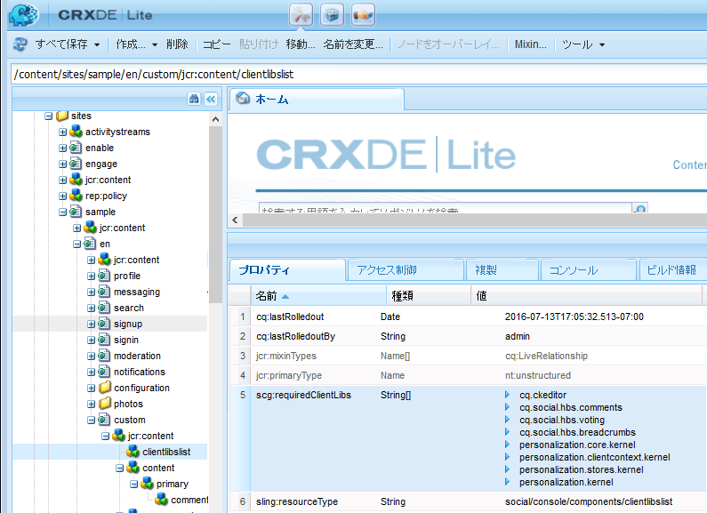
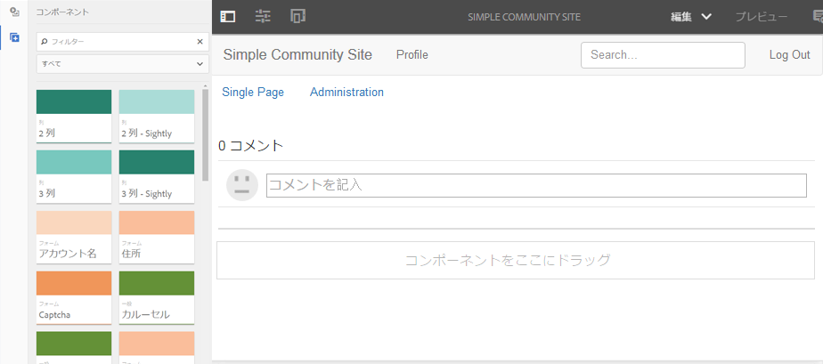
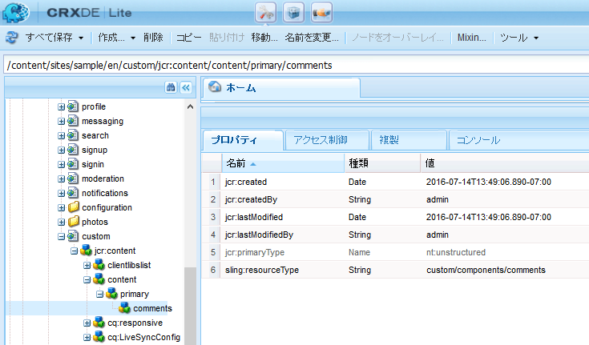
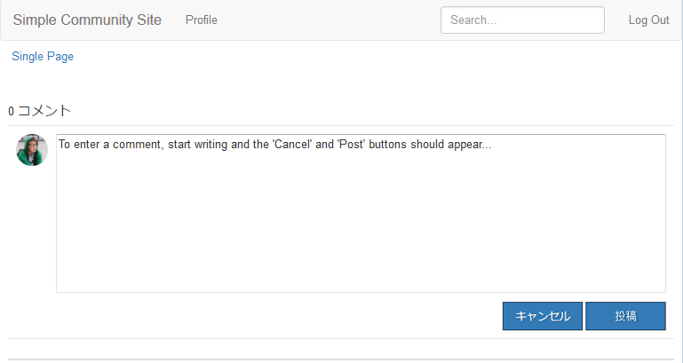
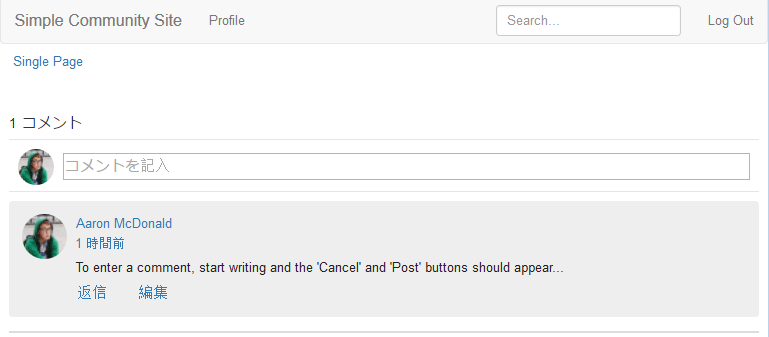

# サンプルページへのコメントの追加  {#add-comment-to-sample-page}

カスタムコメントシステムのコンポーネントがアプリケーションディレクトリ（/apps）に配置されたので、拡張コンポーネントを使用できます。 影響を受けるweb サイト内のコメントシステムのインスタンスは、そのresourceTypeをカスタムコメントシステムに設定し、必要なすべてのクライアントライブラリを含める必要があります。

## 必要なクライアントライブラリの特定 {#identify-required-clientlibs}

デフォルトのコメントのスタイルと機能に必要なクライアントライブラリも、拡張コメントに必要です。

[&#x200B; コミュニティコンポーネントガイド &#x200B;](/help/communities/components-guide.md)は、必要なクライアントライブラリを特定します。 コンポーネントガイドを参照し、コメントコンポーネントを表示します。次に例を示します。

[https://localhost:4502/content/community-components/en/comments.html](https://localhost:4502/content/community-components/en/comments.html)

コメントが適切にレンダリングされ、機能するために必要な3つのクライアントライブラリに注意してください。 これらは、拡張コメントを参照する場所と、[拡張コメントのクライアントライブラリ &#x200B;](/help/communities/extend-create-components.md#create-a-client-library-folder) （`apps.custom.comments`）に含める必要があります。

### ページへのカスタムコメントの追加 {#add-custom-comments-to-a-page}

1つのページにコメントシステムは1つしか存在できないので、[&#x200B; サンプルページの作成](/help/communities/create-sample-page.md) チュートリアルの概要で説明されているように、サンプルページを作成する方が簡単です。

作成したら、デザインモードに入り、カスタムコンポーネントグループを利用できるようにして、`Alt Comments` コンポーネントをページに追加できるようにします。

コメントが正しく表示され、機能するには、コメントのクライアントライブラリをページのclientlibslistに追加する必要があります（[&#x200B; コミュニティコンポーネントのClientlibs](/help/communities/clientlibs.md)を参照）。

#### サンプルページのClientlibsへのコメント {#comments-clientlibs-on-sample-page}

#### 作成者：サンプルページのAlt コメント {#author-alt-comment-on-sample-page}

#### 作成者：サンプルページコメントノード {#author-sample-page-comments-node}

サンプルページ `/content/sites/sample/en/jcr:content/content/primary/comments`のコメントノードのプロパティを表示することで、CRXDEでresourceTypeを確認できます。

#### サンプルページを公開 {#publish-sample-page}

カスタムコンポーネントをページに追加した後、[&#x200B; ページを再公開](/help/communities/sites-console.md#publishing-the-site)する必要もあります。

#### パブリッシュ：サンプルページのAlt コメント {#publish-alt-comment-on-sample-page}

カスタムアプリケーションとサンプルページの両方を公開した後、コメントを入力できます。 [&#x200B; デモユーザー](/help/communities/tutorials.md#demo-users)または管理者のいずれかでログインすると、コメントを投稿できます。

以下はaaron.mcdonald@mailinator.comがコメントを投稿しています。

拡張コンポーネントがデフォルトのアピアランスで正しく動作しているように見えるので、次はアピアランスを修正します。
