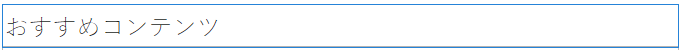
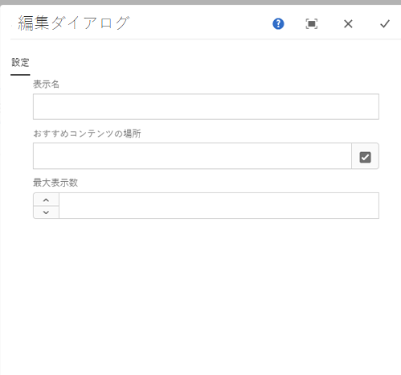
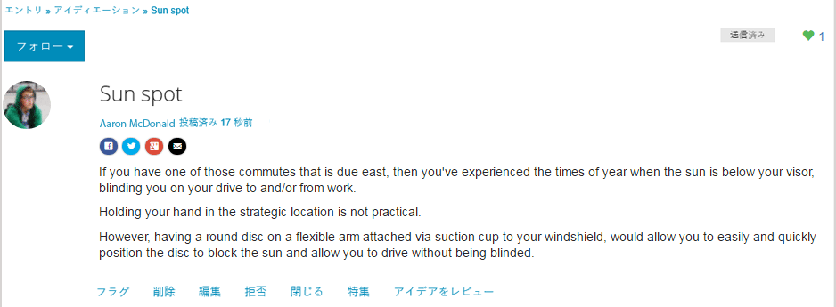
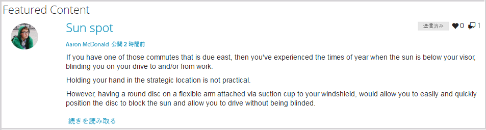

# おすすめコンテンツ機能 {#featured-content-feature}

## はじめに {#introduction}

おすすめコンテンツ機能は、パブリッシュ環境でサインインしたサイト訪問者（コミュニティメンバー）が次のコンテンツをハイライト表示するためのエリアを提供します。

* [ブログ](blog-feature.md)
* [カレンダー](calendar.md)
* [フォーラム](forum.md)
* [アイデア](ideation-feature.md)
* [Q&amp;A](working-with-qna.md)

コンテンツがおすすめとしてフラグ付けされると、このコンポーネント内にリストされ、特定のランディングページや、コミュニティメンバーの注意を容易に引くエリアに配置されます。

コンテンツを機能させる機能は、コンポーネントごとに許可または禁止される場合があります。

この節では、次の内容について説明します。

* コミュニティサイトへの注目のコンテンツの追加。
* `Featured Content` コンポーネントの構成設定。

## ページへの注目コンテンツの追加 {#adding-featured-content-to-a-page}

作成者モードでページに`Featured Content` コンポーネントを追加するには、コンポーネントブラウザーを使用して

* `Communities / Featured Content`

をクリックし、注目のコンテンツが表示されるページ上にドラッグします。

必要な情報については、[&#x200B; コミュニティコンポーネントの基本](basics.md)を参照してください。

[必要なクライアントサイドライブラリ &#x200B;](essentials-featured.md#essentials-for-client-side)が含まれている場合、`Featured Content` コンポーネントは次のように表示されます。

## おすすめのコンテンツの設定 {#configuring-featured-content}

配置された`Featured Content` コンポーネントを選択して、編集ダイアログを開く`Configure` アイコンにアクセスして選択できるようにします。

### 「設定」タブ {#settings-tab}

「**[!UICONTROL 設定]**」タブで、機能するコンテンツを特定します。

* **[!UICONTROL 表示名]**

  おすすめコンテンツのリストのタイトル。 例えば、`Featured Questions` や `Featured Ideas` です。 空のままにすると、デフォルトは`Featured Content`になります。

* **[!UICONTROL おすすめコンテンツの場所]**

  *（必須）*&#x200B;おすすめのコンテンツを含むページを参照します（このページのコンポーネントは、おすすめのコンテンツを許可するように設定する必要があります）。 例えば、`/content/sites/engage/en/forum` のように指定します。

* **[!UICONTROL 表示制限]**

  表示する特集コンテンツの最大数です。 デフォルトは5です。

## サイト訪問者エクスペリエンス {#site-visitor-experience}

コンテンツを注目コンテンツとしてフラグ付けするには、モデレーター権限が必要です。

モデレーターが投稿されたコンテンツを表示すると、新しい`Feature` フラグを含むコンテキスト内モデレーションフラグにアクセスできます。

機能としてフラグが付けられると、モデレーションフラグは`Unfeature`になります。

`Featured Content` コンポーネントを含むページに、この投稿が含まれるようになりました。

`Read More`は実際の投稿にリンクしています。

## 追加情報 {#additional-information}

詳しくは、開発者向けの[おすすめコンテンツ &#x200B;](essentials-featured.md) ページを参照してください。

おすすめのコンテンツとしてフラグを立てる方法については、[&#x200B; ユーザー生成コンテンツの管理](moderate-ugc.md)を参照してください。
