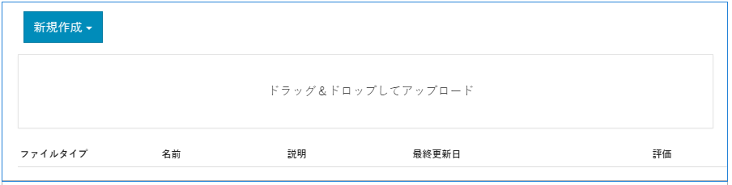
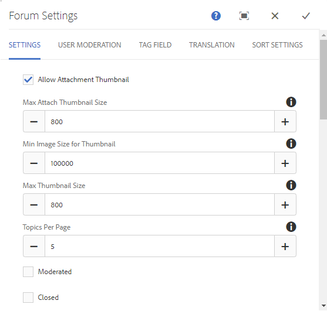

# ファイルライブラリ機能{#file-library-feature}

## はじめに {#introduction}

ファイルライブラリ機能は、サインインサイト訪問者（コミュニティメンバー）がコミュニティサイト内でファイルをアップロード、管理、ダウンロードするための場所を提供します。

この節では、次の内容について説明します。

* AEM サイトへのファイルライブラリ機能の追加。
* `File Library` コンポーネントの構成設定。

### ページへのファイルライブラリの追加 {#adding-a-file-library-to-a-page}

作成者モードでページに`File Library` コンポーネントを追加するには、コンポーネントを見つけます。

* `Communities / File Library`

ページ上の所定の位置にドラッグします。

必要な情報については、[ コミュニティコンポーネントの基本](/help/communities/basics.md)を参照してください。

[必要なクライアントサイドライブラリ ](/help/communities/essentials-file-library.md#essentials-for-client-side)が含まれている場合、`File Library` コンポーネントが表示されます。

### ファイルライブラリの設定 {#configuring-file-library}

配置された`File Library` コンポーネントを選択して、編集ダイアログボックスを開く`Configure` アイコンにアクセスして選択します。

#### 「コメント」タブ {#comments-tab}

「**コメント**」タブで、アップロードされたファイルのコメントが表示されるかどうか、および表示される方法を指定します。

* **ファイルに対するコメントを許可**

  オンにした場合は、アップロードしたファイルに対するコメントを許可します。 デフォルトはオフです。

* ページあたりのコメント数&#x200B;**件**

  ページごとに表示されるコメントの数と、表示される返信の数を制限します。 デフォルトは&#x200B;**10**&#x200B;です。

* **最大ファイルサイズ**

  この値は、アップロードされるファイルサイズを制限します。 デフォルトの制限は104857600 （10 MB）です。

* **メッセージの最大長**

  テキストボックスに入力できる最大文字数。 デフォルトは4096文字です。

* **許可されているファイル形式**

  「ドット」区切り文字を持つファイル拡張子のコンマ区切りリスト。 例：.jpg、.jpeg、.png、.doc、.docx、.pdf 任意のファイルタイプを指定した場合、指定されていないファイルタイプは使用できません。 デフォルトは、すべてのファイルタイプが許可されるように指定されていません。

* **リッチテキストエディター**

  チェックを入れると、コメントがマークアップと共に入力される場合があります。 デフォルトはオフです。

* **コメントを削除**

  オンにすると、ユーザーは自分のコメントを削除できます。 デフォルトはオンです。

* **タグ付けを許可**

  オンにすると、ファイルにタグを追加する機能が有効になります。 デフォルトはオフです。

* **許可された名前空間**

  「タグ付けを許可」がオンになっている場合、使用可能なタグは、オンになっている名前空間に制限されます。 名前空間がチェックされていない場合は、すべて許可されます。 デフォルトは、すべての名前空間です。

* **推奨回数**

  「タグ付けを許可」をオンにすると、この設定によって表示される推奨タグの数が制限されます。 -1に設定した場合、制限はありません。 初期設定は -1 です。

* **投票を許可**

  オンにすると、ファイルに投票する機能が有効になります。 デフォルトはオフです。

* **次を許可**

  チェックを入れた場合は、ブログ記事に次の機能を含めます。これにより、メンバーは新しい投稿を[通知](/help/communities/notifications.md)できます。 デフォルトはオフです。

* **メンションを有効にする**

  有効にすると、登録コミュニティユーザーは他の登録メンバー（名、姓、ユーザー名を使用）を識別し、共通の@user-name構文を使用してタグ付けすることができます。 タグ付けされたユーザーは、メンションに関する通知を受け取ります。

* **最大言及数**

  投稿で許可されるメンションの最大数を制限します。 初期設定は 10 です。

* **UI メンション パターン**

  許可されるパターン文字列を指定して、登録されたユーザーを投稿にタグ付け（@mention）します。 例えば、`~{{familyName}}{{givenName}}` のように指定します。

* **スレッド返信を許可**

  オンにした場合、投稿されたコメントへの返信を許可します。 デフォルトはオフです。

#### 「User Moderation」タブ {#user-moderation-tab}

「**ユーザーモデレーション**」タブで、コメントが許可されている場合は、コメントのモデレーションを設定します。

* **事前管理**

  オンにした場合、コメントは公開サイトに表示される前に承認する必要があります。 デフォルトはオフです。

* **コメントを削除**

  チェックを入れると、コメントを投稿した訪問者は、必要に応じてコメントを削除できます。 デフォルトはオンです。

* **コメントを拒否**

  オンにした場合、信頼できるメンバーのモデレーターがコメントを拒否することを許可します。 デフォルトはオフです。

* **コメントを閉じる/再度開く**

  オンにした場合、信頼できるメンバーのモデレーターがコメントを閉じて再度開くことを許可します。 デフォルトはオフです。

* **フラグコメント**

  チェックを入れた場合、訪問者が不適切なコメントとしてフラグを立てることを許可します。 デフォルトはオフです。

* **フラグ理由リスト**

  チェックを入れた場合、訪問者はドロップダウンリストから、コメントを不適切としてフラグ付けする理由を選択できます。 デフォルトはオフです。

* **カスタムフラグの理由**

  チェックを入れた場合、訪問者が不適切なコメントとしてフラグを立てる独自の理由を入力できるようにします。 デフォルトはオフです。

* **モデレーションしきい値**

  モデレーターに通知する前に、訪問者がコメントにフラグを立てる必要がある回数を入力します。 デフォルトは1回（**1**）です。

* **フラグ設定の上限**

  コメントが公開ビューから非表示になる前にフラグを立てる必要がある回数を入力します。 この数値は、**モデレーションしきい値**&#x200B;以上である必要があります。 デフォルトは 5 です。

### 「並べ替え設定」タブ {#sort-settings-tab}

並べ替え

デフォルトとして設定

### 追加情報 {#additional-information}

詳しくは、開発者向けの[File Library Essentials](/help/communities/essentials-file-library.md) ページを参照してください。

投稿されたトピックとコメントの管理については、[ ユーザー生成コンテンツの管理](/help/communities/moderate-ugc.md)を参照してください。

投稿されたトピックやコメントのタグ付けについては、[ ユーザー生成コンテンツのタグ付け](/help/communities/tag-ugc.md)を参照してください。
