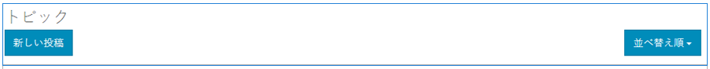

# フォーラム機能{#forum-feature}

## はじめに {#introduction}

フォーラム機能は、パブリッシュ環境のサインインサイト訪問者（コミュニティメンバー）に次のエリアを提供します。

* トピックの作成
* トピックの表示と返信
* トピックに従う
* フォーラムを検索
* フォーラムのコンテンツ管理にご協力ください
* フォーラムのトピックをページ間で移動する

この節では、次の内容について説明します。

* AEM サイトへのフォーラム機能の追加。
* `Forum` コンポーネントの構成設定。

### ページへのフォーラムの追加 {#adding-a-forum-to-a-page}

作成者モードでページに`Forum` コンポーネントを追加するには、コンポーネントブラウザーを使用して

* `Communities / Forum`

フォーラムが表示されるページ上にドラッグします。

必要な情報については、[ コミュニティコンポーネントの基本](/help/communities/basics.md)を参照してください。

[必要なクライアントサイドライブラリ ](/help/communities/essentials-forum.md#essentials-for-client-side)が含まれている場合、`Forum` コンポーネントは次のように表示されます。

### フォーラムの設定 {#configuring-a-forum}

配置された`Forum` コンポーネントを選択して、編集ダイアログを開く`Configure` アイコンにアクセスして選択できるようにします。

#### 「設定」タブ {#settings-tab}

「**設定**」タブで、トピックと返信の設定を指定します。

* **添付ファイルのサムネールを許可**

  オンにすると、添付された画像のサムネールが作成されます。

* **最大添付サムネールサイズ**

  添付ファイルのサムネール画像の最大サイズ（ピクセル単位）。 デフォルト値は800 x 800です。

* サムネール **の**&#x200B;最小画像サイズ
* **サムネールの最大サイズ**

  インライン画像のサムネール画像の最大サイズ（ピクセル単位）。 デフォルト値は800 x 800です。

* **ページあたりのトピック**

  ページごとに表示されるトピック/投稿の数を定義します。 初期設定は 10 です。

* **モデレート**

  オンにすると、トピックとコメントの投稿は、公開サイトに表示される前に承認する必要があります。 デフォルトはオフです。

* **終了**

  オンにすると、フォーラムは新しいトピックとコメントに対して閉じられます。 デフォルトはオフです。

* **リッチテキストエディター**

  オンにすると、トピックとコメントがマークアップと共に入力される場合があります。 デフォルトはオフです。

* **タグ付けを許可**

  オンにした場合、メンバーが投稿にタグラベルを追加できるようにします（**タグフィールド** タブを参照）。 デフォルトはオフです。

* **ファイルのアップロードを許可**

  オンにした場合、添付ファイルをトピックまたはコメントに追加できます。 デフォルトはオフです。

* **次を許可**

  チェックを入れた場合は、フォーラムへの投稿に次の機能を含めます。これにより、メンバーは新しい投稿について[通知](/help/communities/notifications.md)を受け取ることができます。 デフォルトはオフです。

* **ピン留めを許可**

  オンにすると、フォーラムのトピックがトピックのリストの先頭にピン留めされる場合があります。 デフォルトはオフです。

* **おすすめのコンテンツを許可**

  チェックを入れると、アイデアは[おすすめコンテンツ ](/help/communities/featured.md)として識別できます。 デフォルトはオフです。

* **メール配信の許可**

  チェックを入れた場合は、新しい投稿がメールでメンバーに通知されるようにします（[ サブスクリプション ](/help/communities/subscriptions.md)）。 `Allow Following`を確認し、電子メール [を設定する必要があります](/help/communities/email.md)。 デフォルトはオフです。

* **最大ファイルサイズ**

  `Allow File Uploads`がチェックされている場合にのみ関連します。 このフィールドは、アップロードされたファイルのサイズ（バイト単位）を制限します。 デフォルトは104857600 （10 Mb）です。

* **許可されているファイル形式**

  `Allow File Uploads`がチェックされている場合にのみ関連します。 「ドット」区切り文字を持つファイル拡張子のコンマ区切りリスト。 例：.jpg、.jpeg、.png、.doc、.docx、.pdf 任意のファイルタイプを指定した場合、指定しなかったファイルタイプはアップロードできません。 デフォルトは、すべてのファイルタイプが許可されるように指定されていません。

* **最大アタッチ画像ファイル サイズ**
「ファイルのアップロードを許可」がオンになっている場合にのみ関連します。 アップロードされた画像ファイルの最大バイト数。 デフォルトは2097152 （2 Mb）です。

* **スレッド返信を許可**

  オンにした場合、トピックに投稿されたコメントへの返信を許可します。 デフォルトはオフです。

* **投票を許可**

  チェックを入れた場合は、投票の機能をトピックに含めます。 デフォルトはオフです。

* **ユーザーによるコメントとトピックの削除を許可**

  オンにした場合、メンバーは投稿したコメントとトピックを削除できます。 デフォルトはオフです。

* **パンくずリストを表示**

  オンにした場合、トピックページにナビゲーション用のパンくずリストを表示します。 デフォルトはオンです。

* **バッジの表示**

  チェックを入れた場合、メンバーのブログエントリで獲得および割り当てられた[ バッジ ](/help/communities/implementing-scoring.md)を表示します。 デフォルトはオフです。

* **特権メンバーを許可**

  オンにした場合、コンテンツの作成が許可されるのは特権メンバーのみです。

* **許可された特権メンバー**

  コンテンツの作成を許可する特権メンバーを追加します。

* **作成者編集モードでユーザー生成コンテンツをブロック**

  有効にすると、作成者モードでの編集中にユーザー生成コンテンツがブロックされます。

* **メンションを有効にする**

  有効にすると、登録コミュニティユーザーは他の登録メンバー（名、姓、ユーザー名を使用）を識別し、共通の@user-name構文を使用してタグ付けすることができます。 タグ付けされたユーザーは、メンションに関する通知を受け取ります。

* **最大言及数**

  投稿で許可されるメンションの最大数を制限します。 初期設定は 10 です。

* **UI メンション パターン**

  投稿に登録されたユーザーをタグ（@mention）付けする許可されたパターン文字列を指定します。 例えば、`~{{familyName}}{{givenName}}` のように指定します。

>[!NOTE]
>
>トピックに対するコメントを有効にするには、`AllowThreaded Replies`と`Allow users to Delete Comments and Topics`の両方を確認する必要がある場合があります。

#### 「User Moderation」タブ {#user-moderation-tab}

「**ユーザーモデレーション**」タブで、投稿されたトピックと返信（ユーザー生成コンテンツ）の管理方法を指定します。 詳しくは、[ ユーザー生成コンテンツの管理](/help/communities/moderate-ugc.md)を参照してください。

* **投稿を拒否**

  チェックを入れると、信頼できるメンバーのモデレーターは投稿を拒否し、投稿が公開フォーラムに表示されないようにすることができます。 デフォルトはオフです。

* **トピックを閉じる/再度開く**

  チェックを入れると、信頼できるメンバーのモデレーターは、トピックを閉じてさらに編集やコメントを追加したり、トピックを再度開いたりすることができます。 デフォルトはオフです。

* **トピックの移動**

  オンにした場合、パブリッシュ側のモデレーターがトピックを移動できるようにします。 デフォルトはオンです。

* **投稿にフラグを付ける**

  チェックを入れた場合、メンバーが他のユーザーのトピックやコメントに不適切なフラグを付けられるようにします。 デフォルトはオフです。

* **フラグ理由リスト**

  オンにした場合、トピックまたはコメントを不適切とフラグ付けする理由をドロップダウンリストからメンバーが選択できるようにします。 デフォルトはオフです。

* **カスタムフラグの理由**

  チェックを入れた場合は、トピックまたはコメントを不適切としてフラグ付けする独自の理由をメンバーが入力できるようにします。 デフォルトはオフです。

* **モデレーションしきい値**

  モデレーターに通知する前に、メンバーがトピックまたはコメントにフラグを付ける必要がある回数を入力します。 デフォルトは1 （1回）です。

* **フラグ設定の上限**

  トピックまたはコメントが公開ビューから非表示になる前にフラグを立てる必要がある回数を入力します。 -1に設定すると、フラグ付きのトピックまたはコメントが公開ビューから非表示になることはありません。 それ以外の場合、この数値はモデレーションしきい値以上である必要があります。 デフォルトは 5 です。

#### 「タグフィールド」タブ {#tag-field-tab}

「**タグ」フィールド** タブでは、**設定** タブで許可されている場合、適用できるタグは、選択した名前空間に応じて制限されます。

* **許可された名前空間**

  `Allow Tagging`が「**設定**」タブでチェックされている場合に関連します。 適用できるタグは、チェックした名前空間カテゴリ内のタグに限定されます。 名前空間のリストには、「標準タグ」（デフォルトの名前空間）と「すべてのタグを含める」が含まれます。 デフォルトは「なし」にチェックされます。つまり、すべての名前空間が許可されます。

* **推奨回数**

  フォーラムに投稿するメンバーに提案として表示するタグの数を入力します。 デフォルトは**-**1 （制限なし）です。

#### 「翻訳」タブ {#translation-tab}

「**翻訳**」タブで、コミュニティサイトの翻訳が有効になっている場合、トピック全体または選択した投稿を翻訳するように翻訳を設定できます。

* **すべてを翻訳**

  オンにすると、フォーラムのスレッドがユーザーの優先言語に翻訳されます。 デフォルトはオフです。

#### 「並べ替え設定」タブ {#sort-settings-tab}

「**並べ替え設定**」タブで、投稿されたコメントの表示時の並べ替え方法を指定します。

* **並べ替え基準**

  許可されているすべての並べ替え選択を確認してください：`Newest, Oldest, Last Updated, Most Viewed, Most Active, Most Followed and Most Liked`。 デフォルトは `Newest, Oldest, Last Updated` です。

* **既定として設定**

  チェックした並べ替えオプションの1つを選択して、デフォルトとして表示します。 デフォルトは `Newest` です。

* **Analyticsの並べ替えの時間オプションを選択**

  次のいずれかのオプションを選択します：`All, Last 24 Hours, Last 7 Days, Last 30 Days`。

  デフォルトは `All` です。

### 追加情報 {#additional-information}

詳しくは、開発者向けの[Forum Essentials](/help/communities/essentials-forum.md) ページを参照してください。

投稿されたトピックとコメントの管理については、[ ユーザー生成コンテンツの管理](/help/communities/moderate-ugc.md)を参照してください。

投稿されたトピックやコメントのタグ付けについては、[ ユーザー生成コンテンツのタグ付け](/help/communities/tag-ugc.md)を参照してください。

投稿されたトピックやコメントの翻訳については、[ ユーザー生成コンテンツの翻訳](/help/communities/translate-ugc.md)を参照してください。
