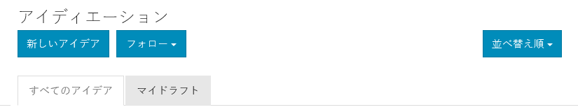
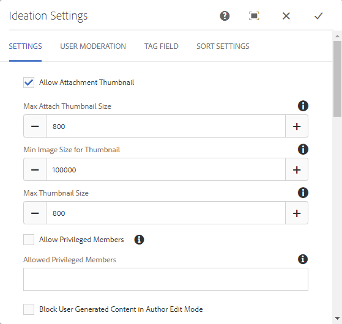
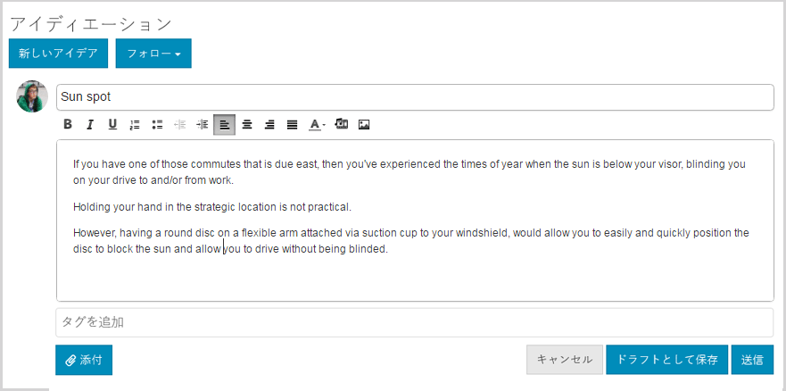
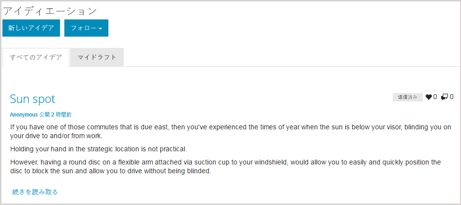
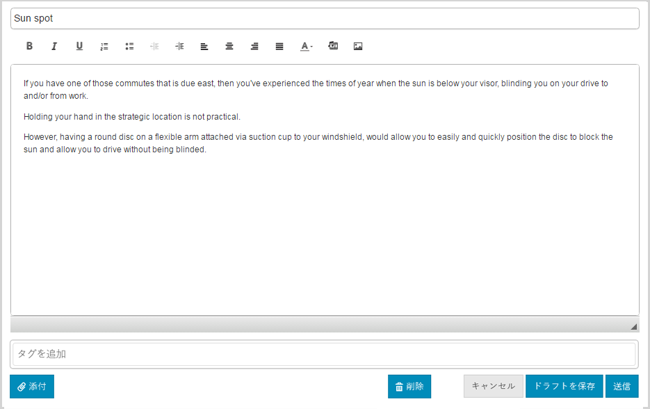
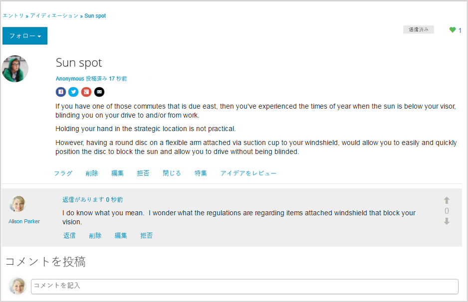

# アイディエーション機能 {#ideation-feature}

## はじめに {#introduction}

アイデア出し機能は、パブリッシュ環境のサインインサイト訪問者（コミュニティメンバー）に次のエリアを提供します。

* コミュニティと共有するためのアイデアを創出する。
* アイデアの表示とコメント。
* アイデアに従う：
* アイデアに投票する：

この節では、次の内容について説明します。

* AEMサイトにアイデア出し機能を追加する。
* アイデア創出コンポーネントの設定設定。

### ページへのアイデアの追加 {#adding-a-ideation-to-a-page}

作成者モードでページに`Ideation` コンポーネントを追加するには、コンポーネントブラウザーを使用して

* `Communities / Ideation`

アイデアを表示するページ上にドラッグします。

必要な情報については、[ コミュニティコンポーネントの基本](/help/communities/basics.md)を参照してください。

[必要なクライアントサイドライブラリ ](/help/communities/ideation.md#essentials-for-client-side)が含まれている場合、`Ideation` コンポーネントは次のように表示されます。

### アイデアの設定 {#configuring-an-ideation}

配置された`Ideation` コンポーネントを選択して、編集ダイアログを開く`Configure` アイコンにアクセスして選択できるようにします。

#### 「設定」タブ {#settings-tab}

「**[!UICONTROL 設定]**」タブで、アイデアとコメントの設定を指定します。

* **添付ファイルのサムネールを許可**
* **最大添付サムネールサイズ**
* サムネール **の**&#x200B;最小イメージ サイズ
* **サムネールの最大サイズ**
* **特権メンバーを許可**
* **許可された特権メンバー**
* **作成者編集モードでユーザーが生成したコンテンツをブロック**
* **アイデアのタイトル**

* アイデアの表示タイトル。 デフォルトは `Ideation` です。
* **アイデアの説明**

  アイデアのサブタイトルとして表示する説明。 デフォルトは説明なし。

* **ページあたりのトピック**

  ページごとに表示されるアイデア/投稿の数を定義します。 初期設定は 10 です。

* **モデレート**

  チェックを入れた場合、アイデアやコメントの投稿は、公開サイトに表示される前に承認する必要があります。 デフォルトはオフです。

* **終了**

  チェックを入れると、アイデア創出フォーラムは新しいアイデアやコメントに対してクローズされます。 デフォルトはオフです。

* **リッチテキストエディター**

  チェックを入れると、アイデアやコメントがマークアップと共に入力されます。 デフォルトはオフです。

* **タグ付けを許可**

  オンにした場合、メンバーが投稿にタグラベルを追加できるようにします（**[!UICONTROL タグフィールド]** タブを参照）。 デフォルトはオフです。

* **ファイルのアップロードを許可**

  オンにした場合、添付ファイルをアイデアまたはコメントに追加できます。 デフォルトはオフです。

* **最大ファイルサイズ**

  `Allow File Uploads`がチェックされている場合にのみ関連します。 このフィールドは、アップロードされたファイルのサイズ（バイト単位）を制限します。 デフォルトは104857600 （10 Mb）です。

* **許可されているファイル形式**

  `Allow File Uploads`がチェックされている場合にのみ関連します。 「ドット」区切り文字を持つファイル拡張子のコンマ区切りリスト。 例：.jpg、.jpeg、.png、.doc、.docx、.pdf 任意のファイルタイプを指定した場合、指定しなかったファイルタイプはアップロードできません。 デフォルトは、すべてのファイルタイプが許可されるように指定されていません。

* **最大アタッチ画像ファイル サイズ**

  「ファイルのアップロードを許可」がオンになっている場合にのみ関連します。 アップロードされた画像ファイルの最大バイト数。 デフォルトは2097152 （2 Mb）です。

* **返信を許可**

  オンにした場合は、アイデアに投稿されたコメントへの返信を許可します。 デフォルトはオフです。

* **投票を許可**

  チェックを入れた場合は、アイデアのコメントへの投票を許可します。 デフォルトはオフです。

* **ユーザーによるコメントとトピックの削除を許可**

  オンにした場合、投稿したコメントやアイデアをメンバーが削除できるようにします。 デフォルトはオフです。

* **次を許可**

  チェックを入れた場合は、アイデアの投稿に次の機能を含めます。これにより、メンバーは新しい投稿について[通知](/help/communities/notifications.md)を受け取ることができます。 デフォルトはオフです。

* **メール配信の許可**

  チェックを入れた場合は、新しい投稿がメールでメンバーに通知されるようにします（[ サブスクリプション ](/help/communities/subscriptions.md)）。 `Allow Following`を確認し、電子メール [を設定する必要があります](/help/communities/email.md)。 デフォルトはオフです。

* **投票を許可**

  チェックを入れた場合は、アイデアのコメントへの投票を許可します。 デフォルトはオフです。

* **バッジの表示**

  チェックを入れた場合、メンバーのアイデアで獲得および割り当てられた[ バッジ ](/help/communities/implementing-scoring.md)を表示します。 デフォルトはオフです。

* **リストページで返信を受け取らない**

* **おすすめのコンテンツを許可**

  チェックを入れると、アイデアは[おすすめコンテンツ ](/help/communities/featured.md)として識別できます。 デフォルトはオフです。

* **メンションを有効にする**
* **最大言及数**
* **UI メンション パターン**

#### 「User Moderation」タブ {#user-moderation-tab}

「**[!UICONTROL ユーザーモデレーション]**」タブで、投稿されたアイデアとコメント（ユーザー生成コンテンツ）の管理方法を指定します。 詳しくは、「[ ユーザー生成コンテンツの管理](/help/communities/moderate-ugc.md)」を参照してください。

* **投稿を拒否**

  オンにすると、信頼できるメンバーのモデレーターは、投稿を拒否し、投稿が公開フォーラムに表示されるのを防ぐことができます。 デフォルトはオフです。

* **トピックを閉じる/再度開く**

  チェックを入れると、信頼できるメンバーのモデレーターは、トピックを閉じてさらに編集やコメントを追加したり、トピックを再度開いたりすることができます。 デフォルトはオフです。

* **投稿にフラグを付ける**

  チェックを入れた場合、メンバーが他のユーザーのトピックやコメントに不適切なフラグを付けられるようにします。 デフォルトはオフです。

* **フラグ理由リスト**

  オンにした場合、トピックまたはコメントを不適切とフラグ付けする理由をドロップダウンリストからメンバーが選択できるようにします。 デフォルトはオフです。

* **カスタムフラグの理由**

  チェックを入れた場合は、トピックまたはコメントを不適切としてフラグ付けする独自の理由をメンバーが入力できるようにします。 デフォルトはオフです。

* **モデレーションしきい値**

  モデレーターに通知する前に、メンバーがトピックまたはコメントにフラグを付ける必要がある回数を入力します。 デフォルトは1 （1回）です。

* **フラグ設定の上限**

  トピックまたはコメントが公開ビューから非表示になる前にフラグを立てる必要がある回数を入力します。 -1に設定すると、フラグ付きのトピックまたはコメントが公開ビューから非表示になることはありません。 それ以外の場合、この数値はモデレーションしきい値以上である必要があります。 デフォルトは 5 です。

#### 「タグフィールド」タブ {#tag-field-tab}

「**[!UICONTROL タグ」フィールド]** タブでは、**[!UICONTROL 設定]** タブで許可されている場合、適用できるタグは、選択した名前空間に応じて制限されます。

* **許可された名前空間**

  `Allow Tagging`が「**[!UICONTROL 設定]**」タブでチェックされている場合に関連します。 適用できるタグは、チェックした名前空間カテゴリ内のタグに限定されます。 名前空間のリストには、「標準タグ」（デフォルトの名前空間）と「すべてのタグを含める」が含まれます。 デフォルトは「なし」にチェックされます。つまり、すべての名前空間が許可されます。

* **推奨回数**

  フォーラムに投稿するメンバーに提案として表示するタグの数を入力します。 値&#x200B;**～ 1**&#x200B;は制限がないことを意味します。 初期設定は 0 です。

#### 「並べ替え設定」タブ {#sort-settings-tab}

「**[!UICONTROL 並べ替え設定]**」タブで、投稿されたコメントの表示時の並べ替え方法を指定します。

* **並べ替え基準**

  許可されているすべての並べ替え選択を確認してください：`Newest, Oldest, Last Updated, Most Viewed, Most Active, Most Followed and Most Liked`。 デフォルトは `Newest, Oldest, Last Updated` です。

* **既定として設定**

  チェックした並べ替えオプションの1つを選択して、デフォルトとして表示します。 デフォルトは `Newest` です。

* **Analyticsの並べ替えの時間オプションを選択**

  `All, Last 24 Hours, Last 7 Days, Last 30 Days`のいずれかを選択します。 デフォルトは `All` です。

## サイト訪問者エクスペリエンス {#site-visitor-experience}

### アイデアの創出 {#creating-idea}

すべてのコミュニティ機能と同様に、ログインしていない場合、サイト訪問者はアイデアを読み、他のユーザーの意見を（コメントや投票/いいね）を閲覧することしかできません。

ログインすると、メンバーはアイデアを作成できます。

アイデアを提出する前に、メンバーはドラフトを保存できます。

`Save as Draft` ボタンを選択すると、ドラフトが保存されます。

「`My Drafts`」タブで保存されたドラフトを表示する際に、`Read More`を選択して編集モードに戻ります。

#### フィードバックの提供 {#providing-feedback}

アイデアが公開されると、他のメンバーがログインしてアイデアを開き（`Read More`）、アイデアを気に入って投票カウントに追加し、コメントを作成できます。

### 追加情報 {#additional-information}

詳しくは、開発者向けの[Ideation Essentials](/help/communities/ideation.md) ページを参照してください。

投稿されたトピックとコメントの管理については、[ ユーザー生成コンテンツの管理](/help/communities/moderate-ugc.md)を参照してください。

投稿されたトピックとコメントのタグ付けについては、[ ユーザー生成コンテンツのタグ付け](/help/communities/tag-ugc.md)を参照してください。
