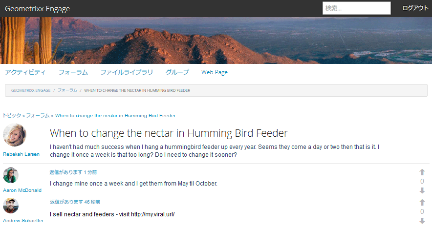
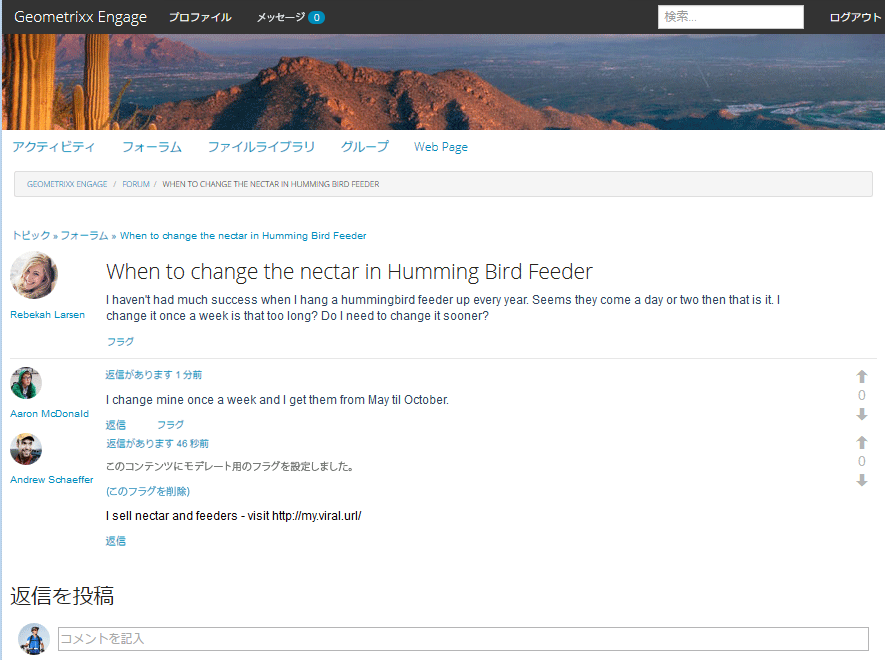
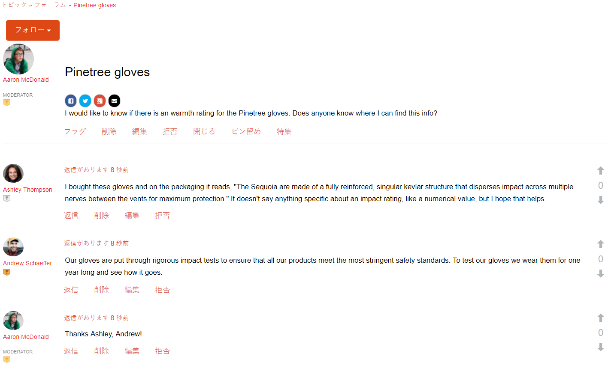
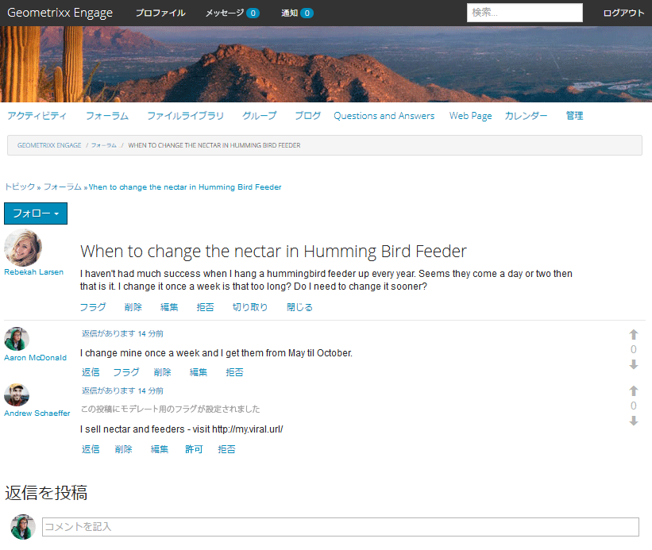
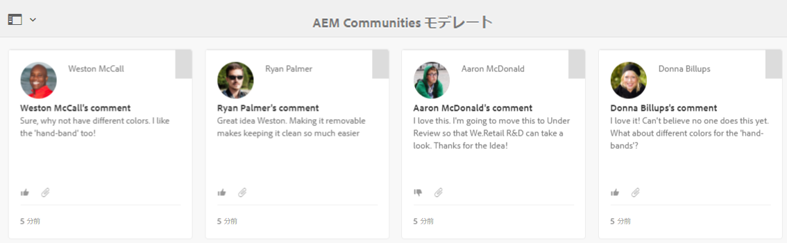
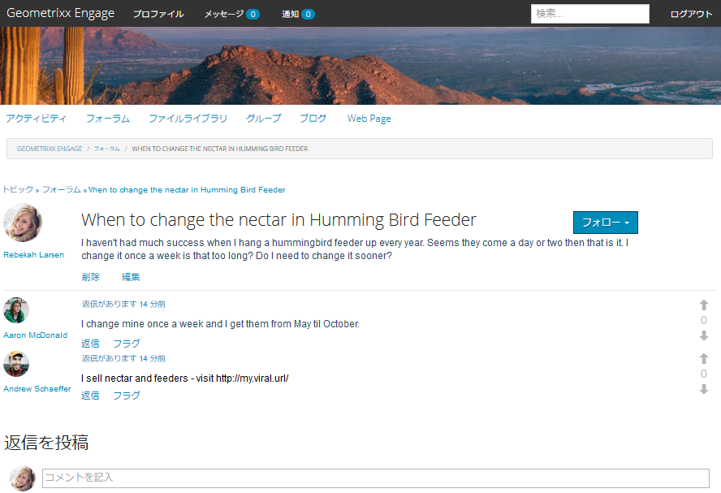

# コンテキスト内モデレート {#in-context-moderation}

AEM Communitiesの場合、管理者と信頼できるコミュニティメンバーは、コミュニティコンテンツが投稿された公開済みページで直接モデレーションを実行できます。

[&#x200B; モデレーションコンソール &#x200B;](moderation.md)を使用する場合、コンテンツに表示される情報には、公開済みページへのリンクが含まれており、コンテキスト内でモデレーションする際に使用できる追加のモデレーションアクションへのアクセスが可能になります。

## モデレーション活動 {#moderation-actions}

[&#x200B; モデレーションアクション &#x200B;](moderate-ugc.md#moderation-actions)の説明については、モデレーションの概要を参照してください。

## モデレーション UI {#moderation-ui}

パブリッシュインスタンスのモデレーターに表示されるUIは、ユーザー生成コンテンツ（UGC）の投稿と管理用のダイアログ内に含まれています。 UIの要素は、サイト訪問者のステータスによって決まります – 彼らが…

1. コンテンツを投稿したメンバー。
1. 信頼できるメンバーモデレーター：
1. 管理者。
1. ログインしていますが、コンテンツの管理者、モデレーター、作成者ではありません。
1. ログインしていません。

## 例 {#example}

[&#128279;](getting-started.md)Geometrixxの使用開始時に作成された[AEM Communities Engage](http://localhost:4503/content/sites/engage/en.html) サイトを使用して、パブリッシュ環境で様々なモデレーションアクティビティを体験するフォーラムにスレッドを設定できます。 &#x200B;以下を参照してください。

Aaron McDonald （`aaron.mcdonald@mailinator.com`）は、サイトの作成時にcommunity-engage-moderators グループに追加することで、信頼できるコミュニティメンバーとして識別されました。

Rebekah Larsen （`rebekah.larsen@trashymail.com`）は、[&#x200B; メンバーコンソール &#x200B;](members.md)を使用して、community-engage-members グループのメンバーとして追加できます。

コミュニティユーザーグループについて詳しくは、[&#x200B; ユーザーとユーザーグループの管理](users.md)を参照してください。

### フォーラム投稿の作成 {#create-the-forum-posts}

* Rebekah Larsen （rebekah.larsen@trashymail.com）としてログインします。

  * フォーラムを選択
  * 新しい投稿を選択
  * 件名を入力

    Humming Bird Feederで蜜を変更するタイミング

  * 本文を入力

    私は毎年ハチドリのフィーダーアップをぶら下げているときはあまり成功していません。 1日か2日は来ているようですが、それだけです。 1週間に1回変更するのは長すぎますか？ もっと早く変えなければいけませんか。

  * 投稿を選択
  * ログアウトを選択

* Aaron McDonaldとしてログインします（aaron.mcdonald@mailinator.com）

  * フォーラムを選択
  * Hummingbirdのトピックは、「Read More」を選択します
  * 返信を投稿するためのコメントを入力

    私は週に1回変更し、5月から10月まで受け取ります。

  * 返信を選択
  * ログアウトを選択

* Andrew Schaefferとしてログインします（andrew.schaeffer@trashymail.com）

  * フォーラムを選択
  * Hummingbirdのトピックは、「Read More」を選択します
  * 返信を投稿するためのコメントを入力

    私はネクターとフィーダーを販売します – https://my.viral.url/を参照してください。

  * 返信を選択
  * ログアウトを選択

### 匿名サイト訪問者（#5） {#anonymous-site-visitor}

以下は、ログインしていないサイト訪問者（5）が表示したフォーラムのビューです。

匿名のサイト訪問者はフォーラムを閲覧するだけですが、コンテンツを投稿したり、モデレーションアクションを実行したりすることはできません。

### 新しいメンバー（#4） {#new-member}

作成者は、管理者としてログインし、[&#x200B; メンバーコンソール &#x200B;](members.md)を使用してCommunity-engage-members グループの新しいメンバーとしてBoyd Larsen （boyd.larsen@dodgit.com）を追加してからログアウトします。

公開時にBoyd Larsenとしてログインし、ハミングバードの投稿に「`Forum`」、「`Read more`」を選択してスレッドにアクセスします。

ご注意：

* Boydはフォーラムに参加していません。
* ボイドは何も削除できません。
* Boydはログインしており、返信またはコンテンツにフラグを立てることができます。

BoydにAndrewが投稿したコンテンツにフラグを付けるフラグを選択してもらいます。

ログアウト

### 管理者（#3） {#administrator}

管理者（管理者）としてログインし、「フォーラム」を選択してスレッドにアクセスし、投稿の「詳細」を選択します。

ご注意：

* 管理者は、フラグ、削除、編集、拒否、カット、閉じる、ピン、機能を選択できます。
* 管理者は、「管理」を選択してモデレーションコンソールにアクセスできます。

管理メニュー項目を選択して、パブリッシュ環境から[&#x200B; モデレーションコンソール &#x200B;](moderation.md)にアクセスできるようにします。

管理者の場合、Geometrixx Engage コミュニティサイトのコンテンツだけでなく、モデレート可能なすべてのコンテンツが表示されます。

検索フィルターは、開くか閉じるかを切り替えるサイドパネルです。

ログアウトします。

### コミュニティモデレーター（#2） {#community-moderator}

コミュニティのモデレーターであるAaron McDonald （`aaron.mcdonal@mailinator.com`）としてログインし、「フォーラム」を選択してスレッドにアクセスし、ハミングバードの投稿に「詳細を読む」を選択します。

ご注意：

* Aaronは、自分の投稿に返信、削除、編集、または拒否できます。
* Aaronは、他のコンテンツのフラグ/許可、返信、削除、編集、拒否も可能です。
* Aaronは、フォーラムのトピックをカットして、彼が司会を務める別のフォーラムに移動することができます。
* Aaronは管理を選択してモデレーションコンソールにアクセスできます。

管理メニュー項目を選択して、パブリッシュ環境から[&#x200B; モデレーションコンソール &#x200B;](moderation.md)にアクセスできるようにします。

コミュニティモデレーターの場合、Geometrixx Engage コミュニティサイトのモデレート可能なコンテンツのみが表示されます。

コミュニティモデレーターには管理者と同じオプションが設定されていますが（画像は検索サイドバーを閉じて切り替えています）、他のAEM コンソールにはアクセスできません。

ログアウトします。

### コンテンツ作成者（#1） {#content-author}

スレッドを開始したコミュニティメンバーであるRebekah Larsen （`rebekah.larsen@mailinator.com`）としてログインし、「フォーラム」を選択してスレッドにアクセスし、ハミングバードの投稿に「詳細を読む」を選択します。

ご注意：

* Rebekahは、自分の投稿を削除または編集できます。
* Rebekahは、他のコンテンツに返信したり、フラグを立てたりすることもできます。
* Rebekahはモデレーションコンソールにアクセスできません。

