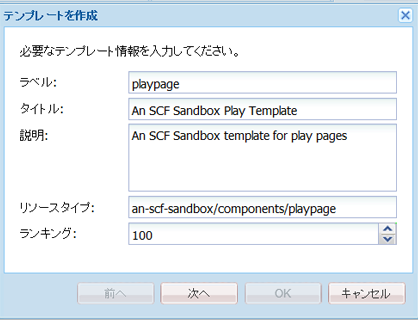
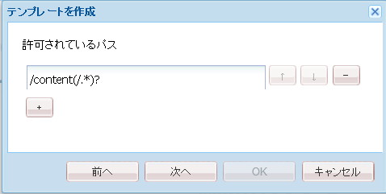
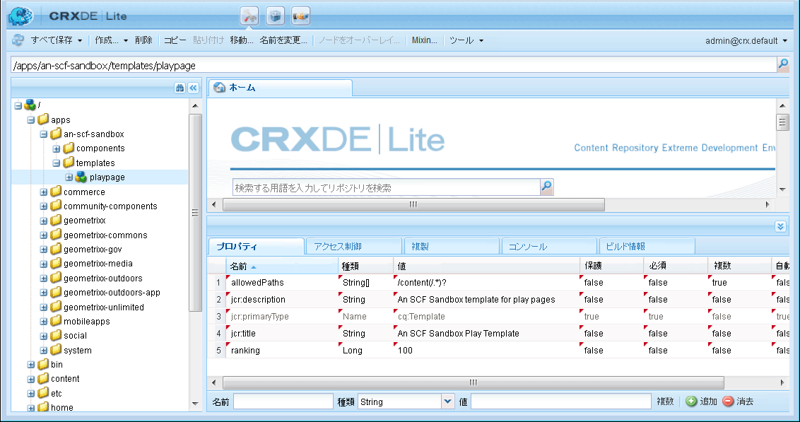
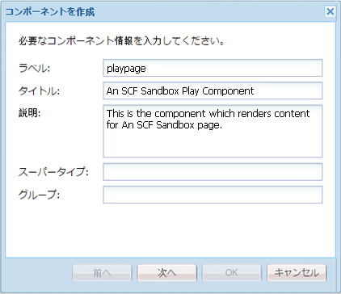
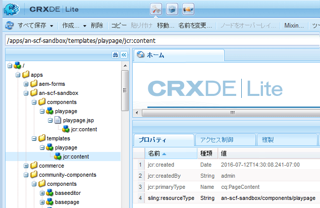

# 初期サンドボックスアプリケーション {#initial-sandbox-application}

この節では、次を作成します。

* サンプル web サイトでコンテンツ ページを作成するために使用される&#x200B;**[テンプレート](#createthepagetemplate)**。
* Web サイト ページのレンダリングに使用される&#x200B;**[コンポーネントとスクリプト](#create-the-template-s-rendering-component)**。

## コンテンツテンプレートの作成 {#create-the-content-template}

テンプレートは、新しいページのデフォルトコンテンツを定義します。 複雑な web サイトでは、サイト内の様々なタイプのページを作成するために、複数のテンプレートを使用する場合があります。 さらに、一連のテンプレートは、サーバーのクラスターに変更をロールアウトするために使用される設計図になる場合があります。

この演習では、すべてのページを 1 つのシンプルなテンプレートに基づいて作成します。

1. CRXDE Liteのエクスプローラーパネルで、次の操作を行います。

   * `/apps/an-scf-sandbox/templates` を選択します。
   * **[!UICONTROL 作成]** / **[!UICONTROL テンプレートを作成]**

1. テンプレートを作成ダイアログで、次の値を入力して「**[!UICONTROL 次へ]**」をクリックします。

   * ラベル：`playpage`
   * タイトル：`An SCF Sandbox Play Template`
   * 説明：`An SCF Sandbox template for play pages`
   * リソースの種類：`an-scf-sandbox/components/playpage`
   * ランキング：&lt; デフォルトのままにする>

   Labelはノード名に使用されます。

   リソースタイプは、`playpage`の`jcr:content` ノードにプロパティ `sling:resourceType`として表示されます。 ブラウザーから要求されたときにコンテンツをレンダリングするコンポーネント（リソース）を識別します。

   この場合、`playpage` テンプレートを使用して作成されたすべてのページは、`an-scf-sandbox/components/playpage` コンポーネントによってレンダリングされます。 規則により、コンポーネントへのパスは相対パスであり、Slingは`/apps` フォルダーで最初にリソースを検索し、見つからない場合は`/libs` フォルダーでリソースを検索できます。

   

1. コピー/ペーストを使用する場合は、リソースタイプの値に先頭または末尾のスペースがないことを確認します。

   「**[!UICONTROL 次へ]**」をクリックします。

1. 「許可パス」とは、このテンプレートを使用するページのパスを指します。テンプレートは&#x200B;**[!UICONTROL 新しいページ]** ダイアログに表示されます。

   パスを追加するには、プラスボタン `+`をクリックし、表示されるテキストボックスに`/content(/.&ast;)?`と入力します。 コピー/ペーストを使用する場合は、先頭または末尾にスペースがないことを確認します。

   注意：許可されるパスプロパティの値は&#x200B;*正規表現*&#x200B;です。 式に一致するパスを持つコンテンツページは、テンプレートを使用できます。 この場合、正規表現は&#x200B;**/content** フォルダーとそのすべてのサブページのパスと一致します。

   作成者が`/content`より下のページを作成すると、「SCF サンドボックスページ テンプレート」というタイトルの`playpage` テンプレートが、使用可能なテンプレートのリストに表示されます。

   ルートページをテンプレートから作成した後、プロパティを編集してルートパスを正規表現に含めることで、テンプレートへのアクセスをこのweb サイトに制限できます。

   `/content/an-scf-sandbox(/.&ast;)?`

   

1. 「**[!UICONTROL 次へ]**」をクリックします。

   「**[!UICONTROL 許可された親]**」パネルの「**[!UICONTROL 次へ]**」をクリックします。

   **[!UICONTROL 許可された子]** パネルの&#x200B;**[!UICONTROL 次へ]**&#x200B;をクリックします。

   「**[!UICONTROL OK]**」をクリックします。

1. 「OK」をクリックしてテンプレートの作成を完了した後、新しい`playpage` テンプレートの「プロパティ」タブ値の隅に表示される赤い三角形に注目してください。 これらの赤い三角形は、保存されていない編集を示します。

   「**[!UICONTROL すべて保存]**」をクリックして、新しいテンプレートをリポジトリに保存します。

   

### テンプレートのレンダリングコンポーネントの作成 {#create-the-template-s-rendering-component}

コンテンツを定義し、[再生ページテンプレート ](#createthepagetemplate)に基づいて作成されたページをレンダリングする&#x200B;*コンポーネント*&#x200B;を作成します。

1. CRXDE Liteで、**`/apps/an-scf-sandbox/components`**&#x200B;を右クリックし、**[!UICONTROL 作成/ コンポーネント]**&#x200B;をクリックします。
1. ノードの名前（ラベル）を&#x200B;*playpage*&#x200B;に設定すると、コンポーネントへのパスは

   `/apps/an-scf-sandbox/components/playpage`

   これは、再生ページテンプレートのリソースタイプに対応します（オプションで、パスの最初の&#x200B;**`/apps/`**&#x200B;部分を除きます）。

   **[!UICONTROL コンポーネントを作成]**&#x200B;ダイアログで、以下のプロパティ値を入力します。

   * ラベル：**playpage**
   * タイトル：**SCF サンドボックス再生コンポーネント**
   * 説明：**これは、SCF サンドボックス ページのコンテンツをレンダリングするコンポーネントです。**
   * スーパータイプ：*&lt;空白のままにする>*
   * グループ：*&lt;空白のままにする>*

   

1. ダイアログの&#x200B;**[!UICONTROL 許可された子]** パネルが表示されるまで、**[!UICONTROL 次の]**&#x200B;をクリックします。

   * 「**[!UICONTROL OK]**」をクリックします。
   * 「**[!UICONTROL すべて保存]**」をクリックします。

1. コンポーネントへのパスとテンプレートのresourceTypeが一致することを確認します。

   >[!CAUTION]
   >
   >再生ページコンポーネントへのパスと再生ページテンプレートの`sling:resourceType` プロパティとの対応は、web サイトを正しく機能させるために極めて重要です。

   
