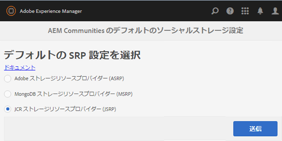

# JSRP - JCR ストレージリソースプロバイダー {#jsrp-jcr-storage-resource-provider}

## JSRPについて {#about-jsrp}

AEM CommunitiesがJSRPをストレージオプション（デフォルト）として使用する場合、コミュニティコンテンツはJCRに保存され、ユーザー生成コンテンツ（UGC）は、そのコンテンツが投稿されたオーサーインスタンスまたはパブリッシュインスタンスからのみアクセスできます。

デプロイメントはシンプルであるため、JSRPは、1つのパブリッシュインスタンスと1つのオーサーインスタンスのデモ環境や開発環境に最適です。

[SRP オプションの特性](working-with-srp.md#characteristics-of-srp-options)および[推奨トポロジ &#x200B;](topologies.md)も参照してください。

## 設定 {#configuration}

### JSRPを選択 {#select-jsrp}

デフォルトでは、JSRPはUGCのストレージオプションです。

[&#x200B; ストレージ設定コンソール &#x200B;](srp-config.md)では、使用するSRPの実装を特定するデフォルトのストレージ設定を選択できます。

オーサー環境で、ストレージ設定コンソールにアクセスします

* グローバルナビゲーションから：**[!UICONTROL ツール]** > **[!UICONTROL コミュニティ]** > **[!UICONTROL ストレージ設定]**

* **[!UICONTROL JCR ストレージリソースプロバイダー（JSRP）]**&#x200B;を選択

* 「**[!UICONTROL 送信]**」を選択します。

### 設定の公開 {#publishing-the-configuration}

JSRPがデフォルト設定ですが、パブリッシュ環境で同じ設定が設定されるようにするには、次の手順を実行します。

* グローバルナビゲーションから：**[!UICONTROL ツール]** > **[!UICONTROL デプロイメント]** > **[!UICONTROL レプリケーション]**
* **[!UICONTROL Activate Tree]** > **[!UICONTROL Start Path]**&#x200B;を選択します。

  * `/conf/global/settings/community/srpc/`を参照

* **[!UICONTROL アクティブ化]**&#x200B;を選択

## ユーザーデータの管理 {#managing-user-data}

*ユーザー*、*ユーザープロファイル*&#x200B;および&#x200B;*ユーザーグループ*&#x200B;について、パブリッシュ環境で頻繁に入力される情報については、次のサイトを参照してください。

* [ユーザー同期](sync.md)
* [ユーザーとユーザーグループの管理](users.md)

## トラブルシューティング {#troubleshooting}

### UGCがJCRに表示されない {#ugc-not-visible-in-jcr}

ストレージオプションの設定を確認して、JSRPがデフォルトプロバイダーに設定されていることを確認します。 デフォルトでは、ストレージリソースプロバイダーはJSRPです。

すべてのオーサーおよびパブリッシュ AEM インスタンスで、ストレージ設定コンソールを再訪問するか、AEM リポジトリを確認します。

* JCRで、[/conf/global/settings/community](http://localhost:4502/crx/de/index.jsp#/conf/global/settings/community)の場合

  * [srpc](http://localhost:4502/crx/de/index.jsp#/conf/global/settings/community/srpc) ノードが含まれていません。これは、ストレージプロバイダーがJSRPであることを意味します。
  * srpc ノードが存在し、ノード [defaultconfiguration](http://localhost:4502/crx/de/index.jsp#/conf/global/settings/community/srpc/defaultconfiguration)が含まれている場合、defaultconfigurationのプロパティでJSRPをデフォルトプロバイダーとして定義する必要があります。

### UGCがオーサーインスタンスで表示されない {#ugc-not-visible-on-author-instance}

バグではありません。 JSRPの特徴は、パブリッシュ環境で入力されたコミュニティコンテンツがパブリッシュ環境でのみ表示されることです。

### UGCがパブリッシュインスタンスに表示されない {#ugc-not-visible-on-publish-instance}

1つのパブリッシュインスタンスまたはパブリッシュクラスターがデプロイされている場合は、[UGC Not Visible in JCR](#ugc-not-visible-in-jcr)の手順に従います。

パブリッシュファームがデプロイされている場合、JSRPの特徴は、コミュニティコンテンツが投稿されたパブリッシュインスタンスでのみ表示されることです。

UGCを任意のパブリッシュインスタンスから表示するには、パブリッシュクラスターが必要です。
