# モデレートコンソール {#moderation-console}

AEM Communitiesでは、作成者とパブリッシュ環境の両方から、管理者とコミュニティモデレーター（モデレーターとして割り当てられた信頼できるコミュニティメンバー）がコミュニティコンテンツの一括[&#x200B; モデレーションを行うことができます](/help/communities/moderate-ugc.md)。

管理者とコミュニティ モデレーターは、パブリッシュ環境で[&#x200B; インコンテクスト モデレーション &#x200B;](/help/communities/in-context.md)を実行することもできます。

すべての[&#x200B; コミュニティサイト &#x200B;](/help/communities/sites-console.md)の機能は、管理者権限でログインしているユーザーが利用できる`Administration` メニュー項目です。 `Administration` リンクを使用すると、モデレーションコンソールにアクセスできます。

モデレーションコンソールから、管理者とコミュニティモデレーターは、モデレーションする権限を持つすべてのユーザー生成コンテンツ（UGC）にアクセスできます。 複数のサイトを管理できる場合は、すべてのサイトで投稿を表示したり、選択したコミュニティサイトで絞り込んだりできます。

詳細については、[&#x200B; ユーザーとユーザーグループの管理](/help/communities/users.md)を参照してください。

モデレーションコンソールでは、次の機能がサポートされています。

* モデレーションタスクを一括実行。
* UGCの検索：
* UGCの詳細：
* UGC制作者の詳細の表示。

管理者または` [moderator permissions](/help/communities/in-context.md#identifyingtrustedmembers)`を持つメンバーとしてログインした場合にのみ、モデレーションタスクを実行できます。

## 環境アクセスを公開 {#publish-environment-access}

公開されたコミュニティサイトからモデレーションコンソールにアクセスするには、コミュニティモデレーターがサインインしたときに表示される管理リンクを使用します。

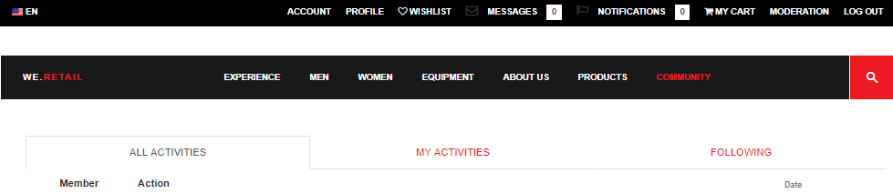

管理リンクを選択すると、モデレーションコンソールが表示されます。

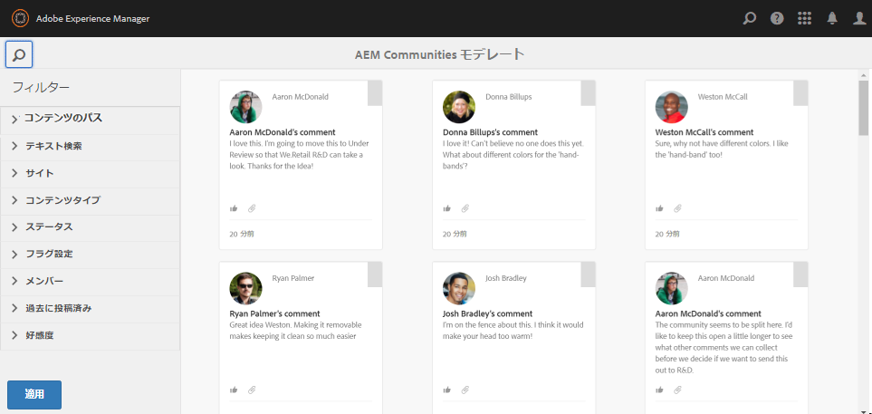

## オーサー環境アクセス {#author-environment-access}

オーサー環境でモデレーションコンソールにアクセスし

* グローバルナビゲーションから、**[!UICONTROL Communities]** > **[!UICONTROL Moderation]**&#x200B;を選択します。

管理者として、または[&#x200B; モデレーター権限](/help/communities/in-context.md#identifyingtrustedmembers)を持つメンバーとしてログインした場合にのみ、モデレーションタスクを実行できます。 表示される唯一のコミュニティコンテンツは、サインインしたメンバーが管理を許可されているコンテンツです。

>[!NOTE]
>
>パブリッシュ環境のUGCは、選択したSRPが共通ストアを実装している場合にのみオーサーに表示されます。 例えば、デフォルトでは、ストレージはJSRPで、オーサーとパブリッシュの一般的なストアではありません。 [コミュニティコンテンツのストレージ](/help/communities/working-with-srp.md)を参照してください。

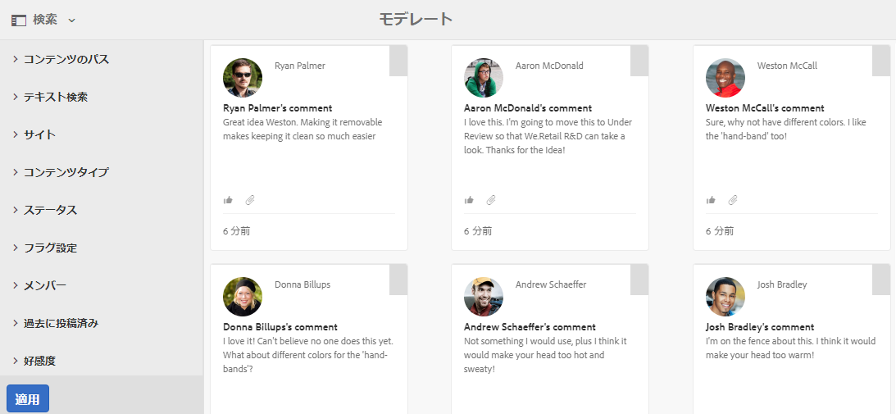

## モデレーションコンソール UI {#moderation-console-ui}

左側のナビゲーションパネル（作成者には表示されますが、パブリッシュには表示されません）を除いて、モデレーション UIには次の主な領域があります。

* **[上部のナビゲーションバー](#top-navigation-bar)**
* **[ツールバー](#toolbar)**
* **[コンテンツ領域](#content-area)**

### 上部ナビゲーションバー {#top-navigation-bar}

上部のナビゲーションバーは、すべてのコンソールに対して一定です。 詳しくは、[基本処理](/help/sites-authoring/basic-handling.md)を参照してください。

### ツールバー {#toolbar}

上部のナビゲーションバーの下にあるツールバーには、左側に次の切り替えスイッチがあります。

* [&#x200B; フィルターパネル](/help/communities/moderation.md#filterrail)
コンテンツをフィルタリングするプロパティを選択できるパネルが開きます。

上部のナビゲーションバーの下にあるツールバーには、左側に次の切り替えスイッチがあります。

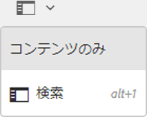

[&#x200B; フィルターパネル](/help/communities/moderation.md#filterrail)
「検索」を選択するとパネルが開き、コンテンツをフィルタリングするプロパティを選択できます。

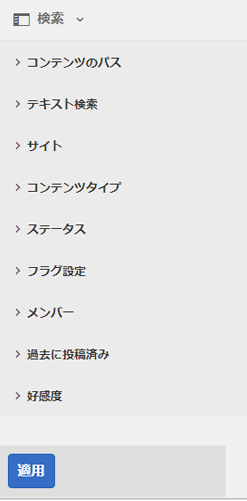

### コンテンツ領域 {#content-area}

コンテンツ領域には、投稿されたUGCの情報が含まれます。

* UGCを投稿しました
* メンバー名
* メンバーアバター
* 投稿の場所
* 投稿日
* 投稿への返信の数
* 投稿に関連付けられている[センチメント](/help/communities/moderate-ugc.md#sentiment)
* 承認されると、チェックマークが表示されます
* 添付ファイルがある場合、ペーパークリップが表示されます

>[!NOTE]
> 
>コンテンツ領域には&#x200B;*無限スクロール*&#x200B;が表示されます。つまり、コンテンツの最後に達するまでスクロールし続けることができます。 ツールバーは、スクロール中でもコンテンツ領域の上に固定された表示位置のままです。

### フィルターレール {#ootbfilters}

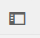

サイドパネルアイコンがフィルターパネルを開きます。 フィルターパネルは、コンテンツ領域の左側に表示され、コンテンツ領域に表示される参照先のUGCにそれぞれ異なるフィルターを適用します。

各カテゴリ内のフィルターは&#x200B;**OR**&#x200B;個あり、異なるカテゴリのフィルターは&#x200B;**AND**&#x200B;個あります。

例えば、**質問**&#x200B;と&#x200B;**回答**&#x200B;の両方をチェックすると、**質問** *または*&#x200B;と&#x200B;**回答**&#x200B;の両方のコンテンツが表示されます。

ただし、**質問**&#x200B;と&#x200B;**保留中**&#x200B;をチェックすると、**質問**&#x200B;で&#x200B;**保留中**&#x200B;のコンテンツのみが表示されます。

>[!NOTE]
>
>コミュニティモデレーターは、モデレーションコンソール UIで事前定義されたフィルターをブックマークできます。 これらのフィルターは（クエリ文字列パラメーターとして） URLの末尾に追加されるので、モデレーターは後でブックマーク付きのフィルターに戻り、これらのリンクも共有できます。

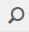

フィルターパネルが開いている場合、検索アイコンはサイドパネルを閉じることを切り替えます。 ただし、フィルターパネルを閉じてユーザー生成コンテンツのみを表示するには、検索アイコンをクリックし、「コンテンツのみ」オプションを選択します。

#### コンテンツのパス {#content-path}

コンテンツパスは、表示される参照UGCを、指定したコンテンツリポジトリに配置された投稿に制限します。

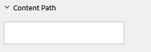

#### テキスト検索 {#text-search}

テキスト検索では、入力されたテキストが含まれる投稿に表示される参照UGCを制限します。

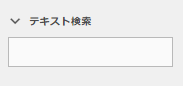

#### サイト {#site}

サイトは、選択したコミュニティサイトへの投稿に表示される参照UGCを制限します。 サイトがチェックされていない場合、UGCへのすべての参照が表示されます。

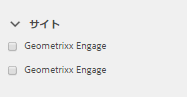

>[!NOTE]
>
>管理者が一括管理コンソールにアクセスすると、Geometrixx サンプルなど、[&#x200B; サイト作成ウィザード &#x200B;](/help/communities/sites-console.md)で作成されていないサイトを含め、UGCへのすべての参照が表示されます。
>
>信頼できるコミュニティメンバーが一括管理コンソールにパブリッシュでアクセスすると、そのメンバーが管理を許可されたコミュニティサイト用に作成されたUGCへの参照のみが表示されます。 また、サイトフィルターでフィルタリングすることもできます。

#### コンテンツタイプ {#content-type}

コンテンツタイプは、選択したリソースタイプの投稿に表示される参照UGCを制限します。 次の1つ以上のタイプを選択できます。 選択されていない場合は、すべてのタイプが表示されます。

* **コメント**
* **フォーラムのトピック**
* **フォーラム返信**
* **QnA質問**
* **QnA回答**
* **ブログ記事**
* **ブログコメント**
* **カレンダーイベント**
* **カレンダーコメント**
* **ファイルライブラリフォルダー**
* **ファイルライブラリドキュメント**
* **アイデア**
* **アイデア創出コメント**

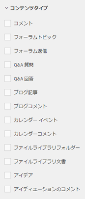

#### その他のコンテンツタイプ {#additional-content-types}

フィルターするリソースを追加するには：

* オーサーインスタンスに管理者としてログインします。
* [Web コンソール &#x200B;](https://localhost:4502/system/console/configMgr)を開きます。
* `AEM Communities Moderation Dashboard Filters` を見つけます。
* 編集モードで開くことができるように、設定を選択します。
* フィルターするコンポーネントのResourceTypeを入力します。

  * 例えば、含まれる投票コンポーネントをフィルタリングするには、次のように入力します。

    `Voting=social/tally/components/hbs/voting`

  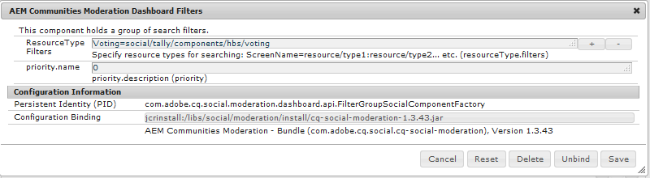

* 「保存」を選択します。
* Communities - Moderation コンソールを更新します。

結果は、`Content Type` フィルターグループの下の`Voting`の新しい選択可能なフィルターです。

このフィルターを選択すると、ダッシュボードのコンテンツに、入力したすべてのResourceTypeに一致するUGCが表示されます。

#### ステータス {#status}

ステータスは、選択したステータスの投稿に表示される参照UGCを制限します。この投稿には、保留中、承認済み、拒否、クローズの1つ以上、ブログ記事のドラフトまたはスケジュール、QnAの質問に対する回答または未回答が含まれます。 何も選択されていない場合は、すべて表示されます。

>[!NOTE]
>
>「未回答」ステータスのみが選択されている場合は、回答された質問を除くすべてのコンテンツ（すべてのコンテンツタイプ）がモデレーターに表示されます。 これは、回答済み質問の責任を負うプロパティが、未回答の質問やその他のコンテンツ（フォーラムのトピック、ブログ記事、コメントなど）が存在しない場合に存在しないためです。

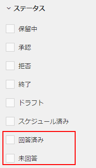

#### フラグ設定 {#flagging}

フラグを設定すると、表示される参照UGCが、フラグが設定された投稿または非表示の投稿に制限されます。

コンテンツの一部にフラグを付けた後、**フラグ** ボタンをもう一度選択して、そのコンテンツの一部のフラグを解除するまで、そのコンテンツはフラグ付けされたままになります。 「重要」や「フォローアップ」などのフラグ付きレベルはありません。

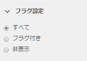

#### メンバー {#members}

メンバーは、入力されたメンバー名によって投稿されたUGCに表示される参照UGCを制限します。

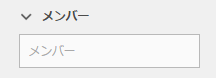

#### 過去に投稿済み {#posted-in-the-last}

「過去の投稿」では、過去1時間、1日、1週間、1か月、1年に投稿されたUGCに表示される参照先のUGCを制限しています。

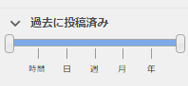

#### 好感度 {#sentiment}

[センチメント](/help/communities/moderate-ugc.md#sentiment)は、表示される参照UGCを、正、負、または中立のいずれかのセンチメント値を持つ投稿に制限します。

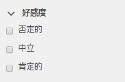

## カスタムフィルター {#custom-filters}

[&#x200B; フィルターレール &#x200B;](/help/communities/moderation.md#ootbfilters)の標準フィルターとは別に、メタデータに対する追加のカスタムフィルターをモデレーション UIに追加できます。 開発者は、GitHubのサンプルコードを使用して、既存のモデレーション UI フィルターを拡張できます。

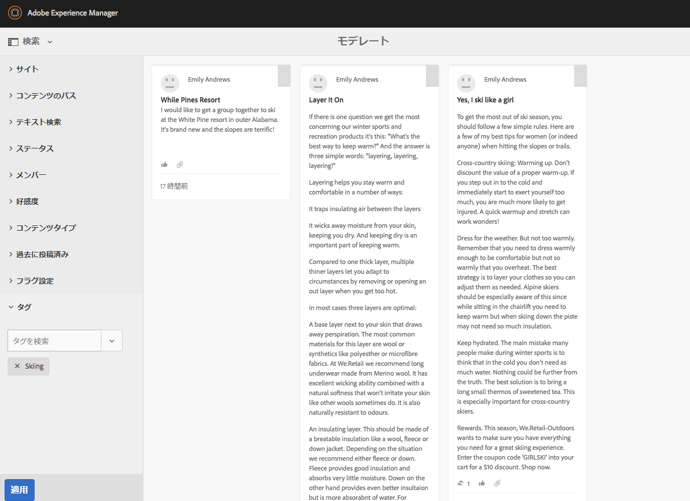

GitHubの[&#x200B; サンプルプロジェクト &#x200B;](https://github.com/Adobe-Marketing-Cloud/aem-communities-extensions/tree/main/aem-communities-moderation-filter)は、ユーザーが生成したコンテンツに特定のタグが適用されているかどうかに基づいてUGC リストをフィルタリングするタグフィルターを実装しています。 サンプルコードに従って、ほかの類似するUGC メタデータフィールド用の類似フィルターを構築できます。

タグフィルターのサンプルをインストールするには：

1. AEM オーサー（`https://[aem-author]:4502/crx/packmgr/index.jsp`） インスタンスとAEM パブリッシュ （`https://[aem-publish]:4503/crx/packmgr/index.jsp`） インスタンスでパッケージマネージャーを開きます。
1. パッケージ `com.adobe.social.sample.moderation.filter.ui.apps-1.0-SNAPSHOT.zip`をGitHub コードからビルドし、同じものをインストールして有効にします。
1. AEM オーサー（`https://[aem-author]:4502/system/console/bundles`）インスタンスおよびAEM パブリッシュ（`https://[aem-publish]:4503/system/console/bundles`）インスタンスでバンドルコンソールを開きます。
1. GitHubからパッケージ （`[com](https://sample-moderation-filter.com/).adobe.social.sample.moderation.filter.core-1.0-SNAPSHOT.jar`）をビルドし、同じものをインストールして有効にします。
1. AEM オーサー（`https://[aem-author]:4502/crx/de/index.jsp#/apps/social/moderation/facets`）およびAEM パブリッシュ（`https://[aem-publish]:4502/crx/de/index.jsp#/apps/social/moderation/facets`）インスタンスの&#x200B;**/apps/social/moderation/facets** ノードに移動します。
1. テクニカルユーザー&#x200B;**communities-utility-reader**&#x200B;を`jcr:read`権限で追加します。

既存のコミュニティサイトでカスタムフィルターを公開するには：

1. 既存の管理ページ `/content/we-retail/us/en/community/moderation/shell3/jcr:content/head/clientlibs.`の`Clientlibs`を編集

   * 新しいカテゴリ `cq.social.hbs.moderation.v2.`を追加

1. `/content/we-retail/us/en/community/moderation/shell3/jcr:content/rails/searchWell/items/filters.` に移動します。

   * 新しいコンポーネント `sling:resourceType = social/moderation/v2/filters.`に設定

1. `/content/we-retail/us/en/community/moderation/shell3/jcr:content/views/content/items/modcontainer` にアクセスします。

   * 新しいコンポーネント `sling:resourceType = social/moderation/v2/modcontainer`に設定します。

## モデレーション活動 {#moderation-actions}

[&#x200B; モデレーションアクション &#x200B;](/help/communities/moderate-ugc.md#moderation-actions)は、コンテンツ領域で行われた1つ以上の選択や、コンテンツの詳細を表示する際に実行できます。

投稿を一括管理するには、コンテンツ領域で、投稿の選択（）アイコンをクリックします。これは、マウス（デスクトップ）で投稿の上にカーソルを合わせるか、投稿（モバイル）で指を押し続けるときに表示されます。 これを行うと、複数選択モードに入り、その後の投稿をクリックするだけで一括管理するように選択できるようになりました。 ツールバーに表示されるボタンを使用して、選択した投稿に対してモデレーションアクションを実行できます。 すべてのアクションで確認を求めるプロンプトが表示されます。

コンテンツ領域で単一の投稿を調整するには、マウス（デスクトップ）でカーソルを合わせるか、投稿（モバイル）で指を押し続けて、投稿にボタンが表示されるようにします。 単一のコンテンツの詳細を操作する場合、確認を求めるプロンプトは削除アクションのみです。

### 複数の投稿の管理 {#moderating-multiple-posts}

投稿の`Select` アイコンをクリックして、一括選択モードに入ります。

一括選択モードを終了するには、ツールバーのキャンセル（x）アイコンを選択します。

複数の投稿で実行できるモデレーションアクションは次のとおりです。

* 拒否
* 削除
* 投稿を閉じる/再度開く

これらのアクションを許可するアイコンは、複数の投稿が選択されている場合にのみツールバーに表示されます。

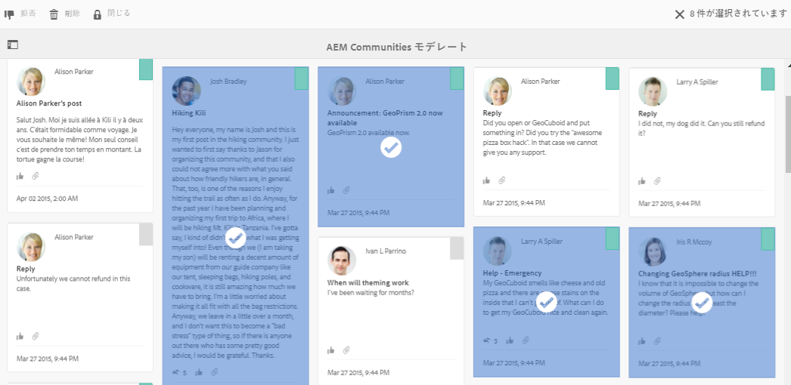

### 単一の投稿の管理 {#moderating-a-single-post}

単一選択モードでは、次のことが可能です。

* ユーザー名を選択して、ユーザーの詳細を表示します。
* 投稿へのリンクを選択して、投稿をインコンテクストで表示します。
* [返信](#reply)
* [許可](#allow)
* [拒否](#deny)
* [削除](#delete)
* [閉じる](#close)
* [&#x200B; モデレーション履歴](#moderation-history)を表示
* [詳細を表示](#viewdetails)

モデレーションアクションアイコンの上にあるカード表示には、投稿のテキストが表示され、次のデータが表示されます。

* 返信がある場合、その前に返信の数が表示されます
* フラグが立てられている場合
* 承認されていれば
* UGCが投稿されたとき

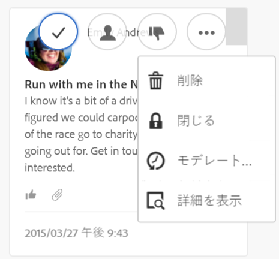

#### 返信 {#reply}

1つの投稿を操作する場合、UGC タイプが返信をサポートし、返信を許可するように設定されている場合は、返信アイコンが表示されます。

#### 許可 {#allow}

1つの投稿を操作する場合、その投稿にフラグが付けられたか拒否されたときに、「許可」アイコンが表示されます。 フラグが設定されている場合、「許可」を選択すると、すべてのフラグがクリアされます。

#### 拒否 {#deny}

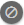

「**拒否**」モデレーションアクションは、モデレートされたコンテンツでのみ使用でき、複数選択モードを除き、モデレートされていないコンテンツには表示されません。

モデレートされていないコンテンツは、常に承認されます。

モデレートされたコンテンツは、最初に「保留中」状態になり、後で承認または拒否のために変更できます。

保留状態を残したコンテンツは、保留状態に戻すことはできません。 「承認」または「拒否」としてマークされたコンテンツは、いつでも別の状態に変更できます。

#### 削除 {#delete}

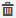

単一選択モードまたはバルクモードでは、項目を選択して削除できます。 削除アクションを実行すると、確認ダイアログが表示されます。 削除すると、それらのアイテムはすぐにコンテンツ領域から消えます。 **UGCが削除されると、リポジトリから完全に削除され、後で取得することはできません**。

#### 閉じる {#close}

1つの投稿を操作する場合、UGC タイプがそのリソースの投稿を防ぐ機能をサポートしている場合は、「閉じる」アイコンが表示されます。

#### モデレート履歴 {#moderation-history}

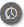

1つの投稿を操作する場合、その上にカーソルを置くと、モデレーション履歴アイコンが表示されます。 このアイコンを選択すると、UGC投稿に関して実行されたアクションの履歴を含むペインが表示されます。

複数のUGC投稿のコンテンツ領域の表示に戻るには、表示詳細ペインの右上隅にある「X」を選択します。

例：

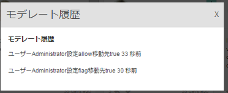

#### 詳細を表示 {#view-detail}

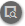

単一の投稿を操作する場合は、UGCを詳細モードで開くことで、より詳細な情報を表示できます。

これを行うには、投稿にカーソルを合わせて`View Detail` アイコンを表示し、それを選択して、投稿の詳細を含むパネルを表示します。

複数のUGC投稿のコンテンツ領域の表示に戻るには、表示詳細ペインの右上隅にある「X」を選択します。

例：

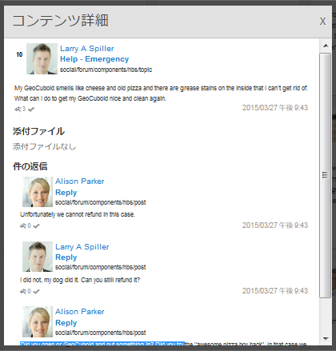
