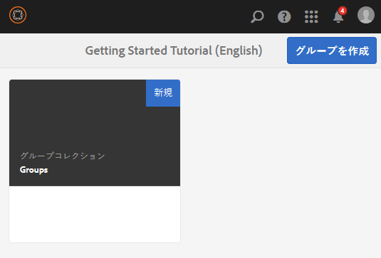
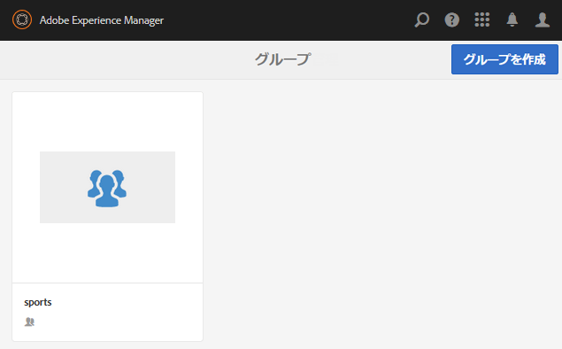
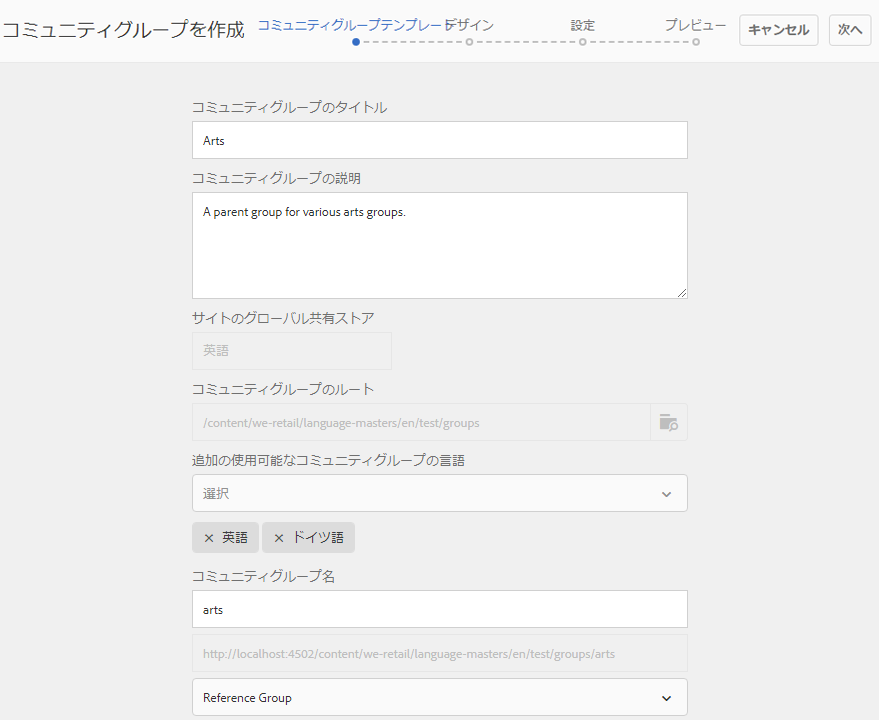
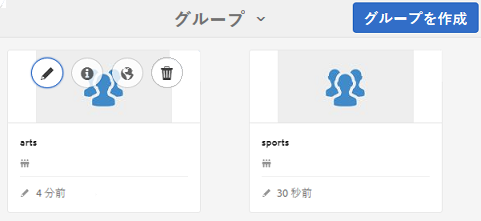
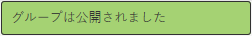
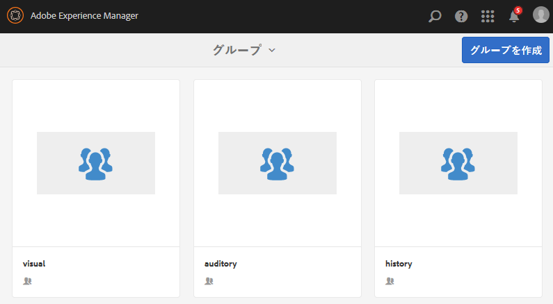

# ネストされたグループの作成{#authoring-nested-groups}

## 作成者のグループの作成 {#creating-groups-on-author}

AEM オーサーインスタンスでは、グローバルナビゲーションから次の操作を実行します。

* **[!UICONTROL Communities]** > **[!UICONTROL Sites]**&#x200B;を選択します。
* **[!UICONTROL エンゲージメントフォルダー]**&#x200B;を選択して開きます。
* **[!UICONTROL はじめにチュートリアル]**&#x200B;英語サイトのカードを選択します。

  * カード画像を選択します。
  * *not*&#x200B;でアイコンを選択します。

その結果、[ グループコンソール ](/help/communities/groups.md)にアクセスできます。

グループ関数は、グループのインスタンスが作成されるフォルダーとして表示されます。 開くには、グループ フォルダーを選択します。 公開時に作成されたグループが表示されます。

## メインのアートグループを作成 {#create-main-arts-group}

このグループは、エンゲージ用のサイト構造にグループの機能が含まれているため、作成できます。 サイトの`Reference Template`の関数の設定は、有効なグループテンプレートの選択を許可するようにデフォルトで設定されています。 したがって、この新しいグループ用に選択されたテンプレートは`Reference Group`です。

これらのコンソールは、Communities Sites コンソールに似ています。

* 「**[!UICONTROL グループを作成]**」を選択

* **コミュニティグループテンプレート**:

  * **[!UICONTROL コミュニティグループタイトル]**：アート
  * **[!UICONTROL コミュニティグループの説明]**：様々なアートグループの親グループ
  * **[!UICONTROL コミュニティグループルート]**: *デフォルトのままにする*
  * **[!UICONTROL 追加の利用可能なコミュニティグループ言語]**：ドロップダウンメニューを使用して、利用可能なコミュニティグループ言語を選択します。 メニューには、親コミュニティサイトが作成されるすべての言語が表示されます。 ユーザーは、この単一のステップで、これらの言語の中から選択して、複数のロケールでグループを作成できます。 同じグループが、それぞれのコミュニティサイトのグループコンソールで、指定された複数の言語で作成されます。
  * **[!UICONTROL コミュニティグループ名]**：アート
  * **[!UICONTROL テンプレート]**: `Reference Group`を選択するためのドロップダウン
  * **[!UICONTROL 次へ]**&#x200B;を選択

次の設定で他のパネルを続行します。

* **[!UICONTROL デザイン]**

  * デザインを変更するか、デフォルトの親サイトのデザインを許可します。
  * 「**[!UICONTROL 次へ]**」を選択します。

* **[!UICONTROL 設定]**

  * **[!UICONTROL モデレーション]**

    * 空のままにする（親サイトから継承）。

  * **[!UICONTROL メンバーシップ]**

    * 既定の`Optional Membership.`を使用

    * **[!UICONTROL サムネール]**
      * `optional.*`

    * **[!UICONTROL 次を選択]**。

* 「**[!UICONTROL 作成]**」を選択します。

### アートグループ内のネスティンググループ {#nesting-groups-within-arts-group}

`groups` フォルダーに2つのグループが含まれるようになりました（ページを更新します）。

#### グループを公開 {#publish-group}

`arts` グループ内にネストされたグループを作成する前に、`arts` カードにカーソルを合わせ、公開アイコンを選択して公開します。

グループが公開されたという確認を待ちます。

`arts` グループには`groups` フォルダーも含める必要がありますが、空で、新しいグループを作成できるフォルダーが含まれています。 アートグループフォルダーに移動し、それぞれ異なるメンバーシップ設定を持つ3つのネストされたグループを作成します。

1. **[!UICONTROL ビジュアル]**

   * タイトル: `Visual Arts`
   * 名前：`visual`
   * テンプレート：`Reference Group`
   * メンバーシップ：`Optional Membership`、公開グループを選択し、すべてのメンバーに対して開きます。

1. **[!UICONTROL 監査]**

   * タイトル: `Auditory Arts`
   * 名前：`auditory`
   * テンプレート：`Reference Group`
   * メンバーシップ：メンバーが参加できる開いているグループ `Required Membership`を選択します。

1. **[!UICONTROL 履歴]**

   * タイトル: `Art History`
   * 名前：`history`
   * テンプレート：`Reference Group`
   * メンバーシップ：招待されたメンバーにのみ表示されるシークレットグループである`Restricted Membership`を選択します。 例として、[ デモユーザー](/help/communities/tutorials.md#demo-users) `emily.andrews@mailinator.com`を招待します。

3つのネストされたグループ（サブコミュニティ）をすべて表示できるように、ページを更新します。

Communities Sites コンソールからネストされたグループに移動するには：

* **[!UICONTROL engage フォルダー]**&#x200B;を選択します
* 「**[!UICONTROL はじめに」チュートリアルカードを選択]**
* **[!UICONTROL グループ]** フォルダーを選択
* **[!UICONTROL アートカード]**&#x200B;を選択
* **[!UICONTROL グループ]** フォルダーを選択

## 公開グループ {#publishing-groups}

メインコミュニティサイトを公開した後：

* 各グループを個別に公開します。

  * グループが公開されたことを確認しています。

* 次の中にネストされたグループを公開する前に、親グループを公開します。

  * すべてのグループは、トップダウン形式で公開する必要があります。

## 公開時のエクスペリエンス {#experience-on-publish}

例えば、[ デモユーザー](/help/communities/tutorials.md#demo-users)が次の目的で使用されている場合、ログイン時に様々なグループを体験できます。

* アート/ヒストリーグループ メンバー：`emily.andrews@mailinator.com/password`
  * 制限付き（秘密鍵）グループ、アート/履歴が表示されます。
  * オプションの（パブリックな）グループを表示できます。
  * 制限付き（オープン）グループに参加できます。

* グループマネージャー：`aaron.mcdonald@mailinator.com/password`

  * オプションの（パブリックな）グループを表示できます。
  * 制限付き（オープン）グループに参加できます。
  * 制限付き（秘密鍵）グループを表示できません。

作成者のコミュニティ [ メンバーとグループ コンソール ](/help/communities/members.md)にアクセスして、コミュニティグループに対応する様々なメンバーグループに他のユーザーを追加します。
