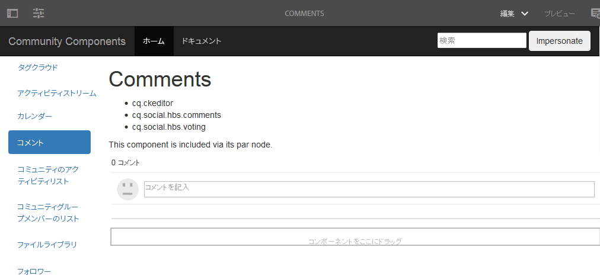

# コメントページの作成 {#create-comments-page}

**[⇐オーバーレイコメントコンポーネント &#x200B;](overlay-comments.md) [&#x200B; ノードを作成⇒](overlay-create-nodes.md)**

## コメントページ {#comments-page}

[&#x200B; コミュニティコンポーネントガイド &#x200B;](components-guide.md)を使用すると、コメントコンポーネントを簡単にオーバーレイできます。

オーサーインスタンスのページを表示します。

* [http://localhost:4502/editor.html/content/community-components/en/comments.html](http://localhost:4502/editor.html/content/community-components/en/comments.html)

**[⇐オーバーレイコメントコンポーネント &#x200B;](overlay-comments.md) [&#x200B; ノードを作成⇒](overlay-create-nodes.md)**
