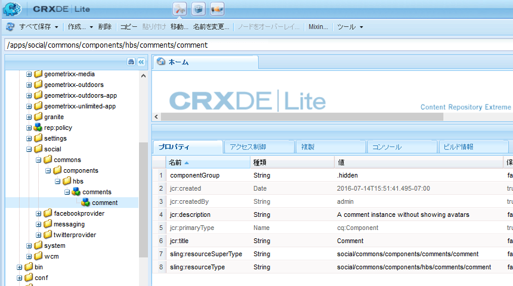

# ノードの作成 {#create-nodes}

`/libs`から`/apps`に必要な最小限のファイル数をコピーし、`/apps`で変更することで、コメントシステムをカスタムバージョンでオーバーレイします。

>[!CAUTION]
>
>/libs フォルダーの内容は変更されません。これは、/apps フォルダーの内容が変更されないまま、再インストールまたはアップグレードで/libs フォルダーが削除または置き換えられる可能性があるためです。

オーサーインスタンスで[CRXDE Lite](../../help/sites-developing/developing-with-crxde-lite.md)を使用するには、まず、/apps フォルダーに、/libs フォルダー内のオーバーレイされたコンポーネントのパスと同じパスを作成します。

複製されるパスは次のとおりです。

* `/libs/social/commons/components/hbs/comments/comment`

パス内の一部のノードはフォルダーであり、一部のノードはコンポーネントです。

1. [http://localhost:4502/crx/de/index.jsp](http://localhost:4502/crx/de/index.jsp)を参照
1. `/apps/social`を作成します（まだ存在しない場合）
   * `/apps` ノードを選択
   * **[!UICONTROL 作成> フォルダー]**
     * 名前を入力：`social`
1. `social` ノードを選択
   * **[!UICONTROL 作成]** > **[!UICONTROL フォルダー]**
     * 名前を入力：`commons`
1. `commons` ノードを選択
   * **[!UICONTROL 作成> フォルダー]**
     * 名前を入力：`components`
1. `components` ノードを選択
   * **[!UICONTROL 作成> フォルダー]**。
     * 名前を入力：`hbs`
1. `hbs` ノードを選択
   * **[!UICONTROL 作成]** / **[!UICONTROL コンポーネントを作成]**
     * ラベルを入力：`comments`
     * タイトルを入力：`Comments`
     * 説明を入力：`List of comments without showing avatars`
     * スーパータイプ：`social/commons/components/comments`
     * グループを入力：`Communities`
     * **[!UICONTROL 次へ]**&#x200B;をクリックして&#x200B;**[!UICONTROL OK]**&#x200B;まで進みます
1. `comments` ノードを選択

   * **[!UICONTROL 作成]** / **[!UICONTROL コンポーネントを作成]**

     * ラベルを入力：`comment`
     * タイトルを入力：`Comment`
     * 説明を入力：`A comment instance without avatars`
     * スーパータイプ：`social/commons/components/comments/comment`
     * グループを入力：`.hidden`
     * **[!UICONTROL 次へ]**&#x200B;をクリックして&#x200B;**[!UICONTROL OK]**&#x200B;まで進みます
   * **[!UICONTROL すべて保存]**&#x200B;を選択
1. 既定の`comments.jsp`を削除します
   * ノード `/apps/social/commons/components/hbs/comments/comments.jsp`を選択
   * 「**[!UICONTROL 削除]**」を選択します。
1. デフォルトのcomment.jspを削除します
   * ノード `/apps/social/commons/components/hbs/comments/comment/comment.jsp`を選択
   * 「**[!UICONTROL 削除]**」を選択します。
   * **[!UICONTROL すべて保存]**&#x200B;を選択

>[!NOTE]
>
>継承チェーンを保持するために、オーバーレイコンポーネントの`Super Type` （プロパティ `sling:resourceSuperType`）は、オーバーレイされるコンポーネントの`Super Type`と同じ値に設定されます。この場合は、次のようになります。
>
>* `social/commons/components/comments`
>* `social/commons/components/comments/comment`

オーバーレイの独自の`Type` （プロパティ `sling:resourceType`）は相対的な自己参照である必要があります。これにより、/appsに見つからないコンテンツは/libsで検索されます。
* 名前：`sling:resourceType`
* タイプ：`String`
* 値：`social/commons/components/hbs/comments`

1. 緑の`[+] Add`を選択します
   * 名前：`sling:resourceType`
   * タイプ：`String`
   * 値：`social/commons/components/hbs/comments/comment`
1. 緑の`[+] Add`を選択します
   * **[!UICONTROL すべて保存]**&#x200B;を選択

