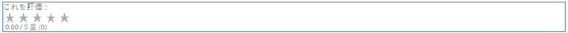
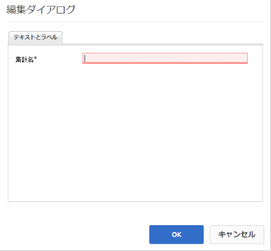

# 評価の使用 {#using-ratings}

`Rating` コンポーネントは、スタンドアロンまたは他のコミュニティ機能と共に使用されます。 このコンポーネントを使用すると、サインインしているコミュニティメンバーは、コンテンツを評価して意見を表明できます。

## ページへの評価の追加 {#adding-a-rating-to-a-page}

作成者モードのページに`Rating` コンポーネントを追加するには、コンポーネント `Communities / Rating`を見つけて、メンバーが評価する機能に対する相対的な位置など、ページ上の場所にドラッグします。

必要な情報については、[ コミュニティコンポーネントの基本](basics.md)を参照してください。

[必要なクライアントサイドライブラリ ](rating-basics.md#essentials-for-client-side)が含まれている場合、`Rating` コンポーネントはこのように表示されます。

## 評価の設定 {#configuring-rating}

配置された`Rating` コンポーネントを選択して、編集ダイアログを開く`Configure` アイコンにアクセスして選択できるようにします。

「**[!UICONTROL テキストとラベル]**」タブで、評価の内部識別子を指定します。

**[!UICONTROL 合計名]**
（*必須*）このインスタンスを一意に識別する`Rating`の簡単な名前。 リポジトリの有効なノード名である必要があります。

## サイト訪問者エクスペリエンス {#site-visitor-experience}

### メンバー {#members}

メンバーごとに1つの評価のみが許可されます。 会員は、いつでも評価を変更することができます。

### 匿名 {#anonymous}

評価の匿名での投稿はサポートされていません。 サイト訪問者は登録（会員になる）し、ログインして参加する必要があります。

## 追加情報 {#additional-information}

詳細については、開発者向けの[Rating Essentials](rating-basics.md) ページを参照してください。
