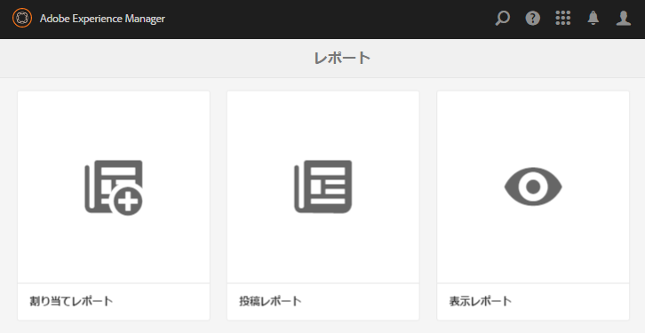
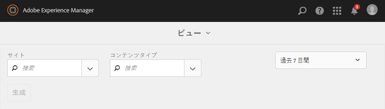
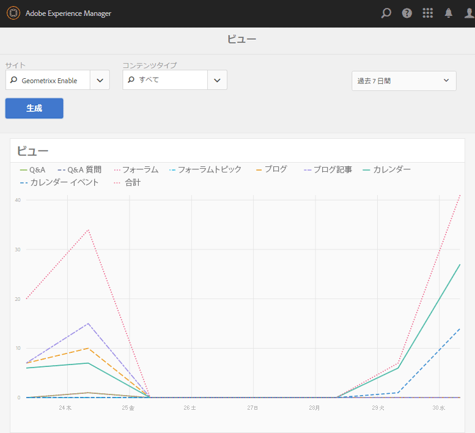
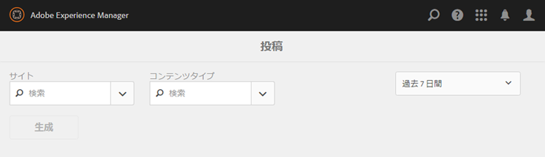
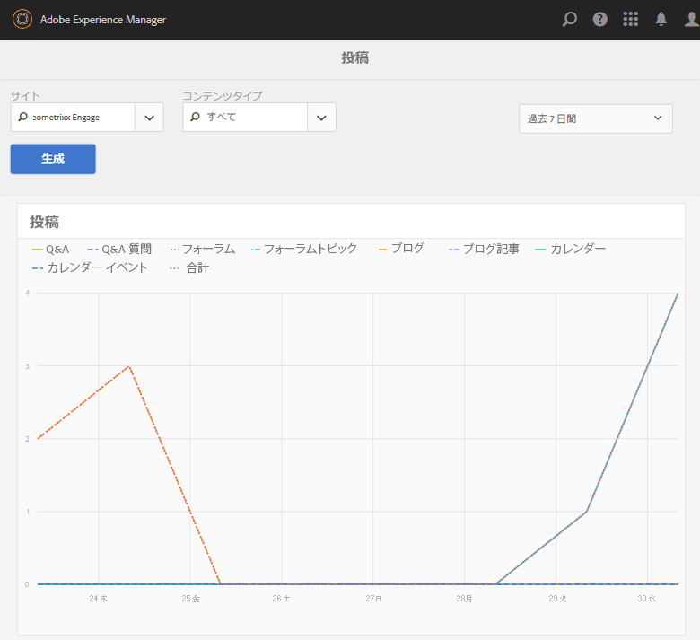

# レポートコンソール {#reports-console}

## 概要 {#overview}

AEM Communitiesの場合、オーサー環境から様々な方法でアクセスできる様々なレポートがあります。

一般的に、様々なレポートは次のとおりです。

* [&#x200B; ビューレポート &#x200B;](#views-report)

  任意のコミュニティサイトについて、コミュニティメンバーおよびサイト訪問者によるコンテンツのビューのチャートを提供します。

* [投稿レポート &#x200B;](#posts-report)

  任意のコミュニティサイトへのコミュニティメンバーによる様々な種類の投稿のチャートを提供します。

表形式のレポートは、後続の処理のために.csv形式で書き出すことができます。

## レポートコンソール {#reporting-consoles}

### コミュニティサイトのレポート {#reports-for-community-sites}

* グローバルナビゲーションから：**[!UICONTROL ナビゲーション]** > **[!UICONTROL コミュニティ]** > **[!UICONTROL レポート]**

* 次から選択：

  * **[!UICONTROL 割り当てレポート]**

    * 選択したコミュニティサイト、ユーザーまたはグループ、および割り当てのレポートを生成します。

  * **[!UICONTROL 投稿レポート]**

    * 選択したコミュニティサイト、コンテンツタイプ、期間のレポートを生成します。

  * **[!UICONTROL ビューレポート]**

    * 選択したコミュニティサイト、コンテンツタイプ、期間のレポートを生成します。

## 表示レポート {#views-report}

ビューコンソールを使用すると、特定の期間、コミュニティ機能によってページビューでレポートを生成できます。

レポートの基準を選択します。

* **[!UICONTROL サイト]**

  コミュニティサイトの選択：

* **[!UICONTROL コンテンツの種類]**

  「すべてのコンテンツ」を選択するか、サイトに存在する機能の1つを選択します。

* **[!UICONTROL 時間枠]**

  次のいずれかを選択します。

  * 過去 7 日間
  * 過去 30 日間
  * 過去 90 日間
  * 昨年

「**[!UICONTROL 生成]**」を選択してレポートを作成します。

## 投稿レポート {#posts-report}

投稿コンソールでは、特定の期間のコミュニティ機能への投稿数に関するレポートを生成できます。

レポートの基準を選択します。

* **[!UICONTROL サイト]**

  コミュニティサイトの選択：

* **[!UICONTROL コンテンツの種類]**

  「すべてのコンテンツ」を選択するか、サイトに存在する機能の1つを選択します。

* **[!UICONTROL 時間枠]**

  次のいずれかを選択します。

  * 過去 7 日間
  * 過去 30 日間
  * 過去 90 日間
  * 昨年

「**[!UICONTROL 生成]**」を選択してレポートを作成します。

## トラブルシューティング {#troubleshooting}

### コミュニティサイトが表示されていません {#no-community-sites-listed}

コミュニティサイトが表示されない場合は、Adobe Analyticsがサイトに対して有効になっていることを確認します。 割り当て時にレポートを選択する場合は、コミュニティサイトの構造に割り当て機能があることを確認します。

### AEM オーサーインスタンスにレポートが表示されない {#reports-do-not-show-in-aem-author-instance}

レポートがAEM オーサーインスタンスに表示されない場合は、パブリッシュインスタンスのURL マッピングなどのカスタマイズを確認します。 URL マッピングがcommunities サイトのAEM パブリッシュインスタンスでのみ行われる場合は、**サイトトレンドレポートのソーシャルコンポーネントファクトリー**&#x200B;設定で、AEM オーサーインスタンスで同じことが設定されていることを確認してください。

AEM オーサーのURL マッピング
