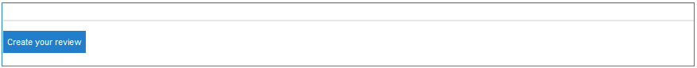
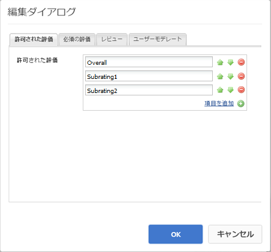
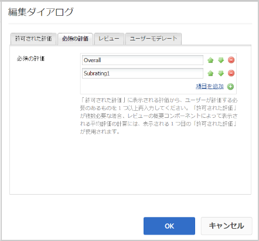
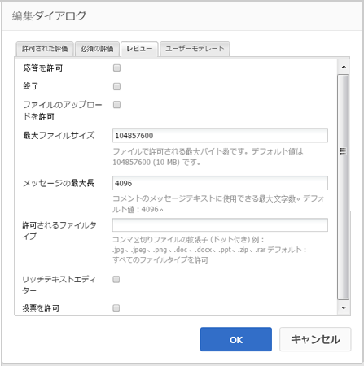
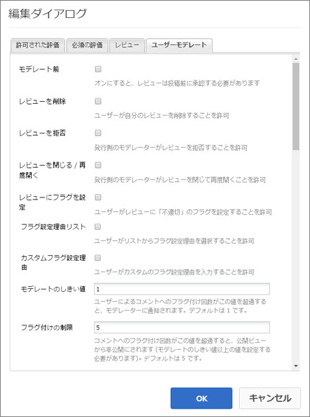
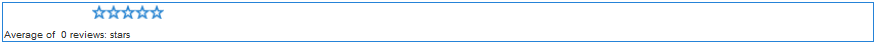
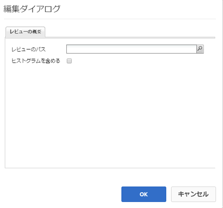
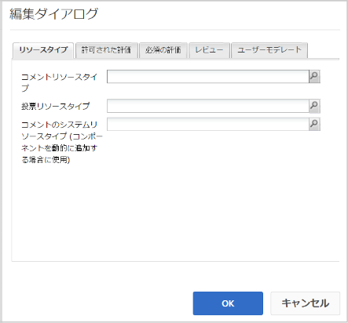

# レビューおよびレビューの概要（表示）の使用 {#using-reviews-and-reviews-summary-display}

`Reviews` コンポーネントは、[&#x200B; コメント &#x200B;](comments.md)と[評価](rating.md) コンポーネントの組み合わせで使用できます。

`Reviews Summary (Display)` コンポーネントは、サイト上の別の場所に表示するために、`Reviews` コンポーネントのアクティブなインスタンスまたはクローズしたインスタンスの概要を提供します。

>[!NOTE]
>
>レビューの匿名への投稿はサポートされていません。 サイト訪問者は登録（会員になる）し、ログインして参加する必要があります。 ログインした訪問者は、いつでもレビューを更新できます。

## ページへのレビューの追加 {#adding-a-review-to-a-page}

作成者モードでページに`Reviews` コンポーネントを追加するには、コンポーネントブラウザーを使用して`Communities / Reviews`を見つけ、ユーザーがレビューする機能に対する相対的な位置など、ページ上の場所にコンポーネントブラウザーをドラッグします。

必要な情報については、[&#x200B; コミュニティコンポーネントの基本](basics.md)を参照してください。

[必要なクライアントサイドライブラリ &#x200B;](reviews-basics.md#essentials-for-client-side)が含まれている場合、`Reviews` コンポーネントはこのように表示されます。

## レビューの設定 {#configuring-reviews}

配置された`Reviews` コンポーネントを選択して、編集ダイアログを開く`Configure` アイコンにアクセスして選択できるようにします。

「**[!UICONTROL 許可された評価]**」タブで、メンバーに表示する評価の完全なリストを指定します。 最初の評価は、`Review Summary (Display)` コンポーネントの平均評価を提供する評価であるため、全体的/一般的な評価である必要があります。 デフォルト設定の次の2つの評価には、「Subrating 1」または「Subrating 2」以外の別のタイトルを付ける必要があります。

* **[!UICONTROL 許可された評価]**

  メンバーが選択できる評価のリスト。

  上向き矢印、下向き矢印、削除ボタンを使用して、表示されている選択範囲を変更します。

  「**[!UICONTROL 項目を追加]**」をクリックして、別の評価の選択肢を追加します。

「**[!UICONTROL 必要な評価]**」タブで、評価に必要な&#x200B;**[!UICONTROL 許可された評価]**&#x200B;のリストから項目を再入力します。 「許可された評価」タブでのみ項目が指定されている場合、メンバーが送信したときに項目のマークを解除したままにされる場合があります。

web サイトでは、必要な評価にアスタリスクが付いています。 項目が必須でマークされていない場合、メンバーにメッセージが表示され、必須の評価がすべてマークされるまで送信は拒否されます。

* **[!UICONTROL 必要な評価]**

  許可されている評価のサブセット。どの評価が必要かを示します。

  上向き矢印、下向き矢印、削除ボタンを使用して、表示されている選択範囲を変更します。

  「**[!UICONTROL 項目を追加]**」をクリックして、別の回答の選択肢を追加します。

>[!NOTE]
>
>**[!UICONTROL 許可された評価]** タブで指定されていない&#x200B;**[!UICONTROL 必要な評価]** タブに項目が入力された場合、その項目は評価する項目に含まれません。

「**[!UICONTROL レビュー]**」タブで、レビューの処理方法を指定します。

* **[!UICONTROL 返信を許可]**

  オンになっている場合は、レビューへの返信を許可します。 デフォルトはオフです。

* **[!UICONTROL 終了]**

  オンにした場合、レビューは新しいレビューと返信に対して閉じられます。 デフォルトはオフです。

* **[!UICONTROL ファイルのアップロードを許可]**

  オンにした場合は、添付ファイルをレビュー用にアップロードできます。 デフォルトはオフです。

* **最大ファイルサイズ**

  **[!UICONTROL ファイルのアップロードを許可]**&#x200B;がオンになっている場合にのみ関連します。 このフィールドは、アップロードされたファイルのサイズ（バイト単位）を制限します。 デフォルトは 10 MB です。

* **[!UICONTROL メッセージの最大長]**

  テキストボックスに入力できる最大文字数。 デフォルトは4096文字です。

* **[!UICONTROL 許可されているファイル形式]**

  **[!UICONTROL ファイルのアップロードを許可]**&#x200B;がオンになっている場合にのみ関連します。 「ドット」区切り文字を持つファイル拡張子のコンマ区切りリスト。 例：.jpg、.jpeg、.png、.doc、.docx、.pdf 任意のファイルタイプを指定した場合、指定しなかったファイルタイプは使用できません。 デフォルトは、すべてのファイルタイプが許可されるように指定されていません。

* **[!UICONTROL リッチテキストエディター]**

  オンにすると、マークアップを使用して投稿が入力される場合があります。 デフォルトはオフです。

* **[!UICONTROL 投票を許可]**

  チェックを入れた場合は、トピックの投票機能を含めます。 デフォルトはオフです。

「**[!UICONTROL ユーザーモデレーション]**」タブで、投稿されたレビューの管理方法を指定します。 詳しくは、「[&#x200B; ユーザー生成コンテンツの管理](moderate-ugc.md)」を参照してください。

* **[!UICONTROL 事前管理]**

  オンにした場合、レビューは公開サイトに表示される前に承認する必要があります。 デフォルトはオフです。

* **[!UICONTROL レビューを削除]**

  オンにした場合、レビューを投稿したメンバーはレビューを削除できます。 デフォルトはオフです。

* **[!UICONTROL レビューの拒否]**

  チェックを入れた場合、モデレーターがレビューを拒否できるようにします。 デフォルトはオフです。

* **[!UICONTROL レビューを閉じる/再度開く]**

  チェックを入れた場合、モデレーターがレビューを閉じて再度開くことを許可します。 デフォルトはオフです。

* **[!UICONTROL レビューの報告]**

  チェックを入れた場合、メンバーがレビューに不適切なフラグを付けられるようにします。 デフォルトはオフです。

* **[!UICONTROL フラグ理由リスト]**

  チェックを入れた場合、レビューを不適切と判定した理由をドロップダウンリストからメンバーが選択できるようにします。 デフォルトはオフです。

* **[!UICONTROL カスタムフラグの理由]**

  チェックを入れた場合、メンバーがレビューを不適切とマークした独自の理由を入力できるようにします。 デフォルトはオフです。

* **[!UICONTROL モデレーションしきい値]**

  モデレーターに通知する前に、レビューがメンバーによってフラグ付けされる回数を入力します。 デフォルトは1回（1）です。

* **[!UICONTROL フラグ設定の上限]**

  レビューが公開ビューから非表示になる前にフラグを立てる必要がある回数を入力します。 この数値は、**[!UICONTROL モデレーションしきい値]**&#x200B;以上である必要があります。 デフォルトは 5 です。

### レビュー概要（表示）のページへの追加 {#adding-a-review-summary-display-to-a-page}

作成者モードでページに`Reviews Summary (Display)` コンポーネントを追加するには、コンポーネントを見つけます

* `Communities / Reviews Summary (Display)`

アクティブなレビューまたはクローズしたレビューの概要を表示するページ上にドラッグします。

必要な情報については、[&#x200B; コミュニティコンポーネントの基本](basics.md)を参照してください。

[必要なクライアントサイドライブラリ &#x200B;](reviews-basics.md#essentials-for-client-side)が含まれている場合、`Reviews Summary (Display)` コンポーネントはこのように表示されます。

>[!NOTE]
>
>「平均」には、要約されるレビューの「許可された評価」タブにリストされている最初の項目の投票が反映されます。

### レビュー概要の設定（表示） {#configuring-reviews-summary-display}

配置された`Reviews Summary (Display)` コンポーネントを選択して、編集ダイアログを開く`Configure` アイコンにアクセスして選択できるようにします。

「**[!UICONTROL レビューの概要]**」タブの下

* `Review Path`

  `reviews` コンポーネントの配置されたインスタンスを入力または参照して、例えば、[Geometrixx Engage サイトのWeb ページに追加した場合、パスは次のようになります。](getting-started.md)

  `/content/sites/engage/en/page/jcr:content/content/primary/reviews`

* `Include histogram`

  チェックを入れた場合は、レビューの中で星評価の数を示す棒グラフの表示を要約します。 デフォルトはオフです。

### カスタムレビュータイプへの変更 {#changing-to-a-custom-review-type}

レビューコンポーネントでは、コメントシステムを使用します。

コメントリソースタイプを変更すると、コメントシステムはデフォルトを使用してコメントのインスタンスを生成しなくなり、開発者によってカスタマイズ（拡張）されたインスタンスを生成するようになりました。

カスタムリソースタイプがわかっている場合は、[&#x200B; デザインモード &#x200B;](../../help/sites-authoring/default-components-designmode.md)と入力し、配置された`Comments` コンポーネントをダブルクリックして、追加のタブを含むダイアログを開きます。

「**[!UICONTROL リソースタイプ]**」タブで、`Comments or Voting` コンポーネントの新しいインスタンスのカスタム resourceTypeを指定します。

* **[!UICONTROL コメントリソースタイプ]**

  /appsの拡張`comment` コンポーネント （単一コメント）のresourceTypeに移動します。 例えば、`/apps/social/commons/components/hbs/comments/comment` のように指定します。

  このリソースは、訪問者がコメントを投稿したときに作成されたUGCのresourceTypeを識別します。

* **[!UICONTROL リソースタイプの投票]**

  /appsの拡張`voting` コンポーネントのresourceTypeに移動します。 例えば、`/apps/social/components/hbs/voting` のように指定します。

  このリソースは、訪問者が投票を投稿したときに作成されたUGCのリソースタイプを識別します。

* **[!UICONTROL コメント システム リソースの種類]**

  /appsの拡張`comments` コンポーネント（コメントシステム）のresourceTypeに移動します。 ページテンプレート [がリソースとしてページに追加されるのではなく、基になるスクリプトにコメントシステム &#x200B;](scf.md#add-or-include-a-communities-component)を動的に含めない限り、空白のままにします（コメントノード）。 詳しくは、[`{{include}}` ヘルパー](handlebars-helpers.md#include)を参照してください。

## サイト訪問者エクスペリエンス {#site-visitor-experience}

### モデレーターと管理者 {#moderators-and-administrators}

ログインしたユーザーにモデレーターまたは管理者権限がある場合、レビューの作成者に関係なく、コンポーネントの設定で許可されているモデレーションタスクを実行できます。

### メンバー {#members}

サイト訪問者がログインすると、設定に応じて、次のことが行われます。

* 新しいレビューを投稿
* 自分のレビューを編集
* 自分のレビューを削除
* 他のユーザーのレビューコメントにフラグを付ける

メンバーごとに1つの評価のみが許可されます。 会員は、いつでも評価を変更することができます。

### 匿名 {#anonymous}

ログインしていないサイト訪問者は投稿されたレビューを読んだり、対応している場合は翻訳したりできるが、評価やレビューを追加したり、他の人のレビューコメントにフラグを立てたりすることはできません。

## 追加情報 {#additional-information}

詳しくは、[Review Essentials](reviews-basics.md) ページの開発者向けページを参照してください。

投稿されたコメントの管理については、[&#x200B; ユーザー生成コンテンツの管理](moderate-ugc.md)を参照してください。

投稿されたコメントの翻訳については、[&#x200B; ユーザー生成コンテンツの翻訳](translate-ugc.md)を参照してください。
