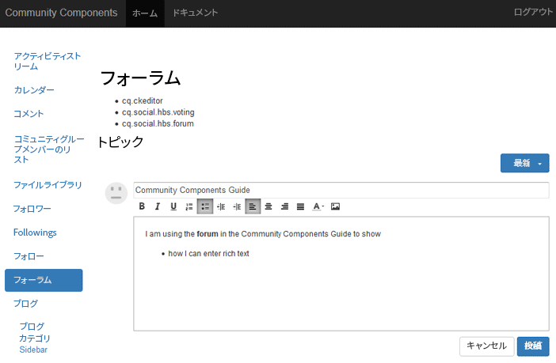

# リッチテキストエディターの基本事項 {#rich-text-editor-essentials}

## 概要 {#overview}

リッチテキストエディター（RTE）を使用すると、マークアップ付きのテキストを入力できます。

Communities コンポーネントの場合、オーサー環境の[&#x200B; リッチテキストエディター](../../help/sites-authoring/rich-text-editor.md)と同様ですが、パブリッシュ環境に入力されたテキストに影響します。



## リッチテキストエディターの有効化 {#enabling-rich-text-editor}

ユーザー生成コンテンツ（UGC）を許可するコミュニティコンポーネントを有効にして、RTEを許可できます。 コンポーネントがページに追加されたか、[関数](functions.md)に含まれている場合、RTEはデフォルトで有効にされるか、無効にされる可能性があります。

有効になっていない場合は、[作成者の編集モード &#x200B;](sites-console.md#authoring-site-content)を入力し、編集するコンポーネントを選択して、`Rich Text Editor` チェックボックスを選択します。

RTEは、次のCommunities コンポーネントで使用できます。

* [ブログ](blog-feature.md)
* [Calendar](calendar.md)
* [コメント](comments.md)
* [Filelibrary](file-library.md)
* [フォーラム](forum.md)
* [メッセージ](configure-messaging.md)
* [Q&amp;A](working-with-qna.md)
* [レビュー](reviews.md)

## カスタマイズ {#customization}

実装は[CKEditor](https://ckeditor.com/)に基づいているため、リッチテキストエディターのカスタマイズが可能です。

Communities コンポーネントの現在の設定は、次の場所にあるリポジトリの`cq.social.  scf   clientlib`にあります。

`/libs/clientlibs/social/commons/scf/ckrte.js`

cq.social.scf clientlibの変更は、今後のアップグレードで変更内容が上書きされる可能性があるため、お勧めしません。

### カスタマイズ例：インラインリンク {#example-customization-inline-links}

セキュリティ上の懸念により、ハイパーリンクオプションは、デフォルトでメンバーに表示されるリッチテキストアイコンのセットには含まれません。 UGCでヘルメットが許可されている場合、いたずらの余地は大きくなります。

ツールバーにハイパーリンクオプションを追加するには：

* 「`links`」という名前のツールバーを追加
  * `{ name: 'links', items: [ 'Link','Unlink','Anchor' ] }`
* **[!UICONTROL すべて保存]**&#x200B;を選択

#### /libs/clientlibs/social/commons/scf/ckrte.js {#libs-clientlibs-social-commons-scf-ckrte-js}

```
CKRte.prototype.config = {
    toolbar: [
        { name: "basicstyles",
           items: ["Bold", "Italic", "Underline", "NumberedList", "BulletedList", "Outdent", "Indent", "JustifyLeft", "JustifyCenter", "JustifyRight", "JustifyBlock", "TextColor"]
        },
        { name: 'links',
           items: [ 'Link','Unlink','Anchor' ]
        }
    ],
    autoParagraph: false,
    autoUpdateElement: false,
    removePlugins: "elementspath",
    resize_enabled: false
};
```
