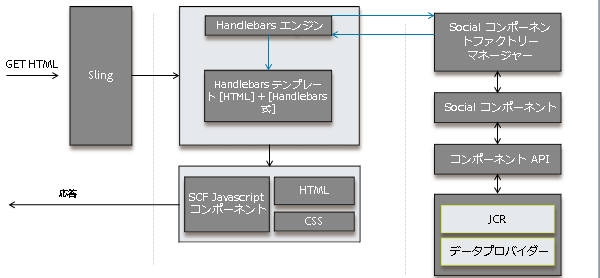
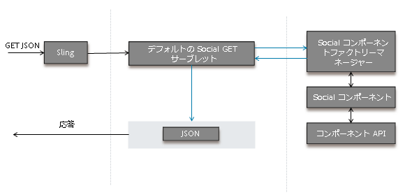
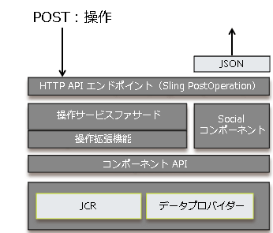

# ソーシャルコンポーネントフレームワーク {#social-component-framework}

ソーシャルコンポーネントフレームワーク（SCF）は、サーバーサイドとクライアントサイドの両方で、コミュニティコンポーネントの設定、カスタマイズ、拡張のプロセスを簡素化します。

この枠組みの利点は次のとおりです。

* **機能的**：すぐに利用できる簡単な統合機能で、80%のユースケースではカスタマイズはほとんどありません。
* **Skinnable**: CSSのスタイル設定にHTML属性を一貫して使用しています。
* **拡張可能**: コンポーネントの実装はオブジェクト指向で、ビジネスロジックが軽いため、サーバーに増分ビジネスログインを簡単に追加できます。
* **柔軟性**：簡単にオーバーレイおよびカスタマイズできる、ロジックを使用しないシンプルなJavaScript テンプレート。
* **アクセス可能**: HTTP APIは、モバイルアプリを含むあらゆるクライアントからの投稿をサポートしています。
* **ポータブル**：任意のテクノロジ上に構築された任意のWeb ページを統合または埋め込みます。

インタラクティブな[ コミュニティコンポーネントガイド ](components-guide.md)を使用して、オーサーインスタンスまたはパブリッシュインスタンスを調査します。

## 概要 {#overview}

SCFでは、コンポーネントは、SocialComponent POJO、Handlebars JS テンプレート（コンポーネントをレンダリング）、CSS （コンポーネントのスタイル設定）で構成されます。

Handlebars JS テンプレートは、モデル/ビューJS コンポーネントを拡張して、クライアント上のコンポーネントとのユーザーインタラクションを処理できます。

コンポーネントがデータの変更をサポートする必要がある場合、SocialComponent APIの実装は、従来のweb アプリケーションのモデル/データオブジェクトと同様のデータの編集/保存をサポートするように記述できます。 さらに、操作（コントローラ）と操作サービスを追加して、操作リクエストを処理し、ビジネスロジックを実行し、モデル/データオブジェクト上のAPIを呼び出すことができます。

SocialComponent APIは、クライアントがビューレイヤーまたはHTTP クライアントに必要なデータを提供するように拡張できます。

### クライアントのページのレンダリング方法 {#how-pages-are-rendered-for-client}



### コンポーネントのカスタマイズと拡張 {#component-customization-and-extension}

コンポーネントをカスタマイズまたは拡張するには、オーバーレイと拡張機能のみを/apps ディレクトリに書き込みます。これにより、今後のリリースにアップグレードするプロセスが簡素化されます。

* スキニング用：
  * 編集が必要なのは[CSSのみです](client-customize.md#skinning-css)。
* ルックアンドフィールの場合：
  * JS テンプレートとCSSを変更します。
* 「Look, Feel and UX」に関するページ：
  * JS テンプレート、CSS、および[JavaScriptの拡張/オーバーライド ](client-customize.md#extending-javascript)を変更します。
* JS テンプレートまたはGET エンドポイントで使用できる情報を変更するには：
  * [SocialComponent](server-customize.md#socialcomponent-interface)を拡張します。
* 運用中にカスタム処理を追加するには：
  * [OperationExtension](server-customize.md#operationextension-class)を書き込みます。
* カスタム操作を追加するには：
  * [Sling Post操作](server-customize.md#postoperation-class)を作成します。
  * 必要に応じて、既存の[OperationServices](server-customize.md#operationservice-class)を使用します。
  * 必要に応じて、クライアントサイドからオペレーションを呼び出すJavaScript コードを追加します。

## サーバーサイドフレームワーク {#server-side-framework}

このフレームワークは、サーバー上の機能にアクセスし、クライアントとサーバー間のインタラクションをサポートするためのAPIを提供します。

### Java™ API {#java-apis}

Java™ APIは、簡単に継承またはサブクラス化できる抽象クラスとインターフェイスを提供します。

主なクラスについては、[ サーバーサイドのカスタマイズ ](server-customize.md) ページで説明しています。

UGCの操作について詳しくは、[ ストレージリソースプロバイダーの概要](srp.md)にアクセスしてください。

### HTTP API {#http-api}

HTTP APIは、PhoneGap アプリ、ネイティブアプリ、その他の統合やマッシュアップのクライアントプラットフォームの簡単なカスタマイズと選択をサポートしています。 さらに、HTTP APIにより、コミュニティサイトをクライアントなしでサービスとして実行できるため、フレームワークコンポーネントを任意のテクノロジーで構築されたあらゆるweb ページに統合できます。

### HTTP API - GET リクエスト {#http-api-get-requests}

各SocialComponentに対して、フレームワークはHTTP ベースのAPI エンドポイントを提供します。 エンドポイントにアクセスするには、「.social.json」セレクター+拡張機能を使用してリソースにGET リクエストを送信します。 Slingを使用すると、リクエストは`DefaultSocialGetServlet`に渡されます。

**`DefaultSocialGetServlet`**

1. リソース （resourceType）を`SocialComponentFactoryManager`に渡し、リソースを表す`SocialComponent`を選択できるSocialComponentFactoryを受け取ります。

1. ファクトリを呼び出し、リソースとリクエストを処理できる`SocialComponent`を受信します。
1. リクエストを処理し、結果のJSON表現を返す`SocialComponent`を呼び出します。
1. クライアントに対するJSON応答を返します。

**`GET Request`**

デフォルトのGET サーブレットは、カスタマイズ可能なJSONでSocialComponentが応答する.social.json リクエストをリッスンします。



### HTTP API - POST リクエスト {#http-api-post-requests}

このフレームワークでは、GET （読み取り）操作に加えて、作成、更新、削除などのコンポーネントに対する他の操作を有効にするためのエンドポイントパターンを定義します。 これらのエンドポイントは、入力を受け入れ、HTTP ステータスコードまたはJSON レスポンスオブジェクトで応答するHTTP APIです。

このフレームワークエンドポイントパターンにより、CUD操作は拡張可能で、再利用可能で、テスト可能になります。

**`POST Request`**

すべてのSocialComponent操作にSling POST:operationがあります。 各操作のビジネスロジックとメンテナンスコードは、HTTP APIまたは他の場所からOSGi サービスとしてアクセスできるOperationServiceにラップされます。 フックは、前後のアクションのプラグ可能な操作拡張機能をサポートして提供されます。



### ストレージリソースプロバイダー（SRP） {#storage-resource-provider-srp}

[ コミュニティコンテンツストア ](working-with-srp.md)に保存されているUGCの処理について詳しくは、次を参照してください。

* [ ストレージリソースプロバイダーの概要](srp.md) – 概要とリポジトリの使用状況の概要。
* [SRPおよびUGC Essentials](srp-and-ugc.md) - SRP API ユーティリティのメソッドと例。
* [SRPを使用したUGCへのアクセス ](accessing-ugc-with-srp.md) - コーディング ガイドライン。

### サーバーサイドのカスタマイズ {#server-side-customizations}

サーバーサイドのCommunities コンポーネントのビジネスロジックと動作のカスタマイズについて詳しくは、[ サーバーサイドのカスタマイズ ](server-customize.md)を参照してください。

## Handlebars JS テンプレート言語 {#handlebars-js-templating-language}

新しいフレームワークの最も顕著な変更の1つは、サーバーとクライアントのレンダリングに人気のあるオープンソース技術である`Handlebars JS` （HBS）テンプレート言語の使用です。

HBS スクリプトはシンプルでロジックを使用せず、サーバーとクライアントの両方でコンパイルされ、オーバーレイとカスタマイズが簡単で、クライアント側のレンダリングをサポートしているので、クライアント UXと自然にバインドされます。

このフレームワークには、SocialComponentsの開発に役立つ[Handlebars ヘルパー](handlebars-helpers.md)がいくつか用意されています。

サーバー上で、SlingがGET リクエストを解決すると、リクエストに応答するために使用されるスクリプトが識別されます。 スクリプトがHBS テンプレート（.hbs）の場合、Slingはハンドルバーエンジンにリクエストをデリゲートします。 次に、Handlebars エンジンは、適切なSocialComponentFactoryからSocialComponentを取得し、コンテキストを構築してHTMLをレンダリングします。

### アクセス制限なし {#no-access-restriction}

ハンドルバー（HBS）テンプレートファイル（.hbs）は、.jspおよび.html テンプレートファイルと似ていますが、クライアントブラウザーとサーバーの両方でレンダリングするために使用される場合があります。 そのため、クライアント側テンプレートを要求するクライアントブラウザーは、サーバーから.hbs ファイルを受け取ります。

これには、Sling検索パス内のすべてのHBS テンプレート（/libs/または/appsの下にある.hbs ファイル）を、オーサーまたはパブリッシュから任意のユーザーが取得できる必要があります。

.hbs ファイルへのHTTP アクセスは禁止されていない場合があります。

### コミュニティコンポーネントを追加または含める {#add-or-include-a-communities-component}

ほとんどのCommunities コンポーネントは、Sling アドレス可能リソースとして&#x200B;*追加*&#x200B;されている必要があります。 一部のコミュニティコンポーネントは、UGCを記述する場所を動的に含めてカスタマイズできるように、テンプレート内に既存でないリソースとして&#x200B;*含まれる*&#x200B;を含めることができます。

いずれの場合も、コンポーネントの[必要なクライアントライブラリ ](clientlibs.md)も存在する必要があります。

**コンポーネントを追加**

コンポーネントの追加とは、コンポーネントブラウザー（サイドキック）から作成者編集モードでページにドラッグする場合など、リソース（コンポーネント）のインスタンスを追加するプロセスを指します。

結果は、パーノードの下のJCR子ノードで、これはSling アドレス可能です。

**コンポーネントを含める**

コンポーネントを含めるとは、スクリプト言語を使用するなど、テンプレート内の[ 「存在しない」リソース ](srp.md#for-non-existing-resources-ners) （JCR ノードなし）への参照を追加するプロセスを指します。

Adobe Experience Manager（AEM） 6.1では、コンポーネントが追加ではなく動的に含まれている場合、作成者&#x200B;*デザイン* モードでコンポーネントのプロパティを編集できます。

動的に含めることができるのは、一部のAEM Communities コンポーネントのみです。 次の要素を備えています。

* [コメント](essentials-comments.md)
* [レーティング](rating-basics.md)
* [レビュー](reviews-basics.md)
* [投票](essentials-voting.md)

[ コミュニティコンポーネントガイド ](components-guide.md)では、追加されたコンポーネントを追加から追加に切り替えることができます。

**Handlebars** テンプレート言語を使用する場合、resourceTypeを指定して[include ヘルパー](handlebars-helpers.md#include)を使用して、既存でないリソースが含まれます。

`{{include this.id path="comments" resourceType="social/commons/components/hbs/comments"}}`

**JSP**&#x200B;を使用する場合、タグ [cq:include](../../help/sites-developing/taglib.md#lt-cq-include)を使用してリソースが含まれます。

```
<cq:include path="votes"
 resourceType="social/tally/components/voting" />
```

>[!NOTE]
>
>ページにコンポーネントを動的に追加するには、テンプレートにコンポーネントを追加または含める代わりに、[ コンポーネントサイドローディング ](sideloading.md)を参照してください。

### Handlebars Helpers {#handlebars-helpers}

SCFで使用可能なカスタムヘルパーのリストと説明については、[SCF ハンドルバーヘルパー](handlebars-helpers.md)を参照してください。

## クライアントサイドフレームワーク {#client-side-framework}

### Model-View JavaScript Framework {#model-view-javascript-framework}

このフレームワークには、豊富でインタラクティブなコンポーネントの開発を促進するために、[Backbone.js](https://backbonejs.org/)というモデルビューのJavaScript フレームワークの拡張機能が含まれています。 オブジェクト指向の性質は、拡張可能/再利用可能なフレームワークをサポートします。 クライアントとサーバー間の通信は、HTTP APIを使用して簡素化されます。

このフレームワークでは、サーバー側のHandlebars テンプレートを使用して、クライアントのコンポーネントをレンダリングします。 モデルは、HTTP APIによって生成されたJSON応答に基づいています。 ビューは、Handlebars テンプレートによって生成されたHTMLにバインドされ、インタラクティブ機能を提供します。

### CSS規則 {#css-conventions}

CSS クラスを定義および使用する際に推奨される規則は次のとおりです。

* 明確な名前空間のCSS クラスセレクター名を使用し、「heading」や「image」などの汎用的な名前は使用しないでください。
* 特定のクラスセレクタースタイルを定義して、CSS スタイルシートがページ上の他の要素やスタイルと適切に連携できるようにします。 例：`.social-forum .topic-list .li { color: blue; }`
* スタイル設定のためのCSS クラスは、JavaScriptによるUX用のCSS クラスとは別に保持します。

### クライアントサイドのカスタマイズ {#client-side-customizations}

クライアントサイドのCommunities コンポーネントの外観と動作をカスタマイズするには、[ クライアントサイドのカスタマイズ ](client-customize.md)を参照してください。これには、次の情報が含まれます。

* [オーバーレイ](client-customize.md#overlays)
* [拡張子](client-customize.md#extensions)
* [HTML Markup](client-customize.md#htmlmarkup)
* [スキニング CSS](client-customize.md#skinning-css)
* [JavaScriptの拡張](client-customize.md#extending-javascript)
* [SCFのClientlibs](client-customize.md#clientlibs-for-scf)

## 機能およびコンポーネントの基本 {#feature-and-component-essentials}

開発者向けの重要な情報については、[機能とコンポーネントの基本](essentials.md) セクションで説明しています。

追加の開発者情報については、[ コーディングガイドライン ](code-guide.md) セクションを参照してください。

## トラブルシューティング {#troubleshooting}

よくある懸念と既知の問題については、[ トラブルシューティング ](troubleshooting.md)の節を参照してください。
