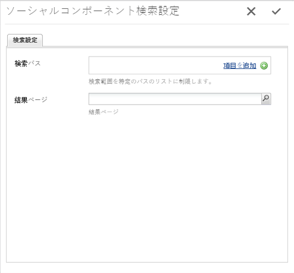
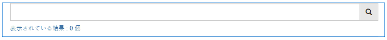
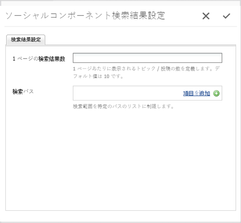

# 検索機能 {#search-feature}

検索機能は、フォーラムなどの他のさまざまな機能と連携して、コンテンツを検索する機能を提供します。

ユーザー生成コンテンツ（UGC）と呼ばれる、コミュニティメンバーが入力した投稿を検索する機能を追加する場合、2つのコンポーネントがあります。[検索](#search)と[検索結果](#search-results)。

`Search Results` コンポーネントを含むページは、検索と結果の表示の両方をサポートしています。

`Search` コンポーネントを含むページでは、`Search Results` ページに検索結果が表示される検索機能を起動する場所を提供します。

検索機能は、サイト訪問者とメンバーがコンテンツを表示できる他の機能と共に使用できます。

## 検索 {#search-features}

### ページに検索を追加 {#add-search-to-a-page}

作成者モードのページに`Search` コンポーネントを追加するには、コンポーネントブラウザーを使用して`Communities / Search`を見つけ、ページ上に配置するようにドラッグします。 `Search`を使用するには、`Search Results.`の2番目のページが必要です

必要な情報については、[&#x200B; コミュニティコンポーネントの基本](basics.md)を参照してください。

必要なクライアントサイドライブラリ `cq.social.hbs.search`が含まれている場合、`Search` コンポーネントはこのように表示されます。

### 追加した検索条件の設定 {#configure-the-added-search}

アクセスする配置された`Search` コンポーネントを選択し、編集ダイアログを開く`Configure` アイコンを選択します。

「**[!UICONTROL 検索設定]**」タブで、訪問者がクエリを入力したときに検索するパスを指定します。

* **[!UICONTROL パスの検索]**
「項目を追加」ボタンを使用して検索パスを追加すると、コンテンツ検索が制限されます。 例えば、検索を特定のフォーラムに制限するには、ページ内に配置されたフォーラムコンポーネントを選択します。

  * `/content/community-components/en/forum/jcr:content/content/forum`

* **[!UICONTROL 結果ページ]**
結果は、ブラウザーを使用して`Search Results` コンポーネントを含むページを選択することで指定された別のページに表示されます。

## 検索結果 {#search-results}

### ページへの検索結果の追加 {#add-search-results-to-a-page}

作成者モードでページに`Search Results` コンポーネントを追加するには、コンポーネントブラウザーを使用して

* `Communities / Search Results`

ページ上の所定の位置にドラッグします。 検索コンポーネントとは異なり、同じページに結果が表示されるため、2番目のページは必要ありません。

Web サイト内の別の場所で検索を使用する場合、`Search Results`を含むこの1つのページは、`Search`の任意またはすべてのインスタンスに対して`Result Page`として設定できます。

必要な情報については、[&#x200B; コミュニティコンポーネントの基本](basics.md)を参照してください。

必要なクライアントサイドライブラリ `cq.social.hbs.search`が含まれている場合、次のように`Search Result` コンポーネントが表示されます。

### 追加した検索結果の設定 {#configure-the-added-search-result}

アクセスする配置された`Search Results` コンポーネントを選択し、編集ダイアログを開く`Configure` アイコンを選択します。

「**[!UICONTROL 検索結果の設定]**」タブでは、訪問者がクエリを入力したときに検索に含めるパスを指定できます。

* **[!UICONTROL ページあたりの検索結果]**

  ページごとに表示されるトピック/投稿の数を定義します。 初期設定は 10 です。

* **[!UICONTROL パスの検索]**

  「項目を追加」ボタンを使用して検索パスを追加すると、コンテンツ検索が制限されます。

## 追加情報 {#additional-information}

詳しくは、開発者向けの[検索エッセンシャル &#x200B;](search-implementation.md) ページを参照してください。
