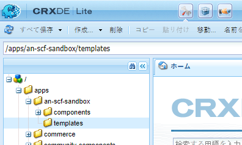
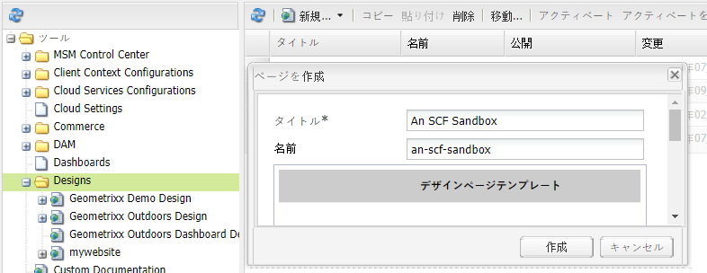
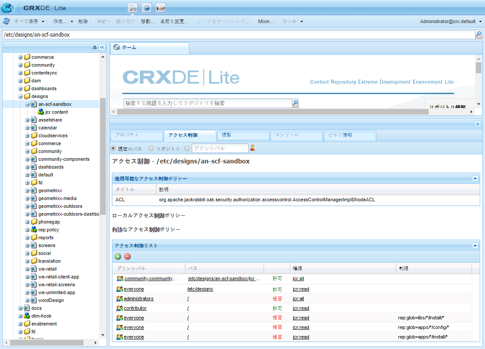

# Web サイト構造のセットアップ {#setup-website-structure}

Web サイトを設定するには、次の手順で作成するフォルダーを次の場所に示します。

* `/apps/an-scf-sandbox`

  そこにカスタムアプリケーションとテンプレートを配置します。

* `/etc/designs/an-scf-sandbox`

  ダウンロード可能なデザイン要素がここに格納されます。

* `/content/an-scf-sandbox`

  ここにダウンロード可能なweb ページがあります。

このチュートリアルのコードは、メインフォルダー名がアプリケーション、デザイン、コンテンツで同じであることに依存しています。 Web サイトに他の名前を選択した場合は、常に`an-scf-sandbox`を選択した名前に置き換えます。

>[!NOTE]
>
>名前について：
>
>* CRXDEで表示される名前は、アドレス可能なコンテンツへのパスを形成するノード名です。
>* ノード名にはスペースを含めることができますが、URIで使用する場合、スペースは&#39;%20&#39;または&#39;+&#39;としてエンコードする必要があります。
>* ノード名にはハイフンとアンダースコアを含めることができますが、Java™ ファイル内でパッケージ名として参照する場合はエンコードする必要があります。 ハイフンとアンダースコアの両方が、アンダースコアの後にUnicode値が続いてエスケープされます。
>
>   * ハイフンは&#39;_002d&#39;になります
>   * アンダースコアが&#39;_005f&#39;になります

## アプリケーションディレクトリ（/apps）の設定 {#setup-the-application-directory-apps}

リポジトリ内の/apps ディレクトリには、/content ディレクトリから提供されるページの動作とレンダリングを実装したコードが含まれています。

/apps ディレクトリは保護されており、/content ディレクトリや/etc/designs ディレクトリと同様に公開できません。

1. `/apps/an-scf-sandbox` フォルダーを作成します。

   エクスプローラーパネルで&#x200B;**[!UICONTROL CRXDE Lite]**&#x200B;を使用する

   1. `/apps` フォルダーを選択します。
   1. **[!UICONTROL 作成]**...を右クリックするか、**[!UICONTROL 作成…]** メニューをプルダウンします。
   1. 「**[!UICONTROL フォルダーを作成…]**」を選択します。
   1. **[!UICONTROL フォルダーを作成]** ダイアログで、`an-scf-sandbox`と入力します。
   1. 「**[!UICONTROL OK]**」をクリックします。

1. **[!UICONTROL コンポーネント]** サブフォルダーを作成します。

   1. `/apps/an-scf-sandbox` フォルダーを選択します。
   1. **[!UICONTROL 作成/ フォルダーを作成]**&#x200B;をクリックします。
   1. **[!UICONTROL フォルダーを作成]** ダイアログで、**[!UICONTROL components]**&#x200B;と入力します。
   1. 「**[!UICONTROL OK]**」をクリックします。

1. **[!UICONTROL テンプレート]** サブフォルダーを作成します。

   1. `/apps/an-scf-sandbox` フォルダーを選択します。
   1. **[!UICONTROL 作成/ フォルダーを作成]**&#x200B;をクリックします。
   1. **[!UICONTROL フォルダーを作成]** ダイアログで、**[!UICONTROL テンプレート]**&#x200B;と入力します。
   1. 「**[!UICONTROL OK]**」をクリックします。
   1. `/apps/an-scf-sandbox`を再選択します。
   1. 「**[!UICONTROL すべて保存]**」を選択します。

   他の編集プロセスと同様に、頻繁に保存する必要があります。 データの入力に問題が発生した場合は、ログインがタイムアウトしているか、以前の編集内容を保存する必要がある可能性があります。

1. CRXDE Liteのエクスプローラーパネルの構造は、次のようになります。

   

## デザインディレクトリの設定（/etc/designs） {#setup-the-design-directory-etc-designs}

/etc/designs ディレクトリには、ページコンテンツとともにダウンロードする画像、スクリプト、スタイルシートが含まれます。

1. クラシック UIでDesigner ツールを使用するには、[https://&lt;server>:&lt;port>/miscadmin](http://localhost:4502/miscadmin)を参照します。

   注：CRXDE Liteを使用して`cq:Page`型のノードを作成する場合、アクセス制御とレプリケーションはページの既定の設定に設定されません。

1. エクスプローラーパネルで、**[!UICONTROL Designs]** フォルダーを選択し、**[!UICONTROL New]** > **[!UICONTROL New Page]**&#x200B;をクリックします。

   次を入力 :

   * タイトル：**[!UICONTROL SCF サンドボックス]**
   * 名前：**[!UICONTROL an-scf-sandbox]**
   * **[!UICONTROL デザインページテンプレート]**&#x200B;を選択

   「**[!UICONTROL 作成]**」をクリックします。

   

1. 「SCF サンドボックス」フォルダーが表示されない場合は、エクスプローラーパネルを更新します。

1. CRXDE Lite （http:// localhost:4502/crx/de）に戻り、/etc/designsを展開して、「an-scf-sandbox」という名前のノードを確認します。

   CRXDEの右側の下のペインで、「プロパティ」タブ、「アクセス制御」タブ、「レプリケーション」タブを表示して、デザインページテンプレートを使用して定義された内容を確認できます。

   

## コンテンツディレクトリ （/content）を設定します {#setup-the-content-directory-content}

リポジトリ内の/content ディレクトリは、web サイトのコンテンツが格納されている場所です。 /contentの下のパスは、ブラウザーリクエストのURLのパスで構成されます。

*最初のアプリケーションの一部として[ ページテンプレート ](initial-app.md#createthepagetemplate)を*&#x200B;後に作成すると、最初のページコンテンツをテンプレート…[**⇒**](initial-app.md)&#x200B;に基づいて作成できます
