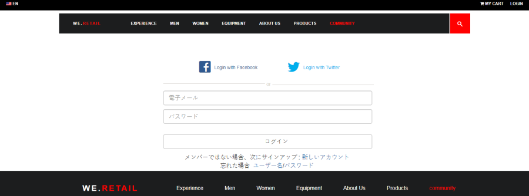
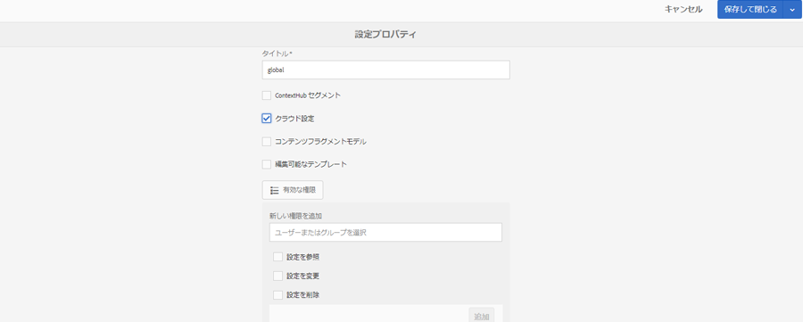
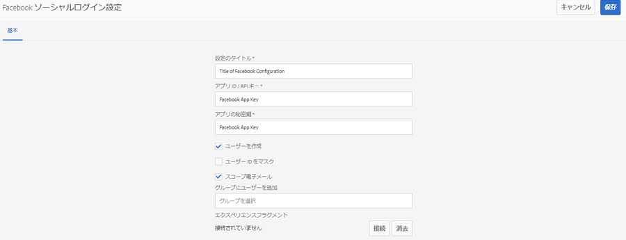
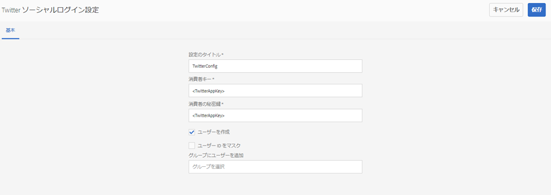
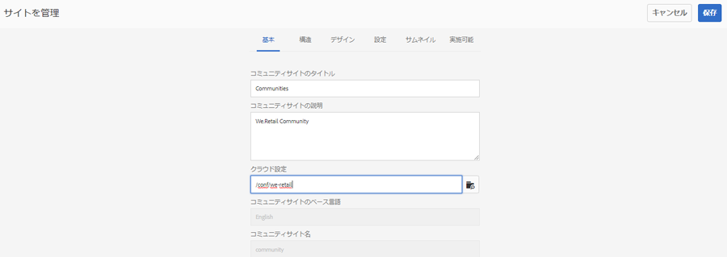
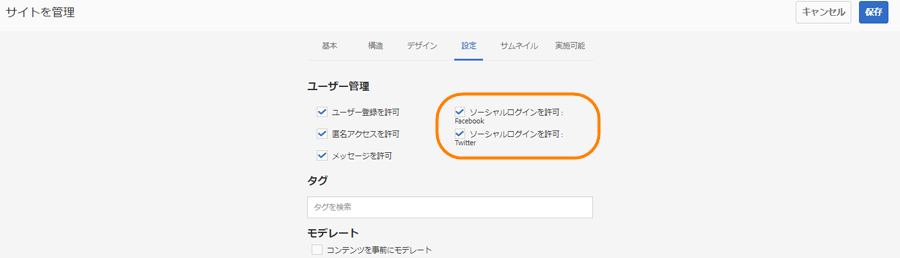
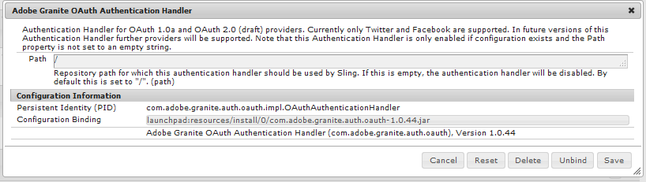
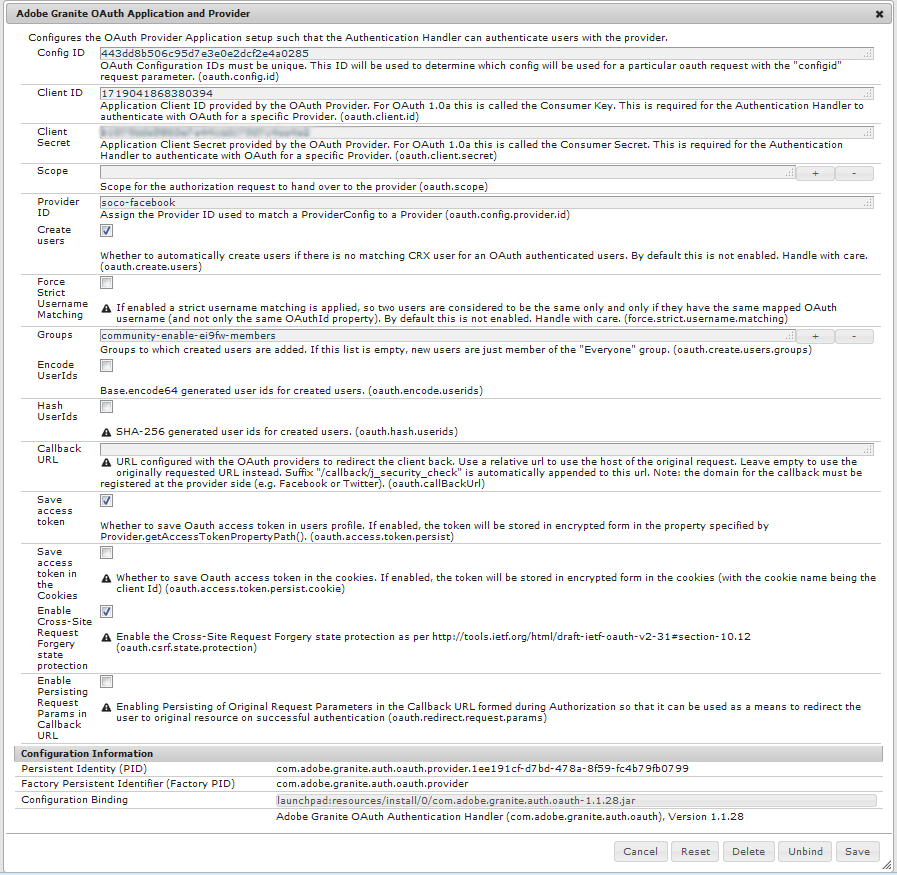
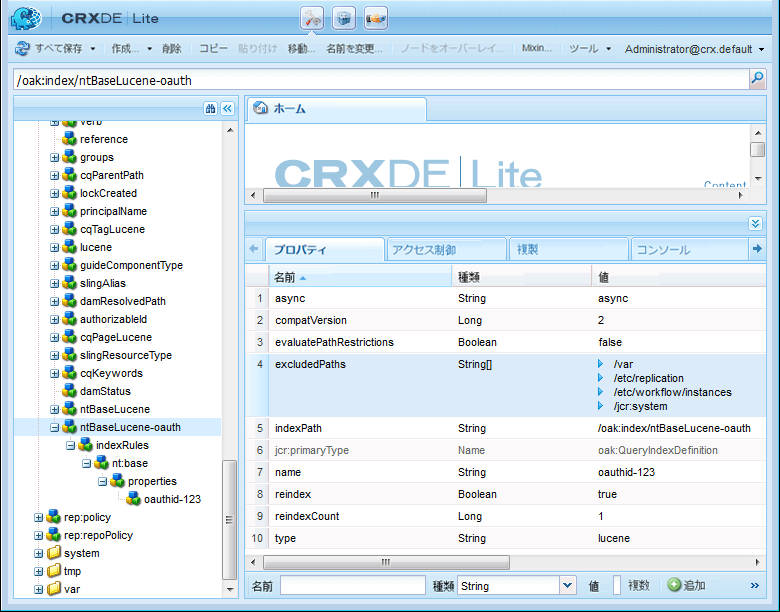

# Facebook と Twitter を使用したソーシャルログイン {#social-login-with-facebook-and-twitter}

ソーシャルログインとは、サイト訪問者にFacebookまたはTwitter アカウントでログインするオプションを提示する機能です。 したがって、許可されたFacebookまたはTwitterのデータをAEM会員プロファイルに含めます。

## ソーシャルログインの概要 {#social-login-overview}

ソーシャルログインを含めるには、カスタム FacebookおよびTwitter アプリケーションを作成することが&#x200B;*必要です*。

we-retail サンプルは、サンプルのFacebook アプリとTwitter アプリおよびクラウドサービスを提供していますが、[実稼動web サイト ](../../help/sites-administering/production-ready.md)では利用できません。

必要な手順は次のとおりです。

1. [すべてのAEM パブリッシュインスタンスでOAuth認証](#adobe-granite-oauth-authentication-handler)を有効にします。

   OAuthを有効にしないと、ログインに失敗します。

1. **ソーシャルアプリとクラウドサービスを作成**&#x200B;します。

   * Facebookでのログインをサポートするには：

     * [Facebook アプリ ](#create-a-facebook-app)を作成します。
     * [Facebook Connect クラウドサービス ](#create-a-facebook-connect-cloud-service)を作成して公開します。

   * Twitterでのログインをサポートするには：

     * [Twitter アプリ ](#create-a-twitter-app)を作成します。
     * [Twitter Connect クラウドサービス ](#create-a-twitter-connect-cloud-service)を作成して公開します。

1. コミュニティサイトの&#x200B;[**ソーシャルログイン**&#x200B;を有効にする](#enable-social-login)。

基本的な概念は次の2つです。

1. **スコープ** （権限）は、アプリがリクエストを許可するデータを指定します。

   * FacebookおよびTwitter [Adobe Granite OAuth Application and Provider](#adobe-granite-oauth-application-and-provider) インスタンスには、デフォルトで、スコープ内に基本的なアプリ権限が含まれています。

1. **フィールド** （パラメーター）は、URL パラメーターを使用して要求された実際のデータを指定します。

   * これらのフィールドは、[AEM Communities Facebook OAuth Provider](#aem-communities-facebook-oauth-provider)および[AEM Communities Twitter OAuth Provider](#aem-communities-twitter-oauth-provider)で指定されます。
   * デフォルトのフィールドは、ほとんどのユースケースで十分ですが、変更できます。

## Facebook ログイン {#facebook-login}

### Facebook API バージョン {#facebook-api-version}

ソーシャルログインとwe-retailのFacebook サンプルは、Facebook Graph APIがバージョン 1.0のときに開発されました。
AEM 6.4 GAおよびAEM 6.3 SP1のソーシャルログインは、新しいFacebook Graph API 2.5 バージョンと連携するように更新されました。

>[!NOTE]
>
>古いAEMのバージョンで、ログ **で例外が発生した場合、この**&#x200B;からトークンを抽出できない場合は、そのAEM リリースの最新のCFPにアップグレードしてください。

Facebook Graph APIのバージョン情報については、[Facebook API changelog](https://developers.facebook.com/docs/apps/changelog)を参照してください。

### Facebook アプリの作成 {#create-a-facebook-app}

Facebook ソーシャルログインを有効にするには、適切に設定されたFacebook アプリケーションが必要です。

Facebook アプリケーションを作成するには、[https://developers.facebook.com/apps/](https://developers.facebook.com/apps/)にあるFacebookの指示に従ってください。 これらの指示の変更は、次の情報には反映されません。

一般に、Facebook API v2.7以降では、次のようになります。

* *新しいFacebook アプリを追加*
  * *Platform*&#x200B;の場合は、Web サイトを選択します。
    * *サイト URL*&#x200B;の場合、`  https://<server>:<port>.`と入力します
    * *表示名*&#x200B;に、Facebook接続サービスのタイトルとして使用するタイトルを入力します。
    * *カテゴリ*&#x200B;の場合は、*ページ用アプリ*&#x200B;を選択することをお勧めしますが、何でも使用できます。
    * *製品を追加：Facebook ログイン*
    * *有効なOAuth リダイレクト URI*&#x200B;の場合、`  https://<server>:<port>.`と入力します

>[!NOTE]
>
>開発の場合は、http://localhost:4503が機能します。

アプリケーションを作成したら、**[!UICONTROL アプリ ID]**&#x200B;と&#x200B;**[!UICONTROL アプリ シークレット]**&#x200B;の設定を見つけます。 この情報は、[Facebook クラウドサービス ](#createafacebookcloudservice)の設定に必要です。

### Facebook Connect Cloud Serviceの作成 {#create-a-facebook-connect-cloud-service}

クラウドサービス設定を作成してインスタンス化された[Adobe Granite OAuth Application and Provider](#adobe-granite-oauth-application-and-provider) インスタンスは、新しいユーザーを追加するFacebook アプリケーションとメンバーグループを識別します。

1. AEM オーサーインスタンスで、管理者権限でログインします。
1. グローバルナビゲーションから、**[!UICONTROL ツール]**/**[!UICONTROL クラウドサービス]**/**[!UICONTROL Facebook ソーシャルログイン設定]**&#x200B;を選択します。
1. 設定&#x200B;**[!UICONTROL コンテキストパス]**&#x200B;を選択します。

   **[!UICONTROL コンテキストパス]**&#x200B;は、コミュニティサイトの作成/編集中に選択したクラウド設定パスと同じである必要があります。

1. コンテキストパスがその下にクラウドサービスを作成するために有効になっているかどうかを確認します。
1. **[!UICONTROL ツール]** > **[!UICONTROL 一般]** > **[!UICONTROL 設定ブラウザー]**&#x200B;に移動します。 コンテキストを選択し、プロパティを編集します。 まだ有効になっていない場合は、クラウド設定を有効にします。

   

   * 詳しくは、[設定ブラウザー](/help/sites-administering/configurations.md)のドキュメントを参照してください。

1. **Facebook クラウドサービス設定を作成/編集**。

   

   * **[!UICONTROL タイトル]** （*必須*） Facebook アプリを識別する表示タイトルを入力します。 Facebook アプリの&#x200B;*表示名*&#x200B;と同じ名前を入力してください。
   * **[!UICONTROL アプリ ID/API キー]** （*必須*） Facebook アプリの&#x200B;***アプリ ID***&#x200B;を入力します。 これにより、ダイアログから作成された[Adobe Granite OAuth Application and Provider](https://helpx.adobe.com/experience-manager/6-3/communities/using/social-login.html#AdobeGraniteOAuthApplicationandProvider) インスタンスが特定されます。
   * **[!UICONTROL アプリ秘密鍵]** （*必須*） Facebook アプリの&#x200B;***アプリ秘密鍵***&#x200B;を入力します。
   * **[!UICONTROL Create Users]** オンにした場合、Facebook アカウントでログインすると、AEM ユーザーエントリが作成され、選択したユーザーグループにメンバーとして追加されます。  デフォルトはオンになっています（強くお勧めします）。
   * **[!UICONTROL ユーザーIDをマスク]**：選択解除のままにします。
   * **[!UICONTROL 範囲メール]**: ユーザーのメール IDをFacebookから取得する必要があります。
   * **[!UICONTROL ユーザーグループに追加]**&#x200B;を選択して、ユーザーを追加するコミュニティサイトの1つ以上の[ メンバーグループ ](https://helpx.adobe.com/experience-manager/6-3/communities/using/users.html)を選択します。

   >[!NOTE]
   >
   >グループはいつでも追加または削除できます。 ただし、既存のユーザーのメンバーシップには影響はありません。 自動メンバーシップは、このフィールドの更新後に作成される新規ユーザーにのみ適用されます。 匿名ユーザーが無効になっているサイトの場合は、閉じたコミュニティサイト用の対応するコミュニティメンバーグループにユーザーを追加することを選択します。

   * **[!UICONTROL 保存]**&#x200B;を選択します。
   * **[!UICONTROL 公開]**。

その結果、[Adobe Granite OAuth Application and Provider](https://helpx.adobe.com/experience-manager/6-3/communities/using/social-login.html#adobe-granite-oauth-application-and-provider) インスタンスが作成されます。このインスタンスは、スコープ（権限）を追加しない限り、追加の変更は必要ありません。 デフォルトのスコープは、Facebook ログインの標準的な権限です。 追加のスコープが必要な場合は、OSGI設定を直接編集する必要があります。 システム/コンソールから直接変更を行った場合は、上書きを避けるために、タッチ UIからクラウドサービス設定を編集しないでください。

### AEM Communities Facebook OAuth プロバイダー {#aem-communities-facebook-oauth-provider}

AEM Communities プロバイダーは、[Adobe Granite OAuth Application and Provider](#adobe-granite-oauth-application-and-provider) インスタンスを拡張します。

このプロバイダーは、次の場所で編集する必要があります。

* ユーザーによる更新を許可
* 範囲](#adobe-granite-oauth-application-and-provider)内の[追加フィールドを追加します

  * デフォルトで許可されているすべてのフィールドがデフォルトで含まれているわけではありません。

編集が必要な場合は、各AEM パブリッシュインスタンスで次の操作を行います。

1. 管理者権限でログインします。
1. [Web コンソール ](../../help/sites-deploying/configuring-osgi.md)に移動します。 例：http://localhost:4503/system/console/configMgr
1. AEM Communities Facebook OAuth プロバイダーを探します。
1. 編集のために開く鉛筆アイコンを選択します。

   

   * **[!UICONTROL OAuth プロバイダーID]**

     （*必須*） デフォルト値は&#x200B;*soco -facebook*&#x200B;です。 編集しないでください。

   * **[!UICONTROL Cloud Service Config]**

     デフォルト値は `/etc/  cloudservices /  facebookconnect` です。 編集しないでください。

   * **[!UICONTROL OAuth プロバイダーサービス設定]**

     デフォルト値は `/apps/social/facebookprovider/config/` です。 編集しないでください。

   * **[!UICONTROL タグを有効にする]**

     編集しないでください。

   * **[!UICONTROL ユーザーパス]**

     ユーザーデータが保存されているリポジトリ内の場所。 コミュニティサイトの場合、メンバーがお互いのプロファイルを表示するための権限を確保するには、パスをデフォルトの&#x200B;*/home/users/community*&#x200B;にする必要があります。

   * **[!UICONTROL フィールドを有効にする]**

     チェックを入れた場合、リストされたフィールドは、ユーザーの認証と情報のためにFacebookへのリクエストで指定されます。 デフォルトの選択は解除されます。

   * **[!UICONTROL フィールド]**

     フィールドが有効になっている場合、Facebook Graph APIの呼び出し時に次のフィールドが含まれます。 フィールドは、クラウドサービス設定で定義されたスコープ内で許可する必要があります。 追加のフィールドは、Facebookによる承認が必要な場合があります。 Facebook ドキュメントの「Facebook ログイン権限」セクションを参照してください。 パラメーターとして追加されるデフォルトのフィールドは次のとおりです。

     * id
     * name
     * first_name
     * last_name
     * リンク
     * locale
     * ピクチャ
     * タイムゾーン
     * updated_time
     * 検証済み
     * メール

   フィールドが追加または変更された場合は、対応するデフォルトの同期ハンドラー設定を更新して、マッピングを修正します。

   * **[!UICONTROL ユーザーの更新]**

     オンにすると、各ログイン時にリポジトリ内のユーザーデータが更新され、プロファイルの変更や要求された追加データが反映されます。 デフォルトの選択は解除されます。

#### 次の手順 {#next-steps}

次の手順は、FacebookとTwitterの両方で同じです。

* [クラウドサービス設定の公開](#publishcloudservices)
* [コミュニティサイトで有効にする](#enable-social-login)

## Twitter ログイン {#twitter-login}

### Twitter アプリの作成 {#create-a-twitter-app}

Twitter ソーシャルログインを有効にするには、設定されたTwitter アプリケーションが必要です。

Twitter アプリケーションを作成するには、最新の手順（[https://apps.twitter.com](https://apps.twitter.com/)）に従ってください。

一般的には以下のようになります。

1. Web サイトのユーザーにTwitter アプリケーションを識別する&#x200B;*名前*&#x200B;を入力します。
1. 「*説明*」を入力します。
1. *web サイト*&#x200B;の場合：`https://<server>`と入力します。
1. *コールバック URL*&#x200B;の場合は、`https://server`と入力します。

   >[!NOTE]
   >
   >ポートを指定する必要はありません。
   >
   >開発の場合は、https://127.0.0.1/が機能します。

1. アプリケーションを作成したら、**[!UICONTROL Consumer （API） Key]**&#x200B;と&#x200B;**[!UICONTROL Consumer （API） Secret]**&#x200B;を見つけます。 この情報は、[Twitter クラウドサービス ](#createatwittercloudservice)の設定に必要です。

#### 権限 {#permissions}

Twitter アプリケーション管理の権限セクションで、次の操作を行います。

* **[!UICONTROL アクセス]**: `Read only`を選択します。

  * その他のオプションはサポートされていません

* **[!UICONTROL 追加の権限]**：オプションで`Request email addresses from users`を選択します。

  * 選択しない場合、AEMのユーザープロファイルにはメールアドレスが含まれません。
  * Twitterの指示は、追加の手順を記録します。

ソーシャルログインに対して行われたREST リクエストは、*[アカウントの取得/資格情報の確認](https://dev.twitter.com/rest/reference/get/account/verify_credentials)*&#x200B;のみです。

### Twitter Connect Cloud Serviceを作成する {#create-a-twitter-connect-cloud-service}

クラウドサービス設定を作成してインスタンス化された[Adobe Granite OAuth Application and Provider](#adobe-granite-oauth-application-and-provider) インスタンスは、新しいユーザーを追加するTwitter アプリケーションとメンバーグループを識別します。

1. オーサーインスタンスで、管理者権限でログインします。
1. グローバルナビゲーションから、**[!UICONTROL ツール]**/**[!UICONTROL クラウドサービス]**/**[!UICONTROL Twitter ソーシャルログイン設定]**&#x200B;を選択します。
1. **[!UICONTROL コンテキストパス]**&#x200B;設定を選択します。

   コンテキストパスは、コミュニティサイトの作成/編集時に選択したクラウド設定パスと同じである必要があります。

1. コンテキストパスがその下にクラウドサービスを作成するために有効になっているかどうかを確認します。
1. **[!UICONTROL ツール]** > **[!UICONTROL 一般]** > **[!UICONTROL 設定ブラウザー]**&#x200B;に移動します。 コンテキストを選択し、プロパティを編集します。 まだ有効になっていない場合は、クラウド設定を有効にします。

   

   * 詳しくは、[設定ブラウザー](/help/sites-administering/configurations.md)のドキュメントを参照してください。

1. Twitter クラウドサービス設定を作成/編集します。

   

   * **[!UICONTROL タイトル]**

     （*必須*） Twitter アプリを識別する表示タイトルを入力します。 Twitter アプリの&#x200B;*表示名*&#x200B;と同じ名前を入力してください。

   * **[!UICONTROL コンシューマーキー]**

     （*必須*） Twitter アプリの&#x200B;**消費者（API） キー**&#x200B;を入力します。 これにより、ダイアログから作成された[Adobe Granite OAuth Application and Provider](https://helpx.adobe.com/experience-manager/6-3/communities/using/social-login.html#AdobeGraniteOAuthApplicationandProvider) インスタンスが特定されます。

   * **[!UICONTROL コンシューマーシークレット]**

     （*必須*） Twitter アプリの&#x200B;***Consumer （API） Secret***&#x200B;を入力します。

   * **[!UICONTROL ユーザーの作成]**

     チェックを入れた場合、Twitter アカウントでログインすると、AEM ユーザーエントリが作成され、選択したユーザーグループにメンバーとして追加されます。 デフォルトはオンになっています（強くお勧めします）。

   * **[!UICONTROL ユーザーIDをマスク]**

     選択を解除したままにします。

   * **[!UICONTROL ユーザーグループに追加]**

     「ユーザーグループを追加」を選択して、ユーザーを追加するコミュニティサイトの1つ以上の[ メンバーグループ ](https://helpx.adobe.com/experience-manager/6-3/communities/using/users.html)を選択します。

   >[!NOTE]
   >
   >グループはいつでも追加または削除できます。 ただし、既存のユーザーのメンバーシップには影響はありません。 自動メンバーシップは、このフィールドの更新後に作成される新規ユーザーにのみ適用されます。 匿名ユーザーが無効になっているサイトの場合は、閉じたコミュニティサイトを対象とした対応するコミュニティメンバーグループにユーザーを追加します。
   >

1. **[!UICONTROL SAVE]**&#x200B;と&#x200B;**[!UICONTROL Publish]**&#x200B;を選択します。

その結果、[Adobe Granite OAuth Application and Provider](https://helpx.adobe.com/experience-manager/6-3/communities/using/social-login.html#adobe-granite-oauth-application-and-provider) インスタンスが作成され、これ以上の変更は必要ありません。 デフォルトのスコープは、Twitter ログインの標準的な権限です。

### AEM Communities Twitter OAuth プロバイダー {#aem-communities-twitter-oauth-provider}

AEM Communities設定は、[Adobe Granite OAuth Application and Provider](#adobe-granite-oauth-application-and-provider) インスタンスを拡張します。 このプロバイダーは、ユーザーの更新を許可するために編集が必要です。

編集が必要な場合は、各AEM パブリッシュインスタンスで次の操作を行います。

1. 管理者権限でログインします。
1. [Web コンソール ](../../help/sites-deploying/configuring-osgi.md)に移動します。

   例：http://localhost:4503/system/console/configMgr

1. AEM Communities Twitter OAuth プロバイダーを探します。
1. 編集のために開く鉛筆アイコンを選択します。

   

   * **[!UICONTROL OAuth プロバイダーID]**

   （*必須*） デフォルト値は&#x200B;*soco -twitter*&#x200B;です。 編集しないでください。

   * **[!UICONTROL Cloud Service Config]**

     デフォルト値は&#x200B;*conf.*&#x200B;です 編集しないでください。

   * **[!UICONTROL OAuth プロバイダーサービス設定]**

     デフォルト値は `/apps/social/twitterprovider/config/` です。 編集しないでください。

   * **[!UICONTROL ユーザーパス]**

     ユーザーデータが保存されているリポジトリ内の場所。 コミュニティサイトの場合、メンバーがお互いのプロファイルを表示するための権限を確保するには、パスをデフォルトの`/home/users/community`にする必要があります。

   * **[!UICONTROL パラメーターを有効にする]** – 編集しない
   * **[!UICONTROL URL パラメーター]** – 編集しない
   * **[!UICONTROL ユーザーの更新]**

     オンにすると、各ログイン時にリポジトリ内のユーザーデータが更新され、プロファイルの変更や要求された追加データが反映されます。 デフォルトの選択は解除されます。

#### 次の手順 {#next-steps-1}

次の手順は、FacebookとTwitterの両方で同じです。

* [クラウドサービス設定の公開](#publishcloudservices)
* [コミュニティサイトで有効にする](#enable-social-login)

## ソーシャルログインを有効にする {#enable-social-login}

### AEM Communities Sites Console {#aem-communities-sites-console}

クラウドサービスを設定すると、コミュニティサイト [作成](https://helpx.adobe.com/experience-manager/6-3/communities/using/sites-console.html#SiteCreation)または[管理](https://helpx.adobe.com/experience-manager/6-3/communities/using/sites-console.html#ModifyingSiteProperties)中に、[ ユーザー管理](https://helpx.adobe.com/experience-manager/6-3/communities/using/sites-console.html#USERMANAGEMENT)設定サブパネルを使用して、コミュニティサイトの関連するソーシャルログイン設定に対してクラウドサービスを有効にすることができます。

1. ソーシャルログイン設定を保存したサイト設定コンテキストを選択します。

1. 「一般」タブで、クラウド設定を設定します。

   

1. 「設定」タブで、**[!UICONTROL ソーシャルログイン]**&#x200B;を有効にして保存します。

   

## ソーシャルログインのテスト {#test-social-login}

* すべてのパブリッシュインスタンスで[Adobe Granite OAuth Authentication Handler](#adobe-granite-oauth-authentication-handler)が有効になっていることを確認します。
* クラウドサービスが公開されていることを確認します。
* コミュニティサイトが公開されていることを確認します。
* ブラウザーで公開したサイトを起動します。
例：http://localhost:4503/content/sites/engage/en.html
* 「**[!UICONTROL ログイン]**」を選択します。
* 「**[!UICONTROL Facebookでログイン]**」または「**[!UICONTROL Twitterでログイン]**」のいずれかを選択します。
* FacebookまたはTwitterにまだログインしていない場合は、適切な資格情報でログインします。
* FacebookやTwitter アプリで表示されるダイアログによっては、権限を付与する必要がある場合があります。
* ページ上部のツールバーが更新され、正常なログインが反映されます。
* 「**[!UICONTROL プロファイル]**」を選択します。プロファイルページには、ユーザーのアバター画像、名、姓が表示されます。 許可されているフィールド/パラメーターに従って、FacebookまたはTwitter プロファイルからの情報も表示されます。

## AEM Platform OAuth設定 {#aem-platform-oauth-configurations}

### Adobe Granite OAuth Authentication Handler {#adobe-granite-oauth-authentication-handler}

`Adobe Granite OAuth Authentication Handler`はデフォルトで有効になっていないため、すべてのAEM パブリッシュインスタンスで&#x200B;***を有効にする必要があります。***

パブリッシュで認証ハンドラーを有効にするには、OSGi設定を開いて保存します。

* 管理者権限でログインします。
* [Web コンソール ](../../help/sites-deploying/configuring-osgi.md)に移動します。
例：http://localhost:4503/system/console/configMgr
* `Adobe Granite OAuth Authentication Handler` を見つけます。
* を選択して、編集する設定を開きます。
* 「**[!UICONTROL 保存]**」を選択します。

>[!CAUTION]
>
>認証ハンドラーを&#x200B;*Adobe Granite OAuth ApplicationおよびProvider*&#x200B;のFacebookまたはTwitter インスタンスと混同しないように注意してください。

### Adobe Granite OAuth アプリケーションとプロバイダー {#adobe-granite-oauth-application-and-provider}

FacebookまたはTwitter用のクラウドサービスが作成されると、`Adobe Granite OAuth Authentication Handler`のインスタンスが作成されます。

FacebookまたはTwitter アプリ用に作成されたインスタンスを見つけるには：

1. 管理者権限でログインします。
1. [Web コンソール ](../../help/sites-deploying/configuring-osgi.md)に移動します。

   例：http://localhost:4503/system/console/configMgr

1. Adobe Granite OAuth Application and Providerを探します。

   * **[!UICONTROL クライアント ID]**&#x200B;が&#x200B;**[!UICONTROL アプリ ID]**&#x200B;と一致するインスタンスを見つけます。

     

     次のプロパティを除き、設定のその他のプロパティは変更しないでください。

   * **[!UICONTROL 設定ID]**

     （*必須*） OAuth設定IDは一意である必要があります。 クラウドサービスの作成時に自動生成。

   * **[!UICONTROL クライアント ID]**

     （*必須*） クラウドサービスの作成時に指定されたアプリケーション ID。

   * **[!UICONTROL クライアントの秘密鍵]**

     （*必須*） クラウドサービスの作成時に指定されたアプリケーション秘密鍵。

   * **[!UICONTROL 範囲]**

     （*オプション*）許可される内容に関する追加の範囲は、プロバイダーから求めることができます。 デフォルトの範囲では、ソーシャル認証とプロファイルデータの提供に必要な権限がカバーされています。

   * **[!UICONTROL プロバイダーID]**

     （*必須*） AEM CommunitiesのプロバイダーIDは、クラウドサービスの作成時に設定されます。 編集しないでください。 Facebook Connectの場合、値は&#x200B;*soco -facebook*&#x200B;です。 Twitter Connectの場合、値は&#x200B;*soco -twitter*&#x200B;です。

   * **[!UICONTROL グループ]**

     （*おすすめ*）作成したユーザーが追加される1つ以上のメンバーグループ。 AEM Communitiesの場合は、コミュニティサイトのメンバーグループをリストアップすることをお勧めします。

   * **[!UICONTROL コールバック URL]**

     （*オプション*）のURLは、クライアントをリダイレクトするためにOAuth プロバイダーで設定されています。 相対URLを使用して、元のリクエストのホストを使用します。 最初にリクエストされたURLを代わりに使用するには、空のままにします。 サフィックス「/callback/j_security_check」がこのURLに自動的に追加されます。

   >[!NOTE]
   >
   >コールバックのドメインは、プロバイダー（FacebookまたはTwitter）に登録する必要があります。

OAuth認証ハンドラーの設定ごとに、インスタンスに2つの追加の設定が作成されます。

* Apache Jackrabbit Oak Default Sync Handler （org.apache.jackrabbit.oak.spi.security.authentication.external.impl.DefaultSyncHandler） – そこでの編集は必要ありませんが、Facebook フィールドがCQ ユーザープロファイルノードにマッピングされる方法をユーザーフィールドマッピングで確認できます。 「Sync Handler Name」がOAuth プロバイダー設定の設定IDと一致していることも確認してください。
* Apache Jackrabbit Oak External Login Module （org.apache.jackrabbit.oak.spi.security.authentication.external.impl.ExternalLoginModuleFactory） – そこでの編集は必要ありませんが、「ID プロバイダー名」と「同期ハンドラー名」が同じで、対応するOAuthと同期ハンドラーの設定を指していることに気付くかもしれません。

詳しくは、[Apache Oak外部ログインモジュールを使用した認証](https://jackrabbit.apache.org/oak/docs/security/authentication/externalloginmodule.html)を参照してください。

## OAuth ユーザートラバーサルパフォーマンス {#oauth-user-traversal-performance}

FacebookまたはTwitterのログインを使用して登録したユーザー数が数十万人のコミュニティサイトの場合、サイト訪問者がソーシャルログインを使用したときに実行されるクエリのトラバーサルパフォーマンスは、次のOak インデックスを追加することで向上できます。

ログにトラバーサル警告が表示される場合は、このインデックスを追加することをお勧めします。

オーサーインスタンスで、管理者権限でログインした場合：

1. グローバルナビゲーションから：**ツール、[CRX/DE Lite](../../help/sites-developing/developing-with-crxde-lite.md)を選択します。**
1. ntBaseLuceneのコピーからntBaseLucene-oauthという名前のインデックスを作成します。

   * ノード `/oak:index`の下
   * ノード `ntBaseLucene`を選択
   * **[!UICONTROL コピー]**&#x200B;を選択
   * `/oak:index` を選択します。
   * **[!UICONTROL 貼り付け]**&#x200B;を選択
   * ntBaseLuceneのコピー名を`ntBaseLucene-oauth`に変更

1. ノード ntBaseLucene-oauthのプロパティを変更します。

   * **[!UICONTROL indexPath]**: `/oak:index/ntBaseLucene-oauth`
   * **[!UICONTROL name]**: `oauthid-123****`
   * **[!UICONTROL インデックス再作成]**: `true`
   * **[!UICONTROL reindexCount]**: `1`

1. ノード /oak:index/ntBaseLucene-oauth/indexRules/nt:base/propertiesの下：

   * cqTagsを除くすべての子ノードを削除します。
   * cqTagsを`oauthid-123****`に変更します
   * ノード `oauthid-123****`のプロパティを変更します

     * **[!UICONTROL name]**: `oauthid-123****`

   * 「**[!UICONTROL すべて保存]**」を選択します。

* **name** `oauthid-123`の場合、*123*&#x200B;を[Adobe Granite OAuth Application and Provider](social-login.md#adobe-granite-oauth-application-and-provider)設定の&#x200B;**クライアント ID**&#x200B;の値であるFacebook ***アプリ ID***&#x200B;またはTwitter ***Consumer （API） Key***&#x200B;に置き換えます。

  

詳しくは、[Oak クエリとインデックス作成](../../help/sites-deploying/queries-and-indexing.md)を参照してください。

## Dispatcher 設定 {#dispatcher-configuration}

[Dispatcher for Communitiesの設定](dispatcher.md)を参照してください。
