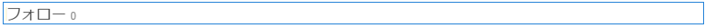

# ソーシャルグラフの使用 {#using-social-graph}

## はじめに {#introduction}

コミュニティメンバーが[ アクティビティ ](activities.md)に従ってフォローする機能は、`Follow`と`Following`の2つのコンポーネントによって確立されます。

`Follow` コンポーネントは別のリソースに関連付ける必要があり、この関連付けはコミュニティ メンバーと機能に対して既に確立されています。

`Following` コンポーネントには、現在のメンバーに従っているか、現在のメンバーに従っているメンバーが一覧表示されます。 メンバー間の関係を示すこのソーシャルグラフは、[ コミュニティサイト ](overview.md#communitiessites)用に作成されたユーザープロファイルに含まれています。

## ページへのフォローの追加 {#adding-following-to-a-page}

作成者モードのページに`Following` コンポーネントを追加する場合は、コンポーネント `Communities / Following`を見つけて、ソーシャルグラフが表示されるページ上に配置します。

必要な情報については、[ コミュニティコンポーネントの基本](basics.md)を参照してください。

[必要なクライアントサイドライブラリ ](essentials-socialgraph.md#essentials-for-client-side)が含まれている場合、`Following` コンポーネントは次のように表示されます。

## 次の設定 {#configuring-following}

現在、コンポーネントが`follows`関係を表示するか、`following`関係を表示するかを判断するには、プロパティを設定する必要があります。

## 追加情報 {#additional-information}

詳細については、[Social Graph Essentials](essentials-socialgraph.md)開発者向けページを参照してください。
