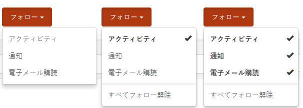
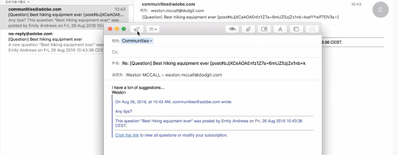
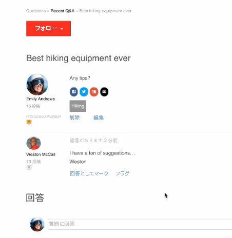

# コミュニティの購読 {#communities-subscriptions}

## 概要 {#overview}

コミュニティ [FP1](deploy-communities.md#latestfeaturepack)の時点では、コミュニティ メンバーは、サブスクリプションと呼ばれる機能を使用して、メールを通じてコミュニティとやり取りできます。

購読は、[通知](notifications.md)と似ています。メンバーは、ブログ記事、フォーラムのトピック、QnAの質問をフォローする際に購読できます。

購読と通知の違いは次のとおりです。

* 会員は、他の会員にフォローする際に購読することはできません。
* メンバーが実行するアクションは、フォロー時に`Email Subscriptions`を選択することだけです。
* メール返信が設定されている場合、メンバーは受信したメールに返信するだけで、コンテンツを効果的に投稿できます。

### 要件 {#requirements}

**メールの設定**

購読が機能し、メンバーがメールで返信するには、メールを設定する必要があります。

電子メールの設定方法については、[電子メールの設定](email.md)を参照してください。

**サブスクリプションを有効にしてフォローする**

次のサブスクリプション *および*&#x200B;を有効にするには、コンポーネントを設定する必要があります。 サブスクリプションを許可する機能は、[ ブログ ](blog-feature.md)、[ フォーラム ](forum.md)、[QnA](working-with-qna.md)です。

## フォローからの購読 {#subscriptions-from-following}

「**フォロー**」ボタンは、アクティビティ、サブスクリプション、通知などのエントリをフォローするための手段を提供します。 「**フォロー**」ボタンを選択するたびに、選択範囲のオンとオフを切り替えることができます。

次のいずれかの方法を選択すると、ボタンのテキストが&#x200B;**次**&#x200B;に変わります。 便宜上、`Unfollow All`を選択してすべてのメソッドをオフにすることができます。

**フォロー** ボタンには、`Email Subscriptions` オプションが含まれます。これは、フォーラム、QnA、またはブログがメール購読を有効にするように設定されている場合に限られます。 このボタンは次のように表示されます。

* 有効になっているフォーラム、QnA、またはブログのメイン機能ページでは、その機能の下にあるすべてのアクティビティに関するメールが送信されます。

* フォーラムのトピック、QnAの質問、ブログ記事など、特定のエントリのアクティビティが発生すると、そのエントリに対してメールが送信されます。

## メールで返信 {#reply-by-email}

電子メールが[電子メールで返信するように設定されている場合](email.md#configure-polling-importer)、購読者は、投稿されたコンテンツとオンラインコンテンツへのリンクが記載された電子メールを受け取ります。

返信先が電子メールに返信した場合、返信先に入力したコンテンツがオンラインでコンテンツとして表示されます。

返信が投稿されるまでの時間は、[ ポーリングインポーターの更新間隔](email.md#configure-polling-importer)によって制御されます。

