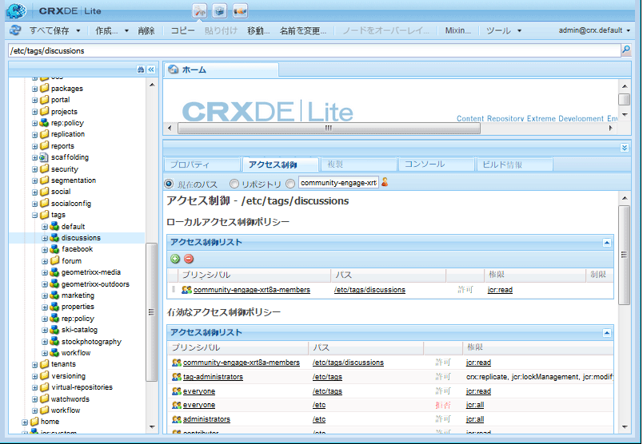

# ユーザー生成コンテンツのタグ付け {#tagging-user-generated-content}

## 概要 {#overview}

ユーザー生成コンテンツ（UGC）のタグ付けとは、コミュニティメンバーがコンテンツを検索する際に役立つ手段のことです。

通常、タグはオーサー環境のオーサーと管理者によって適用されます。 UGCのタグ付けは、UGC タグがパブリッシュ環境のコミュニティメンバーによって適用されるという点で一意です。

タグの名前空間と分類は、両方のアプリケーションで同じです。

## Communities の機能 {#communities-features}

タグ付けを許可するように設定できるAEM Communitiesの機能は次のとおりです。

* [ブログ](blog-feature.md)
* [Calendar](calendar.md)
* [ファイルライブラリ](file-library.md)
* [フォーラム](forum.md#configuretheaddedforum)
* [質問と答え](working-with-qna.md)

## タグの管理 {#administering-tags}

タグの名前空間と分類の作成と管理については、[ タグの管理](../../help/sites-administering/tags.md#tagging-console)を参照してください。

開発者の情報については、[Tag Essentials](tag.md)を参照してください。

ソーシャルタグクラウドコンポーネントをページに追加し、適用されたタグを使用して投稿されたUGCを簡単に検索する方法については、[ ソーシャルタグクラウドの使用](tagcloud.md)を参照してください。

### タグの権限 {#tag-permissions}

デフォルトの権限は、パブリッシュ環境のすべてのユーザーがタグ名前空間を読み取ることを許可しないように設定されています。

タグはパブリッシュ環境のUGCに適用されるため、適用するタグを選択できるようにするには、コミュニティメンバーに対して読み取り権限を有効にする必要があります。

[ タグ権限の設定](../../help/sites-administering/tags.md#setting-tag-permissions)を参照してください。

次に、管理者がグループ `Community Engage Members`に対して`/etc/tag/discussions`に読み取り権限を適用する場合のCRXDEでの表示方法を示します。

