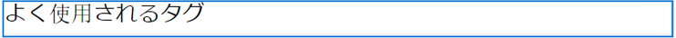
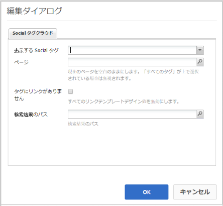
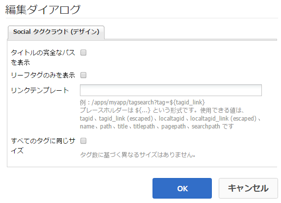

# Social タグクラウドの使用 {#using-social-tag-cloud}

## はじめに {#introduction}

`Social Tag Cloud` コンポーネントは、コンテンツの投稿時にコミュニティメンバーによって適用されたタグを強調表示します。 これは、トレンドのトピックを特定し、サイト訪問者がタグ付きのコンテンツをすばやく見つけられるようにするための手段です。

現在の傾向を特定するもう1つの方法については、[&#x200B; アクティビティの傾向](trends.md)を参照してください。

このページでは、`Social Tag Cloud` コンポーネントダイアログの設定を説明し、ユーザーエクスペリエンスについて説明します。

開発者向けの詳細については、[Tag Essentials](tag.md)を参照してください。

タグの作成および管理や、タグが適用されるコンテンツについては、[タグの管理](../../help/sites-administering/tags.md)を参照してください。

## ソーシャルタグクラウドの追加 {#adding-a-social-tag-cloud}

作成者モードでページに`Social Tag Cloud` コンポーネントを追加するには、コンポーネントブラウザーを使用して`Communities / Social Tag Cloud`を見つけ、タグクラウドが表示されるページ上に配置するようにコンポーネントブラウザーをドラッグします。

必要な情報については、[&#x200B; コミュニティコンポーネントの基本](basics.md)を参照してください。

[必要なクライアントサイドライブラリ &#x200B;](tag.md#essentials-for-client-side)が含まれている場合、`Social Tag Cloud` コンポーネントは次のように表示されます。

## ソーシャルタグクラウドの設定 {#configuring-social-tag-cloud}

配置された`Social Tag Cloud` コンポーネントを選択して、編集ダイアログを開く`Configure` アイコンにアクセスして選択できるようにします。

「**[!UICONTROL ソーシャルタグクラウド]**」タブで、表示するタグを指定し、タグがアクティブリンクの場合は、検索結果のページの場所を指定します。

* 表示する&#x200B;**[!UICONTROL ソーシャルタグ]**
表示するUGC タグを決める。 プルダウンオプションは次のとおりです。

  * `From page and child pages`
  * `All tags`

  デフォルトは`From page and child pages`です。ここでは、「ページ」は以下の&#x200B;**ページ**&#x200B;設定を指します。

* **[!UICONTROL Page]**

  （`All tags)`以外の場合は必須）ページのUGCへのパス。 空白のままにすると、デフォルトは現在のページになります。

* **[!UICONTROL タグにリンクがありません]**

  オンにすると、タグはタグクラウドにプレーンテキストとして表示されます。 チェックを外すと、タグはアクティブリンクとして表示され、そのタグが適用されているすべてのコンテンツを検索します。 デフォルトはオフになっており、**[!UICONTROL 検索結果パス]**&#x200B;を設定する必要があります。

* **[!UICONTROL 検索結果のパス]**

  `Search Result` コンポーネントが配置されたページへのパスで、**ページ**&#x200B;設定で指定されたUGC パスを含むUGCを参照するように設定されています。

## ソーシャルタグクラウドの表示を変更 {#change-display-of-social-tag-cloud}

**ソーシャルタグクラウド**&#x200B;の表示を編集するには、[&#x200B; デザインモード &#x200B;](../../help/sites-authoring/default-components-designmode.md)と入力し、配置された`Social Tag Cloud` コンポーネントをダブルクリックして、追加のタブを含むダイアログを開きます。

「**[!UICONTROL ソーシャルタグクラウド（デザイン）]**」タブを使用して、タグの表示方法を指定します。 タグは、単純なタグ、デフォルトの名前空間の単一の単語、または階層分類法のいずれかです。

* **[!UICONTROL 完全なタイトルパスを表示]**

  オンにすると、適用された各タグの親タグと名前空間のタイトルが表示されます。

  例：

  * チェック済み：`Geometrixx Media: Gadgets / Cars`
  * 未選択：`Cars`

  単純なタグに違いはありません。

  デフォルトはオフです。

* **[!UICONTROL 葉タグのみを表示]**

  オンにすると、他のタグを含まない適用されたタグのみが表示されます。

  例えば、次のタグ IDを指定します。

  `Geometrixx Media: Gadgets / Cars`

  適用できるタグは3つあります。

  `Geometrixx Media (the namespace)`、`Gadgets` および `Cars`

  * チェック済み：適用されている場合は`Cars`のみが表示されます。
  * チェックを外した場合：`Geometrixx Media`、`Gadgets`、`Cars`が表示されます（適用されている場合）。

  シンプルなタグはリーフタグです。

  デフォルトはオフです。

* **[!UICONTROL リンクテンプレート]**

  コンポーネント編集ダイアログでリンクが有効になっている場合、デフォルト以外のテンプレートを使用してタグクラウドにリンクを表示します。

* **[!UICONTROL すべてのタグに同じサイズ]**

  オンにすると、タグクラウド内のすべての単語に同じスタイルが適用されます。 チェックを外すと、単語のスタイルは使用状況に応じて異なります。 デフォルトはオフです。

## 追加情報 {#additional-information}

詳細については、開発者向けの[Tag Essentials](tag.md) ページを参照してください。

タグの作成と管理について詳しくは、[&#x200B; ユーザー生成コンテンツのタグ付け](tag-ugc.md) （UGC）を参照してください。
