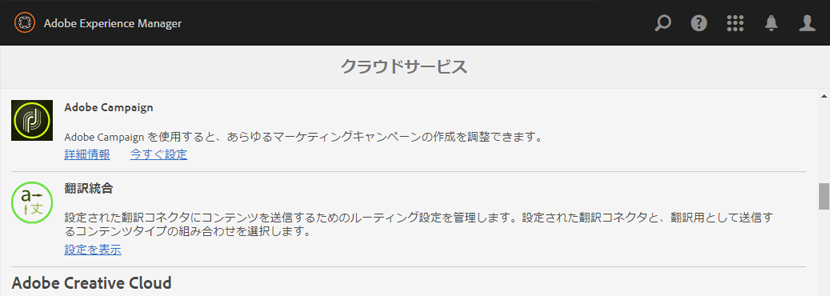
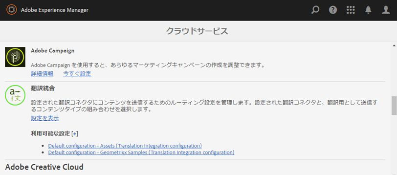
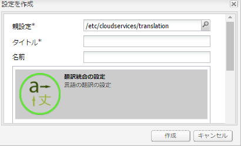
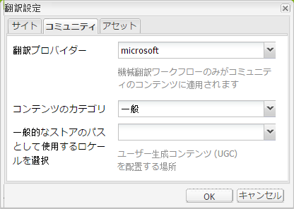
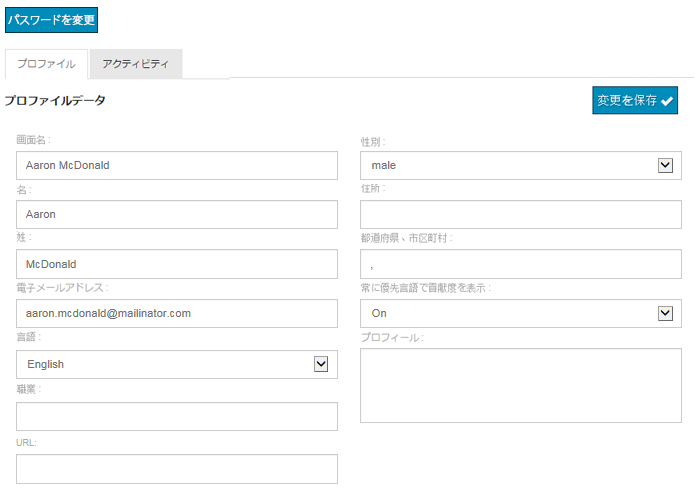

# Ugcの翻訳 {#translating-user-generated-content}

Adobe Experience Manager （AEM） Communitiesの翻訳機能では、[ ソーシャルコンポーネントフレームワーク （SCF） コンポーネント ](scf.md)を使用してコミュニティサイトに投稿されたユーザー生成コンテンツ （UGC）に[ ページコンテンツ ](../../help/sites-administering/translation.md)を翻訳するというコンセプトを拡張しています。

UGCの翻訳により、サイト訪問者とメンバーは、言語の障壁を取り除くことで、グローバルコミュニティを体験できます。

例えば、次のようにします。

* フランス人のメンバーが、多国籍料理サイトのコミュニティフォーラムにフランス語でレシピを投稿しました。
* また、フランス語から日本語への翻訳をトリガーするために、翻訳機能を使用する日本のメンバーがいます。
* 日本から来たメンバーは、レシピを日本語で読んだ後、日本語でコメントを投稿します。
* フランス出身のメンバーが翻訳機能を使って日本語のコメントをフランス語に翻訳します。
* グローバルなコミュニケーション：

## 概要 {#overview}

ここでは、翻訳サービスとUGCの連携について詳しく説明します。 また、AEMを[翻訳サービスプロバイダー](../../help/sites-administering/translation.md#connectingtoatranslationserviceprovider)に接続し、[翻訳統合フレームワーク ](../../help/sites-administering/tc-tic.md)を設定して、そのサービスをweb サイトに統合する方法を理解していることを前提としています。

翻訳サービスプロバイダーがサイトに関連付けられている場合、サイトの各言語コピーは、コメントなどのSCF コンポーネントを通じて投稿されたUGCの独自のスレッドを保持します。

翻訳サービスプロバイダーに加えて翻訳統合が設定されている場合、サイトの各言語コピーでUGCの単一スレッドを共有し、言語コピー間でグローバルなコミュニケーションを提供できます。 言語で分離されたディスカッションスレッドの代わりに、設定された[ グローバル共有ストア ](#global-translation-of-ugc)を使用すると、表示されている言語コピーに関係なく、スレッド全体を表示できます。 さらに、複数の翻訳統合設定を設定して、グローバル参加者の論理グループ（地域別など）に対して異なるグローバル共有ストアを指定することができます。

## デフォルトの翻訳サービス {#the-default-translation-service}

AEM Communitiesには、複数の言語で有効な[ デフォルト翻訳サービス ](../../help/sites-administering/tc-msconf.md)の[体験版ライセンス ](../../help/sites-administering/tc-msconf.md#microsoft-translator-trial-license)が含まれています。

[ コミュニティサイト ](sites-console.md)を作成する場合、`Allow Machine Translation`が[翻訳](sites-console.md#translation) サブパネルからチェックされると、デフォルトの翻訳サービスが有効になります。

>[!CAUTION]
>
>デフォルトの翻訳サービスはデモ用のみです。
>
>実稼動システムの場合は、ライセンス済みの翻訳サービスが必要です。 ライセンスを取得していない場合、デフォルトの翻訳サービスは[ オフ ](../../help/sites-administering/tc-msconf.md#microsoft-translator-trial-license-geometrixx-outdoors)にする必要があります。

## UGCのグローバル翻訳 {#global-translation-of-ugc}

Web サイトに複数の[言語コピー](../../help/sites-administering/tc-prep.md)がある場合、デフォルトの翻訳サービスでは、あるサイトに入力されたUGCが、別のサイトに入力されたUGCに関連している可能性があることを認識しません。 これは、UGCが同じコンポーネント（コンポーネントを含むページの言語コピー）によって生成される場合に当てはまります。

これは、トピックについて話し合うグループに似ています。 1つの会話に参加している大きなグループの全員と比較して、自分のグループ以外のグループで行われたコメントを認識していません。

「1つのグループの会話」が必要な場合は、複数の言語コピーを持つweb サイト全体でグローバル翻訳を有効にすることができます。これにより、どの言語コピーから表示されているかに関係なく、スレッド全体が表示されます。

例えば、ベースサイトにフォーラムが確立され、言語コピーが作成され、グローバル翻訳が有効になっている場合、1つの言語コピーで作成されたフォーラムに投稿されたトピックは、すべての言語コピーに表示されます。 どの言語コピーから返信が入力されたかに関係なく、すべての返信についても同じことが当てはまります。 その結果、トピックとその応答のスレッド全体が、トピックの表示されている言語コピーに関係なく表示されます。

>[!CAUTION]
>
>グローバル翻訳前に存在していたUGCは、すべて表示されなくなります。
>
>UGCはまだ[共通ストア ](working-with-srp.md)にありますが、言語に固有のUGCの場所の下に配置され、グローバル翻訳が設定された後に追加された新しいコンテンツは、グローバル共有ストアの場所から取得されます。
>
>言語固有のコンテンツをグローバル共有ストアに移動または結合するための移行ツールはありません。

### 翻訳統合の設定 {#translation-integration-configuration}

翻訳統合を作成するには、翻訳サービスコネクタをオーサーインスタンスのweb サイトと統合します。

* 管理者としてログイン
* [ メインメニュー](http://localhost:4502/)から
* 「**[!UICONTROL ツール]**」を選択します
* **[!UICONTROL 操作]**&#x200B;を選択
* **[!UICONTROL クラウド]**&#x200B;を選択
* **[!UICONTROL クラウドサービス]**&#x200B;を選択
* **[!UICONTROL 翻訳統合]**&#x200B;までスクロールします

  

* **[!UICONTROL 設定を表示]**&#x200B;を選択

  

* **[!UICONTROL 使用可能な設定]**&#x200B;の横にある`[+]` アイコンを選択して、設定を作成します。

#### 設定を作成ダイアログ {#create-configuration-dialog}

* **[!UICONTROL 親設定]**

  （必須）通常、デフォルトのままにします。 デフォルトは `/etc/cloudservices/translation` です。

* **[!UICONTROL タイトル]**

  （必須）選択した表示タイトルを入力します。 デフォルト値はありません。

* **[!UICONTROL 名前]**

  （オプション）設定の名前を入力します。 デフォルトは、タイトルに基づくノード名です。

* 「**[!UICONTROL 作成]**」を選択します。

#### 翻訳設定ダイアログ {#translation-config-dialog}

詳細な手順については、[翻訳統合設定の作成](../../help/sites-administering/tc-tic.md#creating-a-translation-integration-configuration)を参照してください。

* **[!UICONTROL サイト]** タブ：デフォルトのままにできます。

* **[!UICONTROL コミュニティ]** タブ：
  * **[!UICONTROL 翻訳プロバイダー]**
    ドロップダウンリストから翻訳プロバイダーを選択します。 デフォルトは`microsoft`、体験版サービスです。

  * **[!UICONTROL コンテンツカテゴリ]**
    翻訳するコンテンツを説明するカテゴリを選択します。 デフォルトは`General.`です

  * **[!UICONTROL ロケールを選択…]**
    （オプション） UGCを保存するロケールを選択すると、すべての言語コピーの投稿が1つのグローバル会話に表示されます。 慣例により、web サイトの[ベース言語](sites-console.md#translation)のロケールを選択してください。 `No Common Store`を選択すると、グローバル翻訳が無効になります。 デフォルトでは、グローバル翻訳は無効です。

* **[!UICONTROL Assets]** タブ：デフォルトのままにできます。
* 「**[!UICONTROL OK]**」を選択します。

#### アクティベーション {#activation}

新しい翻訳統合クラウドサービスをパブリッシュ環境でアクティブ化する必要があります。 Web サイトに関連付けられている場合、まだアクティブ化されていない場合、関連付けられているページが公開されるときに、このクラウドサービス設定を公開するように求めるメッセージがアクティベーションワークフローに表示されます。

## 翻訳設定の管理 {#managing-translation-settings}

>[!NOTE]
>
>**優先言語**
>
>投稿が好みの言語と異なる言語にあるかどうかを検出する場合は、サイト訪問者の好みの言語を確立する必要があります。
>
>優先言語は、サイト訪問者がログインし、言語設定を指定した場合に、ユーザーのプロファイルで設定された言語設定です。
>
>サイト訪問者が匿名であるか、プロファイルで言語設定を指定していない場合、優先言語はページテンプレートのベース言語となります。

### ユーザー設定 {#user-preference}

#### ユーザープロファイル {#user-profile}

すべてのコミュニティサイトでは、ログインしているメンバーが編集してコミュニティに自分を識別し、ユーザーの環境設定を行うためのユーザープロファイルを提供しています。

そのような設定の1つは、コミュニティコンテンツを常に好みの言語で表示するかどうかです。 デフォルトでは、この設定は設定されておらず、システム設定がデフォルトになります。 ユーザーは設定をオンまたはオフに変更して、システム設定を上書きできます。

ページがユーザーの好みの言語に自動的に翻訳された場合でも、元のテキストを表示し、翻訳を改善するためのUIは引き続き利用できます。

### コミュニティサイト設定 {#community-site-setting}

コミュニティサイトの作成時に、翻訳オプションを有効にして設定できます。 翻訳設定は、匿名のサイト訪問者が表示できるコンテンツに対して有効ですが、ユーザーのプロファイル設定によって上書きされます。
