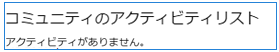
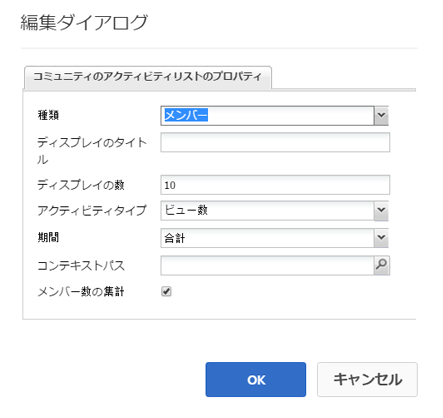
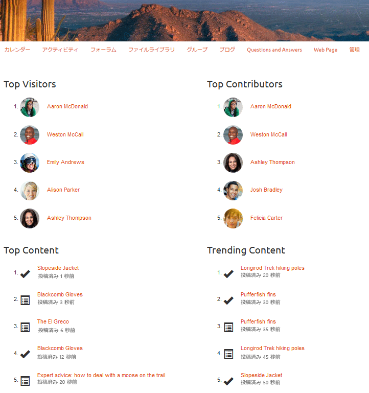

# アクティビティのトレンド {#activity-trends}

## はじめに {#introduction}

`Community Activity List` コンポーネントを使用すると、メンバーおよびコンテンツの投稿とビューごとの投稿とビューに関するトレンド情報を追加できます。

このドキュメントには、次の内容が記載されています。

* `Community Activity List` コンポーネントを[ コミュニティサイト ](/help/communities/overview.md#community-sites)に追加しています。

* `Community Activity List` コンポーネントの構成設定。

### 要件 {#requirement}

`Community Activity List`のデータは、Adobe Analyticsがコミュニティサイト用にライセンスされ、設定されている場合にのみ使用できます。

[Analyticsのコミュニティ機能の設定](/help/communities/analytics.md)を参照してください。

### ページへのコミュニティアクティビティリストの追加 {#adding-a-community-activity-list-to-a-page}

作成者モードのページに`Community Activity List` コンポーネントを追加するには、コンポーネント `Communities / Community Activity List`を見つけて、ページ上の場所にドラッグします。

必要な情報については、[ コミュニティコンポーネントの基本](/help/communities/basics.md)を参照してください。

最初にコミュニティサイトのページに配置した場合、コンポーネントは次のように表示されます。

### コミュニティアクティビティリストの設定  {#configuring-community-activity-list}

配置された`Community Activity List` コンポーネントを選択し、`Configure` アイコンを選択して、編集ダイアログボックスを開きます。

「**コメント**」タブで、アップロードされたファイルのコメントが表示されるかどうか、および表示される方法を指定します。

* **タイプ**

  コミュニティメンバーまたはユーザー生成コンテンツ（UGC）に関するデータを表示するかどうかを指定します。

  次から選択します。

  * `Members`
  * `Content`

  デフォルトは `Members` です。

* **タイトルの表示**

  データの上に表示する、わかりやすいタイトル（`Trending Content`など）。
  デフォルトはタイトルがありません。

* **表示回数**

  リストする項目の数。
  デフォルトは10です。

* **アクティビティの種類**

  次のいずれかを選択します。

  * `Views` （ページ訪問）
  * `Posts` （UGCの作成中）
  * `Follows`
  * `Likes`

  デフォルトはビューです。

* **期間**

  次のいずれかを選択します。

  * `Last 24 hours`
  * `Last 7 days`
  * `Last 30 days`
  * `Last 90 days`
  * `This year (since Jan 1)`
  * `Total`

  デフォルトは `Total` です。

* **コンテキストパス**

  これにより、特定のブログなど、サイトのサブセットにアクティビティをスコープできます。
  デフォルトは、コミュニティサイト全体です。

* **メンバー数の集計**

  選択を解除（オフ）すると、最上位の投稿のみがカウントされます。 例えば、コンテキストがルートページ（デフォルト）の場合、`Posts`の`Activity Type`はルートページにコンテンツを投稿する機能がないので、アクティビティを表示しません。 オンにすると、すべての子孫ページのカウントが含まれます。
  デフォルトはオンです。

### 4つのコンポーネントを含むページの例 {#example-page-with-components}

**トップ訪問者**&#x200B;構成：タイプ = メンバー、アクティビティ タイプ = ビュー

**トップ コントリビューター**&#x200B;の設定：タイプ = メンバー、アクティビティ タイプ =投稿

**上位コンテンツ**&#x200B;の設定：タイプ = コンテンツ、アクティビティのタイプ = ビュー、

**トレンドコンテンツ**&#x200B;の設定：タイプ = コンテンツ、アクティビティタイプ =投稿

