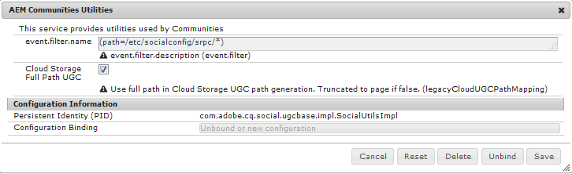

# AEM 6.5 Communities へのアップグレード {#upgrading-to-aem-communities}

各サイトのトポロジと機能によっては、AEM Communities 6.5にアップグレードする場合や最新の機能パックをインストールする場合は、次の操作が必要になる場合があります。

このセクションは、Communitiesに固有であり、[AEM 6.5](/help/sites-deploying/upgrade.md) （platform）へのアップグレードで提供される情報を補足します。

## AEM 6.1以降からのアップグレード {#upgrading-from-aem-or-later}

### Solrを再インデックス {#reindex-solr}

MSRPで設定されたデプロイメントに新しいCommunities機能パックをインストールする場合、次のことが必要になります。

1. [最新の機能パック &#x200B;](/help/communities/deploy-communities.md#latestfeaturepack)をインストールします。
1. 最新の[Solr設定ファイル &#x200B;](/help/communities/msrp.md#upgrading)をインストールします。
1. MSRPのインデックス再作成
セクション [MSRP インデックス再作成ツール &#x200B;](/help/communities/msrp.md#msrp-reindex-tool)を参照してください。

## AEM 6.0からのアップグレード {#upgrading-from-aem}

既存のUGCを保持する必要がある場合、そのための手段は、デプロイメントがUGC [&#x200B; オンプレミス &#x200B;](#on-premise-storage)または[Adobe クラウド &#x200B;](#adobe-cloud-storage)のどちらに保存されているかによって異なります。

### Adobe クラウドストレージ {#adobe-cloud-storage}

アップグレードされたサイトがAdobe クラウドストレージを使用するように設定されている場合、SRP メソッドが以前の場所にある既存のUGCを見つけることができないため、すべてのUGCが失われたかのように（誤って）表示される可能性があります。

したがって、UGCへのアクセスに`AEM 6.0 compatability-mode`を使用するようにASRPに指示する機能があります。

すべてのAEM 6.3 オーサーインスタンスとパブリッシュインスタンスの場合：

* 管理者権限でログインします。
* [ASRP](/help/communities/asrp.md)を設定します。
* 既存のUGCを表示するには、次の手順に従います。

  * Web コンソールを参照します。

    * 例：[https://&lt;host>:&lt;port>/system/console/configMgr](https://localhost:4502/system/console/configMgr)

    * **AEM Communities Utilities**&#x200B;の設定を探します。
    * 選択して設定パネルを展開します。

      * *チェックを解除* `Cloud Storage`

      * 「**保存**」を選択します

    

### オンプレミスストレージ {#on-premise-storage}

アップグレードされたサイトでクラウドストレージを使用しなかった場合、既存のUGCは、共通ストアをサポートするAEM 6.1 Communitiesで導入された新しい構造に準拠するように変換する必要があります。

この目的のために、オープンソースの移行ツールがGitHubで利用できます。
[AEM Communities UGC Migration Tool](https://github.com/Adobe-Marketing-Cloud/communities-ugc-migration)

### Java API {#java-apis}

AEM 6.0 ソーシャルコミュニティからAEM 6.3 コミュニティにアップグレードすると、多くのAPIが異なるパッケージに再編成されました。 コミュニティ機能のカスタマイズにIDEを使用する場合は、ほとんどの場合は簡単に解決できます。

非推奨のSocialUtils パッケージについて詳しくは、[SocialUtils リファクタリング &#x200B;](/help/communities/socialutils.md)を参照してください。

[Maven for Communitiesの使用](/help/communities/maven.md)も参照してください。

### JSP コンポーネントテンプレートがありません {#no-jsp-component-templates}

[&#x200B; ソーシャルコンポーネントフレームワーク &#x200B;](/help/communities/scf.md) （SCF）では、AEM 6.0以前に使用されていたJava Server Pages （JSP）の代わりに[HandlebarsJS](https://handlebarsjs.com/) （HBS）テンプレート言語が使用されています。

AEM 6.0では、JSP コンポーネントは新しいHBS フレームワークコンポーネントと同じ場所に配置され、HBS コンポーネントは通常「hbs」という名前のサブフォルダーに配置されていました。

AEM 6.1以降、JSP コンポーネントは完全に削除されました。 コミュニティの場合は、JSP コンポーネントのすべての使用をSCF コンポーネントに置き換えることをお勧めします。

## AEM Communities UGC Migration Tool {#aem-communities-ugc-migration-tool}

[AEM Communities UGC Migration Tool](https://github.com/Adobe-Marketing-Cloud/communities-ugc-migration)は、GitHubで利用できるオープンソースの移行ツールで、以前のバージョンのAEM ソーシャルコミュニティからUGCを書き出し、AEM Communities 6.1以降に読み込むようにカスタマイズできます。

以前のバージョンからUGCを移動するだけでなく、ツールを使用して、ある[SRP](/help/communities/working-with-srp.md)から別のバージョン（MSRPからDSRPなど）にUGCを移動することもできます。

## AEM 5.6.1以前からのアップグレード {#upgrading-from-aem-or-earlier}

概念的には、コミュニティコンポーネントには3つの世代があります。

**Gen 1**：大まかにCQ 5.4からAEM 5.6.0まで、これらは&#x200B;**collab** コンポーネントです。これらは、プラットフォーム間でUGCを同期する手段として、レプリケーションを使用してローカルリポジトリにUGCを保存します。 その他の違いとして、Java Server Pages （JSP）を使用した実装と、オーサー環境でのみオーサリングできるブログ機能があります。

**Gen 2**: AEM 5.6.1からAEM 6.1まで、これは&#x200B;**collab**&#x200B;と&#x200B;**social** コンポーネントの組み合わせです。 AEM 6.0では新しい[&#x200B; ソーシャルコンポーネントフレームワーク &#x200B;](/help/communities/scf.md) （SCF）が導入され、AEM 6.2では[一般的なUGC ストア &#x200B;](/help/communities/working-with-srp.md)が導入されました。UGCには[&#x200B; ストレージリソースプロバイダー](/help/communities/srp.md) （SRP）を使用してアクセスします。

**Gen 3**: AEM 6.2以降では、**social**&#x200B;個のコンポーネントのみがSCF as Handlebars （HBS）コンポーネントとして実装され、UGCにSRPを選択する必要があります。
