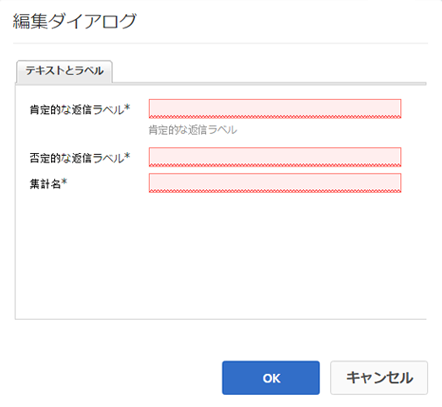

# 投票の使用 {#using-voting}

`Voting` コンポーネントは、コミュニティ メンバーがQnA コンポーネント内の回答など、特定のコンテンツを評価できる便利なツールです。 `Voting` コンポーネントでは、メンバーは上向き矢印または下向き矢印を選択して、自分の意見を示します。

## ページへの投票の追加 {#adding-voting-to-a-page}

作成者モードでページに`Voting` コンポーネントを追加するには、コンポーネントブラウザーを使用します。 `Communities / Voting`を見つけ、ユーザーが投票する機能に対する相対的な位置など、ページ上の場所にドラッグします。

必要な情報については、[ コミュニティコンポーネントの基本](basics.md)を参照してください。

[必要なクライアントサイドライブラリ ](essentials-voting.md#essentials-for-client-side)が含まれている場合、`Voting` コンポーネントはこのように表示されます。

## 投票の設定 {#configuring-voting}

配置された`Voting` コンポーネントを選択して、編集ダイアログを開く`Configure` アイコンにアクセスして選択できるようにします。

「**[!UICONTROL テキストとラベル]**」タブで、投票の記録に使用するプロパティを指定します。

* **[!UICONTROL 肯定的な応答ラベル]**

  （*必須*）肯定的な応答の内部プロパティ名。

* **[!UICONTROL 否定的な応答ラベル]**

  （*必須*）否定的な応答の内部プロパティ名。

* **[!UICONTROL 合計名]**

  （*必須*）投票コンポーネントのこのインスタンスの内部で識別可能なプロパティ名。

## サイト訪問者エクスペリエンス {#site-visitor-experience}

### メンバー {#members}

メンバーは一度だけ投票できますが、いつでも投票を変更できます。

### 匿名 {#anonymous}

匿名投票はサポートされていません。 サイト訪問者は、一度投票に参加するために登録（会員になる）し、サインインする必要があります。

## 追加情報 {#additional-information}

詳しくは、開発者向けの[Voting Essentials](essentials-voting.md) ページを参照してください。
